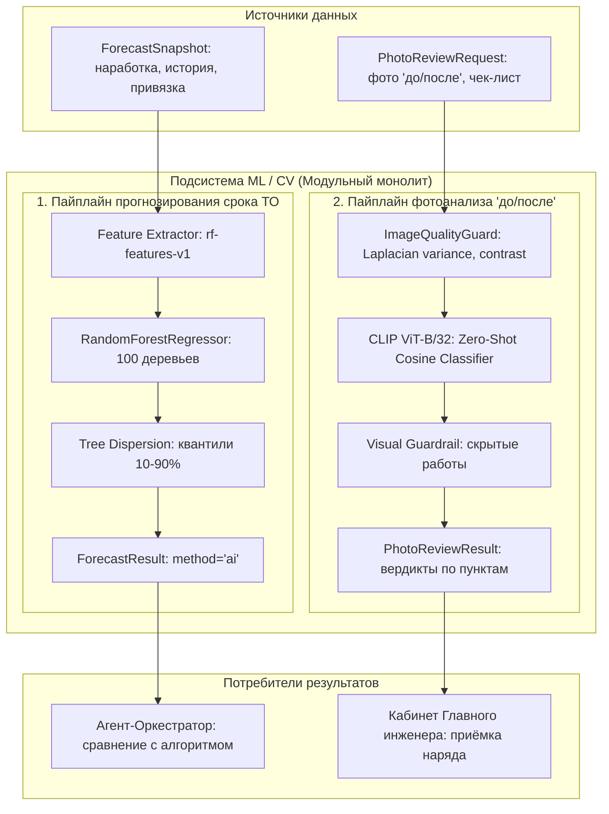
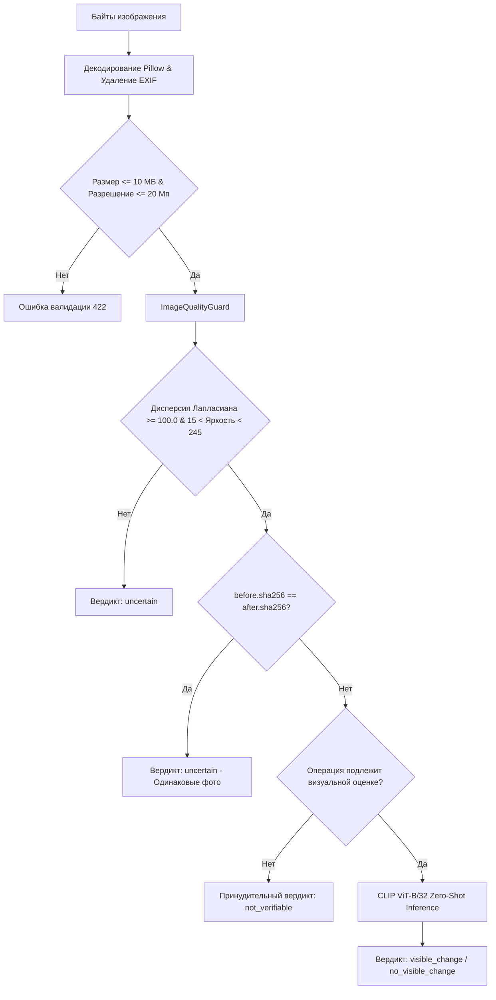

# FixRate AI — Архитектура ML/CV подсистемы (ARCHITECTURE.md)

**Проект:** FixRate AI — Интеллектуальное планирование ТО и ППР инженерного оборудования  
**Срез документа:** 29 октября 2026 г.  
**Ветка:** `feat/ml-forecasting-photo-review`  
**Исполнитель:** Мухаммад (AI-прогноз и анализ фото)  

---

## 1. Введение и архитектурные цели

Подсистема машинного обучения и компьютерного зрения FixRate AI решает две ключевые задачи в жизненном цикле обслуживания инженерных систем (в пилоте — индивидуальный тепловой пункт, ИТП):

1. **AI-прогнозирование потребности в ТО:** статистическая оценка оставшегося времени безаварийной работы оборудования на основе накопленной наработки и истории обслуживания, дополняющая детерминированный регламентный календарь.
2. **AI-контроль качества фотоотчётов:** полуавтоматическая проверка видимых результатов обслуживания (чистки поверхностей, фильтров, узлов) по парам фотографий «до» и «после» с помощью локальной мультимодальной нейросети.



---

## 2. Пайплайн 1: AI-прогнозирование сроков ТО

### 2.1. Входные данные и защита от утечки будущего (Data Leakage)

Входной структурой является канонический DTO [`ForecastSnapshot`](file:///home/handraqw/Projects/FixRate_AI/backend/app/schemas/maintenance.py#L148-L186). Снимок формируется бэкендом на конкретный момент времени отсечки (`as_of`) и содержит:
- Паспортные данные оборудования (`Equipment`) и объекта (`Site` с часовым поясом, например `Asia/Yekaterinburg`).
- Действующую версию регламентной операции (`OperationVersion`) и правила периодичности (`RecurrenceRule`).
- Список ранее принятых событий обслуживания (`accepted_events: list[AcceptedEvent]`).
- Текущие валидированные показания счётчика наработки (`runtime_reading: RuntimeReading | None`).
- Нормативные границы: жесткий дедлайн регламента (`mandatory_due_date`), допустимое раннее окно (`earliest_date`) и порог наработки (`runtime_due_at_hours`).

> [!IMPORTANT]
> **Инвариант герметичности во времени:**
> Для всех исторических событий строго выполняется:
> $$\text{performed\_at} \le \text{accepted\_at} \le \text{as\_of}$$
> Если событие было выполнено, но на момент `as_of` ещё не принято инженером, оно **не включается** в `accepted_events`.
> Поле `observed_need_date` (дата фактического проявления дефекта) допускается только из прошлого: $\text{observed\_need\_date} \le \text{local\_day}(\text{as\_of})$.

Хеш снимка `snapshot_sha256` рассчитывается как канонический SHA-256 от JSON-представления объекта без поля `content_sha256` с сортировкой ключей (`sort_keys=True`) и компактными разделителями `,`/`:`.

---

### 2.2. Извлечение признаков (Feature Engineering — `rf-features-v1`)

Граф объектов снимка разворачивается в плоский числовой вектор $X \in \mathbb{R}^6$:

| Индекс | Имя признака | Тип | Описание | Формула / Источник |
| :---: | :--- | :---: | :--- | :--- |
| $f_0$ | `eq_type_code` | `int` | Категориальный код типа оборудования | Детерминированный хеш `equipment_type_id % 1000` |
| $f_1$ | `age_days` | `float` | Возраст оборудования на момент `as_of` | $(\text{as\_of.date} - \text{commissioned\_on}).\text{days}$ |
| $f_2$ | `days_since_last_service` | `float` | Дней с даты последнего принятого ТО | $(\text{as\_of.date} - \text{last\_event.performed\_at.date}).\text{days}$ |
| $f_3$ | `runtime_hours_delta` | `float` | Наработка со времени последнего принятого ТО | $\text{current\_reading.value\_hours} - \text{last\_event.runtime\_hours}$ |
| $f_4$ | `history_event_count` | `int` | Общее количество подтверждённых ТО в истории | $\text{len}(\text{accepted\_events})$ |
| $f_5$ | `mean_prior_interval_days` | `float` | Средний фактический интервал между ТО | $\frac{1}{N-1} \sum (\text{event}_{i} - \text{event}_{i-1})$ (или норматив при $N<2$) |

Если история пуста ($N=0$), $f_2$ и $f_3$ рассчитываются от даты ввода в эксплуатацию `commissioned_on`.

---

### 2.3. Выбор алгоритма и архитектурный анализ моделей

| Критерий | Baseline (Линейная регрессия) | Deep Learning (LSTM / MLP) | LLM (Промптинг) | **Random Forest Regressor (Наш выбор)** |
| :--- | :--- | :--- | :--- | :--- |
| **Качество на малых данных ($N \sim 50-200$)** | Низкое (не улавливает нелинейный износ) | Крайне низкое (быстрое переобучение) | Случайное (галлюцинации в датах) | **Высокое (устойчив к переобучению)** |
| **Оценка неопределённости** | Нет / только предположение нормальности | Требует MC Dropout / Ensembles | Недостоверные вербальные оценки | **Нативная (разброс индивидуальных деревьев)** |
| **Время обучения** | < 10 мс | 10–60 с (нужен GPU) | Не применимо | **~ 50–100 мс на CPU** |
| **Время инференса** | < 1 мс | 10–50 мс | 1–3 секунды | **< 5 мс на CPU** |
| **Интерпретируемость (XAI)** | Коэффициенты весов | «Черный ящик» | Текстовые оправдания | **Feature Importances + Tree Paths** |
| **Требования к памяти** | < 1 МБ | 50–200 МБ | Гигабайты (или внешний API) | **< 5 МБ** |

**Вывод:** `RandomForestRegressor` (`n_estimators=100`, `max_depth=6`, `random_state=42`) является оптимальным инженерным решением для v1: он не требует GPU, мгновенно обучается, не имеет сетевых задержек и даёт математически строгую оценку разброса.

---

### 2.4. Моделирование неопределённости: `tree_dispersion`

В отличие от классических доверительных интервалов, требующих гауссова распределения остатков, случайный лес позволяет напрямую извлечь распределение предсказаний каждого из 100 независимых деревьев ансамбля:
$$\{ \hat{y}_t \}_{t=1}^{100}, \quad \text{где } \hat{y}_t = \text{Tree}_t(X)$$

1. Точечный прогноз:
   $$\hat{y}_{mean} = \frac{1}{100} \sum_{t=1}^{100} \hat{y}_t, \quad \Delta_{days} = \text{round}(\hat{y}_{mean})$$
   $$\text{recommended\_date} = \text{as\_of.date} + \Delta_{days}$$

2. Границы неопределённости (10-й и 90-й перцентили):
   $$L = \text{Percentile}_{10}(\{ \hat{y}_t \}), \quad U = \text{Percentile}_{90}(\{ \hat{y}_t \})$$
   $$\text{lower\_date} = \text{as\_of.date} + \text{round}(L), \quad \text{upper\_date} = \text{as\_of.date} + \text{round}(U)$$

3. Контракт неопределённости:
   Формируется объект [`Uncertainty`](file:///home/handraqw/Projects/FixRate_AI/backend/app/schemas/maintenance.py#L188-L204):
   - `kind="tree_dispersion"`
   - `lower_date`, `upper_date`
   - `calibrated=False` *(честное указание, что интервал не калиброван на генеральной совокупности)*
   - `note="Разброс 10-90 перцентилей деревьев RandomForest на синтетике."`

---

### 2.5. Два режима работы и поведение при отказах

1. **Режим реальных данных заказчика (Набор А):**
   - Так как в графике заказчика нет истории поломок и наработки, модель не может выдать обоснованный прогноз.
   - Метод возвращает terminal-результат:
     ```json
     {
       "method": "ai",
       "status": "unavailable",
       "recommended_date": null,
       "error_code": "MODEL_NOT_READY",
       "explanation": "Модель не загружена или отсутствует история оборудования заказчика; алгоритмический срок не подменяется AI."
     }
     ```
2. **Демонстрационный режим (`synthetic_demo`, Набор B):**
   - Использует обученную модель на моделируемом датасете (50 циклов ИТП, 5 единиц оборудования, seed=42).
   - Возвращает `status="ok"`, валидную дату и `warnings=["SYNTHETIC_DATA"]`.

---

## 3. Пайплайн 2: Компьютерное зрение и анализ фотоотчётов

### 3.1. Входной поток и предварительная обработка

Входной контракт — [`PhotoReviewRequest`](file:///home/handraqw/Projects/FixRate_AI/backend/app/schemas/maintenance.py#L386-L406):
- Отчёт об исполнении [`ExecutionReport`](file:///home/handraqw/Projects/FixRate_AI/backend/app/schemas/maintenance.py#L339-L358) строго в состоянии `submitted`.
- Список фотографий [`PhotoReport`](file:///home/handraqw/Projects/FixRate_AI/backend/app/schemas/maintenance.py#L360-L384) с атрибутами: `phase` (`before` / `after`), `view_key`, `checklist_item_id`.
- Байты изображений загружаются через доверенный адаптер хранилища по `photo_id`.



---

### 3.2. Предварительный технический контроль (`ImageQualityGuard`)

Нейросетевой анализ бессмысленен, если фотография смазана, засвечена или снята в темноте:

1. **Оценка резкости (Laplacian Variance):**
   Изображение переводится в градации серого $I_{gray}$, применяется оператор Лапласа $L = \nabla^2 I_{gray}$, вычисляется дисперсия отклика:
   $$\sigma^2_{Laplace} = \text{Var}(L)$$
   - Если $\sigma^2_{Laplace} < 100.0$, кадр признаётся смазанным (`blur`).
2. **Оценка динамического диапазона и яркости:**
   $$\mu_{gray} = \frac{1}{W \times H} \sum_{x, y} I_{gray}(x, y)$$
   - При $\mu_{gray} < 15.0$ — кадр слишком тёмный (недостаток света в подвале/ИТП).
   - При $\mu_{gray} > 245.0$ — кадр пересвечен вспышкой.
3. **Проверка ракурса:**
   Сверяются строковые ключи `view_key` у пары «до» и «после». При несовпадении выставляется флаг несопоставимых ракурсов.

При непрохождении технического фильтра выставляется статус `verdict="uncertain"`, а инференс CLIP отключается в целях экономии вычислительных ресурсов CPU.

---

### 3.3. Мультимодальная модель CLIP ViT-B/32

#### Почему именно CLIP?
1. **Zero-Shot способность:** Модель предварительно обучена сопоставлять концепции на естественном языке с визуальным контекстом на 400 млн пар изображение-текст.
2. **Отсутствие обучающей выборки тепловых пунктов:** Для обучения специализированного детектора (например, YOLO) потребовалось бы собрать и вручную разметить $\sim 2000$ фото грязевиков и теплообменников ИТП. CLIP позволяет оценивать состояние через текстовые промпты «из коробки».
3. **Открытость весов:** Используются открытые веса `openai/clip-vit-base-patch32` из Hugging Face Hub, исполняемые локально через `transformers` без обращения к зарубежным API.

#### Промпт-инжиниринг (`prompt_set_version="demo-clean-pairs-v1"`)
Для оценки пилотной операции 1.4 («Чистка всех узлов и агрегатов») формулируется бинарный промпт-сет:
- $T_0$ (загрязнённое состояние): `"a dirty, dusty, rusty, clogged industrial equipment surface"`
- $T_1$ (чистое состояние): `"a clean, serviced, shiny, spotless industrial equipment surface"`

#### Математика вывода
1. Текстовый энкодер CLIP строит нормированные эмбеддинги промптов:
   $$\mathbf{t}_0 = \frac{\text{TextEnc}(T_0)}{\|\text{TextEnc}(T_0)\|}, \quad \mathbf{t}_1 = \frac{\text{TextEnc}(T_1)}{\|\text{TextEnc}(T_1)\|}$$
2. Визуальный энкодер (Vision Transformer) строит эмбеддинги для фото «до» ($\mathbf{v}_{before}$) и фото «после» ($\mathbf{v}_{after}$).
3. Вычисляется логит сходства с масштабирующим коэффициентом $\tau$ (температура CLIP):
   $$s_{i, k} = \tau \cdot (\mathbf{v}_i \cdot \mathbf{t}_k)$$
4. Софтмакс определяет относительную вероятность чистоты:
   $$P_{clean}(before) = \frac{e^{s_{before, 1}}}{e^{s_{before, 0}} + e^{s_{before, 1}}}$$
   $$P_{clean}(after) = \frac{e^{s_{after, 1}}}{e^{s_{after, 0}} + e^{s_{after, 1}}}$$
5. Оценка дельты улучшения:
   $$\Delta_{clean} = P_{clean}(after) - P_{clean}(before)$$
   - Если $\Delta_{clean} \ge 0.25$ $\to$ `verdict="visible_change"`.
   - Если $\Delta_{clean} < 0.25$ $\to$ `verdict="no_visible_change"`.

---

### 3.4. Доменный Guardrail скрытых и неизмеряемых операций

В реальной инженерной практике не все операции можно подтвердить визуально:
- **Операция 1.1–1.3:** Контроль параметров и протоколирование. Фото манометра фиксирует показание, но не заменяет факт калибровки.
- **Операция 1.5:** Проверка приборов на повреждения и точность показаний.
- **Операция 1.6:** Выпуск воздуха из системы отопления/теплоснабжения.

> [!CAUTION]
> **Принцип честности ИИ:**
> Модуль фотоанализа проверяет атрибут `visual_verifiability` в чек-листе. Если `visual_verifiability="not_verifiable"`, то независимо от скоров CLIP выставляется вердикт:
> `verdict="not_verifiable"`, `observation="Операция скрытого характера или метрологический контроль: факт выполнения подтверждается инструментальным журналом/показаниями, а не фотографией."`

---

## 4. Ресурсный бюджет и аппаратные требования

Целевая машина демонстрационного стенда: **4 vCPU / 8 ГБ RAM / Ubuntu Linux / без дискретного GPU**.

| Модуль | Пиковая память (RAM) | Время холодного старта | Время инференса (CPU) | Бюджет по SLA |
| :--- | :---: | :---: | :---: | :---: |
| **RandomForest Forecaster** | ~ 45 МБ | < 0.2 с | 2–5 мс | $\le 5$ секунд |
| **ImageQualityGuard (Pillow)** | ~ 25 МБ | < 0.1 с | 15–30 мс | $\le 1$ секунда |
| **CLIP ViT-B/32 (Torch/Transformers)**| ~ 1.4 ГБ | ~ 2.5 с | 1.8–3.2 с на пару фото | $\le 20$ секунд |
| **Суммарный стенд** | **~ 1.6 ГБ** | **~ 3 с** | **~ 3.5 с** | **С запасом укладывается** |

Для исключения задержек при первом пользовательском запросе при инициализации сервиса реализуется процедура предварительного прогрева (*warmup*): фиктивный прогон одного тензора через CLIP.

---

## 5. Спецификация контрактов взаимодействия

```text
            ForecastSnapshot
                   │
                   ▼
     ┌───────────────────────────┐
     │  predict_maintenance_ai   │
     └───────────────────────────┘
                   │
                   ▼
             ForecastResult
  (method="ai", recommended_date,
   uncertainty, warnings, explanation)
```

```text
          PhotoReviewRequest
                   │
                   ▼
     ┌───────────────────────────┐
     │       review_photos       │
     └───────────────────────────┘
                   │
                   ▼
           PhotoReviewResult
  (status, model_ref, item_results: [
     ItemPhotoReview(verdict, scores, observation)
   ], limitations)
```

Все типы данных строго соответствуют [`backend/app/schemas/maintenance.py`](file:///home/handraqw/Projects/FixRate_AI/backend/app/schemas/maintenance.py). Никаких дублирующих моделей или изменений названий полей.
