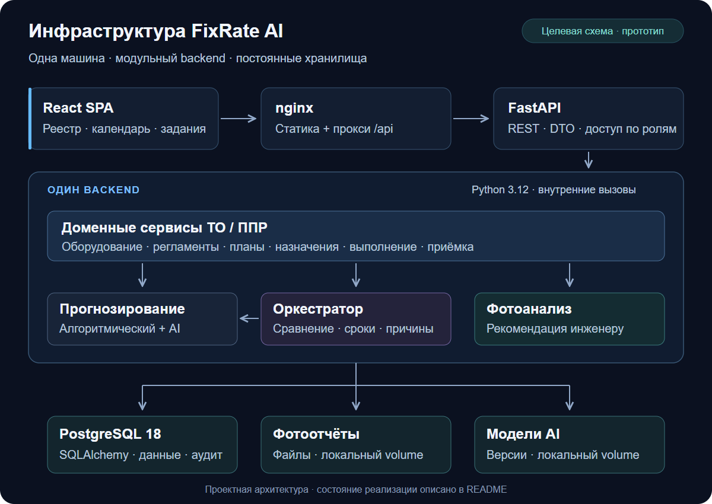
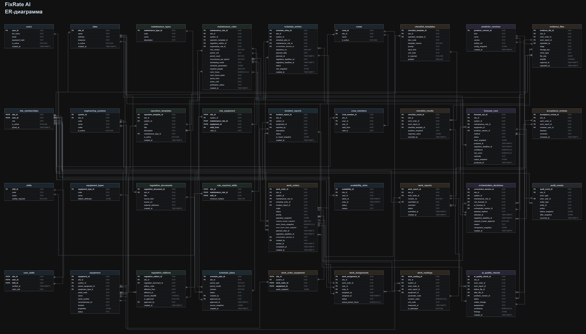

<div align="center">

В dev включён новый интерфейс из feature/frontend-next: Aurora Workspace, рабочие экраны и мобильная навигация. [Описание интерфейса](docs/service/web.md).
# FixRate AI

**Планирование технического обслуживания и планово-предупредительных ремонтов**

Оборудование → регламент → календарь → задание → фотоотчёт → приёмка

`ТО / ППР` · `Python 3.12` · `React` · `PostgreSQL 18`

[Работа аналитика и исходные сценарии](docs/analysis/INDEX.md) · [Архитектура](docs/ARCHITECTURE.md) · [База данных](docs/service/database.md) · [API](docs/service/backend.md) · [План](docs/PLAN.md)

</div>

---

FixRate AI управляет обслуживанием инженерного оборудования и расписанием работников. Версии регламентов задают календарь работ, а смены, чётность недель, доступность, допуски и загрузка определяют состав исполнителей. Алгоритмический и AI-прогнозы сравниваются на одном снимке данных; диспетчер подтверждает назначение, исполнитель отправляет отчёт, инженер принимает результат или возвращает его на доработку.

## Состояние проекта

Рабочая ветка `dev`, срез на **5 ноября 2026 года**. Ориентир демонстрации — **7 ноября 2026 года**.

| Область | Реализовано |
|---|---|
| Backend и доступ | FastAPI, серверные сессии, CSRF, роли и доступ в пределах объекта |
| Оборудование и регламенты | Версии обслуживания, привязки к оборудованию, длительность, допуски и чек-листы |
| Календарь | Предпросмотр, смены, ISO-чётность, квартальные и годовые правила, создание заданий без дублей |
| Работники и бригады | Подбор по доступности, квалификации и загрузке; подтверждение назначения с повторной проверкой в транзакции |
| Выполнение и приёмка | Попытки выполнения, фотоотчёты, доработка, решение инженера и история |
| Веб-интерфейс | Реестр, календарь, настройки, задания, прогнозы и приёмка; адаптивные вход и регистрация |
| AI | AI Tunnel / Qwen3.7 Flash либо локальные RF/Qwen3.5; CLIP сохранён для совместимости |
| База данных | SQL-миграции 001–009, ORM, ограничения целостности и аудит |
| Проверки | Python, SQL, UI и браузерные сценарии на временной PostgreSQL |

Матрица «операции × дни», утверждение месяца, четыре бизнес-роли, протоколы измерений/акты и управляемые исключения реализованы в dev. [Реестр соответствия 37 пунктам](docs/analysis/REMEDIATION.md) различает программные проверки и приёмку на реальных данных. Методики, единицы и пределы шести операций заказчиком не утверждены: они остаются черновиками, полный реальный сценарий на них заблокирован. Качество моделей на данных заказчика не измерено.

Для облачного демо: `python scripts/start_local.py --cloud-ai`, ключ и модели задаются в `.env`. [AI Tunnel / Qwen3.7 Flash: настройка и ограничения](docs/service/aitunnel.md).

Для локального профиля RF/CLIP из корня: `python scripts/start_local.py` (нужны Docker и подготовленные веса либо готовый bundled image). Стенд доступен на http://127.0.0.1:8000, учётки — в var/compose-local/accounts.txt. [Запуск, остановка и тестовые роли](docs/service/runtime.md#постоянный-локальный-стенд-для-тестирования).

## Инфраструктура и потоки данных

Сейчас один процесс FastAPI обслуживает API и собранную React SPA. PostgreSQL хранит данные и историю; фотографии и модели располагаются в файловом хранилище. Backend вызывает алгоритмы и ML/CV-адаптеры; облачный профиль выполняет HTTPS-запросы к AI Tunnel, локальный vision-профиль — к Ollama.

| Слой | Технологии | Назначение |
|---|---|---|
| Интерфейс | React, TypeScript, Vite, Tailwind CSS | Реестр, календарь, задания, прогнозы и приёмка |
| Backend | Python 3.12, FastAPI, Pydantic 2 | REST, роли, доменные сервисы и транзакции |
| Хранение | PostgreSQL 18, SQLAlchemy, psycopg | Версии, назначения, отчёты и аудит |
| Прогнозирование | Календарные правила, NumPy, scikit-learn | Два независимых результата и решение оркестратора |
| Фотоанализ | Pillow, Ollama, Qwen3.5; совместимый CLIP | Отдельные описания до/после, изменения, замечания и ограничения |

Локальный [Compose](compose.yaml) запускает PostgreSQL и FastAPI со SPA; [чистая установка, миграции и seed](docs/service/runtime.md#чистая-postgresql-и-compose). Для двух ML-инструментов без ноутбуков — [профиль CLIP с локальными весами](docs/service/runtime.md#запуск-с-двумя-ml-инструментами). Целевая схема с nginx:

[](docs/assets/architecture/infrastructure.svg)

[Схема компонентов и действующие границы](docs/ARCHITECTURE.md#компоненты-и-взаимодействие) · [Запуск и эксплуатация](docs/service/runtime.md)

## ER-диаграмма базы данных

**Базовая ER-модель: 35 таблиц · 310 полей · 72 связи.**

[](docs/assets/database/erd.svg)

[SVG с масштабированием](docs/assets/database/erd.svg) · [PNG](docs/assets/database/erd.png) · [draw.io](docs/assets/database/erd.drawio) · [Каталог полей](database/schema/model_catalog.json)

Текущая SQL-схема 001–010 расширяет базовую модель и содержит 42 таблицы, включая сессии и реестр миграций. Сущности, ограничения и соответствие DTO описаны в [документации БД](docs/service/database.md).

## Как проходит работа

1. **Оборудование и регламенты.** Сохранить версию обслуживания, периодичность, требования к бригаде и привязку к оборудованию.
2. **Календарь.** Рассчитать вхождения на выбранный период; показать недостающие данные и просрочку.
3. **Прогнозы.** Получить алгоритмический и AI-результат на одном снимке, сравнить их и сохранить объяснение.
4. **Назначение.** Выбрать работников и подтвердить состав с проверкой доступности, допусков и ревизии.
5. **Выполнение.** Заполнить чек-лист и приложить фотографии конкретной попытки.
6. **Приёмка.** Инженер принимает работу либо отправляет на доработку; принятое выполнение пополняет историю обслуживания.

## Навигация по репозиторию

```text
backend/       API, доменные сервисы и хранение
frontend/      React SPA и настройки сборки
ml_service/    прогнозирование и фотоанализ
database/      миграции, seed и каталог схемы
contracts/     JSON Schema и примеры обмена
tests/         Python, UI, E2E, SQL и fixtures
data/          исходный график, модели и demo-ресурсы
scripts/       запуск проверок и подготовка моделей
docs/          архитектура, узлы сервиса, план и ADR
```

| Нужно разобраться с… | Начать здесь |
|---|---|
| Архитектурой и исходными требованиями | [Архитектура](docs/ARCHITECTURE.md) · [Excel заказчика](data/customer/techical_service_schedule.xlsx) |
| API, сессиями и ролями | [Backend](docs/service/backend.md) |
| Календарём и назначением бригады | [Планирование](docs/service/planning.md) |
| Экранами и веб-сценариями | [Веб-интерфейс](docs/service/web.md) |
| AI и фотоанализом | [ML/CV](docs/service/ml.md) · [ADR](docs/decisions/INDEX.md) |
| Средой и командами | [Запуск](docs/service/runtime.md) · [Проверки](docs/service/verification.md) |
| Структурой и работой команды | [Разработка](docs/service/development.md) · [Индекс документации](docs/INDEX.md) |

Для варианта с весами RF/CLIP внутри готового образа: [переносимый ML-стенд](docs/service/runtime.md#готовый-образ-с-rf-и-clip-внутри). После сборки он запускается без host cache через `python scripts/start_local.py --bundled-image fixrate-ai:bundled`.

Для подробного **полностью локального** разбора фото: `python scripts/prepare_local_vision.py`, затем `python scripts/start_local.py --bundled-image fixrate-ai:bundled --local-vision` со свежим готовым image. Нужен NVIDIA GPU; фото не отправляются во внешние AI. [Подготовка, прогрев и запуск](docs/service/runtime.md#локальная-vision-модель-для-фотоотчёта).

## Локальный запуск и проверка

Для постоянного Docker-стенда нужны Git, работающий Docker Desktop/Engine с Compose и Python. Node 24, PostgreSQL 18 и backend собираются в контейнерах. При первом запуске подготовьте CLIP-cache по [инструкции чистого checkout](docs/service/runtime.md#первый-запуск-с-чистого-checkout); подготовка модели использует Python 3.12 и корневой requirements.txt.

```powershell
python scripts/start_local.py
python scripts/start_local.py --status
# Остановка с сохранением БД и фото:
python scripts/start_local.py --stop
```

Адрес и выбранный порт печатает helper; по умолчанию это http://127.0.0.1:8000. Учётки и пароль создаются локально в var/compose-local/accounts.txt. Корневой .env необязателен; FIXRATE_DEMO_LOGIN и FIXRATE_DEMO_PASSWORD позволяют задать [демо-реквизиты](docs/service/runtime.md#логин-и-пароль-демо-стенда-через-env). [Native-запуск без Docker](docs/service/runtime.md#установка-и-запуск) описан отдельно.

Для полного native-прогона тестов дополнительно нужны Node 24, установленная PostgreSQL 18 с утилитами и Chrome. После создания .venv из requirements.txt:

```powershell
npm.cmd --prefix frontend ci
.\.venv\Scripts\python.exe scripts/verify.py --browser --pg-bin "C:\Program Files\PostgreSQL\18\bin"
```

Runner создаёт собственную временную PostgreSQL, проверяет миграции и upgrade, Python, сборку, UI и браузер. Результаты записываются в reports, журналы — в logs. [Последний полный прогон и границы проверки](docs/service/verification.md#последний-полный-прогон).

## Дальнейшие работы

- Реализовать матрицу «операции × дни» и утверждение месячного плана.
- Добавить восстановительное планирование просрочки и изменение состава после начала работ.
- Уточнить у заказчика единицы норм, длительность и неоднозначные правила исходного графика.
- Проверить модели на реальных размеченных данных.
- Настроить nginx/TLS, автоматический прогон тестов в CI, мониторинг и проверку восстановления БД, фото и моделей. Compose и workflow синхронизации уже существуют.

Критерии и состояние задач — в [плане проекта](docs/PLAN.md).

Основной Git-хостинг: [GitHub](https://github.com/krangras/FixRateAI); [состав веток и синхронизация GitVerse](docs/service/git-hosting.md).
