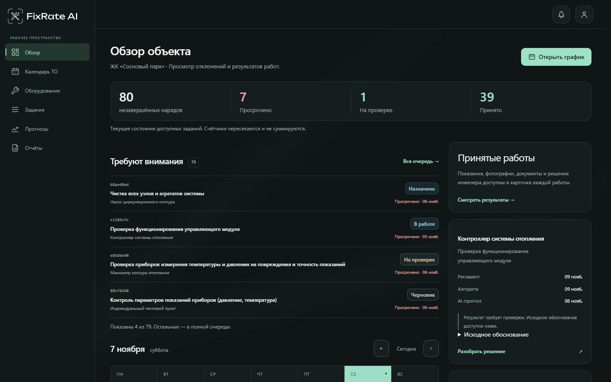
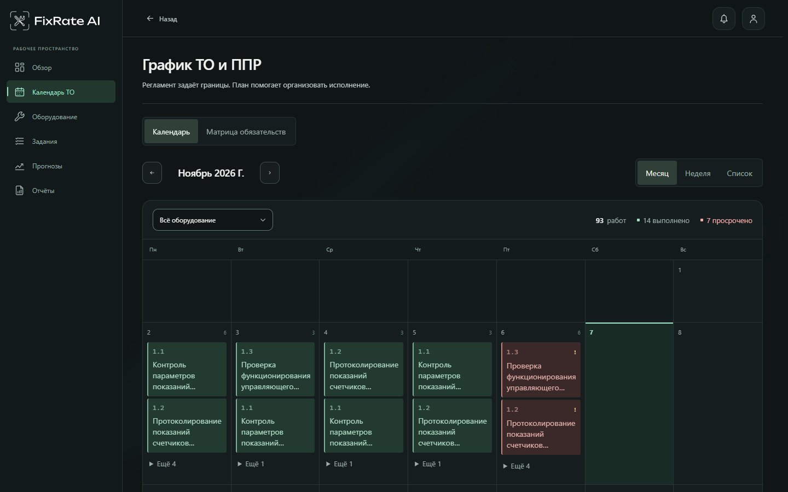
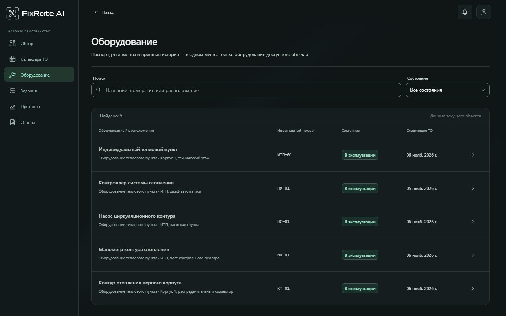
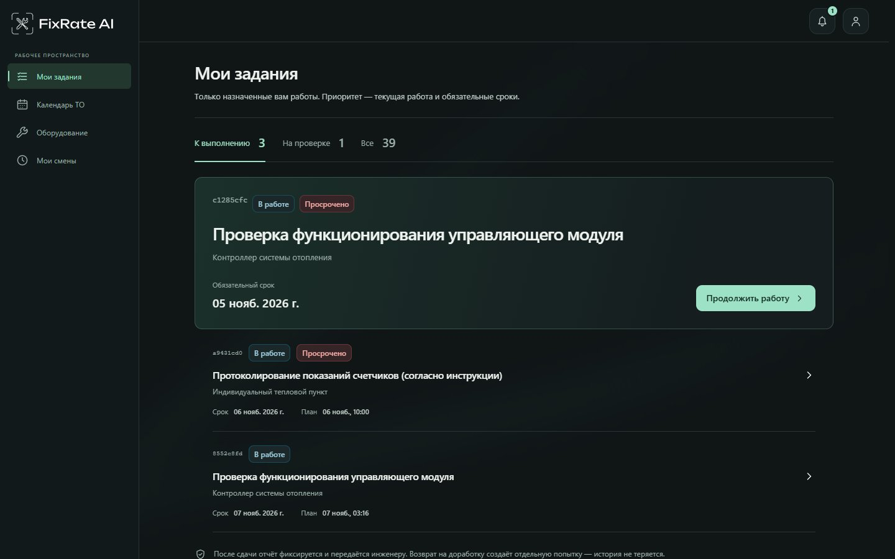
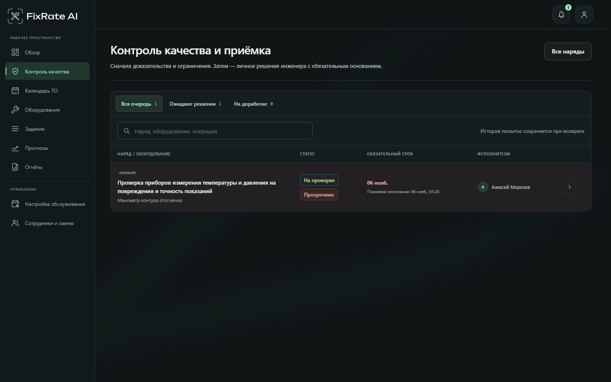
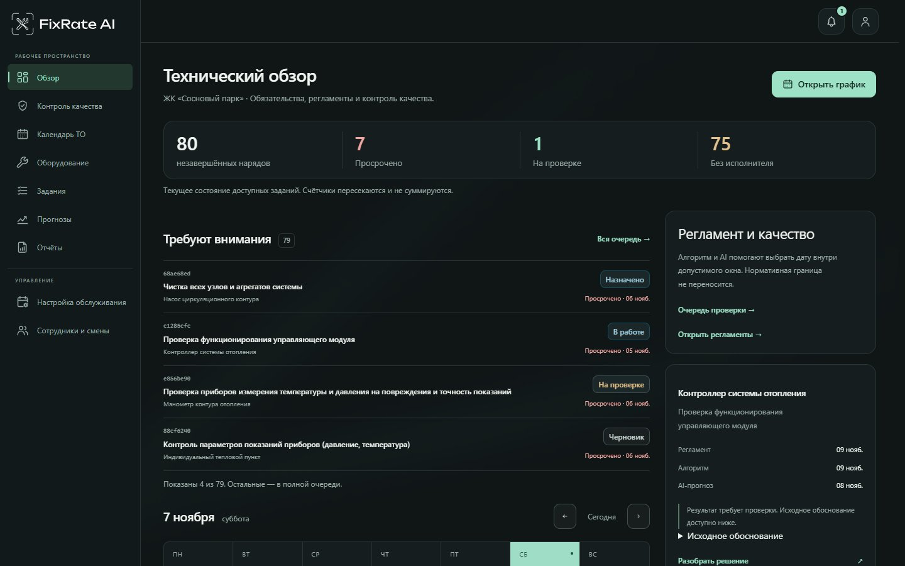

<div align="center">

# FixRate AI

**Техническое обслуживание под контролем — от регламента до приёмки**

Оборудование · Планирование · Задания · Фотоотчёты · Прогнозы

[Возможности](#возможности) · [Роли](#роли-и-сценарии) · [Архитектура](#архитектура) · [Быстрый старт](#быстрый-старт) · [Документация](#документация)

</div>

FixRate AI помогает планировать техническое обслуживание и планово-предупредительные ремонты инженерного оборудования. Система связывает оборудование и регламенты с календарём работ, назначениями, фактическим выполнением и инженерной приёмкой. Руководитель видит состояние объекта, инженер — доказательства и решения, а исполнитель — свои работы и требования к отчёту.


## Возможности

### Обзор объекта

На одном экране собраны незавершённые работы, просрочки, задания на проверке и принятые результаты. Очередь обращает внимание на работы, требующие действий; недельный план помогает перейти к нарядам конкретного дня. Состав разделов и доступные действия зависят от роли и доступного объекта.



### Календарь ТО и ППР

Календарь показывает работы за месяц или неделю, а также в виде списка. Фильтр оборудования, статусы и переход в карточку помогают разобраться в загрузке и сроках. Матрица обязательств связывает операции с календарными днями. Версии правил обслуживания задают периодичность, а при планировании учитываются смены, доступность и квалификация сотрудников.

Поддерживаются дневные, недельные, месячные, квартальные и годовые правила, заданное число выполнений в год и отдельные даты. Обязательный срок, плановый интервал и фактическое выполнение — разные значения. Для правила `after_accepted_completion` следующий срок рассчитывается от фактической даты выполнения принятой работы; при отсутствии подходящей истории используется первый нормативный срок.



### Оборудование и регламенты

Реестр объединяет оборудование объекта, его состояние, паспорт, операции и историю обслуживания. Главный инженер ведёт оборудование и версии регламентов: периодичность, численность, нормы, требования к исполнителям, чек-листы и доказательства. Действия и история определяются ролью пользователя.



### Работа исполнителя

Исполнитель видит назначенные ему задания и их сроки, начинает работу, заполняет чек-лист и фактические данные, добавляет комментарии, показания и требуемые фотографии «до» и «после». Фотографии привязываются к пунктам чек-листа; количество обязательных снимков определяется требованиями задания. После отправки отчёт поступает на проверку, а возврат на доработку сохраняет предыдущую попытку.



### Контроль качества

Инженер проверяет отчёт, чек-лист, фотографии, показания и документы, знакомится с результатом фотоанализа и его ограничениями. При принятии работы или возврате на доработку инженер указывает основание. Результат, файлы, решения и история попыток сохраняются; AI не принимает работу самостоятельно.



### Прогнозы и отчётность

Система сравнивает нормативный и AI-прогноз на одном снимке данных и показывает доступное объяснение результата. Недостаточная история, отказ модели и неподтверждённые данные не превращаются в достоверную оценку риска. Если AI недоступен, применяется предусмотренный регламентный сценарий; обязательные сроки сохраняются. Доступные отчёты и выгрузки графика и заданий позволяют анализировать исполнение и загрузку.

AI-анализ фотографий описывает видимые признаки и изменения. Он не подтверждает скрытые операции и не заменяет проверку показаний или решение инженера. Доступность и качество результата зависят от настроенного провайдера, модели и данных. [Подробнее о ML/CV](docs/service/ml.md) · [Планирование и ограничения](docs/service/planning.md).

## Роли и сценарии

| Роль | Рабочий сценарий |
|---|---|
| **Руководитель** | Просматривает показатели объекта, отклонения, график, оборудование, задания, доказательства и решения инженера. Обычные задания доступны только для чтения. |
| **Главный инженер** | Контролирует процесс, ведёт оборудование и регламенты, утверждает версии и месячный план, управляет назначениями и сложными случаями. |
| **Инженер** | Планирует и назначает работы, сравнивает прогнозы, проверяет отчёты и принимает или возвращает выполнение с основанием. |
| **Исполнитель** | Работает с назначенными заданиями, чек-листами, фотографиями и собственными сменами; может сообщить об обнаруженном дефекте. |

Также предусмотрены технические роли администратора и диспетчера. Проверка прав выполняется на сервере в границах доступного объекта. [Таблица действий по ролям](docs/service/roles.md) · [Авторизация и доступ](docs/service/backend.md).



## Как проходит работа

1. Главный инженер настраивает оборудование и версию регламента.
2. Календарный движок рассчитывает обязательства и помогает сформировать план.
3. Инженер сравнивает доступные прогнозы и назначает исполнителей с учётом смен и квалификации.
4. Исполнитель выполняет работу и отправляет чек-лист, показания и фотографии.
5. Инженер проверяет доказательства и принимает работу либо возвращает её с причиной.
6. Руководитель просматривает состояние, историю, результаты и отчётность.

## Архитектура

Приложение построено как модульный backend и React SPA. Один процесс FastAPI обслуживает API и собранный интерфейс. PostgreSQL хранит данные и историю, файловое хранилище — фотографии и модельные артефакты. Планирование, подбор исполнителей и ML/CV вызываются из backend; облачные и локальные модели подключаются через соответствующие адаптеры.

| Компонент | Технологии и назначение |
|---|---|
| **Интерфейс** | React, TypeScript, Vite, Tailwind CSS — экраны, формы, календарь и ролевые сценарии |
| **Backend** | Python 3.12, FastAPI, Pydantic — REST API, авторизация, доменные сервисы и транзакции |
| **Данные** | PostgreSQL 18, SQLAlchemy, psycopg — оборудование, версии, задания, отчёты и аудит |
| **Планирование** | Серверный календарный движок, подбор по сменам, допускам и загрузке |
| **ML/CV** | scikit-learn, Pillow, локальные модели/Ollama и облачные провайдеры — прогнозирование и анализ фото |
| **Запуск** | Docker Compose — приложение и PostgreSQL; дополнительные профили для моделей |

[](docs/assets/architecture/infrastructure.svg)

[Компоненты и потоки данных](docs/ARCHITECTURE.md) · [Описание API](docs/service/backend.md) · [Схема базы данных](docs/service/database.md)

## Структура проекта

```text
backend/       API, предметные сервисы, авторизация и хранение
frontend/      React SPA и конфигурация сборки
ml_service/    прогнозирование, фотоанализ и адаптеры моделей
database/      SQL-миграции, seed и каталог схемы
contracts/     JSON Schema и примеры обмена
tests/         backend, ML, UI, браузерные и SQL-проверки
data/          исходные данные, модели и ресурсы
scripts/       локальный запуск, подготовка моделей и проверки
docs/          архитектура, спецификации, решения и руководство
```

## Быстрый старт

Для локального запуска нужны Git, Python и работающий Docker Desktop / Docker Engine с Compose. По умолчанию локальному профилю необходимы подготовленные веса CLIP; подробные требования и инструкции приведены в [руководстве по запуску](docs/service/runtime.md).

```powershell
python scripts/start_local.py
python scripts/start_local.py --status
```

Приложение по умолчанию доступно на `http://127.0.0.1:8000`. Локальные учётные данные создаются в `var/compose-local/accounts.txt`. Чтобы остановить стенд с сохранением базы и фотографий:

```powershell
python scripts/start_local.py --stop
```

Доступен облачный профиль `python scripts/start_local.py --cloud-ai` при настроенном провайдере и ключе. Для полностью локального vision-анализа требуется подготовленная модель и совместимый GPU. [Профили, переменные окружения и первый запуск](docs/service/runtime.md) · [Настройка AI Tunnel](docs/service/aitunnel.md).

## Проверки и ограничения

После установки зависимостей фронтенда можно запустить его проверки и сборку:

```powershell
npm.cmd --prefix frontend ci
npm.cmd --prefix frontend run test
npm.cmd --prefix frontend run build
```

Полный сценарий проверки использует отдельную временную PostgreSQL и браузер; требования и команды приведены в [руководстве по проверкам](docs/service/verification.md). Состояние интеграции и результаты проверок — в [отчёте](docs/redesign-v2/INTEGRATION_DEV.md).

Методики, единицы и допустимые диапазоны части исходных операций требуют утверждения заказчика. Качество моделей на данных заказчика не измерено. Полная ручная проверка доступности на реальных устройствах остаётся открытой. Подробные границы и статус задач — в [плане](docs/PLAN.md) и [отчёте о редизайне](docs/redesign-v2/FINAL_REPORT.md).

## Документация

| Раздел | Содержание |
|---|---|
| [Архитектура](docs/ARCHITECTURE.md) | Компоненты, потоки данных и предметная область |
| [Узлы сервиса](docs/service/INDEX.md) | Backend, веб, календарь, БД, AI и роли |
| [Запуск](docs/service/runtime.md) | Среда, профили, миграции и эксплуатация |
| [Разработка](docs/service/development.md) | Структура, ответственность и изменение контрактов |
| [Проверки](docs/service/verification.md) | Тесты, критерии и результаты |
| [План](docs/PLAN.md) · [ADR](docs/decisions/INDEX.md) | Состояние работ и архитектурные решения |
