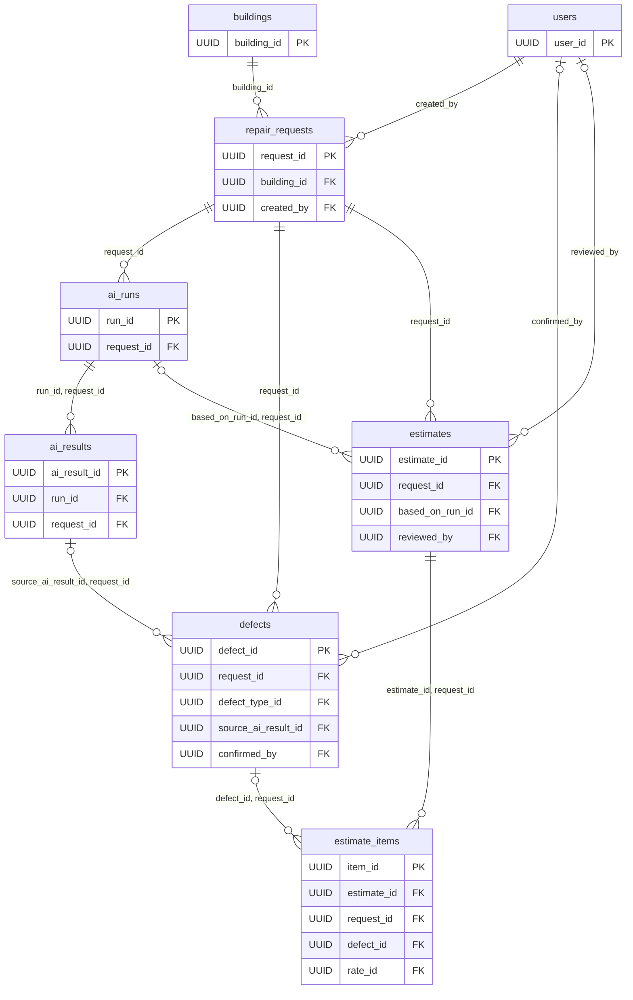

# FixRate_AI

## Архитектура базы данных

В проекте FixRate AI используется PostgreSQL с расширением
pgvector для хранения реляционных данных и векторного поиска.

База данных включает 18 таблиц, охватывающих заявки,
дефекты, AI-анализ, нормативные справочники и сметы.

### ER-диаграмма (Crow’s Foot)

Ядро схемы — 8 ключевых таблиц, только ключи и связи. Диаграмма описана
в формате Mermaid, поэтому рендерится в README как вектор и не превращается
в нечитаемую картинку:

- `||` со стороны родителя — ровно одна родительская запись (FK обязателен);
- `|o` со стороны родителя — родитель необязателен (nullable FK);
- `o{` со стороны потомка — 0..N дочерних записей. Подписи на связях — поля FK дочерней таблицы,
`PK, FK` — составной ключ со ссылкой на родителя.

Остальные 10 таблиц и все атрибуты — в доменных диаграммах:
[docs/database/erd.md](docs/database/erd.md). Полная схема одним холстом —
[erd.svg](docs/database/erd.svg).

**Документация:**

- [ER-диаграмма: доменные схемы](docs/database/erd.md)
- [Открыть ER-диаграмму в SVG](docs/database/erd.svg)
- [Редактировать диаграмму в draw.io](docs/database/erd.drawio)
- [Спецификация базы данных](docs/database/specification.md)
- [Сценарии тестирования](docs/database/test_scenarios.md)
