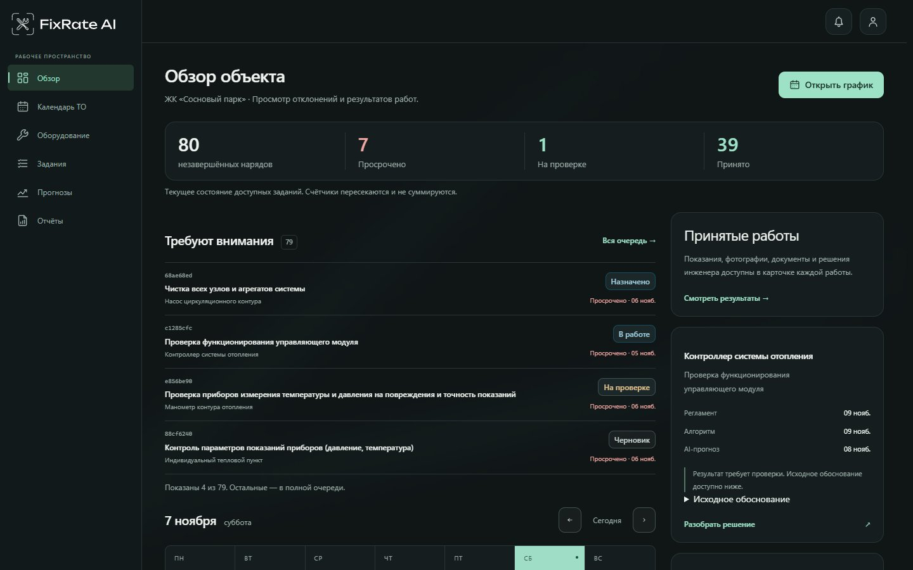
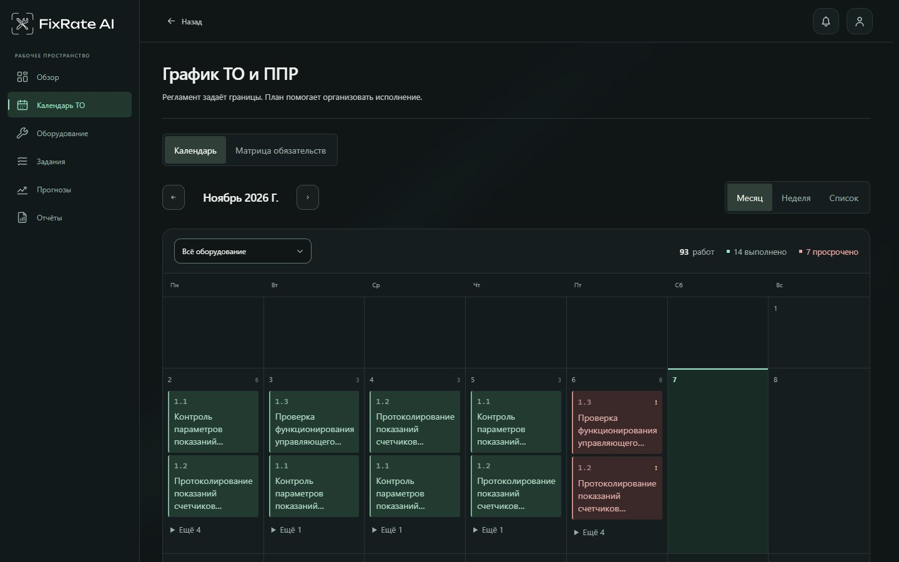
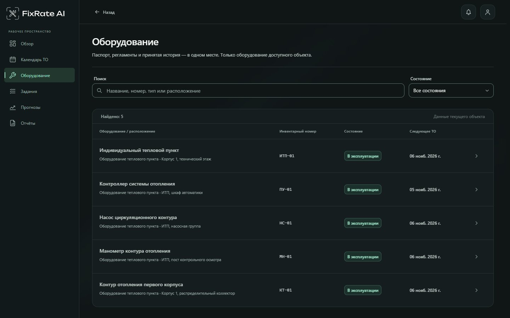
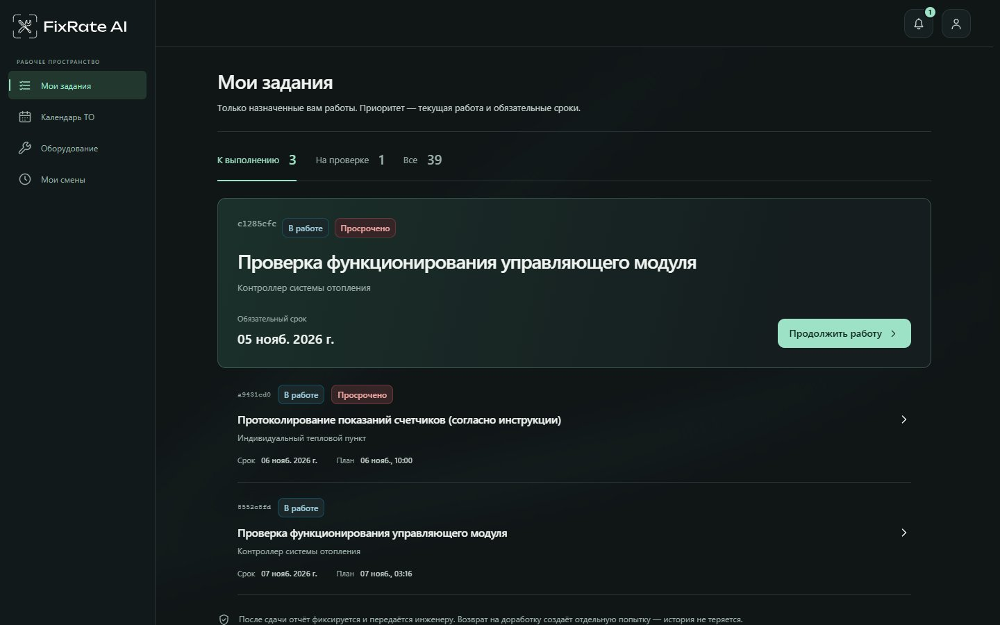
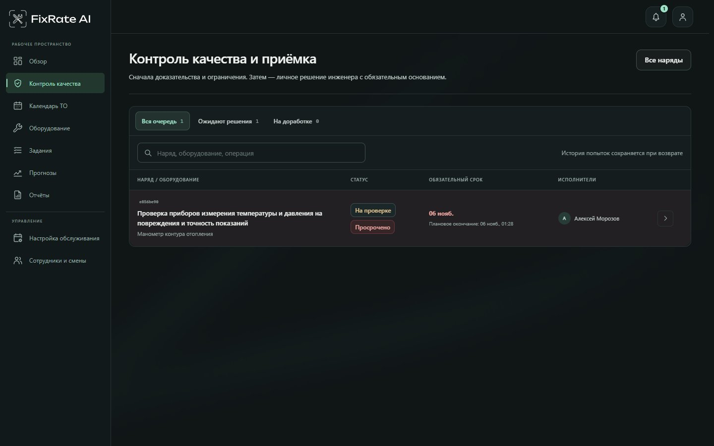
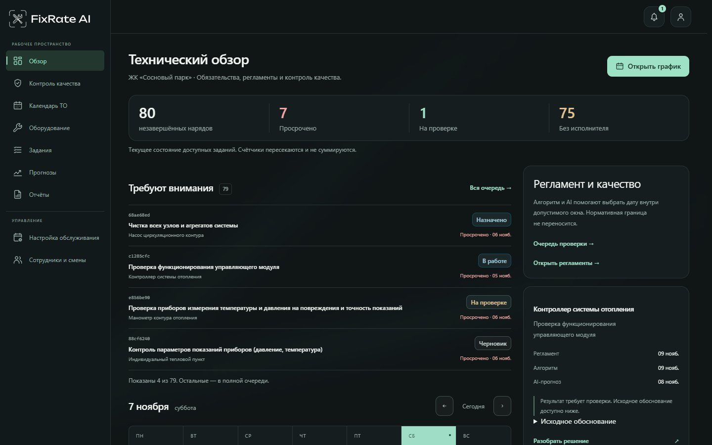
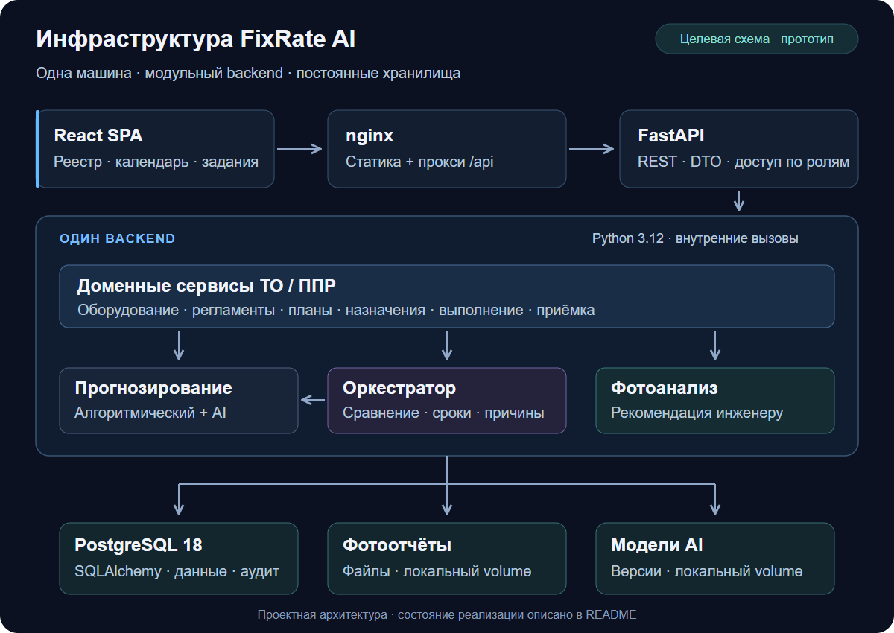

<div align="center">

# FixRate AI

[Фотоанализ через AI Tunnel, отказ от CLIP и требования к фото, 26.11.2026](docs/releases/2026-11-26-aitunnel-photo-review.md) — удаление CLIP, AI Tunnel по умолчанию, фотоагент и контроль `photo_required`.

[Объединение ассистента, CR‑17, ML, материалов и E3, 25.11.2026](docs/releases/2026-11-25-dev-integration.md) — состав интеграции, миграции и проверки.

[Обновление CR‑17 в dev, 23.11.2026](docs/releases/2026-11-23-dev-cr17-catalog-and-acceptance.md) — исходные XLSX, поиск в каталоге и приёмка главным инженером.

[ИИ-агент v4](AI_AGENT_ARCHITECTURE.md) · [Срез итерации](docs/releases/2026-11-24-assistant-tool-agent-v4.md) · [Готовность и запуск](AI_AGENT_MVP_READINESS.md) · [Живые проверки](AI_AGENT_MVP_BENCHMARK.md).

[Демонстрационный срез v4](docs/releases/2026-11-24-v4-demo-stability.md) — критические исправления, возможности исполнителя и ограничения показа.

[Фото и сдача отчёта из чата v4](docs/releases/2026-11-24-v4-report-photos-submit.md) — компактный чат, вставка снимков, просмотр и одно подтверждение.

[Итерация надёжности ERP-оператора](agent_reliability_lab/OPERATOR_RELIABILITY.md) — анализ длинных диалогов и проверка условий до чтения.

[Экспериментальный ERP-оператор](docs/releases/2026-11-23-erp-operator.md) — сохранение условий поручения, подтверждения, покрытие и проверка качества.

[Зависимая аналитика и проверяемые ответы Orchestrator v2, 23.11.2026](docs/releases/2026-11-23-orchestrator-v2-hardening.md) — чтение по проверенным UUID, полнота ответа, контракты и результаты регрессии.

[Инженерные чтения ассистента v2, 22.11.2026](docs/releases/2026-11-22-assistant-architecture-v2.md) — сохранённые требования, проверяемые источники и продолжение поручений.

[Ассистент v3 на LangGraph, 23.11.2026](docs/releases/2026-11-23-assistant-architecture-v3.md) — архитектура исполнения, подключение, миграция 028 и сравнение с v2.
[Надёжность Agent v3](docs/releases/2026-11-23-agent-v3-reliability.md) — независимые сквозные проверки, результаты и ограничения.
[Сравнение пайплайнов ассистента](docs/releases/2026-11-23-assistant-pipeline-experiment.md) — штатный v3, динамическая Qwen и динамическая DeepSeek на одном корпусе.

[Завершение MVP, 21.11.2026](docs/releases/fixrate-mvp-finalization.md) — история действий ИИ, задания и отчёты исполнителя, проверки и состояние CR‑17.

[Рабочий день главного инженера, 21.11.2026](docs/releases/2026-11-21-chief-workday-polish.md) — таймлайн по времени начала, компактный композер и переходы к очередям.

[Внутренние экраны E3, 21.11.2026](docs/releases/2026-11-21-ui-polish.md) — общий стиль форм, навигация, планирование и приёмка.

[Рабочий день E3, 21.11.2026](docs/releases/2026-11-21-e3-workday.md) — упрощённая главная, чат, уведомления и вход на нескольких объектах.

[Объединение E3 и CR‑17 в dev, 19.11.2026](docs/releases/2026-11-19-dev-e3-cr17.md) — новая оболочка React, полномочия главного инженера и серверный импорт XLSX из ветки Яны.

[E3 в рабочем приложении, 19.11.2026](docs/releases/2026-11-19-e3-react.md) — адаптивный дизайн React, общий рабочий день и чат инженера и исполнителя, полномочия главного инженера и результаты проверок.

[E3 · Все страницы проекта, 17.11.2026](docs/releases/2026-11-17-e3-all-pages.md) — 104 вида / 206 нативных макетов на 17 отдельных страницах Penpot. Удалены 11 ненужных страниц после snapshot; Core Workflows, Visual Exploration и текущая страница сохранены. Полный визуальный аудит, 206 рендеров и 9 Viewer-сценариев PASS. Код приложения не изменён.

[E3 · Рабочие сценарии, 17.11.2026](docs/releases/2026-11-17-e3-core-workflows.md) — выбранное владельцем направление: 4 desktop и 2 mobile-макета в Penpot, общие компоненты/токены, рендеры и проверенный прототип. React не изменён; внедрение ожидает утверждения экранов.

[Визуальные направления E1/E2/E3, 17.11.2026](docs/releases/2026-11-17-visual-exploration-e.md) — исходное сравнение трёх главных. Владелец выбрал E3; все оригиналы сохранены.

[Текущий интерфейс в Figma, 17.11.2026](docs/releases/2026-11-17-current-ui-figma-baseline.md) — 103 редактируемых фрейма desktop/mobile, опись экранов и границы переноса перед редизайном.

[Дизайн-среда в локальном Penpot](docs/releases/2026-11-17-current-ui-figma-baseline.md#актуальный-результат-прямой-импорт-предоставленных-svg) — по уточнению владельца импортированы два уникальных SVG, сохранены векторные объекты, исходные размеры и нативный backup. MCP и обычный вход проверены; тексты сохранены контурами, как в SVG. Это не завершение прежней реконструкции 103 семантических экранов.

[Автосинхронизация GitHub ↔ GitVerse, 17.11.2026](docs/releases/2026-11-17-git-host-sync-automation.md) — запуск с обоих хостингов, восстановление передачи и проверяемые ограничения.

[Слияние mvidy_dev в dev, 17.11.2026](docs/releases/2026-11-17-mvidy-dev-to-dev.md) — назначения ассистента, ближайшие ТО, Ollama Qwen3.5 и три открытых отказа backend-проверок.

[Общая база dev из kran_dev, 17.11.2026](docs/releases/2026-11-17-kran-dev-to-dev.md) — сохранность командных ML-изменений, проверенный состав merge, открытые дефекты и обновление личных веток.

[Полный срез итерации перед редизайном, 17.11.2026](docs/releases/2026-11-17-kran-dev-publication.md) — весь объём от опубликованного kran_dev: AI-агент, установка, миграции, продуктовые документы, план, проверки и незавершённая работа.

[Полное автономное досье продукта, редакция 16.11](docs/FixRateAI_Complete_Product_Dossier_2026-11-16.html) · [Актуальный командный план 21 карточки, редакция 17.11](docs/plans/2026-11-17-team-delivery-plan.md). Досье сохраняет исторические источники; поздние решения заказчика отражены в плане.

[Установка Windows/Linux и релизы](docs/service/installation.md) — новый Compose/installer-путь, первый администратор, backup/restore и фактические ограничения приёмки.

[Кандидат установки, 17.11.2026](docs/releases/2026-11-17-installation-candidate.md) — объём PR, результаты проверок и открытые условия выпуска.

[Сохранение AI-итерации в kran_dev, 17.11.2026](docs/releases/2026-11-17-agent-integration-kran-dev.md) — интегрированная история оркестратора, миграции, проверки и открытые ограничения.

[Итоговый отчёт A–J](docs/agent-audit/orchestrator-final-2026-11-16.md) — фактические проверки и открытая промышленная цель.

[Сохраняемый оркестратор, рабочая итерация 16.11.2026](docs/releases/2026-11-16-durable-assistant.md) — отдельные состояния поручения и ответа, серверные доказательства и подтверждения. Работа и полная приёмка продолжаются.

**Техническое обслуживание под контролем — от регламента до приёмки**

Оборудование · Планирование · Задания · Фотоотчёты · Прогнозы

[Возможности](#возможности) · [Роли](#роли-и-сценарии) · [Архитектура](#архитектура) · [Быстрый старт](#быстрый-старт) · [Документация](#документация)

</div>

FixRate AI помогает планировать техническое обслуживание и планово-предупредительные ремонты инженерного оборудования. Система связывает оборудование и регламенты с календарём работ, назначениями, фактическим выполнением и инженерной приёмкой. Руководитель видит состояние объекта, инженер — доказательства и решения, а исполнитель — свои работы и требования к отчёту.


## Возможности

### Обзор объекта

На одном экране собраны незавершённые работы, просрочки, задания на проверке и принятые результаты. Очередь обращает внимание на работы, требующие действий; недельный план помогает перейти к нарядам конкретного дня. Состав разделов и доступные действия зависят от роли и доступного объекта.



### Календарь ТО и ППР

Календарь показывает работы за месяц или неделю, а также в виде списка. Фильтр оборудования, статусы и переход в карточку помогают разобраться в загрузке и сроках. Матрица обязательств связывает операции с календарными днями. Версии правил обслуживания задают периодичность, а при планировании учитываются смены, доступность и квалификация сотрудников.

Поддерживаются дневные, недельные, месячные, квартальные и годовые правила, заданное число выполнений в год и отдельные даты. Обязательный срок, плановый интервал и фактическое выполнение — разные значения. Для правила `after_accepted_completion` следующий срок рассчитывается от фактической даты выполнения принятой работы; при отсутствии подходящей истории используется первый нормативный срок.



### Оборудование и регламенты

Реестр объединяет оборудование объекта, его состояние, паспорт, операции и историю обслуживания. Главный инженер ведёт оборудование и версии регламентов: периодичность, численность, нормы, требования к исполнителям, чек-листы и доказательства. Действия и история определяются ролью пользователя.



### Работа исполнителя

Исполнитель видит назначенные ему задания и их сроки, начинает работу, заполняет чек-лист и фактические данные, добавляет комментарии, показания и требуемые фотографии «до» и «после». Фотографии привязываются к пунктам чек-листа; количество обязательных снимков определяется требованиями задания. После отправки отчёт поступает на проверку, а возврат на доработку сохраняет предыдущую попытку.



### Контроль качества

Инженер проверяет отчёт, чек-лист, фотографии, показания и документы, знакомится с результатом фотоанализа и его ограничениями. Главный инженер принимает работу или возвращает её на доработку, указывая основание. Результат, файлы, решения и история попыток сохраняются.



### Прогнозы и отчётность

Система сравнивает нормативный и AI-прогноз на одном снимке данных и показывает доступное объяснение результата. Недостаточная история, отказ модели и неподтверждённые данные не превращаются в достоверную оценку риска. Если AI недоступен, применяется предусмотренный регламентный сценарий; обязательные сроки сохраняются. Доступные отчёты и выгрузки графика и заданий позволяют анализировать исполнение и загрузку.

AI-анализ фотографий описывает видимые признаки и изменения. Он не подтверждает скрытые операции и не заменяет проверку показаний или решение инженера. Доступность и качество результата зависят от настроенного провайдера, модели и данных. [Подробнее о ML/CV](docs/service/ml.md) · [Планирование и ограничения](docs/service/planning.md).

### ИИ-помощник

Отдельный чат `/assistant` помогает получать данные об оборудовании, регламентах, заданиях и персонале, анализировать прикреплённые Excel и готовить изменения через существующие backend-инструменты. История диалогов находится справа; доступные действия определяются серверной ролью и объектом пользователя. Изменение выполняется после проверки и отдельного подтверждения карточки, а не по одному текстовому согласию.

Чат работает с фактическими данными PostgreSQL; наличие Excel для этого не требуется. Неизвестные нормы, отсутствие прав, пустой результат и ошибка сервиса различаются. Универсальной базы документов со смысловым поиском в чате пока нет: узкий поиск регламентов по словам используется отдельно в анализе обращений. Качество свободных ответов и время выполнения зависят от модели; проверка инструментов не означает безошибочность любого запроса. [Устройство и сценарии помощника](docs/service/assistant.md) · [Аудит, результаты и ограничения](docs/agent-audit/final-report.md).

## Роли и сценарии

| Роль | Рабочий сценарий |
|---|---|
| **Руководитель** | Просматривает показатели объекта, отклонения, график, оборудование, задания, доказательства и решения инженера. Обычные задания доступны только для чтения. |
| **Главный инженер** | Контролирует процесс, ведёт оборудование и регламенты, утверждает версии и месячный план, управляет назначениями и сложными случаями. |
| **Инженер** | Планирует и назначает работы, сравнивает прогнозы, проверяет отчёты и акты. |
| **Исполнитель** | Работает с назначенными заданиями, чек-листами, фотографиями и собственными сменами; может сообщить об обнаруженном дефекте. |

Также предусмотрены технические роли администратора и диспетчера. Проверка прав выполняется на сервере в границах доступного объекта. [Таблица действий по ролям](docs/service/roles.md) · [Авторизация и доступ](docs/service/backend.md).



## Как проходит работа

1. Главный инженер настраивает оборудование и версию регламента.
2. Календарный движок рассчитывает обязательства и помогает сформировать план.
3. Инженер сравнивает доступные прогнозы и назначает исполнителей с учётом смен и квалификации.
4. Исполнитель выполняет работу и отправляет чек-лист, показания и фотографии.
5. Инженер проверяет доказательства и акты. Главный инженер принимает работу либо возвращает её с причиной.
6. Руководитель просматривает состояние, историю, результаты и отчётность.

## Архитектура

Приложение построено как модульный backend и React SPA. Один процесс FastAPI обслуживает API и собранный интерфейс. PostgreSQL хранит данные и историю, файловое хранилище — фотографии и модельные артефакты. Планирование, подбор исполнителей и ML/CV вызываются из backend; облачные и локальные модели подключаются через соответствующие адаптеры.

| Компонент | Технологии и назначение |
|---|---|
| **Интерфейс** | React, TypeScript, Vite, Tailwind CSS — экраны, формы, календарь и ролевые сценарии |
| **Backend** | Python 3.12, FastAPI, Pydantic — REST API, авторизация, доменные сервисы и транзакции |
| **Данные** | PostgreSQL 18, SQLAlchemy, psycopg — оборудование, версии, задания, отчёты и аудит |
| **Планирование** | Серверный календарный движок, подбор по сменам, допускам и загрузке |
| **ML/CV** | scikit-learn, Pillow, локальные модели/Ollama и облачные провайдеры — прогнозирование и анализ фото |
| **Запуск** | Docker Compose — приложение и PostgreSQL; дополнительные профили для моделей |

[](docs/assets/architecture/infrastructure.svg)

[Компоненты и потоки данных](docs/ARCHITECTURE.md) · [Описание API](docs/service/backend.md) · [Схема базы данных](docs/service/database.md)

## Структура проекта

```text
backend/       API, предметные сервисы, авторизация и хранение
frontend/      React SPA и конфигурация сборки
ml_service/    прогнозирование, фотоанализ и адаптеры моделей
database/      SQL-миграции, seed и каталог схемы
contracts/     JSON Schema и примеры обмена
tests/         backend, ML, UI, браузерные и SQL-проверки
data/          исходные данные, модели и ресурсы
scripts/       локальный запуск, подготовка моделей и проверки
docs/          архитектура, спецификации, решения и руководство
```

## Быстрый старт

Для локального запуска нужны Git, Python и работающий Docker Desktop / Docker Engine с Compose. Для облачного анализа фотографий и диалога через AI Tunnel используется `AITUNNEL_API_KEY`; подробные требования и инструкции приведены в [руководстве по запуску](docs/service/runtime.md) и [AI Tunnel](docs/service/aitunnel.md).

Для новой машины доступна [инструкция первого запуска](docs/service/first-run.md): подготовка Python и Docker, выбор AI-профиля, первый вход и остановка с сохранением данных.

```powershell
python scripts/start_local.py
python scripts/start_local.py --status
```

Приложение по умолчанию доступно на `http://127.0.0.1:8000`. Локальные учётные данные создаются в `var/compose-local/accounts.txt`. Чтобы остановить стенд с сохранением базы и фотографий:

```powershell
python scripts/start_local.py --stop
```

Доступен облачный профиль `python scripts/start_local.py --cloud-ai` при настроенном провайдере и ключе. Для полностью локального vision-анализа требуется подготовленная модель и совместимый GPU. [Профили, переменные окружения и первый запуск](docs/service/runtime.md) · [Настройка AI Tunnel](docs/service/aitunnel.md).

## Проверки и ограничения

После установки зависимостей фронтенда можно запустить его проверки и сборку:

```powershell
npm.cmd --prefix frontend ci
npm.cmd --prefix frontend run test
npm.cmd --prefix frontend run build
```

Полный сценарий проверки использует отдельную временную PostgreSQL и браузер; требования и команды приведены в [руководстве по проверкам](docs/service/verification.md). Состояние интеграции и результаты проверок — в [отчёте](docs/redesign-v2/INTEGRATION_DEV.md).

Методики, единицы и допустимые диапазоны части исходных операций требуют утверждения заказчика. Качество моделей на данных заказчика не измерено. Полная ручная проверка доступности на реальных устройствах остаётся открытой. Подробные границы и статус задач — в [плане](docs/PLAN.md) и [отчёте о редизайне](docs/redesign-v2/FINAL_REPORT.md).

## Документация

| Раздел | Содержание |
|---|---|
| [Архитектурный аудит агента 16.11.2026](docs/agent-audit/architecture-review-2026-11-16.md) | Подтверждённая потеря частей поручения, ограничения исполнения и план исправления |
| [Выбор модели чата 16.11.2026](docs/releases/2026-11-16-assistant-model-selection.md) | Каталоги Ollama/AI Tunnel, сохранение личного выбора и миграция 022 |
| [Итерация ИИ-помощника 15.11.2026](docs/releases/2026-11-15-assistant-iteration.md) | Все изменения после последнего push: чат, файлы/Excel, Ollama, назначения, планирование, достоверность аналитики и проверки |
| [Изолированный red-team агента](docs/releases/2026-11-15-agent-redteam.md) | Воспроизведения, безопасные исправления, реальные PostgreSQL/CP-SAT/Ollama, корпуса и ограничения; отдельная audit-ветка |
| [Срез интеграции 15.11.2026](docs/releases/2026-11-15-kran-dev-to-dev.md) | Ранее реализованные функции, миграции, остаток до MVP и проверка перед интеграцией |
| [Архитектура](docs/ARCHITECTURE.md) | Компоненты, потоки данных и предметная область |
| [Узлы сервиса](docs/service/INDEX.md) | Backend, веб, календарь, БД, AI и роли |
| [Запуск](docs/service/runtime.md) | Среда, профили, миграции и эксплуатация |
| [Первый запуск](docs/service/first-run.md) | Подготовка новой машины, первый вход и начало работы |
| [Разработка](docs/service/development.md) | Структура, ответственность и изменение контрактов |
| [Проверки](docs/service/verification.md) | Тесты, критерии и результаты |
| [План](docs/PLAN.md) · [ADR](docs/decisions/INDEX.md) | Состояние работ и архитектурные решения |
