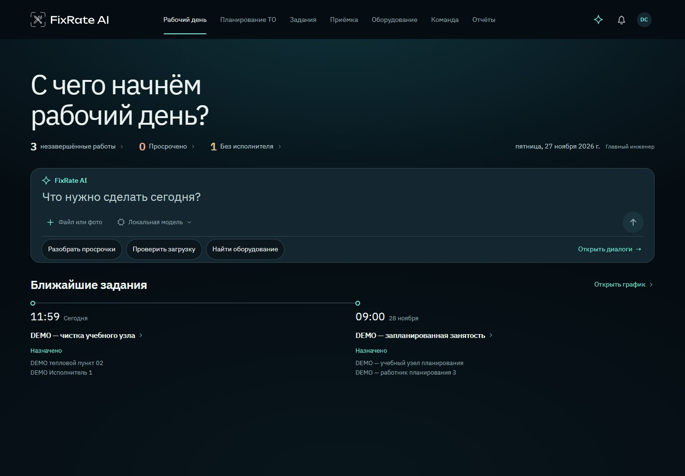
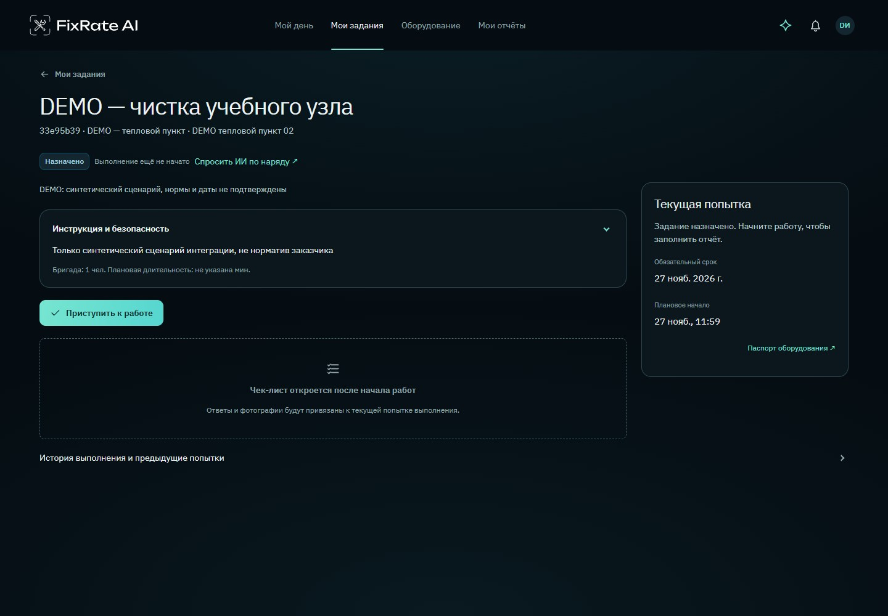
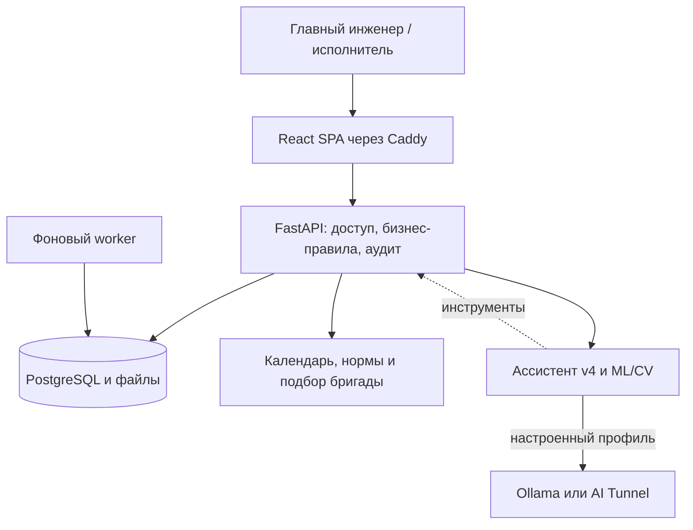

<div align="center">
  
</div>

# FixRate AI

**Техническое обслуживание и ППР — от регламента до приёмки работы.** Проектный практикум УрФУ.

[](REPOSITORY_REFACTOR_REPORT.md)
[](AI_AGENT_ARCHITECTURE.md)
[](quick_start/README.md)

[Интерфейс](#интерфейс) · [Быстрый старт](#быстрый-старт) · [Архитектура](#архитектура) · [Проверки](#проверки-и-ограничения) · [Документация](#документация)

FixRate AI связывает оборудование и регламенты с календарём ТО, нарядами, назначениями и отчётами о выполнении. Нормативный срок, плановый интервал и фактическое выполнение хранятся отдельно.

**Исходные книги Excel:** [локальный ONLYOFFICE](docs/service/runtime.md#локальный-редактор-исходных-xlsx) редактирует сами `.xlsx` с сохранением оригинала и версий. Уже выпущенный наряд [обновляется отдельно](docs/service/publication.md#правки-выпущенных-нарядов-из-книги-excel) после предпросмотра и подтверждения главного инженера.

## Интерфейс

**Главный инженер** начинает с рабочего дня: открывает очередь нарядов, планирует ТО, подбирает бригаду и проверяет доказательства. В профиле MVP обычный и главный инженер получают одинаковые оперативные права, но остаются разными ролями в сессиях и аудите. Публикация регламентов, согласование исключений и управление доступом не входят в общие полномочия.

[](docs/service/demo-gallery.md#главный-инженер)

**Исполнитель** открывает назначенный наряд, отмечает пункты чек-листа и добавляет фотографии «до» и «после». Отчёт передаётся на проверку после отдельного подтверждения; исполнитель не принимает собственную работу.

[](docs/service/demo-gallery.md#исполнитель)

**[Полная галерея Playwright →](docs/service/demo-gallery.md)** Планирование, оборудование, назначения, отчёт и приёмка, мобильные экраны и реальные ответы локального v4. Все данные учебные.

## Быстрый старт

**Из готовых образов — без Python и Node.js.** Для официального `FixRateAI-QuickStart-X.Y.Z.zip` нужны Windows 11 x64 с Docker Desktop/WSL2 или Linux amd64 с Docker Engine и Compose ≥2.24. Сверьте SHA‑256, распакуйте ZIP, подготовьте `.env` и запустите из каталога комплекта:

```console
docker compose --env-file images.env --env-file .env config --quiet
docker compose --env-file images.env --env-file .env up -d --wait
```

Первый вход: `http://127.0.0.1:8080/setup`. [Настройка, диагностика, обновление и резервные копии](quick_start/README.md). **Публичные образы и выпуск текущего кандидата не подтверждены**: локальный тестовый ZIP не предназначен для установки из реестра.

**Из исходников — с синтетическими данными.** Подготовьте Git, Python и работающий Docker с Compose по [инструкции первого запуска](docs/service/first-run.md). На новом локальном проекте:

```console
python scripts/start_local.py
python scripts/start_local.py --status
```

Интерфейс обычно открывается на `http://127.0.0.1:8000`; фактический порт выводит скрипт. Учебные учётные данные сохраняются локально в `var/compose-local/accounts.txt`. Для остановки с сохранением базы и файлов: `python scripts/start_local.py --stop`. [Demo с профилем MVP, Development, Deployment, Ollama и Cloud](docs/service/release-profiles.md).

## Архитектура



`backend/` — API и ассистент; `frontend/` — интерфейс; `database/` — миграции и учебные данные; `ml_service/` — прогноз и фотоанализ, импортируемые FastAPI; `deploy/` — образы, Compose и установщики; `contracts/` и `tests/` — контракты и проверки.

ИИ опирается на доступные пользователю данные. Изменения проходят через серверные проверки и, где положено, отдельную карточку подтверждения. Фотоанализ описывает видимое, а не качество скрытых операций, и не заменяет инженерную приёмку.

## Проверки и ограничения

- Покрытие API, успешная сборка и браузерный сценарий не означают допуск свободных ответов v4. Методики, единицы измерения и нормы заказчика требуют валидации на его данных.
- В локальном прогоне: **195 зарегистрированных операций API в контракте**, **673 теста интерфейса**, ответы локального v4 проверены в Chrome под двумя демонстрационными ролями. Метрики живой облачной приёмки сюда не включены.
- Критерии живой приёмки, корпус и результаты: [протокол v4](AI_AGENT_MVP_BENCHMARK.md) и [журнал проверок](docs/service/verification.md).
- Текущие результаты и препятствия: [журнал демонстрационного выпуска](REPOSITORY_REFACTOR_REPORT.md). Публичное облачное демо не допускается без подтверждённого лимита расходов и разрешения владельца.

## Документация

| Раздел | Что внутри |
|---|---|
| [Узлы сервиса](docs/service/INDEX.md) · [Архитектура](docs/ARCHITECTURE.md) | API, React, БД, планирование, ML/CV и ассистент |
| [Сценарии и UX](docs/service/user-experience.md) · [Роли](docs/service/roles.md) | Главное действие по роли, серверные ограничения и исключения |
| [Установка](docs/service/installation.md) · [Профили](docs/service/release-profiles.md) | Windows/Linux, HTTPS, обновление, откат, backup/restore |
| [Таблица нарядов ТО](docs/releases/2026-11-27-order-table.md) | Правки через предпросмотр, перенос бригады и XLSX |
| [Локальный срез Excel и истории чатов](docs/releases/2026-11-28-xlsx-onlyoffice-checkpoint.md) | Изменения поверх `dev`, проверки и блокеры слияния |
| [MVP](docs/MVP_SCOPE.md) · [План](docs/PLAN.md) · [ADR](docs/decisions/INDEX.md) | Границы продукта, незакрытые требования и решения |
| [Текущий кандидат](docs/releases/2026-11-27-release-readiness.md) · [Changelog](CHANGELOG.md) · [История](README_HISTORY.md) | Изменения, проверки и предыдущие срезы |
