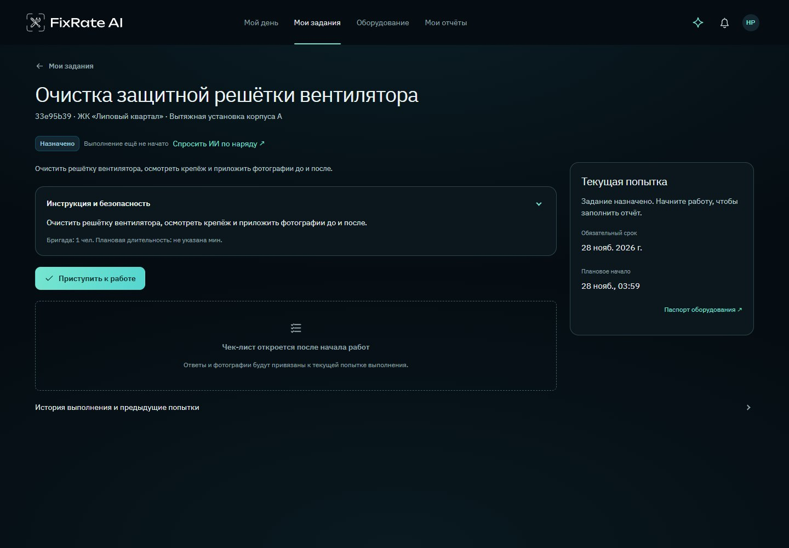
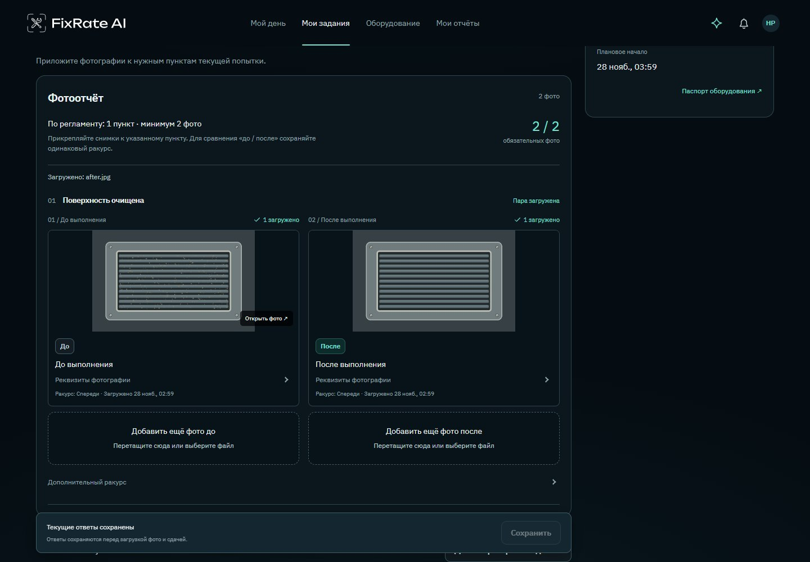
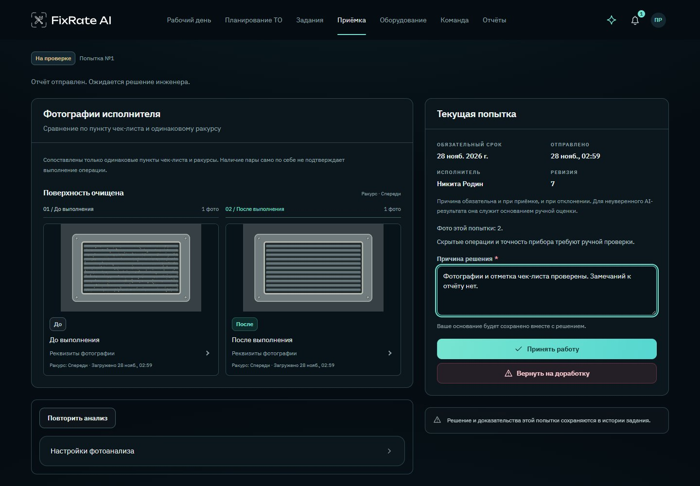
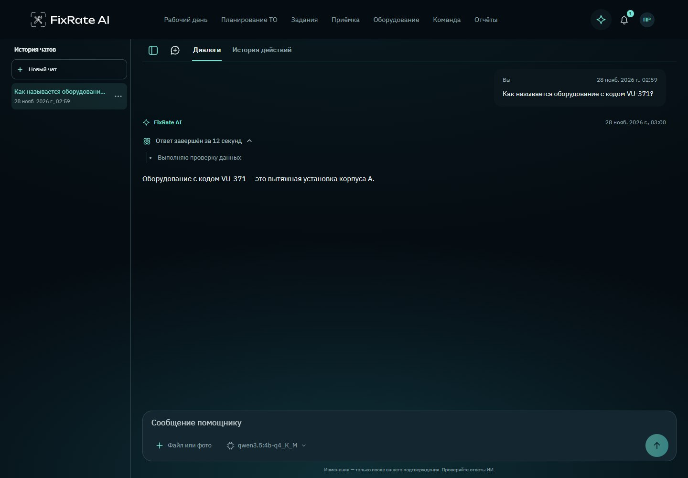
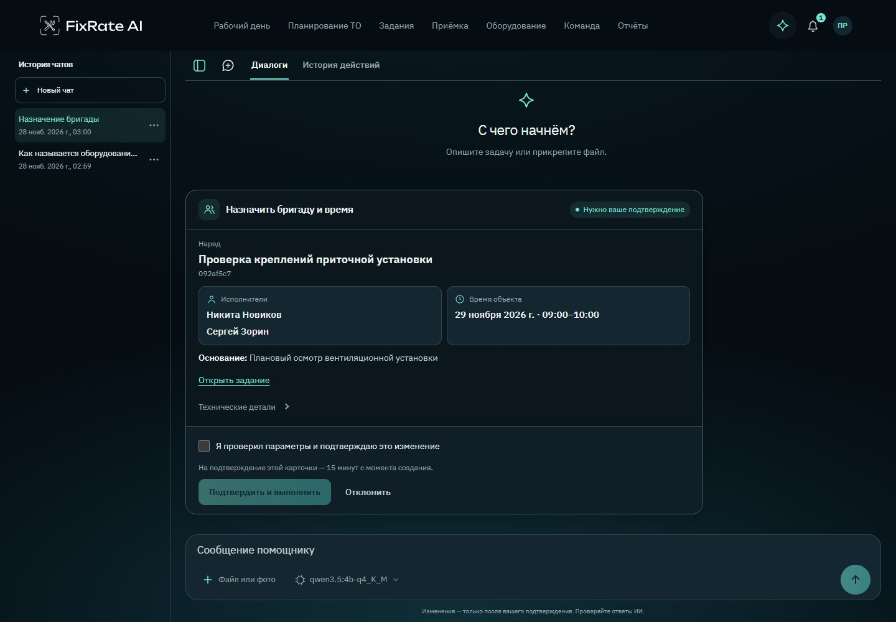
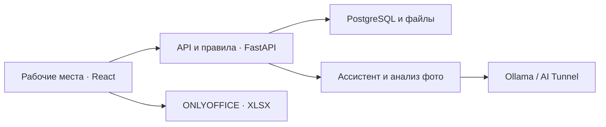

<p align="center">
  
</p>

# FixRate AI

**Плановое техническое обслуживание — от регламента до принятого отчёта.**

FixRate AI помогает эксплуатационной команде планировать ТО и ППР, назначать работы с учётом смен и допусков и собирать подтверждения выполнения. Главный инженер работает с Excel, сроками и приёмкой; исполнитель получает свои наряды, проходит чек-лист и сдаёт отчёт с фотографиями.

Ассистент отвечает по доступным пользователю данным и готовит изменения на подтверждение. Фотоанализ помогает оценить снимки; решение о приёмке принимает инженер.

## Как проходит работа

### 1. Исполнитель получает наряд

В карточке видны оборудование, инструкция и обязательный срок. Исполнитель начинает работу и отмечает выполненные пункты.



### 2. Исполнитель сдаёт отчёт

Снимки «до» и «после» привязаны к пункту чек-листа. Перед отправкой исполнитель проверяет материалы и отдельно подтверждает сдачу.



### 3. Инженер принимает работу

Инженер сверяет чек-лист и фотографии, добавляет причину решения и подтверждает приёмку или возвращает работу на доработку. Результат попадает в журнал и доступен в выгрузке XLSX.



## ИИ-ассистент

Ассистент читает реестр, календарь и наряды через серверные инструменты с правами текущей роли. Ниже — ответ локальной Ollama на вопрос об оборудовании из реестра.



Для назначения сервер сначала проверяет состав, время и допуски. Ниже — настоящая карточка от серверного инструмента назначения (MCP). Пока пользователь не подтвердил действие, наряд остаётся прежним.



Скриншоты сняты Playwright в Chrome на отдельной PostgreSQL с синтетическими данными. Имена, объект и изображения не взяты из рабочей базы.

## Быстрый запуск

Нужны **Git, Python 3.12 и Docker с Compose**. Первый запуск скачивает образы и зависимости. Для знакомства можно запустить проект без ключа AI Tunnel.

```powershell
git clone https://github.com/Fir-White/FixRateAI.git
cd FixRateAI
py -3.12 -m venv .venv
.\.venv\Scripts\python.exe -m pip install -r requirements.txt
.\.venv\Scripts\python.exe scripts/start_local.py
```

На Linux используйте `python3.12` для создания окружения и `.venv/bin/python` вместо Windows-пути.

Скрипт поднимет приложение с PostgreSQL, применит миграции и заполнит учебный объект. Откройте адрес из строки **`URL`** и возьмите учётные данные главного инженера или исполнителя из локального `var/compose-local/accounts.txt`. Для одновременной работы под двумя ролями используйте отдельные профили браузера.

Остановка с сохранением данных:

```powershell
.\.venv\Scripts\python.exe scripts/start_local.py --stop
```

**Дополнительные режимы:** [Ollama, AI Tunnel и редактор Excel ONLYOFFICE](docs/service/runtime.md). Для первоначальной установки из готовых образов — [Quick Start](quick_start/README.md).

## Что ещё есть в продукте

| Задача | Как решается |
|---|---|
| Подготовить ТО и ППР | Проверка Excel, сохранение каталога-черновика, планирование по регламентам. Импорт сам по себе не публикует регламент и не создаёт наряд. |
| Назначить людей | Подбор состава по сменам, загрузке и допускам. Предпросмотр не меняет наряд. |
| Сохранить исходные книги | Редактирование XLSX в локальном ONLYOFFICE; оригинал и версии хранятся отдельно от выпущенных нарядов. |
| Проверить отчёт | Чек-лист, фото, история попыток, решение инженера и экспорт. Фотоанализ не подтверждает скрытые работы или точность измерений. |
| Использовать ИИ | Локальная Ollama или AI Tunnel. Облачный режим требует интернета и собственного ключа. |

## Устройство проекта



```text
backend/      API, роли, наряды, планирование и ассистент
frontend/     интерфейс главного инженера и исполнителя
ml_service/   прогноз и анализ фотографий
database/     миграции и учебные данные
contracts/    контракты API и примеры
deploy/       развёртывание и выпуск
tests/        серверные, браузерные и ML-проверки, стенд ассистента
docs/         архитектура, эксплуатация и проверенные сценарии
```

[Документация проекта](docs/INDEX.md) · [Как повторить браузерную проверку](docs/service/demo-gallery.md)

Проектный практикум УрФУ.
