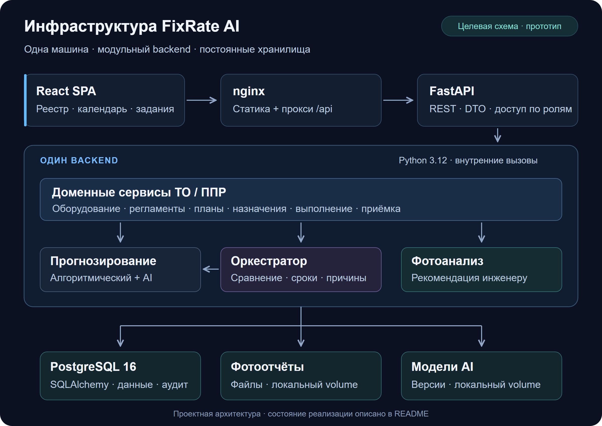

<div align="center">

# FixRate AI

**Планирование технического обслуживания и планово-предупредительных ремонтов**

Оборудование → регламент → календарь → задание → фотоотчёт → приёмка

`ТО / ППР` · `maintenance-0.1` · `Проектирование + контракты` · `27.10.2026`

[Архитектура](docs/architecture/README.md) · [Модель БД](docs/database/README.md) · [API-контракты](docs/architecture/api_contracts.md) · [Границы прототипа](docs/architecture/prototype_scope.md)

</div>

---

FixRate AI проектируется как система управления обслуживанием инженерного оборудования. Она связывает версии регламентов с календарём работ, назначением исполнителей и историей принятого обслуживания. Алгоритмический и AI-прогнозы должны сравниваться на одинаковых исходных данных; фотоанализ помогает инженеру оценивать отчёт, а окончательное решение принимает человек.

## Материалы аналитика для разработчиков

[Предметная документация и примеры](docs/domain/README.md) описывают пилотные операции ТО, пользовательские сценарии, права, модель данных и тестовые сценарии планирования. Это аналитические материалы для проработки требований: демонстрационные допущения и расхождения с существующими API-контрактами и ER-моделью необходимо согласовать до реализации.

## Состояние проекта

Срез рабочей ветки `main` на **27 октября 2026 года**, после обновления до `bb300ec`. Демонстрация прототипа запланирована на **7 ноября 2026 года**.

| Область | Что есть сейчас | Статус |
|---|---|---|
| Архитектура | Границы модулей, стек, сценарии, API-контракты и схемы компонентов | Документировано |
| Backend | Pydantic 2 DTO, REST-модели, матрица разрешений, JSON-примеры и 5 тестов | Реализованы контракты |
| База данных | ER-диаграмма, спецификация и каталог: **35 таблиц · 310 полей · 72 FK** | Логический проект; требуется согласование с DTO |
| Материалы заказчика | Исходный Excel и разбор неоднозначных данных | Сохранены в `docs/` |
| API и авторизация | Описаны интерфейсы, роли, сессии и проверки доступа | Сервер, endpoints и проверки прав ещё не реализованы |
| Frontend | Описаны экраны и пользовательские процессы | Исходников SPA нет |
| AI и алгоритмы | Контракты прогнозов, оркестратора и фотоанализа | Исполняемых модулей и весов нет |
| Развёртывание | Описана схема Docker Compose | Dockerfile, Compose, nginx-конфигурации, CI/CD и SQL-миграций нет |

Текущий checkout позволяет проверять контракты и проектные артефакты. Команды запуска веб-приложения появятся вместе с сервером и инфраструктурой. Старый сметный проект сохранён в ветке `archive/legacy-ai-estimator`; его runtime не входит в текущую инфраструктуру ТО/ППР.

## Инфраструктура и потоки данных

**Целевая схема** — модульный монолит: один backend, одна PostgreSQL и файловые хранилища фото и моделей на одной машине. Схема показывает проектное развёртывание; фактическая готовность компонентов приведена выше.

[](docs/architecture/diagrams/infrastructure.svg)

[Открыть схему в SVG](docs/architecture/diagrams/infrastructure.svg) · [Подробная схема компонентов](docs/architecture/system_architecture.md)

| Слой | Проектное решение | Назначение |
|---|---|---|
| Интерфейс | React, TypeScript, Vite, Tailwind CSS | Реестр, календарь, задания, прогнозы и приёмка |
| Входная точка | nginx | Статика SPA и проксирование `/api` в backend, один origin |
| Backend | Python 3.12, FastAPI, Pydantic 2 | REST, валидация, роли и доменные сервисы |
| Хранение | PostgreSQL 16, SQLAlchemy 2.x, psycopg 3 | Связи, версии, назначения, отчёты и аудит |
| Прогнозирование | Календарные правила; NumPy и scikit-learn | Независимые алгоритмический и AI-результаты |
| Фотоанализ | Pillow, Transformers/PyTorch, кандидат CLIP ViT-B/32 | Ограниченная оценка видимых изменений |
| Развёртывание | Docker Compose | Frontend, backend, БД и постоянные volumes |

Текущий [`backend/requirements.txt`](backend/requirements.txt) содержит только `pydantic>=2.5,<3`. Остальные технологии — решения из [документа о стеке](docs/architecture/tech_stack.md), их зависимости и версии ещё предстоит зафиксировать при реализации.

Проектные volumes: `maintenance_pgdata`, `maintenance_photos`, `maintenance_models`. PostgreSQL хранит метаданные файлов, а фото и веса размещаются вне БД. Запуск backend должен зависеть от успешного применения новой SQL-цепочки и готовности БД. Подробности — в [стеке](docs/architecture/tech_stack.md) и [архитектуре системы](docs/architecture/system_architecture.md).

## ER-диаграмма базы данных

**35 таблиц · 310 полей · 72 связи · PostgreSQL 16.** Диаграмма из переданного ER-комплекта объединяет оборудование и доступ, регламенты, планирование, исполнение, AI и аудит.

[](docs/database/erd.svg)

**Для чтения полей откройте [SVG с масштабированием](docs/database/erd.svg) или [PNG в полном разрешении — 6216 × 3548](docs/database/erd.png).** Редактируемый оригинал — [erd.drawio](docs/database/erd.drawio).

| Домен | Таблиц | Содержание |
|---|---:|---|
| Объекты и доступ | 11 | Оборудование, системы, пользователи, компетенции и бригады |
| Регламенты | 7 | Операции, редакции документов, периодичность и привязки |
| Планирование | 3 | Планы, календарные вхождения и инциденты |
| Исполнение | 9 | Наряды, назначения, отчёты, показания, фото и приёмка |
| AI | 4 | Версии методов, прогнозы, оркестратор и контроль качества |
| Аудит | 1 | История действий и изменений |

[Спецификация полей](docs/database/specification.md) · [Каталог связей](docs/database/relationships.md) · [JSON-каталог](docs/database/model_catalog.json) · [Согласование с API](docs/database/README.md)

Модель остаётся логическим проектом: её роли, статусы и структура прогнозов требуют согласования с текущими DTO перед созданием SQL-миграций. Изображения сохраняют состав таблиц, подписи и маршруты связей из исходного draw.io.

## Как должна проходить работа

1. **Оборудование и регламенты.** Сохранить источник, версию операции, периодичность, требования к бригаде и привязку к оборудованию.
2. **Календарь.** Построить вхождения на выбранный период из подтверждённых правил; отдельно показать недостающие данные и просрочку.
3. **Прогнозы.** Передать один снимок данных двум методам, сохранить оба результата и объяснение решения оркестратора.
4. **Назначение.** Проверить квалификацию, доступность всей бригады и допустимое окно работ.
5. **Выполнение.** Собрать чек-лист, показания и фотографии конкретной попытки; сохранить заключение фотоанализа.
6. **Приёмка.** Инженер принимает работу либо отправляет на доработку. Принятая попытка пополняет историю обслуживания.

Обязательный срок ограничивает рекомендации AI и назначения. Отсутствие истории или модели должно возвращать явный статус недоступности. Просрочка не переносит регламентную дату, а фото не подтверждает скрытые операции. Эти правила описаны в [архитектуре](docs/architecture/system_architecture.md); их исполнение сервисами и БД ещё предстоит реализовать.

## Навигация по репозиторию

```text
FixRate_AI/
├── backend/
│   ├── app/
│   │   ├── api/v1/                  # Каркас пакетов, без роутеров
│   │   └── schemas/                 # DTO maintenance-0.1 и REST-модели
│   ├── examples/                   # Примеры обмена
│   ├── tests/                      # Проверки API-моделей
│   └── requirements.txt            # Текущая runtime-зависимость: Pydantic
├── docs/
│   ├── architecture/               # Архитектура, контракты и валидатор
│   │   ├── contracts/              # Проектные DTO, JSON Schema, fixtures
│   │   └── diagrams/               # Схема компонентов: Mermaid + draw.io
│   ├── assets/                     # Превью инфраструктуры для README
│   ├── database/                   # ER: draw.io, SVG, PNG, спецификация и каталог
│   └── customer/                   # Исходный график заказчика (.xlsx)
└── README.md
```

| Нужно разобраться с… | Начать здесь |
|---|---|
| Архитектурой и ответственностью команды | [Оглавление архитектуры](docs/architecture/README.md) · [Команда](docs/architecture/team_responsibilities.md) |
| Текущими backend-контрактами | [Результат FX26-BE01](docs/architecture/fx26-be01-implementation.md) · [API](docs/architecture/api_contracts.md) |
| Данными и связями | [Документация БД и расхождения с API](docs/database/README.md) |
| ER-диаграммой | [SVG](docs/database/erd.svg) · [PNG](docs/database/erd.png) · [Редактируемая draw.io](docs/database/erd.drawio) · [72 связи](docs/database/relationships.md) |
| Полями и ограничениями | [Спецификация БД](docs/database/specification.md) · [JSON-каталог](docs/database/model_catalog.json) |
| Исходными требованиями | [Excel заказчика](docs/customer/techical_service_schedule.xlsx) · [Анализ графика](docs/architecture/customer_schedule_analysis.md) |
| Объёмом демонстрации и проверками | [Границы прототипа](docs/architecture/prototype_scope.md) · [Матрица сценариев](docs/architecture/architecture_validation.md) |

## Локальная проверка

Команды выполняются из корня репозитория. Для текущих проверок нужен **Python 3.11+**; целевой runtime приложения — **Python 3.12**.

Создание окружения в PowerShell:

```powershell
python -m venv .venv
.\.venv\Scripts\python.exe -m pip install -r backend/requirements.txt pytest tzdata
```

Проверка проектных контрактов, JSON Schema, примеров, ссылок и схем компонентов:

```powershell
.\.venv\Scripts\python.exe -B docs/architecture/validate_artifacts.py
```

Проверка backend DTO из каталога `backend`:

```powershell
Set-Location backend
..\.venv\Scripts\python.exe -B -m pytest -q
Set-Location ..
```

В Linux/macOS используйте `.venv/bin/python` и запускайте тесты командой `(cd backend && ../.venv/bin/python -B -m pytest -q)`.

Валидатор архитектуры проверяет проектные артефакты в `docs/architecture`; pytest проверяет API-модели. Эти команды не запускают сервер и не проверяют SQL-реализацию ER-модели. Исходные DTO в `docs/architecture/contracts` и их backend-копию в `backend/app/schemas/maintenance.py` нужно поддерживать согласованными.

## Перед реализацией БД и сервисов

- Согласовать ER-модель с `maintenance-0.1`: роли, статусы, версии операций, периодичность и структуру прогнозов. [Таблица расхождений](docs/database/README.md) фиксирует текущие различия.
- Подтвердить у заказчика год графика, даты квартального и годового ТО и смысл нормо-часов. До уточнения нельзя вычислять реальные назначения из предположений.
- Создать новую SQL-цепочку, сервисы, транзакции назначения/приёмки и проверки доступа по объекту.
- Подключить API, интерфейс и Compose, затем проверить сквозные сценарии и восстановление данных.
- Проверить модели на фактических данных. Примеры `synthetic_demo` служат демонстрации контрактов и не подтверждают качество AI.

Исторический [аудит от 26.10.2026](docs/architecture/repository_audit.md) описывает состояние до появления текущих backend-контрактов. Актуальный состав `main` приведён в этом README.
