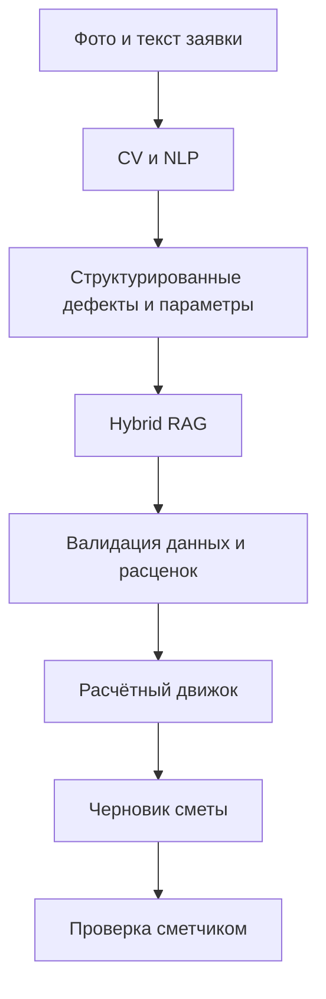

# FixRate AI

**AI-агент для предварительного расчёта стоимости ремонта по фотографии, описанию дефекта и нормативным справочникам.**

**ТОП ИИ · УрФУ · 2026** &nbsp;|&nbsp; **Статус: MVP в разработке**

---

## О проекте

**FixRate AI** — прикладная система поддержки инженера-сметчика. Она предназначена для подготовки **черновика ведомости объёмов работ (ВОР) и предварительной сметы** на основе фотографии дефекта, текстового описания и характеристик объекта недвижимости.

**Вход:** фотография и описание повреждения, известные измерения, сведения об объекте.  
**Выход:** перечень предполагаемых работ, объёмы, материалы, подобранные расценки с указанием источников и предварительная стоимость.

Система **не заменяет сметчика**: специалист проверяет предложенные работы, уточняет объёмы, выбирает применимые расценки и подтверждает результат.

> **Область MVP:** проверяемый предварительный расчёт для ограниченного набора ремонтных сценариев. Поддержка всех нормативных методик ФЕР/ТЕР не заявляется до отдельной реализации и проверки.

## Архитектура решения

**Ключевой принцип:** AI-модули распознают, извлекают и подбирают данные, а итоговые суммы рассчитывает **детерминированный программный модуль**, а не языковая модель.

### Технологический стек

| Компонент | Технологии / подход |
|:--|:--|
| Серверная часть | Python, FastAPI |
| База данных | PostgreSQL 16 |
| Семантический поиск | pgvector, эмбеддинги |
| Поиск нормативов | Hybrid RAG: векторный + лексический поиск |
| AI-анализ | CV, NLP / LLM |
| Расчёт стоимости | Детерминированный расчёт и валидация |
| Пользовательский интерфейс | React, TypeScript (целевой стек MVP) |
| Документирование БД | Markdown, SVG, Crow’s Foot |

*Таблица описывает целевую архитектуру. Реализация компонентов и их интеграция выполняются поэтапно.*

## ER-диаграмма базы данных

**18 сущностей · Crow’s Foot · PostgreSQL + pgvector**

*Нажмите на схему, чтобы открыть её в полном размере. Актуальная полная схема — SVG; draw.io-исходник пока не синхронизирован с v3.1.*

| Материал | Назначение |
|:--|:--|
| [DDL-схема](db/001_init.sql) | Исполняемая схема PostgreSQL 16 + pgvector (v3.1) |
| [DEMO-данные](db/002_seed_demo.sql) | Типы дефектов, DEMO-прайс, демо-пользователи и здание |
| [Инструкция по БД](db/README.md) | Применение, проверка, правила версий смет |
| [ER-диаграмма · SVG](docs/database/erd.svg) | Просмотр схемы в полном размере |
| [ER-диаграмма · draw.io](docs/database/erd.drawio) | Устаревший исходник; не синхронизирован с v3.1 |
| [Спецификация БД](docs/database/specification.md) | Атрибуты, типы, PK/FK, ограничения, индексы |
| [Сценарии тестирования БД](docs/database/test_scenarios.md) | Матрица из 97 проверок; 50 SQL-сценариев выполнены (50/50 PASS) |

### Логические блоки БД

| Блок | Основные сущности |
|:--|:--|
| Пользователи и объекты | `users`, `buildings` |
| Заявки и дефекты | `repair_requests`, `request_photos`, `defects`, `defect_types`, `defect_photos`, `defect_measurements` |
| AI-обработка | `ai_runs`, `ai_results` |
| Нормативы и поиск | `norm_sources`, `rates`, `normative_chunks` |
| Сметы | `estimates`, `estimate_items`, `estimate_materials` |
| История и уточнения | `request_clarifications`, `audit_events` |

**Принципы модели:** целостность связей между заявками, хранение истории AI-запусков, версионирование смет, сохранение использованных цен и источников, исключение двойного учёта материалов.

## Разработка и проверка

Изменения вносятся в отдельных ветках и передаются на проверку через запросы на слияние (Pull Request). Перед объединением изменений необходимо проверять совместимость API-контрактов, миграций и расчётной логики.

**Текущее состояние:** MVP находится в разработке. Успешное прохождение всех тестовых сценариев и промышленная готовность системы пока не заявляются.

Инструкции по локальному запуску и демонстрации будут добавлены после стабилизации интегрированной сборки.

---

**FixRate AI** · Учебный прикладной проект по направлению «Алгоритмы искусственного интеллекта», УрФУ.  
Заказчик, указанный в техническом задании: Уральский банк ПАО Сбербанк.
