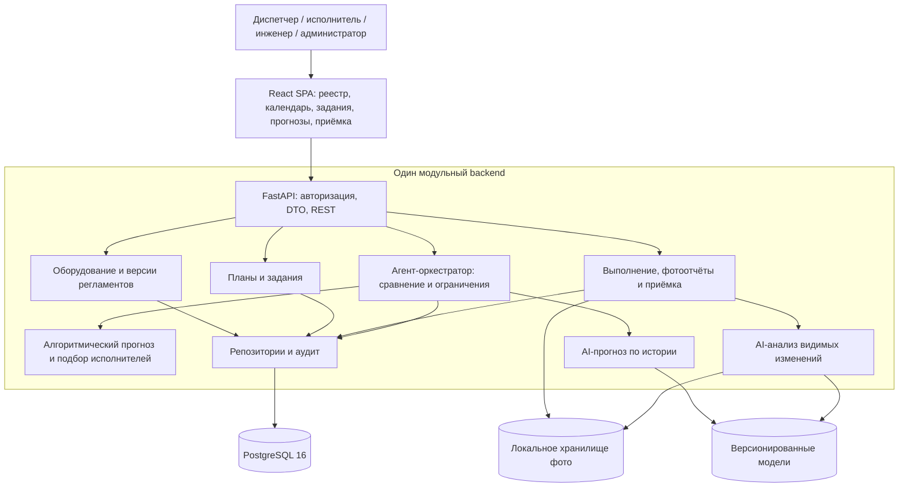

# FixRateAI: реализованная система

Срез `dev` на 01.11.2026. Это описание действующей реализации, а не целевой список ещё не созданных компонентов.

## Назначение

Система составляет календарь обслуживания оборудования и распределяет работы между людьми с учётом смен, чётности недель, доступности, допусков и загрузки. Диспетчер подтверждает назначение, исполнитель отчитывается, инженер принимает результат. Оценка повреждений и стоимости из архивного проекта в этот процесс не входит.

Исходный график заказчика сохраняется отдельно от внутренних настроек. Отметки в Excel являются планом, не фактами выполнения; неизвестные единицы норм остаются неизвестными. [Предметная область и источник](#исходный-график-и-предметная-область).

## Возможности

Реализованы регистрация-заявка с выдачей роли администратором; оборудование и версионированное обслуживание с M:N привязками; общий редактор календарей обслуживания и смен; предпросмотр и идемпотентное создание заданий; сотрудники, трудоустройство, допуски, смены, исключения и датированные бригады; подбор и ручной состав; атомарное подтверждение и отмена назначения до начала; независимые алгоритмический/AI-прогнозы; отчёты, чек-лист, фото, доработка, инженерная приёмка и аудит.

CalendarPattern поддерживает day/week/month/quarter/year/yearly_count/dates, ISO-чётность, сезоны и исключения. Квартал означает реальный календарный квартал; month/3 — интервал от опоры. Годовое число распределяется по допустимым датам реального года. Предпросмотр, генерация и прогноз используют один серверный календарный движок.

## Компоненты и взаимодействие

Один процесс FastAPI обслуживает API и собранную React SPA. PostgreSQL хранит транзакционные данные; фото и модельные артефакты находятся в локальном хранилище. Алгоритмы и ML/CV вызываются как Python-библиотеки в этом же приложении. Отдельного ML-сервера и брокера нет. [Исходники схемы компонентов](assets/architecture/system_architecture.mmd).

| Узел | Реализация и назначение |
|---|---|
| [API и доступ](service/backend.md) | REST, DTO, серверные сессии, CSRF, роли и границы объекта |
| [Веб](service/web.md) | Настройки, календарь, задания, сравнение прогнозов, отчёты и приёмка |
| [Календарь](service/planning.md) | Расчёт дат/сроков, версии правил и эталонные случаи |
| [Подбор и назначение](service/planning.md) | Доступность, квалификация, загрузка, блокировки и аудит |
| [Оркестратор](service/planning.md) | Два результата одного снимка, ограничения и создание черновиков |
| [ML/CV](service/ml.md) | Экспериментальный RF и ограниченное заключение по видимым изменениям |
| [Данные](service/database.md) | SQL 001–008, reflection ORM, происхождение и неизменяемая история |

Основной поток: оборудование и версия обслуживания → календарный предпросмотр → отдельная команда создания черновика → предложение работников/бригады → подтверждение диспетчером → выполнение и отправка попытки → приёмка либо доработка. Подбор не резервирует человека. Сохранение назначения повторяет проверки внутри транзакции, включая глобальную занятость и ревизию. Только принятое выполнение влияет на следующий отсчёт от факта.

## Данные и контракты

Канонический DTO — [maintenance.py](../backend/app/schemas/maintenance.py); [экспорт JSON Schema и примеры](service/backend.md) проверяются на соответствие. UI преобразует camelCase на границе клиента, межмодульные структуры используют snake_case. Два метода возвращают один ForecastResult по одному неизменяемому ForecastSnapshot; исходные результаты сохраняются отдельно от решения оркестратора.

Периоды считаются в timezone объекта, события передаются как ISO 8601 с offset. Последний разрешённый день D заканчивается в локальное начало D+1. Нормо-часы не равны длительности бронирования без подтверждённого смысла единиц. Бригада, смена и назначение — разные сущности. Ошибки неполных данных/модели показываются явно, без выдуманных дат.

База ТО самостоятельная. Последовательные [SQL-миграции](../database/migrations) применяются CLI с блокировкой и контрольными суммами; при старте приложения миграции и create_all не выполняются. Версии инструкций, попытки, решения и аудит сохраняют происхождение. [Подробности хранения](service/database.md).

## Запуск и проверки

Полные команды установки, применения миграций, bootstrap пользователя, сборки SPA и запуска API находятся в [runtime](service/runtime.md). Все Python-зависимости, включая CLIP и тесты, зафиксированы в одном корневом requirements.txt; Node использует frontend/package-lock.json. Веса CLIP подготавливаются отдельно по закреплённой ревизии и не скачиваются во время запроса.

Единый `scripts/verify.py --browser` проверяет чистую и обновляемую отдельную PostgreSQL, backend, ML, сборку/UI и настоящий браузер. Чистые тесты не требуют работающей БД. [Методика](service/verification.md) и [датированные результаты](service/verification.md) разделены; старые числа не считаются новым прогоном.

## Ограничения

Customer-trained модель и измеренная точность на заказчике отсутствуют. RF synthetic_demo демонстрирует процесс. CLIP оценивает лишь видимые признаки и не подтверждает скрытые операции; AI не принимает работу. Человеческое подтверждение назначения обязательно. Недопустимое/неоднозначное местное время закрывается диагностикой.

В UI пока нет полной матрицы «операции × дни» FE03 и формального утверждения месяца. Отдельно остаются восстановительное планирование просрочки, смена состава после начала/при доработке, интерфейс нескольких объектов/ролей, многооперационные наряды, универсальный Excel-import, внешние интеграции и эксплуатационные меры. Текущее однозначное оборудование требуется в SPA/фотопотоке даже при более общей модели repository. [Состояние работ](PLAN.md).

## Исходный график и предметная область

Назначение проекта — корректно распределять обслуживание оборудования и рабочее расписание людей. Исходный график хранится как свидетельство требований; операторская конфигурация обслуживаний и смен является отдельным версионированным слоем.

Проверено 26.10.2026. Файл с буквальным именем `График для ии.xlsx` в рабочем дереве отсутствует. Доступен [techical_service_schedule.xlsx](../data/customer/techical_service_schedule.xlsx), 12 406 байт. Его содержимое соответствует описанному в задании примеру; тождество с файлом под исходным русским именем не установлено.

SHA-256: `8608662fe5d66519e990f65d1377f3fad32c1e6d29d6524dc4aeed24cd079957`.

### Фактическое содержимое

Книга содержит один видимый лист `Лист1`, область данных XML `A2:AK15` (стилевые границы прежнего просмотра — `A1:AK15`), объединённые заголовки. Скрытых строк/столбцов, формул, условного форматирования, изображений и диаграмм нет. При консолидации повторно прочитаны все ячейки и shared strings средствами ZIP/XML, книга не изменялась. Прежний разбор использовал openpyxl. Цветовые стили календаря ТО2 не задают отдельных дат: в строках 9–11 календарные ячейки одинаково оформлены и пусты.

| Ячейка/область | Значение | Следствие |
|---|---|---|
| `A2` | «Система ХВС,ГВС,ЖБО» | Верхний заголовок отличается по предмету от следующего; не исправлять автоматически |
| `B4:D4` | «Система теплоснабжения» | Раздел графика |
| `B5:D5` | «Тепловой пункт (комплекс устройств)» | Одна группа оборудования; отдельных инвентарных единиц в файле нет |
| `G2:AI3` | «Октябрь» | Год не указан. Для демонстрации предлагается 2026 только как допущение |
| `G4:AK5` | Дни 1–31 | Календарная матрица для отображения, а не структура таблицы БД |
| `E4:E5`, `F4:F5` | «кол-во человек», «Нормо-часы» | Нельзя без уточнения вычислять длительность работы и загрузку |
| `B14` | «1. Необходимо учесть добавку строк с работами» | Требуется создание новых операций |
| `B15` | «2. Необходимо учесть добавку оборудования под каждой строкой» | Нужна связь M:N операции с единицами оборудования через применяемый регламент |

| Строка / код | Операция, дословно из B | Вид C | Периодичность D | Работников E | Норма F | Календарь G:AK |
|---|---|---|---|---|---|---|
| 6 / 1.1 | Контроль параметров показаний приборов (давление, температура) | ТО1 | `1/день` | 1 | 1 | 31 отметка `ТО1` |
| 7 / 1.2 | Протоколирование показаний счетчиков (согласно инструкции) | ТО1 | `1/день` | 1 | 1 | 31 отметка `ТО1` |
| 8 / 1.3 | Проверка функционирования управляющего модуля | ТО1 | `1/день` | 1 | 1 | 31 отметка `ТО1` |
| 9 / 1.4 | Чистка всех узлов и агрегатов системы | ТО2 | `5/год` | 2 | 60 | Пусто |
| 10 / 1.5 | Проверка приборов измерения температуры и давления на повреждения и точность показаний | ТО2 | `1/квар` | 1 | 48 | Пусто |
| 11 / 1.6 | Выпустить воздух из системы отопления/теплоснабжения | ТО2 | `1/квар` | 1 | 30 | Пусто |

Подтверждены шесть операций, ТО1/ТО2, ежедневная/квартальная/годовая частота, персонал и числовые нормы, календарь октября и два примечания об расширении. В задании используется запись `1/квартал`, в книге — `1/квар`. Нормализация этих двух записей допустима как распознавание текста; выбор конкретных дат квартального ТО из неё не следует.

### Отображение в предметную модель

Сохраняются оригинальный файл, его SHA-256 и записи `SourceDocument` с координатами строки и исходными значениями. Шесть строк становятся проектами `OperationVersion` и `RecurrenceRule`; «Тепловой пункт» — предложением группы/типа оборудования, пока заказчик не укажет объект и инвентарные номера. Столбцы дней разворачиваются в отдельные `PlanOccurrence`, связанные с версией операции и привязкой оборудования.

Для трёх ежедневных строк при выбранном октябре получается **93 исходные календарные отметки** (3 × 31). Это количество отметок в книге, а не число завершённых работ, не гарантированное число заданий и не число операций по каждой ещё не указанной единице оборудования. Группировка в выезд/задание может быть отдельной функцией позже; в прототипе одно задание соответствует одному выполнению одной операции на одной единице оборудования.

До утверждения параметров импорт имеет статус `draft`. Ежедневные отметки можно показать в календаре предпросмотра. Нельзя создавать фиктивные факты выполнения за 1–25 октября или назначать реальные работы по неуточнённой длительности. Календарь ТО2 отображает «даты требуют уточнения», не случайное распределение.

Исходная `raw_norm_value` хранится как десятичное число, `norm_unit=unconfirmed`. Значение 60 в F9 не означает автоматически 60 минут, 60 человеко-часов, 30 часов бригады либо годовой итог. `planning_duration_minutes` остаётся пустым. После подтверждения отдельная версия сохраняет нормализованную единицу, длительность и основание, не переписывая оригинал.

### Вопросы заказчику и безопасное поведение до ответа

| Вопрос | Почему нужен | Поведение без ответа |
|---|---|---|
| Какое название системы верно: верхнее A2 или раздел B4? | Классификация оборудования | Сохранить оба текста, пометить конфликт |
| К какому году относится октябрь? | Даты календаря | Предпросмотр с явной отметкой «год выбран для демонстрации» |
| Что означает F: на одну операцию, бригаду, период? В часах ли значения? | Длительность и доступность | Назначение блокируется `DURATION_UNCONFIRMED`; значение не преобразуется |
| Квартал календарный или каждые три месяца от предыдущего ТО? Какие срок/окно и исходная дата? | Обязательная граница | ТО2 остаётся `needs_input`, без автоматического утверждения дат |
| Для `5/год` какие пять дат/сезонов или допустимые окна? | Одной частоты недостаточно | Оператор выбирает yearly_count по фактическому году с фильтрами либо dates; фиксированный шаг 73 дня не применяется |
| Какие единицы оборудования, объекты, даты ввода и последнее принятое ТО? | Привязка и начало отсчёта | Нет вымышленных инвентарных номеров/истории; отдельные synthetic_demo записи |
| Какие квалификации/допуски, состав бригады, смены и зона ответственности инженера? | Допустимое назначение и приёмка | Нельзя считать всех пользователей пригодными исполнителями |
| Что обязательно фиксировать по каждому пункту: показания, единицы, фото, протокол? | Полнота отчёта и визуальная проверяемость | Черновой чек-лист, визуальный вывод не подтверждает скрытую операцию |
| Есть ли история осмотров, дефектов, отказов, наработки с датами и разрешением использования? | Обучение и оценка прогноза | AI на реальных данных возвращает `unavailable`; синтетика выделена |
| Кто вправе разрешать изменение обязательного срока и на каком основании? | Политика переноса | В v1 перенос за срок запрещён; интерфейса исключений нет |

Исходные неизвестные значения Excel сохраняются без домыслов. Рабочая конфигурация создаётся оператором как отдельная версионированная настройка; внешнее согласование не блокирует ввод выбранного периода и длительности. Это решение продукта, а не утверждение, что такие даты содержались в исходной книге.

Семантика периодов — в [планировании](service/planning.md), словарь и статусы — в [данных](service/database.md).

### Машинные примеры

[maintenance_cases.json](../tests/fixtures/domain/maintenance_cases.json) — исполняемые предметные сценарии. [operation_to_equipment_links.json](../tests/fixtures/domain/operation_to_equipment_links.json) — M:N привязки. Проверки находятся в [test_domain_scenarios.py](../tests/backend/test_domain_scenarios.py). Эти файлы являются единственными экземплярами fixtures.
