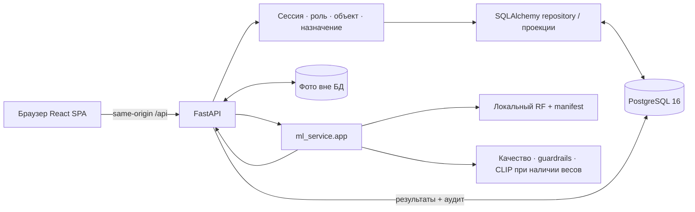

# FixRate AI: фактическая система в dev

Срез интеграции: 1 ноября 2026 года. Основа и точные версии источников находятся в [BRANCH_SOURCES.json](BRANCH_SOURCES.json). Реализация предназначена для локального интеграционного стенда ТО/ППР. Изолированные демонстрационные данные не являются историей обслуживания заказчика.

## Компоненты и реализованные сценарии

| Компонент | Реализация и ответственность |
|---|---|
| SPA | `frontend/`: React 19, TypeScript, Vite, Tailwind. Панель, оборудование, календарь, задания, сравнения, кабинет исполнителя, приёмка |
| HTTP backend | `backend/app/main.py`: FastAPI, серверные сессии, маршруты чтения и выполнения работ, файлы, ошибки, статика SPA |
| Слой данных | `backend/app/db/`: SQLAlchemy 2, отражение существующей PostgreSQL, repository, управление транзакциями |
| Адаптеры | `backend/app/integration/`: проекции для SPA, входы ML из БД, сопоставление состояний, синтетический seed |
| PostgreSQL | `database/migrations/001…007`: оборудование, версии регламентов, календарь, исполнение, назначения, ML, аудит, сессии, идемпотентные запуски планирования |
| ML/CV | `ml_service.app`: RF, извлечение признаков, анализ полноты наблюдений, проверка фото и опциональный локальный CLIP |
| Проверки | `backend/tests`, `ml_service/tests`, `database/tests`, `database/qa`, `frontend/src/**/*.test.tsx`, `frontend/e2e` |

Рабочие сценарии:

1. Вход по email/паролю; восстановление, истечение и завершение серверной сессии. Несколько объектов требуют явного `site_id` при входе.
2. Чтение оборудования и принятой истории; отсутствующие даты и происхождение не заменяются демонстрационными значениями.
3. Чтение сохранённого календаря и заданий. Исполнитель видит только назначенные ему задания, их календарные вхождения и оборудование.
4. Начало работы создаёт отдельную попытку с копией чек-листа. Исполнитель сохраняет ответы и комментарий, загружает фото к пункту и ракурсу.
5. Сдача проверяет обязательные ответы и пары фото; попытка замораживается. Инженер анализирует фото, принимает работу или возвращает её на доработку. Новую попытку начинает исполнитель. Старые отчёты и фотографии сохраняются.
6. Прогноз из карточки задания создаёт единый снимок данных из PostgreSQL, оба результата и объяснение выбора. RF работает с пометкой `synthetic_demo`; данные заказчика получают `unavailable` до появления пригодной модели.
7. ALG02 рассчитывает черновой календарь из правил PostgreSQL. ALG03 в карточке задания предлагает диспетчеру полный состав и время по допускам, доступности и загрузке. Оба расчёта рекомендательные, без сохранения плана/назначений.
8. BE05 сохраняет подтверждённое диспетчером предложение: повторные проверки под блокировками, полный состав, время, снимки допусков, ревизия и аудит одной транзакцией; история переназначения сохраняется.
9. ALG04–ALG08: подтверждённый в вебе расчёт создаёт draft-план и задания, оба независимых прогноза, решение и предложение работников. Повтор не создаёт дубликаты; отказ AI сохраняет планирование по пригодному регламенту. Состав утверждается отдельно через BE05.

Это перечень фактического поведения. Проектные DTO также описывают будущие редакторы операций/регламентов, формальное утверждение месяца и отмену заданий. Эти сервисы сейчас не реализованы; их кнопки не выдают фиктивный успех.

Матрица экранов четырёх ролей, разрешённые переходы, исправления и отличия от целевой схемы: [проверка ролей и процесса](ROLE_WORKFLOW_AUDIT.md). Карточка возвращает `allowedActions`, вычисленные сервером для текущего пользователя и попытки; UI использует их для кнопок. Перед загрузкой фото и сдачей сохраняются текущие ответы. Выход ожидает отзыв сессии, вход восстанавливает исходную внутреннюю ссылку.

## Архитектура и движение данных



ML — библиотека в том же Python процессе, не отдельный HTTP сервер. Один backend обслуживает API и собранную SPA. В разработке Vite проксирует `/api` на `localhost:8000`; собственный CORS whitelist не нужен, поскольку браузер обращается к одному origin. Порт PostgreSQL задаётся в `DATABASE_URL`.

```mermaid
sequenceDiagram
  actor E as Исполнитель
  participant UI as SPA
  participant API as FastAPI
  participant DB as PostgreSQL
  participant ML as ML/CV
  actor I as Инженер
  E->>UI: Начать назначенное задание
  UI->>API: POST tasks/id/start + revision + CSRF
  API->>DB: Блокировка задания, копия чек-листа, новая попытка
  DB-->>UI: Обновлённая ревизия и попытка
  E->>API: Сохранить ответы и фото
  E->>API: Сдать работу
  API->>DB: Проверки полноты, submitted / in_review, аудит
  I->>API: Анализировать фото
  API->>ML: DTO только текущей замороженной попытки
  ML-->>API: Заключение или явная недоступность
  API->>DB: Сохранить заключение; статус работы не менять
  I->>API: Принять или вернуть с причиной
  API->>DB: Проверка роли, собственной работы, revision; решение + аудит
```

## Структура и единые пространства имён

```text
backend/app/main.py                 HTTP и раздача SPA
backend/app/manage.py               миграции, аккаунты, явный seed
backend/app/db/                     исходный ORM/repository/service
backend/app/integration/            согласование SQL, SPA и ML
backend/app/schemas/                канонические maintenance-0.1 DTO
backend/app/security/               исходные RBAC helpers и новые сессии
ml_service/app/                     единственный ML/CV runtime
ml_service/var/artifacts/            исходный RF и его manifest
frontend/src/shared/api/            production fetch и отдельный demo transport
database/migrations/                одна упорядоченная SQL-цепочка
database/seeds/                     исходные демонстрационные данные
database/qa/                        SQL QA из прежнего db/tests
tests/                             единые P0-документы вместо корневых дубликатов
scripts/verify.py                   автономный временный тестовый стенд
docs/branches/                     карты соответствия источников
var/                               локальные фото/логи, игнорируется Git
```

Backend импортируется как `app`, ML исключительно как `ml_service.app`. Добавлен `ml_service/__init__.py` и pytest `--import-mode=importlib`: иначе ML test package мог заслонять `app` backend. В runtime используется тот же класс канонического DTO; JSON/provider границы ML сохранены.

## База данных и миграции

Физическая схема — SQL в `database/migrations`, а не картинка ER и не `metadata.create_all()`. Сохраняются 35 исходных доменных таблиц. В 005 добавлены таблица серверных сессий, поля runtime и поддержка канонических ролей. CLI дополнительно создаёт служебный реестр `fixrate_schema_migrations`.

| Группа | Основные таблицы и правила |
|---|---|
| Доступ | `sites`, `users`, `site_memberships`; активность пользователя, членства и объекта проверяется при каждом запросе |
| Оборудование | `engineering_systems`, `equipment_types`, `equipment`, навыки/бригады/доступность; составные FK удерживают объект и систему |
| Регламенты | `operation_templates`, `regulation_documents`, `regulation_editions`, `maintenance_rules`, `rule_equipment`, `checklist_templates`; идентификатор привязки и revision из 002 |
| Календарь | `schedule_plans`, `schedule_entries`; независимая нормативная дата, версии и уникальность вхождений из 003 |
| Исполнение | `work_orders`, `work_assignments`, `work_order_equipment`, `work_reports`, `checklist_results`, `work_readings`, `evidence_files`, `acceptance_reviews` |
| ML и аудит | `predictor_versions`, `forecast_runs`, `orchestration_decisions`, `ai_quality_checks`, `audit_events` |

001 создаёт исходную схему, 002 добавляет плановые контракты и аудит, 003 — уникальность непривязанных вхождений, 004 — точность нормы `NUMERIC(13,3)` и согласование правила наряда с вхождением. Составной FK 004 остаётся `NOT VALID` для старых данных: он защищает новые записи, но существующие строки необходимо отдельно проверить перед `VALIDATE CONSTRAINT`. Интеграция не меняет это условие незаметно.

005 добавляет положительную `revision` оборудования и заданий, `work_reports.checklist_snapshot`, привязки фото к пункту/ракурсу/оборудованию, контекст решения инженера, уникальный email без учёта регистра и серверные сессии. Старые `under_repair`, `in_review`, `rework`, `completed` сохраняются физически; UI показывает соответственно `out_of_service`, `submitted`, `rework_required`, `accepted`. `clarification` отображается как черновик; исходное SQL состояние не переписывается.

006 добавляет сохранённый конец интервала задания и интервалы/снимки допусков/основания назначений, заменяет уникальность участника частичной уникальностью текущего состава. Старые значения и история сохраняются, новые поля старых записей остаются NULL. Переназначение закрывает старые строки и создаёт новые UUID. [Транзакция, блокировки и миграция BE05](algorithms/assignment_persistence.md).

Нормы заказчика с неизвестной единицей не превращаются в продолжительность. В проекции `scheduledEnd=null`, если конец не сохранён. API чтения не угадывает `data_origin`; без metadata показывает «Источник не указан». Публичный low-level DTO mapper из `kran_dev` по-прежнему отклоняет неоднозначные отображения — этот контракт не ослаблен ради SPA.

CLI миграций использует advisory lock, транзакцию на файл и SHA-256 нормализованного SQL. Успешно применённые версии повторно не запускаются. Проверка checksum блокирует изменение уже применённого SQL. Новые изменения требуют следующего номера миграции.

Для **новой** базы:

```powershell
$env:PYTHONPATH = "backend;."
.\.venv\Scripts\python.exe -m app.manage migrate
```

Для существующей проектной базы с **полностью применёнными 001–004**, после резервной копии и проверки исходной схемы:

```powershell
.\.venv\Scripts\python.exe -m app.manage migrate --adopt-existing
```

Это явное принятие оператором ответственности за предыдущую SQL-цепочку, не автоматический импорт произвольной БД. CLI проверяет основные ORM-признаки 004, затем регистрирует 001–004 и применяет 005–007. До 004 обновляйте в исходном порядке; с другой схемой нужна отдельная миграция. Дубли email, различающиеся только регистром, остановят 005 и должны быть разобраны до повторного запуска. Для базы с реестром применённых 001–006 достаточно обычного `app.manage migrate`, затем перезапуска backend. Обновление локального рабочего стенда выполняется явно, с резервной копией и проверкой сохранности истории.

## API и межмодульные контракты

`/docs` и `/openapi.json` формируются настоящим сервером. Раздел `ui` — явные camelCase проекции для SPA; он не выдаётся за полный REST контракт из проектной документации. Канонические DTO ML остаются snake_case `maintenance-0.1`.

| Метод и путь | Поведение |
|---|---|
| `GET /api/health` | Готовность подключения к БД |
| `POST /api/v1/auth/login` | `{email,password,site_id?}` → профиль, CSRF, cookie |
| `GET /api/v1/auth/session` | Профиль текущего членства |
| `POST /api/v1/auth/logout` | Отзыв сессии и удаление cookie |
| `GET /api/v1/maintenance/ui/equipment[/{id}]` | Реестр или `{equipment,history}` |
| `GET …/ui/tasks[/{id}]` | Список либо `{task,execution,review,decision}` |
| `GET …/ui/calendar?year=…&month=…` | Сохранённые вхождения выбранного месяца |
| `GET …/ui/calendar/preview?year=…&month=…` | Диспетчер/инженер: read-only расчёт ALG02 из PostgreSQL, даты и диагностика по привязкам; без записи плана |
| `GET …/ui/tasks/{id}/assignment-context` | Диспетчер: серверные условия и границы подбора ALG03 |
| `POST …/tasks/{id}/assignment-preview` | `{expected_revision,start_local,end_local,crew_id?}`; диспетчер, CSRF; рекомендация состава/времени, диагностика и каноническая команда без сохранения |
| `POST …/tasks/{id}/assign` | `AssignmentCommand` + `crew_id?`; диспетчер, CSRF; повторная проверка под блокировками, сохранение полного состава/времени/снимков/ревизии/аудита одной транзакцией |
| `POST …/calendar/generate` | Диспетчер, CSRF; `{year,month,preview_token,idempotency_key}` → оба прогноза, решение, draft-задания и предложения бригад. Атомарная запись, повтор без дублирования |
| `GET …/ui/comparisons[/{run_id}]` | Интегрированные сохранённые сравнения |
| `GET …/ui/quality` | Задания на приёмке или доработке |
| `POST …/tasks/{id}/start` | `{expected_revision}`; новая попытка из назначенного задания или доработки |
| `PUT …/tasks/{id}/report` | `{expected_revision,narrative,answers:{item_uuid:value}}`; запись своего черновика |
| `POST …/tasks/{id}/photos` | Multipart: `expected_revision,checklist_item_id,phase,view_key,file` |
| `GET …/photos/{id}/content` | Авторизованное чтение файла; короткий путь `…/photos/{id}` также работает |
| `POST …/tasks/{id}/submit` | `{expected_revision}`; проверка чек-листа/пар фото, заморозка |
| `POST …/tasks/{id}/review` | `expected_revision,execution_id,verdict,reason`, необязательные `reviewed_ai_result_id,additional_evidence_refs` |
| `POST …/tasks/{id}/forecast` | `{expected_revision}`; построение/сохранение общего снимка и результатов |
| `POST …/tasks/{id}/photo-review` | `{expected_revision,comparability_confirmed:false}`; ML/CV для текущей submitted-попытки |

Все многоточия в таблице означают `/api/v1/maintenance`. Изменяющие запросы после входа требуют `X-CSRF-Token`. Frontend читает его из отдельной `fixrate_csrf` cookie. Изменения ревизии клиента не принимаются: backend блокирует строку задания и проверяет `expected_revision`, затем увеличивает ревизию сам.

Коды HTTP: 401 — нет активной сессии; 403 — роль/CSRF/собственная приёмка; 404 — ресурс не найден или скрыт областью доступа; 409 — состояние, ревизия или конфликт ограничений; 422 — неполные/неверные данные; 503 — отказ БД. Тело ошибки FastAPI содержит `detail`. Проектный `ErrorResponse` сохраняется как контракт для дальнейшей унификации и пока не является форматом всех runtime ошибок.

Чтение не создаёт demo записи. Неподдерживаемые маршруты возвращают 404; они не заменяются фиктивными успешными endpoints. Исторические SQL-прогнозы без `comparison_snapshot.ui` сохраняются в БД, но не отображаются как полноценные сравнения нового формата: необходим явный backfill после получения недостающих полей.

## Авторизация и транзакции

Сессия — случайная opaque cookie `fixrate_session`, HttpOnly, SameSite=Lax, срок 8 часов. В БД хранится SHA-256 токена, а не его исходное значение; пароль — PBKDF2-SHA256 с солью и 600000 итераций. Заголовки роли/пользователя не являются удостоверением личности. Отзыв членства действует на существующую сессию.

| Роль API | Доступ в текущем runtime |
|---|---|
| admin | Чтение реестра, заданий и сравнений; не приёмка и не выполнение за исполнителя |
| dispatcher | Реестр, календарь, задания, подбор работников/бригад, запуск/чтение прогнозов |
| engineer | Реестр, календарь, задания, прогнозы, очередь, фотоанализ и решение о приёмке |
| executor | Только назначенные задания; связанное оборудование/собственная история/календарь; изменение своего текущего черновика |

005 принимает новые канонические роли. Старые значения сохраняются: `executive → admin`, `chief_engineer → engineer`, `engineer → engineer`, `technician → executor`. Диспетчер создаётся с ролью `dispatcher`; начальник инженерной службы не становится диспетчером по неявному предположению.

Все обращения ограничены объектом активной сессии. Для исполнителя дополнительно проверяется действующее назначение. Инженер не может принимать собственный отчёт или задание, в котором он был исполнителем. Фото проходят те же проверки. Файлы не публикуются отдельной незащищённой статикой; отдача использует `private, no-store` и `nosniff`.

Сдача, решение и аудит фиксируются одной транзакцией. Файловая запись удаляется при неуспешной транзакции загрузки; UUID пути создаёт сервер. Процессный crash между записью файла и commit может оставить бесхозный файл — сборщик такого мусора пока не реализован. Заморозка отчёта обеспечивается HTTP сервисом; прямой SQL-доступ администратора БД не ограничен отдельными immutable-триггерами.

## Прогнозы и ML

### Библиотечный календарный расчёт ALG01/ALG02

Добавлен независимый `backend/app/scheduling.generate_month`: черновые вхождения
за месяц, фиксированные календарные интервалы, следующий срок от принятого факта,
явные годовые даты, ресурсы и диагностика недостающих данных. Действующие DTO
`maintenance-0.1` сохранены. [Спецификация, ограничения и вызов](algorithms/scheduling_rules.md).
Адаптер `backend/app/integration/calendar.py` подключает модуль к read-only HTTP-предпросмотру
на данных PostgreSQL. SPA показывает его по кнопке «Рассчитать график», позволяет сменить
месяц, раскрыть дату/ресурсы и вернуться к сохранённому графику. Неподтверждённые правила
и неполные данные показаны в таблице причин; даты не выдумываются. Исполнитель видит
сохранённые назначенные работы, без доступа к предпросмотру всего объекта.
Предпросмотр не создаёт планы, задания или назначения и не меняет их историю.

### Подбор работников и бригад ALG03

`backend/app/assignment.select_crew` ищет полный состав на самом раннем общем
интервале, проверяет активность, членство в объекте, все допуски на всё время работы,
доступность и отсутствие пересечений; ранжирует по дневной загрузке и UUID.
Адаптер читает подтверждённые сведения из PostgreSQL, включая отдельную длительность
из снимка задания. В карточке диспетчера «Подобрать бригаду» показывает форму,
рекомендацию и причины по кандидатам/готовым бригадам. [Правила, API, demo и проверки](algorithms/assignment_rules.md).
BE05 подключён отдельным действием «Подтвердить назначение»: точные состав и время
проверяются повторно под блокировками; при успехе сохраняются Assignment + Task + AuditEvent.
История прежнего состава сохраняется, конфликт сбрасывает предложение и перечитывает данные.
[Подробный контракт и проверки BE05](algorithms/assignment_persistence.md).

### Действующий HTTP-прогноз

Backend строит `ForecastSnapshot` из текущего правила, привязки, оборудования, календарного срока и принятой истории той же операции/происхождения до `as_of`. Нормализованный JSON хешируется без поля `content_sha256`; оба результата ссылаются на один `snapshot_id` и hash, сохранённый в `forecast_runs.input_snapshot`.

`calendar-rules-v1` вызывает настоящий ALG02 на том же снимке, который получает RF; календарная дата не копируется из результата AI. `maintenance-orchestrator-v1` проверяет идентичность входа, допустимое окно, подтверждённость раннего риска и обязательный срок. Старые сохранённые сравнения `persisted-calendar-v1` остаются в истории. [Политика и сквозное создание заданий ALG04–ALG08](algorithms/orchestration_rules.md).

RF загружается из `ml_service/var/artifacts/rf_model.joblib` после проверки SHA-256 по `artifact_manifest.json`. Артефакт обучен на синтетике, и его метрики не являются оценкой на данных заказчика. Загруженная модель хранится в состоянии FastAPI; запуск API не меняет глобальный кеш standalone ML. При отсутствии/повреждении файла сервер сохраняет работоспособность чтения и получает `MODEL_NOT_READY`. Клиентские снимки через HTTP не принимаются.

У клиента RF сохранены исходные самостоятельные функции загрузки, обучения и прогнозирования. Добавлен необязательный `use_active_model=False` для изолированного runtime. Condition-evidence API, таймауты и `predict_condition_for_snapshot` перенесены из ML ветки; адаптер вызывается вместе с RF, а оценка полноты хранится в output snapshot. Полнота и severity замечаний не выдаются за обученный прогноз даты.

Оркестрация не создаёт задания. При `needs_input` алгоритмического результата итоговой даты нет. При допустимом AI берётся более ранний срок; результат ограничен нормативной и ранней границами. Отказ AI оставляет явно помеченный fallback. SQL также не позволяет сохранять итоговую дату после дедлайна.

## Фото и CLIP

При загрузке принимаются фактические JPEG/PNG/WebP до 10 МиБ и 20 млн пикселей; MIME определяется по изображению. Сохраняются SHA-256 оригинала, попытка, оборудование, пункт и `view_key`. Время съёмки не выдумывается: при отсутствии EXIF/явного подтверждения остаётся null.

ML получает фото из авторизованного отчёта, не из произвольного пути клиента. Проверяются одинаковые bytes/hash, резкость, свет, ракурс и ограничения видимости. Операции 1.5/1.6 принудительно `not_verifiable`. Даже успешный CLIP не доказывает точность прибора или отсутствие воздуха в системе. Без подтверждения сопоставимости ракурсов результат не выдаётся за надёжное видимое изменение. Инженер принимает работу отдельно.

CLIP опционален: `ml_service/requirements-cv.txt` фиксирует Torch/Transformers. Модель `openai/clip-vit-base-patch32`, revision `3d74acf9a28c67741b2f4f2ea7635f0aaf6f0268`, должна быть заранее помещена в локальный Hugging Face cache. Runtime использует `local_files_only=True` и не скачивает веса по запросу пользователя. Без них возвращается `unavailable`/`CLIP_MODEL_UNAVAILABLE` для семантического анализа; простые guardrails продолжают работать. Исторические `docs/ml/*experiment.json` не являются результатами нынешнего запуска.

RF, guardrails и настоящий CLIP inference проверены в двух отдельных окружениях. Основной профиль проверяет отказ без CV стека; дополнительный профиль с закреплёнными весами проверяет фактический model_ref через HTTP на контролируемых тестовых изображениях. Это проверка исполнения/контрактов, а не оценка точности на фотографиях заказчика. Логи обоих прогонов перечислены в отчёте.

## Установка и запуск

Проверено: Windows, Python 3.12, PostgreSQL 16.13, Node 24.14.0. Для воспроизводимого Python окружения используется `requirements.lock.txt`; функциональные зависимости описаны также в `requirements.txt` и манифестах компонентов. Опциональный CLIP устанавливается отдельно. Frontend использует `package-lock.json` и `npm ci`.

PowerShell, из корня проекта:

```powershell
py -3.12 -m venv .venv
.\.venv\Scripts\python.exe -m pip install -r requirements.lock.txt
Copy-Item .env.example .env
# Отредактируйте DATABASE_URL: новая проектная PostgreSQL, не рабочая БД с чужими данными.
$env:PYTHONPATH = "backend;."
.\.venv\Scripts\python.exe -m app.manage migrate
.\.venv\Scripts\python.exe -m app.manage seed-demo
npm --prefix frontend ci
npm --prefix frontend run build
.\.venv\Scripts\python.exe -m uvicorn app.main:app --app-dir backend --env-file .env --host 127.0.0.1 --port 8000
```

CLI загружает корневой `.env`, сохраняя приоритет переменных окружения. Команда seed явная и необязательная. Она запрашивает пароль минимум из 12 символов (или читает `FIXRATE_DEMO_PASSWORD`, который не нужно сохранять/публиковать). При повторе не сбрасывает пароли и выполненные работы. Исходный SQL seed из `kran_dev` сохранён отдельно и тестируется как исходный артефакт.

Демонстрационные аккаунты:

| Email | Роль |
|---|---|
| `fixrate-demo-1@example.test` | executor |
| `fixrate-demo-engineer@example.test` | engineer |
| `fixrate-demo-dispatcher@example.test` | dispatcher |
| `fixrate-demo-admin@example.test` | admin |

Учётные записи создаются только внутри demo объекта. Для создания обычного пользователя существующего объекта:

```powershell
.\.venv\Scripts\python.exe -m app.manage create-user --email user@example.test --name "Имя" --site <UUID-объекта> --role engineer
```

Новый сайт/регламенты пока вводятся через согласованный SQL/import процесс, а не через отсутствующий UI редактор.

Linux/macOS: `python3.12 -m venv .venv`, `.venv/bin/python` вместо Windows python.exe, `export PYTHONPATH=backend:.`; остальные команды аналогичны. Lock установлен и проверен на Windows; Linux запуск полного стенда здесь не проверялся.

Приложение: `http://127.0.0.1:8000`, OpenAPI: `/docs`, готовность: `/api/health`. Сначала примените миграции и соберите frontend, потом запускайте backend. Импорт модуля не соединяется с БД; lifespan откажет с понятной ошибкой, если схема не готова.

Для горячей разработки запускайте backend так же, а во второй консоли `npm --prefix frontend run dev`. Vite слушает 5173 и проксирует `/api` на 8000, сохраняя Host для same-origin проверки. Остановка: Ctrl+C в обеих консолях; PostgreSQL управляется его штатным сервисом. Локальный скрипт проверки останавливает только созданные им процессы.

Переменные:

| Переменная | Назначение |
|---|---|
| `DATABASE_URL` | `postgresql+psycopg://…`; обязательно |
| `PHOTO_STORAGE_ROOT` | Каталог файлов, по умолчанию `var/photos`; не внутри публичной статики |
| `COOKIE_SECURE` | `false` для loopback HTTP; `true` для HTTPS |
| `HF_HOME` | Необязательный каталог cache моделей |
| `VITE_DEMO_MODE` | По умолчанию false; true создаёт явно демонстрационную SPA с fixtures, без реальных изменений |
| `TEST_DATABASE_URL` | Только исходные ORM тесты; пустая база `fixrate_test_*` |
| `INTEGRATION_DATABASE_URL`, `FIXRATE_TEST_PASSWORD` | Только подготовленный временный HTTP тестовый стенд; задаёт runner |

Docker Compose/nginx/CI в рабочих источниках были проектными решениями, исполняемых конфигураций не было. Они не выдаются за готовый способ развёртывания. Сейчас реализован запуск одного FastAPI процесса со статикой и PostgreSQL. Инфраструктура для публичного доступа, TLS, резервное копирование и эксплуатационный мониторинг требуют отдельной задачи.

## Проверки

### Отдельное окружение с настоящим CLIP

Обычная установка поддерживает RF и guardrails без тяжёлого CV стека. Для локального семантического анализа подготовьте отдельный профиль. Веса не включаются в Git и не скачиваются API во время запроса:

```powershell
py -3.12 -m venv .venv\cv
.\.venv\cv\Scripts\python.exe -m pip install -r ml_service/requirements-cv.lock.txt
$env:HF_HOME = Join-Path (Resolve-Path .venv).Path 'cv-cache'
.\.venv\cv\Scripts\python.exe scripts/prepare_clip.py --download
$env:FIXRATE_REQUIRE_CLIP = '1'
.\.venv\cv\Scripts\python.exe scripts/verify.py --browser --output var/verification-cv
```

`prepare_clip.py` скачивает только заданный revision публичной модели, без токена аккаунта, и проверяет локальную загрузку. `FIXRATE_REQUIRE_CLIP=1` добавляет к HTTP сценарию обязательную проверку использованного model_ref; такой прогон не проходит за счёт unavailable или тестового классификатора. Без сети повторный запуск использует подготовленный cache.

Для приложения с этим профилем сохраните тот же `HF_HOME` и запускайте `.venv/cv/Scripts/python.exe -m uvicorn app.main:app --app-dir backend --env-file .env --host 127.0.0.1 --port 8000`. После подготовки отсутствовавших артефактов перезапустите backend. Проверка на искусственных тестовых изображениях подтверждает исполнение модели и контракты, но не точность на фотографиях заказчика.

Основная команда из корня:

```powershell
.\.venv\Scripts\python.exe scripts/verify.py --browser --pg-bin "C:\Program Files\PostgreSQL\16\bin"
```

`--browser` требует установленный Chrome. Без этого флага выполняются все остальные проверки. Логи сохраняются в `var/verification/`; аргумент `--output` меняет каталог. Runner не использует рабочий `DATABASE_URL`: создаёт новый кластер в TEMP, слушающий loopback на свободном порту, отдельные БД для ORM, runtime, upgrade и браузера; останавливает свои процессы и удаляет только проверенный собственный временный каталог.

Проверяются 001–004 и все SQL assertion исходников, повторный исходный seed, upgrade заполненной 004 до 007 с сохранением истории работ/назначений, повтор мигратора, новая 001–007, повтор runtime seed, все Python тесты с настоящей БД, 12 исполняемых сценариев оркестрации, архитектурный валидатор, compileall, TypeScript/Vite, UI тесты и npm audit. Browser E2E использует собранную SPA и настоящий uvicorn: календарь → два прогноза → создание задания → подтверждение бригады → reload; также сохранены проверки четырёх ролей, фотоотчёта, доработки, приёмки и RF.

Изолированные команды:

```powershell
.\.venv\Scripts\python.exe -B -m pytest -q
.\.venv\Scripts\python.exe -B docs/architecture/validate_artifacts.py
npm --prefix frontend run typecheck
npm --prefix frontend run build
npm --prefix frontend test
npm --prefix frontend audit --audit-level=moderate
```

Обычный pytest без тестовых URL пропускает PostgreSQL/HTTP проверки: такой запуск не равен полному прогону. Vitest использует demo fixtures для проверки всех исходных маршрутов/доступности; production transport отдельно проверяется браузерным E2E. Фактические итоги, команды, ограничения и исправленные ошибки — в [DEV_INTEGRATION_REPORT](DEV_INTEGRATION_REPORT.md).

## Диагностика и оставшиеся границы

- `DATABASE_URL is required`: настройте `.env` и передайте `--env-file .env` uvicorn; драйвер должен быть `postgresql+psycopg`.
- Ошибка startup о 004/007: примените SQL-цепочку. Сервер не запускает миграции автоматически и не создаёт таблицы через ORM.
- UI 404 при прямом открытии: сначала соберите `frontend/dist`, затем перезапустите backend; статика монтируется при создании приложения.
- 401: повторный вход или проверка активности пользователя/членства/объекта; клиентский выбор роли в production не даёт доступ.
- 403 при mutation: CSRF cookie/header, роль или запрет собственной приёмки. За reverse proxy сохраняйте корректный Host/origin.
- 409: перечитайте карточку; параллельный запрос мог уже увеличить revision. Повторная сдача/приёмка не создаёт дубликатов, но универсального Idempotency-Key store пока нет.
- `MISSING_CHECKLIST` / `MISSING_BINDING`: запись в БД не содержит согласованного входа; заполнение не подменяется fixtures.
- `UNCONFIRMED_RULE`: seed намеренно не утверждает неоднозначные правила заказчика. Нужно предметное подтверждение, а не снятие проверки.
- `MODEL_NOT_READY` / `CLIP_MODEL_UNAVAILABLE`: проверьте manifest, артефакт, опциональные зависимости и локальный cache. Отсутствие ML не означает успешный прогноз.
- Нет `ui` payload в старом сравнении: нужны дополнительные достоверные поля и backfill. Старые записи не удалены.

Физическая модель и проектные DTO содержат ещё не покрытые отображением сценарии. Поддержка нескольких единиц оборудования в одном наряде остаётся в repository; нынешняя форма загрузки фото требует ровно одну единицу и возвращает 422 для неоднозначного наряда. Проекции SPA показывают основное оборудование наряда; расширение для нескольких единиц требует отдельного UI, а не потери исходных связей в БД.
