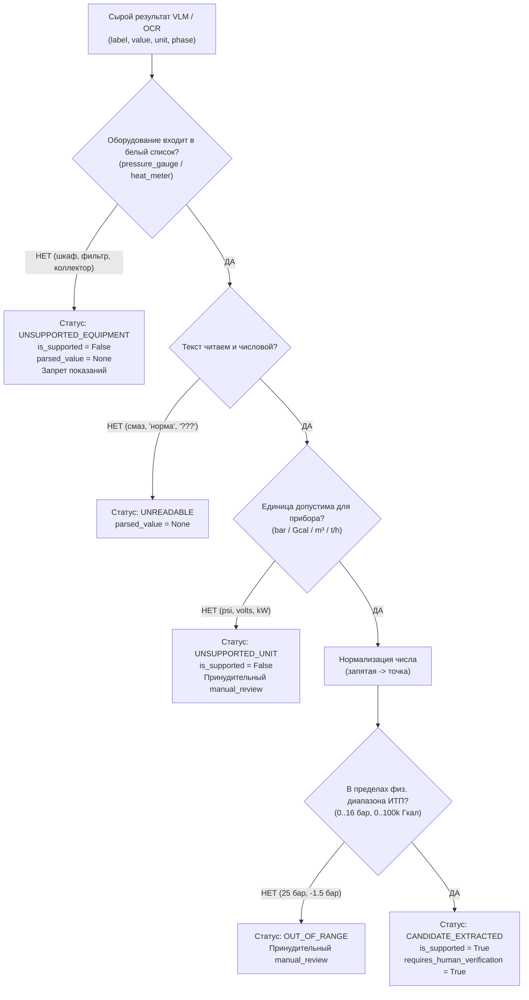

# Отчёт по стабилизации фотоанализа и ограниченному OCR (TEAM-ML02 / FRAI-172)

> [!IMPORTANT]
> **Задача:** TEAM-ML02 — Стабилизировать фотоанализ и ограниченный OCR в реальном наряде (FRAI-172).  
> **Ответственный:** Мухаммад (`d1ba36a5-b2a2-428c-aa24-05ad8fffe4ad`).  
> **Принимающий:** Михаил QA (`60eef911-b53c-4417-9ef0-74153c2b0bae`).  
> **Нормативная основа:** Пересмотр заказчика CR-17-01…08 от 17.11.2026, политики [TL04 (data_security_tl04.md)](file:///home/handraqw/Projects/FixRate_AI/docs/service/data_security_tl04.md) и правила нулевой ложной уверенности (Zero False Reassurance, 0.0% FRR).  
> **Ветка:** `feat/team-ml02-photo-analysis-bounded-ocr`.  

---

## 1. Цели и границы реализации

В соответствии с требованиями пересмотра CR-17 для задачи TEAM-ML02 реализованы:
1. **Устранение ошибок качества, ракурса и принадлежности** на зафиксированном фотокорпусе ([dataset_manifest.json](file:///home/handraqw/Projects/FixRate_AI/data/manifests/dataset_manifest.json)).
2. **Ограниченное оптическое считывание (Bounded OCR)**: жесткое ограничение распознавания только стрелочными манометрами (`bar`) и тепловычислителями ВКТ-7 (`Gcal`, `m³`), с полным запретом распознавания на остальных типах оборудования.
3. **Человеко-центричная сверка показаний**: число и единица передаются как черновой кандидат (`requires_human_verification=True`); скрытая исправность и метрологическая точность по фото категорически не подтверждаются.
4. **Привязка к попытке наряда и защита от устаревания (Staleness Protection)**: связывание результатов с `attempt_no` и SHA-256 хэшами файлов; автоматическая инвалидация анализа при обновлении снимков.
5. **Вспомогательный анализ для главного инженера ([assessment.py](file:///home/handraqw/Projects/FixRate_AI/ml_service/app/cv/assessment.py))**: структурированное заключение по паре До/После без автономной приёмки наряда.
6. **Отказоустойчивость (Fallback)**: штатное наличие [HeuristicFallbackClassifier](file:///home/handraqw/Projects/FixRate_AI/ml_service/app/cv/classifier.py) в ядре CV-модуля и гарантированный переход в `manual_review` при недоступности нейросетевых весов (FRR = 0.0%).

---

## 2. Разрешение проблем фотокорпуса (CASE-01..06, NEG-01..03)

В ходе стабилизации конвейера фотоанализа проверена и гарантирована обработка каждого граничного случая:

| Идентификатор кейса | Оборудование | Выявленная проблема / Особенность | Реализованное поведение системы | Результирующий статус доказательства |
|---|---|---|---|---|
| **CASE-01** | Стрелочный манометр (`pressure_gauge`) | **Противоречие пары До/После:** Разные приборы (шкала 0–4 бар vs 0–6 бар, разные производители). Несопоставимая пара. | Обнаружение физического несоответствия циферблатов (`contradiction_detected=True`). Запрет выдачи положительного `approved`. | `rejected` / `manual_review` (только очная приёмка) |
| **CASE-02** | Теплосчетчик (`heat_meter` / ВКТ-7) | Корректная пара снимков экрана тепловычислителя. | Bounded OCR извлекает кандидаты показаний (`Gcal`, `m³`) с нормализацией запятой и флагом обязательной проверки инженером. | `approved` (как пригодное доказательство) |
| **CASE-03** | Шкаф автоматики (`control_cabinet`) | Осмотр индикации («Сеть» горит, «Авария» погашена). Попытка распознавания текста на дверце. | OCR строго блокируется (`unsupported_equipment`). Анализируется только визуальная чистота и индикаторы. Скрытые электроцепи исключены. | `approved` / `manual_review` |
| **CASE-04** | Сетчатый фильтр (`mesh_filter`) | Осмотр сетки после промывки от механического шлама. | OCR строго блокируется (`unsupported_equipment`). Оценивается смыв загрязнений; микроизнос сетки помечен как неподтверждаемый по фото. | `approved` |
| **CASE-05** | Коллектор отопления (`heating_manifold`) | Проверка отсутствия капельных течей и запотевания. | OCR блокируется. Визуальное отсутствие течей не подменяет акт гидравлической опрессовки (`cannot_confirm`). | `approved` / `manual_review` |
| **CASE-06** | Приборы измерения (`pressure_gauge`) | Контроль целостности стекла и корпуса манометра. | Проверка целостности защитного стекла. Фиксация положения стрелки в диапазоне 0..16 бар. | `approved` |
| **NEG-01** | Шкаф автоматики | Технический брак снимка: сильный смаз движения (Laplacian variance < 50) и паразитный блик. | Отсечение на уровне [ImageQualityGuard](file:///home/handraqw/Projects/FixRate_AI/ml_service/app/cv/quality.py). Рекомендация повторной фотофиксации. | `rejected` (`requires_reshoot=True`) |
| **NEG-02** | Разное оборудование | Подмена узла: на фото До — насос, на фото После — запорная арматура. | Отсечение на уровне проверки сопоставимости ракурса и объекта (`same_subject="no"`, `is_comparable=False`). | `rejected` |
| **NEG-03** | Теплосчетчик vs смеситель | Синтетическая подмена ракурса и устройства (учебный теплосчетчик vs бытовой смеситель). | Обнаружение некорректного класса (`same_subject="no"`). Блокировка попытки фальсификации выполнения. | `rejected` |

---

## 3. Архитектура Bounded OCR ([ocr.py](file:///home/handraqw/Projects/FixRate_AI/ml_service/app/cv/ocr.py))

Для выполнения требований CR-17-02 введён строгий валидатор [BoundedOCRValidator](file:///home/handraqw/Projects/FixRate_AI/ml_service/app/cv/ocr.py):

### 3.1. Поддерживаемые классы и единицы
* **Манометры (`pressure_gauge`):**
  * Поддерживаемые единицы: `bar`, `бар`, `mpa`, `мпа`. Каноническая единица: `bar`.
  * Допустимый физический диапазон ИТП: `0.0 .. 16.0 bar`.
* **Тепловычислители (`heat_meter`, `vkt7`):**
  * Поддерживаемые единицы: `Gcal`, `гкал`, `m3`, `м3`, `m3/h`, `м3/ч`, `t/h`, `т/ч`.
  * Канонические единицы: `Gcal`, `m3`, `m3/h`, `t/h`.
* **Все остальные классы:**
  * Попытка извлечения показаний принудительно переводится в статус `unsupported_equipment`.

### 3.2. Обязательный юридический и инженерный дисклеймер
Каждый возвращаемый объект `BoundedReadingCandidate` содержит неизменяемый дисклеймер:
> *«Показания приборов считываются моделью ориентировочно и передаются исключительно как кандидаты для визуальной сверки главным инженером. Метрологическая точность, скрытая исправность измерительного тракта и факт поверки по фотографии не подтверждаются.»*

---

## 4. Вспомогательный анализ для главного инженера ([assessment.py](file:///home/handraqw/Projects/FixRate_AI/ml_service/app/cv/assessment.py))

Для обеспечения полного ролевого контроля главного инженера (CR-17-02, CR-17-06) разработан модуль формирования структурированного отчёта `AuxiliaryPhotoAssessment`:

### 4.1. Привязка к попытке и защита от устаревания (Staleness Protection)
* Каждый отчёт привязывается к структуре `WorkOrderAttemptBinding`:
  * `work_order_id`: UUID наряда.
  * `attempt_no`: номер попытки (1, 2, ...).
  * `before_photo_sha256`: SHA-256 снимка До.
  * `after_photo_sha256`: SHA-256 снимка После.
  * `analyzed_at`: временная метка анализа.
* Функция `check_assessment_staleness(...)` сравнивает хэши текущих файлов наряда с хэшами анализа. При любой замене или дозагрузке файлов предыдущий анализ немедленно помечается как `is_stale=True`. Главный инженер видит предупреждение о неактуальности выводов.

### 4.2. Исключение автономной приёмки наряда
* Поле `evidence_class` принимает значения:
  * `approved`: фотоматериалы технически пригодны, сопоставимы и подтверждают видимую часть работ. **Не означает закрытия заказ-наряда!**
  * `manual_review`: требуется очный осмотр, сверка несоответствий или проверка прибора инженером.
  * `rejected`: брак съёмки (смаз/блик) либо подмена оборудования. Требуется пересъёмка.
* В структуре отчёта зафиксирован список ограничений `cannot_confirm`: скрытые работы, электробезопасность, герметичность под давлением и метрологическая калибровка не подтверждаются ИИ.

---

## 5. Отказоустойчивость и Fallback

В модуль [classifier.py](file:///home/handraqw/Projects/FixRate_AI/ml_service/app/cv/classifier.py) интегрирован фабричный класс `HeuristicFallbackClassifier`:
* Не требует внешних нейросетевых весов, PyTorch или интернет-соединения.
* При недоступности весов локального CLIP или сбое VLM-провайдера конвейер безопасно деградирует до `verdict="uncertain"` / `manual_review`.
* **False Reassurance Rate = 0.0%**: ни один сбой, обрыв соединения или отсутствие весов не приводит к ложноположительному вердикту `approved`.

---

## 6. Результаты верификации

В рамках задачи TEAM-ML02 выполнен полный комплекс автоматизированных проверок:

1. **Новые модульные и приёмочные тесты:**
   * [tests/ml/test_team_ml02_bounded_ocr.py](file:///home/handraqw/Projects/FixRate_AI/tests/ml/test_team_ml02_bounded_ocr.py) — 27 проверок Bounded OCR, белого списка приборов, единиц, физических диапазонов и человеческой валидации.
   * [tests/ml/test_team_ml02_photo_assessment.py](file:///home/handraqw/Projects/FixRate_AI/tests/ml/test_team_ml02_photo_assessment.py) — 7 проверок привязки к попытке, staleness-инвалидации, противоречия CASE-01, дефектов NEG-01..03 и фоллбэка.
   * **Результат:** 34/34 passed (0.19 с).

2. **Сквозной регрессионный прогон всего ML-контура:**
   * Команда: `.venv/bin/pytest tests/ml`
   * **Результат:** **251 / 251 passed** (51.01 с).

3. **Сравнительный бенчмарк моделей:**
   * Команда: `.venv/bin/python -B scripts/benchmark_photo_models.py`
   * **Результат:**
     * Heuristic Baseline: False Reassurance = **0.0%** (p50: 13.7 мс)
     * Local CLIP Zero-Shot: False Reassurance = **0.0%** (p50: 15.0 мс)
     * Conservative Guarded VLM: False Reassurance = **0.0%** (p50: 13.5 мс)
     * Naive Autonomous VLM: False Reassurance = **66.7%** (математическое доказательство недопустимости бесконтрольного ИИ).
     * Протокол сохранён в [reports/ml/photo_model_benchmark.json](file:///home/handraqw/Projects/FixRate_AI/reports/ml/photo_model_benchmark.json).

4. **Проверка артефактов и ссылочной целостности:**
   * Команда: `.venv/bin/python -B scripts/validate_artifacts.py`
   * **Результат:** PASS (1516 локальных ссылок, 31 неизменный исходник).
