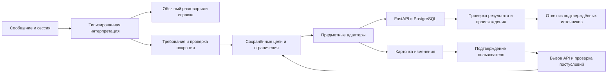

# Оркестратор FixRate AI v2

22 ноября 2026. Рабочий срез `kran_dev` на базе `010c3fd`. Исходный аудит фиксирует расположение кода, роль провайдеров и происхождение прежних результатов. [Аудит](assistant-orchestrator-audit-2026-11-22.md) · [Миграция и проверка](../ai/assistant-migration-v2.md)

## Сценарий

Главный инженер открывает чат, задаёт вопрос о конкретной единице и получает сведения о состоянии, открытых работах, просрочках, последнем обслуживании и регламентах. Каждая часть имеет собственный источник или сообщение о причине остановки. Инженер может сверить запись по ID отчёта, задания или привязки регламента. Изменение начинается с отдельной карточки, на которой пользователь проверяет параметры перед подтверждением.

Сценарий относится к MVP‑11, AT‑08…AT‑12, и использует предметные контракты MVP‑02 и MVP‑07. Согласование нормативов продолжает зависеть от D‑02/D‑03, эксплуатационная приёмка модели — от D‑09. [Матрица завершения](fixrate-finalization-matrix.md)

## Путь запроса

До среза классификатор разговора, `RequestedResults` и общий `ToolSelection` могли по-разному разложить составное сообщение. Результаты вне типизированного словаря переключали весь запрос на общий план. Точный анализ заданий оборудования зависел от того, сможет ли модель найти и связать записи через промежуточные выборки. Модель могла заменить длинный ответ после успешного чтения.

- `semantic_plan.py` расширяет контракт `RequestedResults` дословными опорными фрагментами, ограничениями и требованиями формы ответа. Для составного запроса `request_coverage.py` запрашивает одну проверку пропусков. Исправление опирается на буквальный фрагмент сообщения. Оно может добавить чтение или вынести запрос на уточнение. Записи продолжают проходить через исходный контроль полномочий и подтверждение. Отдельные редакции ответа для одной записи объединяются по области и периоду.
- `compile_plan` связывает требования с существующим каталогом. `request_spec` хранит связь между требованием и целью, состояние проверки, отрицательные условия и ограничения вывода. Запланированный пункт, результат без инструмента, недостаток данных, запрет, недоступная функция и выполненная цель отражаются в этой записи. Неисполненный пункт с буквальным фрагментом остаётся видимым.
- `semantic_execution.py` получает точный ID оборудования через разрешённый поиск или путь с явно указанным UUID. В пределах одного запуска повторно используется один проверенный результат поиска. Задания, история, регламент и календарь запрашиваются у своих предметных API. Обычный диалог проходит в режиме ответа без создания поручения.
- `outcome_contracts.py`, `objective_scope.py` и `workflow.record_result` проверяют форму, выбранный объект, даты, состав выборки и происхождение. Сервер выводит значения из результатов инструментов. Свободное объяснение общего инженерного понятия получает только соответствующую фразу пользователя. Пояснение сохранённой просрочки формируется после чтения карточки. Причина просрочки требует отдельного факта. Рекомендации опираются на категории подтверждённых результатов и ссылаются на использованные источники.
- Ollama и AITunnel передают один типизированный контракт. Общий `ToolSelection` обслуживает операции вне словаря, изображения и совместимых устаревших поставщиков. Сохранённые планы исполняются по своим устойчивым идентификаторам.

## Проверяемые источники

В `request_spec` версии 2 отдельно хранятся связь с планом, результат чтения и доставка. Для рейтинга явные запросы карточки, регламента, истории и календаря восстанавливаются из реплики до запуска зависимых чтений. При сопоставлении открытых работ и регламента с одним явным кодом оборудования план также сохраняет оба чтения. Идентификатор для карточки берётся из буквального операнда или подтверждённого поиска. Если источнику соответствуют несколько записей, в ответе остаются их коды и ID для выбора. Статус «выполнено» присваивается после проверки сформированного ответа. [Срез и проверки](../releases/2026-11-23-orchestrator-v2-hardening.md)

| Вопрос | Источник и проверка |
| --- | --- |
| Какое оборудование выбрано | `equipment_find` связывает исходную ссылку с одним результатом в области доступа. Для актуального состояния используется `equipment_read`. |
| Какие работы относятся к оборудованию | `tasks_find` принимает `equipment_id` и проверяет M:N-связь в пределах объекта. Для исполнителя дополнительно учитываются активные назначения. В выборку незавершённых входят работы в процессе и на проверке. Просрочка сверяется с нормативным моментом и серверным временем. |
| Когда выполнено последнее ТО | `equipment_service_history` с `latest_only` ранжирует принятые попытки по подтверждённой фактической дате. Кандидат, число отчётов и признаки неизвестной или противоречивой даты берутся из одного снимка запроса. Диапазон «последние 12 месяцев» вычисляется от локальной даты объекта. |
| Каков действующий регламент | `regulations_read` проверяется по опубликованному состоянию и датам действия. В ответ входят ID привязки и версия. Первичный документ производителя требует отдельного источника. |
| Когда наступает обязанность | `calendar_evidence` использует `occurrence_pairs` и правила переносов. Ответ показывает период расчёта, исходную и эффективную даты. При отсутствии заданного периода используется 366 дней вперёд от локальной даты. Расчёт по фактической приёмке возвращает ограничение, если источник календаря не содержит входов для такого расчёта. |
| Где находится документ или ячейка | `attachment_read` работает с личным вложением и сохраняет точный лист, строку и столбец. `source_contracts.py` описывает подключение утверждённых документов и подготовку правок по неизменяемой ревизии файла. |

## Запись доказательства

Сохраняемая запись содержит ID, инструмент, цель, время чтения, область user/site/role, идентификатор сущности, период, фактическую проекцию, SHA‑256 и ограничения полноты. Внешние ошибки хранятся без тела ответа. Аппаратные и денежные единицы выводятся только там, где их возвращает предметный контракт.

| Статус | Значение |
| --- | --- |
| `FOUND` | Получен прошедший проверки результат для заданной области. |
| `EMPTY` | Авторизованное полное чтение подтвердило пустую выборку. |
| `PARTIAL` | Подтверждена часть данных. Границы могут зависеть от страниц, диапазона, неизвестных дат или лимита доставки. |
| `MISSING_INPUT` | Недостаточный или неподходящий аргумент. |
| `FORBIDDEN` | Отказ текущей сессии или роли. Данные источника скрыты. |
| `UNAVAILABLE` | Источник недоступен или выбранная запись не получена через доступный интерфейс. |
| `ERROR` | Ошибка вызова, некорректная форма результата или противоречие контракту. |
| `STALE` | Результат незавершённой цели требует свежего чтения при продолжении. |

Без общего токена снимка даже успешно прочитанные страницы остаются частичным доказательством. При возврате пустой страницы, несогласованном количестве, несовпадающем ID или периоде агент сообщает ограничение. Совпадение заголовка задания с названием оборудования не доказывает связь.

## Изменения и продолжение

`service.propose` связывает точную команду с владельцем, объектом, ролью, сроком, хэшем и исходной ревизией. `confirm` заново авторизует запрос, сверяет исходное состояние, фиксирует подтверждение и однократно отправляет команду. `action_outcomes` различает квитанцию, проверенное постусловие, ошибку и неопределённый исход. Составная правка названия и места одной единицы использует один PATCH. Универсальной транзакции для произвольной цепочки разных бизнес-команд нет.

`assistant_turns.worker_claimed_at` регистрирует однократный захват фонового запуска. Истечение `deadline_at` переводит прерванный запуск в диагностический статус. Продолжение создаётся с новой авторизованной сессией и использует тот же корень поручения. Завершённые записи и неопределённые исходы сохраняются. Чтения незавершённых этапов перепроверяются. Для самостоятельного восстановления без нового запроса пользователя требуется механизм обновляемой служебной авторизации и отдельный запуск обработчика.

## Точки расширения

`DocumentRetriever` получает фактический контекст доступа, запрос с датой действия и возвращает фрагменты с типом, статусом, ревизией, локатором и хэшем источника. Применимость регламента и паспорт производителя можно проверить независимо. CR‑17 хранит импорт и журнал ревизий. Потребитель семантического индекса в этом срезе отсутствует.

`WorkbookEditor.preview` принимает личный файл, его ожидаемый хэш и точные изменения ячеек. Интеграция исполнения требует существующей подтверждаемой операции адаптера и проверки доступа к результирующему файлу. Чтение XLSX, фотоанализ, прогноз, каталог обслуживания и MCP используют текущую авторизацию и транспорт. У выделенных инструментов остаются свои источники и правила области.
