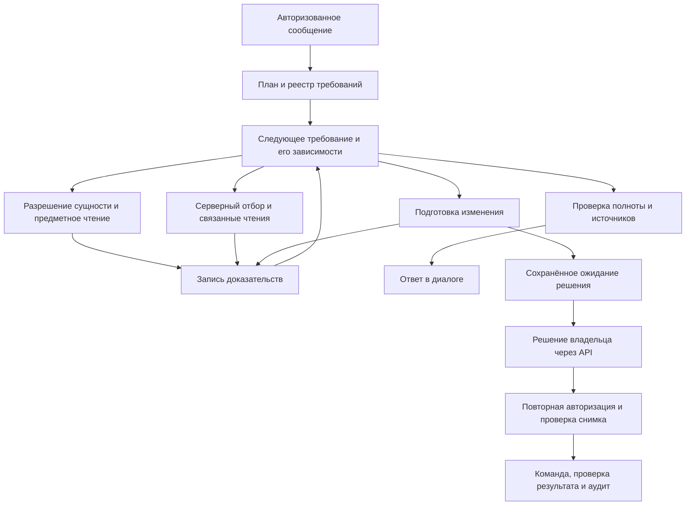

# FixRate AI Agent v3

LangGraph 1.2.24 управляет исполнением поручений через существующий API FastAPI. Версия выбирается для нового сообщения и сохраняется в `assistant_turns.execution_engine`. В режиме v3 ошибка графа завершает попытку с её собственным статусом.

## Аудит исходного контура

Исходный срез `f519c3bae8d98992bcf6164bcd29577b3c967a88` содержал один большой цикл с несколькими ветвями планирования и исполнения внутри `orchestrator.run`. Ветка диалога, семантический план с проверкой покрытия, старый `ToolSelection`, пакеты исполнения заданий и зависимая аналитика использовали разные способы продвижения работы. Сохранённое поручение можно было продолжить через `workflow.resume`. Граница следующего шага определялась новым запуском цикла и текущим состоянием целей.

На исходном срезе уже работали точные чтения оборудования, авторизованный транспорт, детерминированные агрегаты PostgreSQL, проверки полноты и ревизий, предохранитель повторной отправки изменения и проверка результата записи. В запросах о нескольких единицах оборудования свободный план не гарантировал парные выборки по каждому UUID и переиспользование сравнения в следующей реплике. Итоговая сборка рейтинга ограничивала рекомендации тремя позициями. При чтении несколькими запросами отсутствие общего токена снимка ограничивало подтверждение полноты.

## Компоненты

| Компонент | Реализация |
| --- | --- |
| Состояние и маршрутизация | `graph_agent.AgentState`, `StateGraph`, `Command`, узлы плана, чтения, отбора, проекции, подготовки, проверки и ответа |
| Реестр требований | `graph_requirements.Requirement` и `PlanStage` проецируют ID, зависимости, статус выполнения и ссылки на доказательства. Исходные формулировки, ограничения и параметры отбора хранятся в закрытом `workflow` |
| Планирование | `TurnExecution.plan`, схемы `RequestedResults`, `AnalyticalRequestedResults` и `ToolSelection`. Короткие точные запросы используют `graph_context`, выбор инструментов для общего плана ограничен релевантной частью реестра |
| Предметные инструменты | `tools`, `read_transport`, `dependent_execution`, `task_execution`, серверные маршруты аналитики и нарядов. Передача UUID следует проверенным связям ресурсов |
| Доказательства | `workflow.record_result`, `record_read_failure`, `evidence` и `objective_scope`. Данные остаются в рабочей области диалога, checkpoint хранит их ID |
| Проверка и ответ | `graph_requirements.verify_evidence`, предметные валидаторы и проверка фактической доставки требований в `request_coverage`. Формирование ответа используют `semantic_execution`, `dependent_report` и `fact_presenter` |
| Подтверждения | `graph_actions` хранит отдельное ожидание на каждую карточку изменений. `interrupt()` принимает решение только через `Command(resume=...)` от серверного обработчика |

Для точного поиска карточки, сравнения двух буквальных кодов и проверенного продолжения сравнения модель не вызывается. Незавершённые и просроченные работы сравниваются по отдельным авторизованным счётчикам. При равенстве просрочек выбор продолжения определяется меньшим UUID. История в таком продолжении читается за 12 месяцев по часовой зоне объекта. Для исполнителя короткие запросы о сегодняшних и просроченных заданиях используют разрешённый список собственных назначений.

## Хранение, авторизация и восстановление

Таблицы `assistant_turns` и `assistant_actions` остаются источником состояния для UI. Миграция 028 создаёт привязку графа к владельцу диалога. Команда миграции запускает официальный `PostgresSaver.setup()` в схеме `assistant_checkpoints`. Четыре служебные таблицы используют отдельный журнал версий. Три таблицы с данными графа связаны с диалогом каскадными внешними ключами. API хранит пул PostgreSQL на время работы приложения.

Ключ графа включает версию схемы, пользователя, объект, роль, диалог и ID поручения либо действия. Контекст выполнения несёт свежую сессию, клиент модели, подключение к доменным операциям и текущий бюджет. Он передаётся через `context_schema`. Cookies, подтверждающие секреты, исходные файлы и переписка хранятся вне checkpoint. Внешняя трассировка графа выключена. Трасса запроса содержит имена узлов и инструментов, время и статусы. Подробности действия фиксируются существующим аудитом.

Продолжение через «Продолжить» создаёт новую авторизованную попытку. Если сохранённый checkpoint и рабочая область согласованы, граф продолжает ожидающий этап. При изменении плана или необходимости перепроверить источники он восстанавливает план по закрытой рабочей области и повторяет доступные незавершённые чтения. Запись со статусом `executing` или `uncertain` требует сверки результата API. Подготовленные изменения повторно сверяются с ролью, областью, хэшем, сроком действия и исходным состоянием сущности. Повторное подтверждение возвращает сохранённый исход.

| Роль | Поддерживаемая область |
| --- | --- |
| Руководитель | Доступные отчёты и агрегаты текущего объекта, операции в собственной области |
| Главный инженер | Карточки, задания, регламенты, история принятого ТО, планирование, нагрузка и разрешённые изменения |
| Инженер | Допущенные операции планирования, назначения, проверки и приёмки |
| Исполнитель | Собственные назначения, разрешённое оборудование, чек-листы, материалы отчёта и сдача работы по действующим правилам |

Источником разрешений служат маршруты FixRate AI. Каталог ограничивает то, что модель может предложить. Окончательная проверка происходит в бизнес-операциях, в том числе по назначению и состоянию попытки выполнения.

## Границы

Надёжность произвольной формулировки зависит от точности плана модели и доступности источников. Для исторических дат API отмечает границы реконструкции. При отсутствии атомарного снимка многостраничный реестр может быть доступен только частично. Широкий поиск по документам CR‑17, самостоятельный запуск фонового восстановления с обновляемой авторизацией и универсальные транзакции из нескольких разнородных действий остаются отдельными задачами. Если процесс потерян до сохранения плана, пользователь может повторно отправить исходную реплику.

Документация API использованной библиотеки. [Graph API](https://docs.langchain.com/oss/python/langgraph/graph-api) · [Persistence](https://docs.langchain.com/oss/python/langgraph/persistence) · [Interrupts](https://docs.langchain.com/oss/python/langgraph/interrupts).
