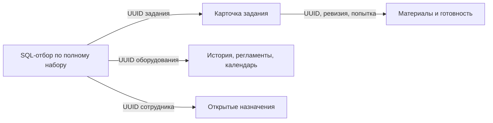

# Зависимые аналитические операции ассистента

## Дефект

В ручном запросе главного инженера нужно было выбрать две единицы оборудования по числу незавершённых просроченных работ, проверить каждую и обосновать приоритет. В исходной трассе `tasks_find` вернул все 24 совпадения. В строках был `equipmentId`, но только у выбранной проекции наряда, без полного списка связей M:N.

Семантическая схема описывала результаты как независимые намерения. `compile_plan` смог скомпилировать список заданий, однако цели карточки, фактического ТО, регламента и календаря оставил без `depends_on`. Он же заблокировал их из-за отсутствия буквального `subject` в сообщении. `semantic_execution._equipment` принимала один такой subject и не могла получить множество идентификаторов из предыдущего результата. Следующие инструменты не вызывались. Пагинация и выбор реализации GET не вызвали этот дефект.

## Контракт исполнения

1. `AnalyticalRequestedResults` задаёт группировку, метрику, число результатов, календарные диапазоны и нужные проекции. Это контракт интерпретации. Указанные пользователем даты и параметры проверяются. Для стандартных запросов используются прежняя схема и подсказка.
2. `compile_analysis` создаёт источник `work_order_analytics` и зависимые цели с `SelectedInput`. Ребро указывает тип чтения и ID цели-источника. UUID конкретных записей на этапе планирования ещё неизвестны.
3. `work_order_analytics.aggregate` читает единый PostgreSQL-снимок в области текущего объекта и роли. Он группирует наряды по связям оборудования, по назначениям либо по двум датированным окнам. Признак просрочки учитывает действующее состояние наряда, нормативный дедлайн и часовой пояс объекта. Счётчики и порядок не зависят от лимита API списка задач. Работы со сроком в будущем, завершённые и отменённые работы не считаются просроченными. Одна работа может учитываться для нескольких единиц оборудования, если такие связи есть в БД.
4. `DataflowRunner` проверяет контракт `AggregateResult`, запрос, область, порядок, уникальность и кардинальность. Затем разворачивает каждую зависимую цель по полученным UUID. Например, история запрашивается с `only_accepted` и `latest_only`, календарь с `approved_only` и `next_only`. В доказательстве сохраняются точная область, аргументы, расчётный период, результат и связь с источником. Чтения идут через обычный GET с проверкой текущего доступа и принятым для API поведением ошибок. Повтор незавершённой аналитики перепроверяет её источник.
5. `dependent_report.render` выводит сведения и инженерные выводы из проверенных ответов. Ничья по числу и возрасту просрочек остаётся ничьей. Стабильный порядок при ничьей использует инвентарный код и UUID, но сам по себе не обосновывает более высокую срочность. При пустой истории, пустом наборе регламентов, отказе доступа и ошибке backend применяются разные формулировки. Ссылки на регламенты и календарные привязки берутся из реально полученных записей. Покрытие рассчитывается по каждой запрошенной проекции и её привязкам; рекомендации и сравнение имеют отдельную проверку выдачи.

## Пределы

- Метрики рейтинга — число незавершённых либо просроченных работ. «Загрузка» исполнителя в этом режиме обозначает число его открытых назначений. Сравнение календарных периодов считает сохранённые работы по дате планового начала. Эти метрики измеряют реестр нарядов.
- Один запрос к источнику ранжирует всю разрешённую выборку и возвращает до 100 групп. Рейтинги оборудования и исполнителей по просроченным и незавершённым работам поддерживают `offset`. Для каждой группы возвращается до 100 строк деталей. При превышении этого числа точный счётчик сохраняется, выдача деталей помечается как частичная. Применяются бюджеты чтений и хранения доказательств.
- По умолчанию история охватывает 12 предыдущих календарных месяцев, а ближайший календарный срок ищется в следующих 12 месяцах среди опубликованных конфигураций, действующих на дату среза. Точное начало и конец периода видны в доказательстве. Если расчёт от фактического завершения недоступен в календарном источнике, сохраняется его ограничение.
- При историческом срезе нормативные сроки сопоставляются с местной календарной датой. Состояния заданий остаются состояниями доступного реестра на момент чтения. Фактическое ТО сверяется с датой из принятой попытки отчёта.

Роли действуют как для существующих чтений. Для исполнителя оборудование ограничено его доступными назначениями, а сводка по сотрудникам и календарным периодам требует соответствующего серверного доступа. Все шаги аналитики используют GET. Действующие карточки подтверждений, изменения и аудит сохраняют свои маршруты. Миграция не требуется.

## Зависимости между чтениями

После первого исправления `SelectedInput` мог потреблять только снимок `AggregateResult`. Новый запрос о наряде остался в прежнем семантическом маршруте, поскольку источник поддерживал рейтинги оборудования и работников и сравнение периодов. В повторе с явной просьбой сначала показать список имелись все 24 UUID и даты. `tasks_find` для просрочки сортировал от позднего нормативного срока к раннему. Цель карточки не имела ребра и до вызова API была заблокирована из-за отсутствия буквального UUID. Простая передача первой строки дала бы другой наряд.

Типизированное ребро теперь принимает проверенный набор ссылок из источника отбора либо из результата другого чтения. Ссылка `ResourceRef` хранит тип сущности, UUID, а для карточки наряда ещё ревизию и активную попытку. `resource_inputs` проверяет область, полноту доказательства, тип ссылки и принадлежность к цели-источнику. У конкретного вызова сохраняется ID того доказательства, из которого взяты аргументы. Неуспешная ветвь сохраняет статус и не останавливает успешные ветви.

- `work_order_analytics.aggregate` выполняет предикаты, группировки и порядок в PostgreSQL. Для задания ключ сортировки состоит из нормативного дня, точного дедлайна и UUID. Ничья по сроку сообщается пользователю. UUID задаёт стабильный порядок чтения. Решения о приёмке проходят штатное подтверждение.
- `task_acceptance_evidence.inspect` перепроверяет UUID, ревизию и попытку. Он показывает чек-лист из попытки либо сохранённого снимка задания, наличие файлов фото, сохранённый анализ, обязательные материалы и препятствия. Визуальная оценка берётся из сохранённого анализа, если доступна. Проверка не запускает анализ изображений и не сохраняет результат приёмки.
- Рейтинг сотрудников считает уникальные открытые наряды. Детализация содержит записи назначений, поэтому несколько назначений одного наряда учитываются отдельно в перечне. Для каждой группы возвращается до 100 записей с указанием точного общего числа.
- Поиск оборудования без подтверждённого ТО требует календарный диапазон. Принятая попытка с проверяемой фактической датой считается выполненной в этом диапазоне. Спорные и неизвестные фактические даты показаны отдельным ограничением. Перечень помечается как частичный, если подходящих записей больше запрошенного предела.
