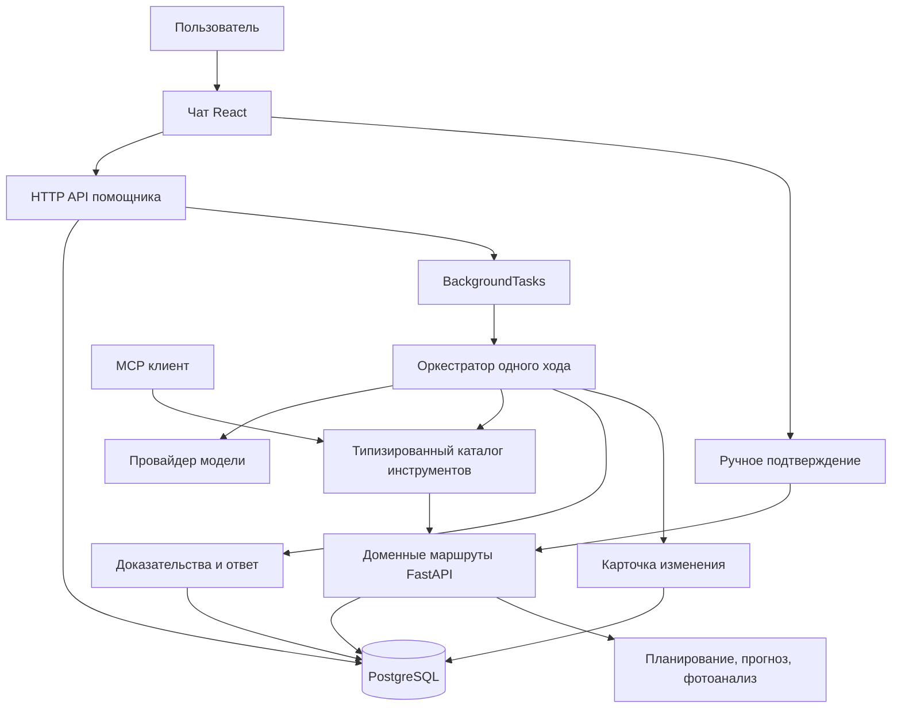
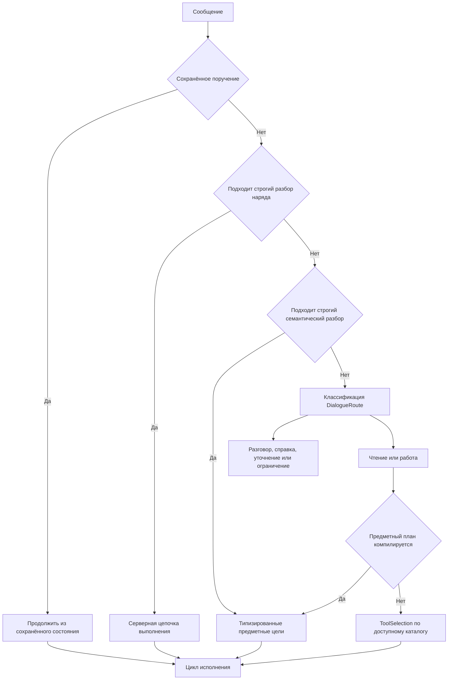
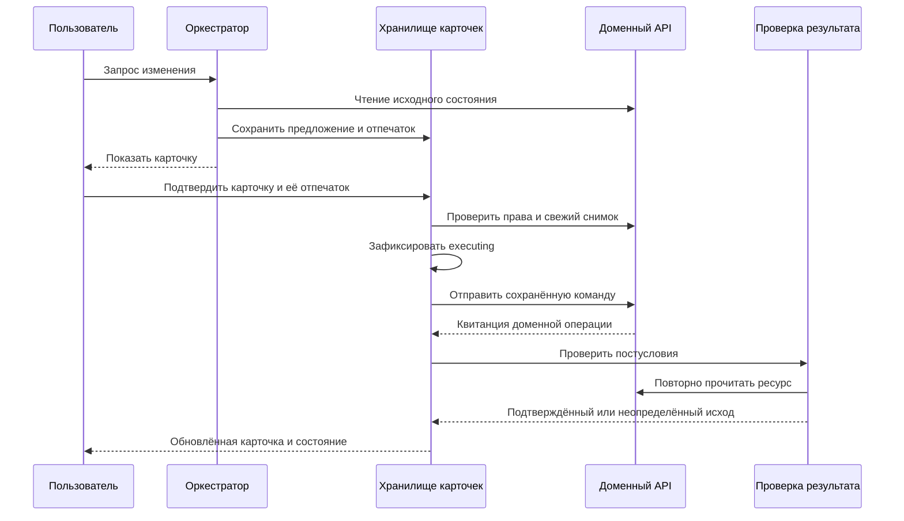

# Как устроена агентная система FixRate AI

Технический разбор на 22 ноября 2026 года. Срез — рабочее дерево `kran_dev`, базовый коммит `010c3fd307a60587e522716503ab818dde3d08e9`. В дереве есть изменения поверх коммита, в том числе новые модули маршрутизации и выполнения наряда. Ссылка на этот SHA сама по себе их не воспроизводит. Поведение ниже сверено с исходниками рабочего дерева. Числа испытаний относятся к сохранённым прогонам с указанными условиями.

Разбор фиксирует исходное состояние для последующей доработки. Актуальный маршрут, контракты и продолжение поручений описаны в [архитектуре v2](assistant-architecture-v2.md). Результаты полного повтора приведены в [релизном срезе](../releases/2026-11-22-assistant-architecture-v2.md#проверки-среза).

[Путь сообщения](#4-от-сообщения-до-фонового-запуска) · [Выбор маршрута](#6-как-реально-выбирается-маршрут) · [Подтверждение записи](#11-подготовка-подтверждение-и-выполнение-записи) · [Решения в коде](#22-что-захардкожено-и-что-меняет-модель) · [Результаты испытаний](#23-как-читать-результаты-испытаний) · [Ограничения](#24-главные-ограничения-которые-следуют-из-схемы)

## 1. Что в системе действительно агентное

FixRate AI — один оркестратор внутри FastAPI. Он может принять намерение пользователя, построить последовательность предметных целей, выбрать инструменты, накопить результаты и сохранить прогресс. LLM получает текст и ограниченный контекст. Она предлагает классификацию, план, аргументы вызова или ответ. Сервер распределяет доступ, решает, допустим ли инструмент, читает данные и хранит запись о том, что в действительности произошло.

Три вещи здесь сделаны отдельно от модели.

1. **Авторитетные данные и изменения.** PostgreSQL и доменные API хранят роли, наряды и отчёты. В чате модель описывает нужное действие. Код строит карточку, пользователь подтверждает, доменный API применяет команду, проверка постусловия сравнивает результат с фактическим состоянием.
2. **Готовые процессы.** Цепочка выполнения наряда из пяти этапов, последовательность выпуска плана, чтение наборов страниц и многие типы доказательств заданы кодом. Модель не изобретает эти протоколы на лету.
3. **Умение сформулировать ответ.** Обычная беседа и пояснения к собранным данным генерируются моделью. Для части предметных чтений сам ответ собирает сервер из полей. Поэтому два внешне одинаковых ответа в чате могут иметь разную природу и разную доказательную силу.

Термин «агент» в проекте обозначает ещё и значение `assistant`, `planner` или `photo` в схеме диалога и каталоге. Основной `orchestrator.run` запрашивает каталог **`assistant`**, даже если у сохранённого диалога есть другой старый ярлык. «Специалист» в цикле — фильтр на список инструментов одной цели. Отдельного автономного процесса, переписки агентов между собой и делегирования отдельному экземпляру LLM здесь нет. Прикладной планировщик, прогноз и фотоанализ при этом реально существуют как доменные подсистемы со своими входами, версиями и результатами. [Оркестратор](../../backend/app/assistant/orchestrator.py) · [Описание специалистов](../../backend/app/assistant/workflow.py) · [Контракт инструментов](../../contracts/assistant-tools.json)

## 2. Карта компонентов

| Слой | Где находится | Что ему доверено |
| --- | --- | --- |
| Браузер | `frontend/src/pages/AssistantPage.tsx`, `features/assistant`, `shared/api/assistant.ts` | Отправка, отображение сохранённых сообщений, подтверждение человеком, история и навигация |
| HTTP транспорта | `backend/app/integration/assistant.py`, `assistant_models.py` | Сессия, собственность диалога, очередь внутри процесса, жизненный цикл ходов, карточек и вложений, MCP |
| Выполнение хода | `orchestrator.py`, `workflow.py`, части `service.py` | Выбор ветки, сохранённый план, цикл вызовов, состояние и результат |
| Интерпретация | `dialogue_routing.py`, `semantic_plan.py`, `intents.py`, `explicit_draft.py`, `prompts/` | Тип запроса, предметная привязка, разбор буквальных полей и условия допустимости предложения |
| Инструменты | `tools.py`, `capabilities.py`, `read_transport.py` | Белый список операций FastAPI, валидация, вызов, ограничение и проекция результата |
| Предметные правила | `task_execution.py`, `production_workflow.py`, `semantic_execution.py`, `domain_adapters.py` | Жёстко заданные переходы и последовательности, источники истинных полей и выбор следующего шага |
| Доказательства | `workflow.py`, `outcome_contracts.py`, `objective_scope.py`, `action_outcomes.py` | Условия, при которых чтение или изменение считается проверенным |
| Доменные API | `backend/app/main.py`, `backend/app/integration/` | RBAC, версии, транзакции, назначения, отчёты, планирование, фото и ML |
| Модели | `ml_service/app/providers/`, `assistant/model_preferences.py`, `model_catalog.py` | Структурированная генерация и текст, выбор и фиксация версии, сетевые ограничения |
| Хранилища | PostgreSQL и приватное хранилище файлов | Долговременная история, состояние, карточки, оригиналы файлов, фактические предметные данные |

## 3. Термины, которые легко перепутать

| Сущность | Значение в реализации |
| --- | --- |
| Диалог | Контейнер сообщений, карточек и файлов с владельцем, зданием и ролью. URL чата идентифицирует контейнер, право загрузить его проверяет сервер |
| Ход, turn | Одно входное сообщение и один сохранённый ответ. Ход может закончиться, пока работа ждёт человека |
| Поручение, workflow | JSON со списком целей, зависимостями, состоянием, аргументами области и доказательствами. Для обычного ответа поле может быть `NULL` |
| Цель, goal | Один предметный результат. У цели есть конечный инструмент, ожидаемый тип доказательства и иногда зависимости |
| Предложение, action | Сохранённый экземпляр потенциального изменения с аргументами, сроком, отпечатком и отдельным статусом |
| Инструмент, tool | Записанный в реестре адаптер конкретного метода и пути FastAPI. Побочный эффект задаётся прикладным признаком `read` или `write` независимо от HTTP-метода |
| Квитанция | Ответ доменного запроса после подтверждения. Может быть получен без доказательства всех важных постусловий |
| Доказательство, proof | Сохранённый результат конкретного вызова с типом, временем, областью, отпечатком, флагом полноты и ограничениями |
| Trace | Краткий технический журнал этапов и вызовов. Это не список скрытых рассуждений и не полная запись всего сетевого обмена |
| Доменная ревизия | Версия задачи, оборудования или другого объекта, нужная для конкурентной записи. Отличается от версии эпизода диалога, шаблона плана и настройки модели |

Например, пользователь видит ответ «Начало работы ждёт подтверждения». При этом `turn.status=completed`, `workflow.outcome=awaiting_confirmation`, карточка `proposed`, а наряд остаётся `assigned`. Эти четыре значения относятся к четырём разным объектам. [Схема хода и карточки](../../database/migrations/019_assistant_workspace.sql) · [Схема поручения](../../database/migrations/023_assistant_workflows.sql) · [Агрегация статусов](../../backend/app/assistant/workflow.py)

## 4. От сообщения до фонового запуска

Вошедший пользователь открывает `/assistant`. Браузер создаёт или восстанавливает диалог и отправляет `POST /api/v1/assistant/conversations/{identity}/messages`. Оболочка содержит текст, UUID `idempotency_key`, упорядоченный массив `attachment_ids`, опциональную текущую ревизию настройки модели и, для продолжения, `resume_turn_id`.

Сервер блокирует строку диалога и проверяет `site_id`, `user_id`, `role`. Известного UUID недостаточно. С прежней ролью история не открывается после смены контекста, даже если пользователь тот же. Для существующего сообщения по тому же ключу возвращается исходный ход. Изменившийся текст, явно переданный набор или порядок файлов, идентификатор продолжения либо конфликт ревизии модели дают `409`. Для старого клиента отсутствие `attachment_ids` означает выбрать ещё не отправленные вложения. Явный пустой массив означает отсутствие файлов.

До постановки в выполнение проверяются принадлежность вложений, максимум четырёх изображений в сообщении, наличие другого активного хода этого диалога и доступность конфигурации модели. Один процесс принимает одновременно до двух ходов через `BoundedSemaphore(2)`. Если слот занят, ответ `429`, без постановки запроса в постоянную очередь. При создании сохраняются вход, версия промпта, снимок выбранной модели, абсолютный `deadline_at` и ссылочные строки вложений. Заголовок нового диалога может быть первыми 100 символами первого сообщения. Этот заголовок отличается от заголовков целей плана с ограничением 400 символов.

После commit FastAPI отдаёт `202` с `turn_id` и передаёт `run_turn` своему `BackgroundTasks`. Тот запускает `agent_turn` через `asyncio.run` и по завершении освобождает слот. Браузер периодически запрашивает сохранённый диалог. Ответ передаётся через опрос сохранённого хода. [Схема запроса](../../backend/app/schemas/assistant.py) · [Обработчик отправки](../../backend/app/integration/assistant.py) · [Запуск хода](../../backend/app/assistant/service.py)

### HTTP входы

В таблице пути указаны относительно `/api/v1/assistant`.

| Запрос | Результат |
| --- | --- |
| `GET /capabilities` | Сконфигурирована ли модель, её ссылка, версия промпта и доступный список возможностей для роли |
| `GET`, `POST /conversations` | Страница приватных диалогов или создание нового |
| `GET /conversations/{id}` | 25 ходов текущей страницы, карточки, связанный прогресс и вложения. Применяется `Cache-Control: private, no-store` |
| `DELETE /conversations/{id}` | Удаление записей и связанных файлов, конфликт при исполняющемся подтверждении |
| `POST /conversations/{id}/messages` | Новый ход либо повтор принятой отправки |
| `POST /conversations/{id}/turns/{turn_id}/stop` | Остановка конкретного открытого хода, отказ по его неподтверждённым карточкам |
| `POST /conversations/{id}/attachments` | Загрузка приватного файла |
| `GET /attachments/{id}` | Доступ к файлу под проверенной сессией |
| `GET /conversations/{id}/attachments/{id}/content` | Строки, структура, поиск либо ограниченное полное чтение XLSX |
| `GET /actions` | История карточек пользователя по объекту и роли |
| `POST /actions/{id}/confirm`, `/reject` | Ручное согласие или отказ |
| `GET /models`, `GET`, `POST /model-preference` | Доступные модели и сохранённый выбор пользователя |
| `POST /mcp` | JSON-RPC поверх Streamable HTTP с фильтром роли |

[Основной HTTP API](../../backend/app/integration/assistant.py) · [API моделей](../../backend/app/integration/assistant_models.py)

## 5. Что сохраняется и где

| Таблица | Содержимое и условия целостности |
| --- | --- |
| `assistant_conversations` | UUID, владелец, объект, роль, заголовок, ярлык агента, времена создания и обновления. Индекс начинается с объекта, владельца и роли |
| `assistant_turns` | Текст до 12 000 символов, ключ запроса, ответ, `trace`, модель, версия промпта, времена, `error_code`, провайдерный снимок, `deadline_at`, `workflow` и ссылка `resume_turn_id`. Уникальна пара диалога и ключа запроса |
| `assistant_actions` | Привязка к диалогу и при наличии к ходу, имя операции, аргументы JSONB, SHA-256, preview начальных данных, причина, срок, результат, времена и состояние. Фазовый уникальный индекс по `workflow_root_turn_id + workflow_goal_id` работает при заполненных ключах |
| `assistant_attachments` | Метаданные, размер, SHA-256 и приватный storage key. Дедупликация по диалогу, хешу и имени |
| `assistant_turn_attachments` | Файл, ход, диалог и позиция. Составные внешние ключи совместно проверяют, что файл и ход относятся к одному диалогу |
| `assistant_model_preferences` | Выбор модели и ревизия по ключу пользователь, объект и роль. Для Ollama обязателен digest, alias возможен для AITunnel |
| `audit_events` | Предложения, решения и исходы инструментов с пользователем и объектом. Доменные сервисы пишут собственные события о фактических изменениях |

Вложения хранятся отдельно от PostgreSQL. Ход содержит пользовательский текст и ответ. JSON хранит отобранные проекции фактов. Эти записи содержат приватные данные. Метки `prompt_version=fixrate-orchestrator-v1` и `workflow.version=1` не являются хешами исходников. Содержимое промптов читается из файлов, поэтому одной строки версии недостаточно для строгого воспроизведения.

Удаление диалога выполняет SQL-удаление его вспомогательных строк, затем пытается удалить файлы из хранилища. Ошибка удаления файла журналируется. Наряд, отчёт или другое ранее применённое изменение принадлежат домену и сохраняются. У общего состояния чата нет автоматического обращения предметной операции. [Миграции 019](../../database/migrations/019_assistant_workspace.sql) · [020](../../database/migrations/020_assistant_attachments.sql) · [021](../../database/migrations/021_assistant_message_attachments.sql) · [022](../../database/migrations/022_assistant_model_preferences.sql) · [023](../../database/migrations/023_assistant_workflows.sql)

## 6. Как реально выбирается маршрут

Главная развилка находится в `orchestrator.run`. Сначала проверяется сессия и загружаются сам ход, до восьми прежних сообщений, текущие вложения и до двадцати уже отправленных файлов. Известные защищённые значения маскируются до повторной передачи истории. Для сохранённого workflow основанием служит его исходный запрос. Новый текст используется, например, для фактов исполнения или явного продолжения.

### Приоритеты и исключения

1. **Продолжение сохранённого поручения.** Оболочка маршрутизации не создаёт независимое новое поручение для того же действия. Проверяются область, привязка к диалогу и актуальные карточки.
2. **Специализированный разбор исполнения наряда.** `task_execution.request` срабатывает до создания провайдера. Есть конкретные русские глаголы, признаки чек-листа/отчёта, разбор кавычек, UUID и кода поста. Для этого класса запросов пятиэтапный план задаётся кодом.
3. **Явный семантический разбор.** При доступной семантической ветке без текущего изображения `explicit_results` может сразу распознать ограниченную команду, точные координаты XLSX, вывод конкретных полей по UUID и несколько других узких операций. На обычный пересказ цитаты в активном новом маршруте это не должно распространяться.
4. **Классификация `DialogueRoute`.** Реальные клиенты заявляют `supports_dialogue_routing`. Модель возвращает `kind`, признаки объяснения и вопроса о предыдущем поручении, список внешних недоступных возможностей. Свободный текст истории и вложения не приобретают права инструмента от попадания в контекст.
5. **Серверные поправки.** Признак внешней возможности проверяется по словам исходного запроса. Запрос фактического поля с буквальным UUID, кодом или явной ссылкой на свои задания может сохранить путь чтения, даже если модель назвала его разговором. Прошедшее время в вопросе о паузе при наличии предыдущего workflow может перевести запрос в объяснение. Часть запроса на текст, варианты или запуск внешних тестов исключается из входа модели-планировщика, когда отделяется от явно распознанного чтения. Исходное сообщение остаётся доступным проверкам намерения.
6. **Обычный ответ.** `conversation`, `system_question`, `clarification` и `unsupported_request` не должны порождать предметный план. Для недоступной внешней возможности ответ собирается из серверного словаря. Для вопроса о незавершённом наряде сервер может вернуть пояснение известной фазы. В остальных неинструментальных случаях ответ пишет модель. Если первоначально рабочий маршрут дал только разговорные цели без инструментов, код также завершает ход обычным ответом.
7. **Рабочий путь.** Чтение ограничивает каталог режимом `read`. Прошедшая отбор цель передаётся семантическому компилятору либо общему планировщику. Код фиксирует план до вызова предметных операций.

| Категория | Пример | Как выглядит результат |
| --- | --- | --- |
| `conversation` | Объяснить RAG или переписать письмо | Сохранённое сообщение и ответ без плана |
| `system_question` | Где исполнитель открывает отчёты | Пояснение о системе с подсказками по доступным операциям |
| `clarification` | Не указан предмет вопроса | Уточнение без предметного вызова |
| `unsupported_request` | Запустить тесты на сервере из чата | Пояснение границы, например предложение прислать вывод тестов |
| `data_query` | Назвать роль и показать наряды | Авторизованные чтения и фактические результаты |
| `single_action` | Изменить одно поле оборудования | Карточка изменения, которую пользователь может проверить |
| `multi_step_task` | Начать задание, заполнить чек-лист, передать отчёт | Сохранённые зависимые этапы и отдельные подтверждения |

**Граница надёжности.** Семь видов задают формат решения. Полнота их распознавания зависит от модели, запроса и серверных правил. Например, модель может вернуть `conversation` вместо `clarification` и всё равно задать разумный уточняющий вопрос. Поздний fallback общего планировщика всё ещё может создать неудачную цель. JSON-схема проверяет форму, но сама по себе не удостоверяет смысл. [Выбор маршрута](../../backend/app/assistant/dialogue_routing.py) · [Промпт](../../backend/app/assistant/prompts/dialogue-route.md) · [Оркестратор](../../backend/app/assistant/orchestrator.py)

### Откуда взялась ошибка с Git

До исправления заготовка плана создавалась слишком рано. Семантическое `other` объединяло беседу, неизвестные внешние действия и настоящие операции FixRate вне короткого словаря. Общий планировщик видел широкий каталог и пытался выбрать инструмент даже для Git и терминала. На воспроизведённом запросе появились попытки `chat_model_select` и чтения `chat_models`, `chat_model_preference`. Действительной карточки не появилось, но пользователю показали план и ошибку аргумента. При пустом плане fallback мог использовать первые 400 символов исходного текста как название цели. Новый путь останавливает этот класс запросов до предметного планирования. Исторические сообщения с ранее сохранённым ошибочным планом могут отражать поведение старой версии. [Протокол воспроизведения](../ai/dialogue-routing-20261122.md)

## 7. Два способа собрать предметный план

### Короткий типизированный словарь

Семантическая ветка Ollama использует `RequestedResults`. Модель выбирает намерения из конечного списка. Она может вернуть предмет `subjects`, поля ответа, период, строку и лист Excel, буквальное значение или ограничение на одного работника. Например, для «назови место установки» сервер связывает выбранный объект с полем `location`. Скомпилировать произвольное новое имя API через этот формат нельзя.

В `semantic_plan.py` жёсткое соответствие `intent → capability`. Например, собственный профиль приводит к `profile_read`, карточка задачи — к `task_read`, запись в ячейке XLSX — к `attachment_read`, сохранённая периодичность — к `regulations_read`. Коды оборудования и UUID сверяются с исходным текстом. На этом же уровне код перераспределяет поля при двух карточках, выделяет явные даты, разделяет периодичность, историю и первичный паспорт. Для точного сценария код может соединить смену названия и расположения оборудования в одну команду с тем же объектом и ревизией.

Далее `semantic_execution.next_step` выбирает конкретный следующий вызов по уже полученным результатам. Например, для изменения оборудования по коду сначала решается идентичность записи, затем читается и проверяется точная карточка. Для темы назначений берётся выбранный наряд, сотрудник и серверный результат `assignment_prepare`. Для неизвестного UUID сервер может независимо проверить поддерживаемые типы записи и обнаружить неоднозначность. Во многих таких задачах после семантического выбора инструментов модель больше не строит шаги.

**Где захардкожено.** Словари действий и полей, шаблоны русских формулировок, проверка отрицаний и условий, формат кодов и UUID, типовые цепочки и формат фактических ответов находятся в Python. Это поддержка классов запросов. Обработка произвольного нового смысла за пределами словаря уходит в общий путь и имеет другие пределы качества. [Семантический компилятор](../../backend/app/assistant/semantic_plan.py) · [Исполнение и рендеринг](../../backend/app/assistant/semantic_execution.py)

### Общий планировщик

Если семантический формат не поддерживается, текущий ход содержит изображение, модель вернула непригодный формат или словарь оставил `other`, код может использовать `ToolSelection`. Модель получает каталог с названиями доступных операций и возвращает цели. `GoalSpec` содержит `id`, название, тип результата, конечное имя инструмента, селекторы, явно заданные изменения, зависимости, требования к доказательству и иногда `workflow_kind`.

`workflow.create_plan` требует уникальных ID и того, чтобы зависимость ссылалась на уже объявленный пункт. Это упорядоченный DAG, проходящий один раз по списку на данном ходу. Контракты результата могут перепривязать цель к требуемому конечному источнику, при наличии явной грамматики `bind_explicit` привязывает нужную команду к исходному объекту. Чтение получает статус блокировки, если модель выдаёт его за запрошенное изменение. При несовместимом плане есть попытка исправления. `preserve_constraints` проверяет, что не потеряны цели, зависимости, буквальные ограничения и тип доказательства.

Проверка плана работает с теми целями, которые удалось выделить. `decomposition_verified` — технический флаг наличия структурированных спецификаций. Он не доказывает, что пользователь выразил ровно столько целей, сколько выделила модель. Когда список целей отсутствует, в коде остаётся fallback `id=request`, название из первых 400 символов запроса. Он объясняет как старые огромные карточки, так и часть возможных ошибок общего маршрута сейчас.

## 8. Цикл исполнения

1. Оркестратор обновляет состояние существующих карточек и проверяет область. Пройденные цели не запускаются снова. Зависимая предметная цель ждёт успешного состояния предыдущей.
2. Для конечного инструмента выбирается «специалист» по семейству имён. Его каталог содержит конечную операцию, авторизованные подготовительные чтения и вспомогательные шаги. Запись соседнего специалиста этому пункту недоступна.
3. Детерминированный адаптер может выдать готовый `AgentStep`. Если он не знает следующего вызова, `executor.md` и схемы инструментов подаются модели. Структура `AgentStep` описывает вызовы, аргументы и пояснение. Свободное поле `answer` не засчитывается как факт исполнения.
4. Если нужна ещё одна схема, псевдооперация `describe_tool` выдаёт схему только разрешённого имени. Это отдельный вспомогательный вызов. Модель не может таким образом открыть произвольный маршрут.
5. GET проходит через слой чтения и доказательств, доменное вычисление использует существующий API, а запись всегда сводится к предложению. Недоступные права, неверный `goal_id`, несовместимый тип инструмента, тот же неудачный отпечаток и исчерпание бюджета останавливают соответствующую ветку.
6. Результат добавляется в состояние, сохраняется след выполнения. Для нескольких целей повторяется тот же цикл. Итог собирается сервером, иногда дополняется объяснением модели по очередному проверенному чтению.

У оркестратора есть ветки со своими правилами. `task_execution` обрабатывает этапы до общего цикла. `production_workflow` использует свой набор функций и этапов, но тот же `propose`, аудит и авторизацию. Генерация простого разговорного пункта в легаси-плане располагается раньше общего блока `depends_on`. Этот вызов получает историю и пустой список текущих наблюдений. Новая смешанная ветка делает пояснение после авторизованного чтения и поэтому лучше подходит для сочетания данных и текста.

Последовательность целей серийная. Здесь нет параллельных веток DAG, отдельного пула исполнителей по узлу, распределённого планировщика, фоновой команды «продолжай до успеха» или открытого рекурсивного вызова агентов. [Цикл оркестратора](../../backend/app/assistant/orchestrator.py) · [Контракт целей](../../backend/app/schemas/assistant.py) · [Компиляция плана](../../backend/app/assistant/workflow.py)

На уровне обмена `ToolSelection` допускает до восьми выбранных имён, до двенадцати целей и до четырёх ID ранее отправленных книг. Это разные поля, поэтому восемь имён не задают размер всего каталога. У `AgentStep` бывает до трёх вызовов. В базовой схеме аргументы представлены строкой JSON до 40 000 символов и при исполнении преобразуются в объект. Wire-адаптер Ollama упрощает этот обмен только для предусмотренных схем. Заголовок цели ограничен 400 символами, пояснение вызова — 3000. Схема `FinalReply` ограничивает текст 12 000 символами, когда ответ действительно проходит через неё. Свободный ответ провайдера проходит по своим ограничениям.

## 9. Каталог, реальные вызовы и права

На этом срезе `assistant-tools.json` содержит 179 возможностей. Из них 103 помечены как чтение и 76 требуют подтверждения. По HTTP-методам в реестре 92 GET, 74 POST, 5 PATCH, 6 PUT и 2 DELETE. Поэтому простое утверждение «GET — читать, POST — писать» в этой архитектуре неверно. Например, некоторые POST подбирают бригаду и возвращают предпросмотр, а сохранение результата прогноза уже считается изменением.

| Слой | Реальная проверка |
| --- | --- |
| Статический реестр | В записи `Tool` фиксируются имя, заголовок, метод, путь, роли, ярлыки агента, режим, необязательное чтение `before` и защищённые поля |
| Доступный набор | `available` пересекает объявленную роль, ярлык и реальные зарегистрированные маршруты FastAPI |
| Схема инструкции | `describe` раскрывает используемые схемы из OpenAPI, закрывает неизвестные поля оболочки, отмечает запись и заменяет ссылки на файлы или секреты типизированными полями |
| Аргументы | `validate_arguments` проверяет `path`, `query`, `body` и опциональную read-проекцию `view`. Модель передаёт значения для зарегистрированного метода и пути |
| Транспорт | `invoke` подставляет значения в фиксированный путь и вызывает то же приложение FastAPI через `httpx.ASGITransport`. Сессия и CSRF передаются в доменный API. Текущий principal контролируется на внутренней границе |
| Домен | Маршрут заново проверяет роль, объект, доступ к строке и бизнес-правила. Пример для исполнителя — доступ к заданию по действующему назначению и возможность менять только свой редактируемый черновик |
| Подтверждение | Сервер ещё раз проверяет каталог и актуальный preflight, сверяет отпечаток, срок, привязку и при необходимости секреты |

Каталог задаёт отдельный набор операций для каждой роли. Статическая матрица содержит 91 сочетание у директора, 174 у главного инженера, 125 у инженера, 136 у диспетчера, 146 у администратора и 55 у исполнителя. Отдельный объект может дополнительно ограничить запись. В частности, инженерная роль позволяет готовить назначение в своём контексте, но проверка доступности и квалификации выполняется для фактических сотрудников и времени.

Инструментам не передаётся прямой SQL-доступ или произвольный адрес для запроса. Режим внутренних вызовов и права имеют смысл именно в пределах зарегистрированных доменных API. Транспортные маршруты чата, остановка, удаление, загрузка вложения и подтверждение исключены из каталога модели. Личный интерфейс меняет пароль отдельным путём. [Реестр](../../backend/app/assistant/tools.py) · [Расширение каталога](../../backend/app/assistant/capabilities.py) · [Снимок покрытия API](../../contracts/assistant-tools.json) · [Права исполнения](../../backend/app/security/sessions.py)

## 10. Чтение, страницы и проверяемые факты

### Как команда чтения доходит до данных

Оркестратор строит конверт `path/query/body/view`. Для списочного API при наличии параметра `limit` транспорт по умолчанию ставит 25 и ограничивает размер страницы. `view` — проекция ответа. Она может выбрать вложенное поле, профильтровать список, вернуть часть строк или порцию текста. Например, неизвестное поле проекции не переписывает UUID в пути вызова.

Для GET есть ограниченный механизм корректировки схемы. Он исправляет безопасные ошибки оболочки или пагинации, а при отдельно распознанной ошибке может отказаться от неправильного `view`. Внешние фильтры чтения и идентификаторы при этом сохраняются. Для семантической цели разрешён один временный повтор GET при 502, 503 или 504 с теми же аргументами. 401, 403, предметная ошибка и запись не превращаются в автоматический повтор. Модельная повторная генерация и повтор запроса backend — разные механизмы.

Чтобы подтвердить полный список, код запрашивает страницы в пределах бюджета и проверяет количество, дубликаты, смещения и пригодность снимка. Для API без единого стабильного `snapshot_id` запросы последовательных страниц могут увидеть разные версии списка. Такая выборка может быть полезной для чтения, но её полнота остаётся ограниченной. Запрос «сколько» по возможности опирается на серверный `total` с нужными фильтрами. В аналитическом API отдельные вычисленные секции могут сводиться серверным адаптером. Запрос о ближайшей работе, просроченной обязанности, фактическом завершении и запланированном начале использует разные условия.

Размер JSON-ответа ограничивается примерно 1 МиБ после получения ответа. Для отдельных файловых результатов допускается больший предел и возвращается ресурс или ссылка вместо вставки содержимого в текст. Указанные пределы отбрасывают крупные ответы. Они сами по себе не являются потоковым ограничением объёма памяти на всём пути сетевого клиента. [Инструментальный транспорт](../../backend/app/assistant/tools.py) · [Коррекции чтения](../../backend/app/assistant/read_transport.py) · [Пагинация в оркестраторе](../../backend/app/assistant/orchestrator.py)

### Как результат превращается в доказательство

`record_result` формирует объект со ссылкой на цель и инструмент, нормализованными аргументами и данными, временем, областью, SHA-256, `complete`, `retained` и причинами неполноты. Например, из результата поисковой страницы нельзя заключить, что пользователь увидел весь реестр. Конечный инструмент, область цели и допустимая форма проверяются отдельно от кода HTTP.

| Правило | Зачем оно существует |
| --- | --- |
| `outcome_contracts` | Выбрать нужный тип результата и проверить структуру. Карточка сотрудника, собственный профиль и кадровый список решают разные задачи |
| `objective_scope` | Сверить селектор, объект, период, владельца и согласованность результата с целью |
| `evidence_required` и `can_complete` | Проверить, достигнут ли нужный класс доказательства. Наличие любого ответа ещё не закрывает цель |
| `completeness` | Распознать частичную страницу, усечение, несогласованный размер и явно возвращённое ограничение |
| Контроль хранения | При размере записи сверх 40 000 символов сериализации либо после превышения накопленной границы около 100 000 символов содержимое отдельного доказательства заменяется маркером `evidence_budget` |
| `finalize_delivery` | Учесть, удалось ли отобразить фактический результат пользователю. Усечённая выдача не должна считаться полностью показанной |

Типы включают сохранённые данные, календарный расчёт, проверенный результат оптимизатора, содержимое файла и предложение действия. Для первичного документа производителя используется отдельное требование. Авторитетный первоисточник нельзя заменить тем, что объект использует внутреннее правило ТО. Если в ходе есть карточка изменения, доказательству присваивается тип предложения.

SHA-256 здесь связывает представление результата с ним самим. Он не доказывает, что датчик исправен, документ утверждён или данные в базе корректно отражают фактическую работу. Доверие ограничено источником, временем считывания и проверенной областью. [Модель доказательств](../../backend/app/assistant/workflow.py) · [Контракты](../../backend/app/assistant/outcome_contracts.py) · [Область цели](../../backend/app/assistant/objective_scope.py) · [Фактический рендеринг](../../backend/app/assistant/fact_presenter.py)

### Что на самом деле кешируется

`evidence_cache.py` умеет реиспользовать приватные полные GET-доказательства из прежних ходов того же контекста. Ключ включает инструмент, хеш аргументов и область диалога, пользователя, объекта и роли. Дополнительные поля области, включая часовой пояс, сопоставляются целиком. Пределы — 60 секунд, 64 записи, 40 000 байт на запись этого кеша. Учитываются исходное время получения, серверные времена внутри результатов, полнота, хеш и отсутствие признаков защищённого содержимого. Кеш не обновляет возраст записи при чтении.

В активном оркестраторе этот механизм используется ограниченно. Набор разрешённых кандидатов жёстко задан и пуст для исполнителя. До четырёх прежних снимков могут добавляться как контекст. Для текущего предметного ответа оркестратор выполняет новое авторизованное чтение. Предзапрос и проверка записи к этому кешу не обращаются. Есть явная инвалидация в ходе при подготовке изменений, но общей межпроцессной подписки на изменения через UI и MCP нет. Поэтому старый снимок не считается доказательством свежего состояния. [Реализация кеша](../../backend/app/assistant/evidence_cache.py) · [Место использования](../../backend/app/assistant/orchestrator.py)

## 11. Подготовка, подтверждение и выполнение записи

### Как собирается предложение

Сначала сервер проверяет, что речь идёт о запрошенной операции. Для строго заданной команды сверяются операция, нужный ID и допустимые поля. Семантические изменения проходят свой распознаватель, а общий путь дополнительно вызывает `may_offer_legacy`. Проверки намерения используют типизированный разбор и лексические правила. Доступная роль и подходящая схема сами по себе не подтверждают, что пользователь действительно просил запись.

`_prepare` может получить недостающую техническую `expected_revision` из существующей карточки или создать ключ идемпотентности там, где его поле есть в API. Это отличается от выбора бизнес-значений. Ревизию, которую пользователь явно задал как условие операции, нельзя молча подменять. Для `task_assign` предварительная проверка заново сверяет окно, допуски, точный состав, часовой пояс и результат предпросмотра. Для изменения оборудования код проверяет составную комбинацию полей и выбранную запись. При наличии прошлого неподтверждённого изменения на том же ресурсе общий цикл старается не строить новую карточку против того же снимка.

`service.propose` блокирует нужные строки хода, проверяет его `running`, ищет ранее созданное предложение фазы, читает свежий preflight и сохраняет `arguments`, preview и хеш исходного состояния. Отпечаток карточки формируется из инструмента, команды, исходного снимка, пользователя и объекта. Результат — `proposed` и событие аудита. Срок жизни предложения 15 минут. Отдельные независимые цели могут породить несколько предложений в одном ходе. Для фаз одного процесса уникальность задана корневым UUID и ключом фазы.

Хеш помогает привязать подтверждение к показанной команде. Это не отдельная подпись пользователя и не средство авторизации. Авторизация остаётся за сессией, CSRF, проверкой владельца и доменными правами. [Подготовка команды](../../backend/app/assistant/orchestrator.py) · [Сохранение предложения](../../backend/app/assistant/service.py) · [Доменные preflight](../../backend/app/assistant/tools.py)

### Что происходит по кнопке

Браузер отправляет ID карточки, её `payload_sha256` и `confirmed=true`. Секретные поля передаются только здесь, если операция их предусматривает. Сервер по сессии повторно находит карточку владельца, блокирует строку и сравнивает хеш. Для уже завершённого состояния возвращается накопленный результат. Просроченное предложение получает конфликт, а изменившийся исходный снимок переводит карточку в `stale`.

При согласии сервер снова проверяет разрешённый инструмент и его исходное состояние. Затем он пишет `executing` и делает commit **до** отправки в доменный API. У предметной операции своя транзакция. Так второй click видит, что отправка уже захвачена. Подтверждение может вернуть `succeeded`, `failed` или `uncertain`. Значение `succeeded` в таблице карточки говорит о результате отправки и может сопровождаться `verification.status=unverified`. Успех пользовательской цели оценивается отдельно.

Отклонение переводит `proposed` в `rejected`. Оно запрещает применение этой карточки. Устаревшую или просроченную карточку нельзя использовать как согласие на пересчитанную команду. В обычном чате «да», «согласен» или ответ с фактом могут участвовать в понимании задачи, но запись через цепочку подтверждения всё равно использует сохранённое предложение. Отдельные доменные формы имеют собственный пользовательский путь. Например, в карточке исполнителя человек может ввести и сохранить факты напрямую. [HTTP подтверждения](../../backend/app/integration/assistant.py) · [Выполнение](../../backend/app/assistant/service.py) · [Карточка в UI](../../frontend/src/features/assistant/ActionCard.tsx)

### Постусловия после записи

Общий `action_outcomes.py` имеет явную семантическую проверку для **9 имён**.

| Группа | Инструменты | Основная идея проверки |
| --- | --- | --- |
| Оборудование | `equipment_create`, `equipment_edit` | ID, ожидаемая ревизия, согласованные поля, отдельное чтение сохранённой карточки |
| Наряды | `task_assign`, `task_cancel`, `task_start` | Статус, точные назначения и окно, наличие требуемой попытки отчёта, смена ревизии |
| Отчёты | `report_save`, `report_submit`, `report_review` | Поля отчёта, факт статуса приёмки или решения, привязка к попытке, ревизия и сохранность требуемых данных |
| Сотрудники | `staff_edit` | Состояние используемой записи сотрудника, отдельные факты аккаунта и членства, ревизия соответствующей области |

Верификатор сравнивает выделенные факты по валидированной команде, исходному состоянию, квитанции и свежему чтению. Если между отправкой и чтением появилась другая ревизия, факт нашего изменения может быть правдоподобен, но итог переводится в `unverified`. Отказ авторизованного чтения также даёт неопределённость. Для иных операций общий верификатор может вернуть `unsupported_postcondition`. Специализированные пути, например согласование и публикация плана, имеют отдельные проверки. Из числа зарегистрированных 76 команд записи нельзя вывести наличие 76 реализованных предметных readback в общем верификаторе.

Ранее это было видно на переключении объекта. Сессия могла обновиться и браузер перейти по полученному результату, а общая проверка вернуть `unsupported_postcondition`. «Действие завершилось» и «предметный результат доказан» в этом случае разные утверждения. Новый сценарий исполнения наряда проверяет текущий объект и сам по себе переключение не предлагает. [Реестр постусловий](../../backend/app/assistant/action_outcomes.py) · [Отдельная проверка выпуска](../../backend/app/assistant/production_workflow.py)

## 12. Состояния, продолжение и сбои

| Объект | Основные состояния |
| --- | --- |
| Ход | `running`, `completed`, `failed` |
| Карточка | `proposed`, `rejected`, `executing`, `succeeded`, `failed`, `uncertain`, `stale` |
| Цель | `planned`, `running`, `awaiting_confirmation`, `awaiting_input`, `completed`, `answered`, `partial`, `blocked`, `failed`, `uncertain`, `cancelled` по веткам |
| Состояние поручения | Агрегат состояний целей. Например, `response_only`, `partial`, ожидание, завершение или блокировка |

В план записываются `version`, пользователь, объект, роль, часовой пояс, исходный запрос, `root_turn_id`, цели, доказательства, метрики, текущая ревизия и причина остановки. Ревизия JSON повышается при сохранении. Обновление обычного состояния ограничено активным статусом хода. Ход хранит очередной снимок прогресса. Подробная версия каждого изменения JSON в отдельный журнал не записывается.

Чтение диалога подтягивает актуальные статусы связанных действий. Если карточка уже была создана, а выполнение оборвалось до записи её ID в план, поиск по корневому UUID и ключу цели позволяет снова её найти. Для процесса из нескольких фаз учитываются фазовые ID. Подтверждение обычно обновляет карточку. Новый зависимый шаг появляется после явного продолжения, в частности по кнопке «Продолжить поручение». `resume_turn_id` относится к тому же диалогу, а API ищет последнюю запись по корню, подставляет свежие статусы карточек и создаёт отдельный ход с копией состояния.

Есть несколько важных границ:

- Один диалог не выполняет два активных хода при обычной отправке. Контроль здесь в SQL и логике API. Каждый процесс имеет собственный семафор на два слота.
- Фоновый запуск выполняется в адресном пространстве сервиса. После остановки процесса пропущенный ход не берёт на себя автоматически другой воркер. Просроченное состояние при чтении помечается прерванным с учётом `deadline_at`. Для старых ходов без него используется отсечка по времени.
- `stop` закрывает конкретный активный ход и отклоняет его предложения в статусе `proposed`. Уже отправленный синхронный запрос провайдеру может продолжаться. Его результат не должен открыть новое предложение закрытого хода. Остановкой ответа нельзя откатить подтверждённую доменную операцию.
- Карточка, которая слишком долго находится в `executing`, при чтении может стать `uncertain`. Порог для этой отметки — три минуты. Запоздавший настоящий ответ вправе обновить диагностическое состояние. Автоматического повторного применения команды нет.
- Если домен записал данные и связь оборвалась до ответа, общей транзакции между записью карточки и доменом нет. Протокол даёт защиту от повторной отправки захваченной карточки и использует доменную идемпотентность там, где она реализована. Это не гарантия exactly-once для всей бизнес-операции при любом сбое.
- Технический `failed` или `uncertain` не устанавливает само по себе, какой сейчас доменный статус наряда. Для этого требуется актуальное чтение. Многие готовые цепочки на таком состоянии просят человека сверить карточку или сформулировать новое поручение.

[Чтение, остановка и продолжение](../../backend/app/integration/assistant.py) · [Восстановление состояния](../../backend/app/assistant/workflow.py) · [Обработка прерванной отправки](../../backend/app/assistant/action_outcomes.py)

## 13. Пятиэтапная цепочка выполнения наряда

Это наиболее наглядный случай жёстко написанного процесса. `task_execution.request` узнаёт явную просьбу начать работу и продолжить чек-лист или отчёт. Код исключает ряд условных и отрицательных формулировок, отделяет кавычки, извлекает одно название или UUID и при наличии один код оборудования. Для распознанного запроса этапы заданы константой `STAGES`. Часть цепочки включается по явно запрошенному результату.

| Этап | Какие факты реально проверяет | Где ждёт человека |
| --- | --- | --- |
| Найти наряд | Роль исполнителя, доступное назначение, точное название или UUID, оборудование и код поста. Дубликат или неполный список не даёт выбрать запись наугад | При неоднозначности нужен точный ID. При несоответствии кода нужно проверить карточку и выбранный объект |
| Начать работу | Свежий `task_read`, допустимое состояние, `allowedActions`, ревизия. При открытом собственном черновике может зачесть уже начатую работу | Отдельное `task_start`, если работа ещё не начата |
| Получить чек-лист | Текущий собственный черновик и его сохранённые пункты. Фиксируется ID попытки | Пока данных нет, модель не подставляет ответы. Пользователь видит список обязательных пунктов |
| Подготовить отчёт | Проверяются ответы, видовые пары фото, выполненное время и затраты, требуемые измерения и акты по методике. Состояние перечитывается | Ответы можно отправить с `Факты:` или сохранить в карточке. Запись через чат требует `report_save` и подтверждения |
| Передать инженеру | Перед предложением читается свежая попытка. После команды проверяются статус задания, отправленный отчёт, связь попытки и время отправки | Отдельное `report_submit`. Решение инженера о приёмке или доработке выполняется уже его ролью |

Поиск по названию запрашивает авторизованный список и затем сравнивает полное нормализованное название. Для UUID читается точная карточка. Если указан пост, код сверяется с карточкой привязанного оборудования. Слово «корпус» внутри названия задания не является указанием сменить сессию.

Разбор `Факты:` детерминирован. Обычный формат — строки «номер пункта: фактический ответ» и опциональное описание. В коде также есть структурированный JSON-ввод для явных полей отчёта. Ответы сопоставляются с ID пунктов **текущей попытки**, булевы ответы распознаются по ограниченному словарю, числа проверяются на конечность, дубликаты ключей и чужие пункты отвергаются. Неуказанные показания и фактическое время берутся из свежего черновика и при формировании команды сохраняются. Фото и акты пользователь обычно оформляет в предметной карточке. Формат ввода в UI сознательно уже возможностей схемы отчёта.

Начало, сохранение и отправка имеют независимые подтверждения. Частично сохранённые ответы не означают готовность отчёта. Обязательная пара снимков проверяется по одному пункту и ракурсу. В момент записи доменный API заново проверяет ревизию и право редактировать попытку. Черновик другой попытки не подменяется незаметно.

Сценарий ПР‑21 показал два разных исходных дефекта. Старый маршрутизатор видел в «корпусе 2» смену здания и терял пункт чек-листа и отчёта. Отдельно в тестовом наряде оказалось прикреплено демонстрационное определение учёта воды. Сценарий продолжения исправлялся в коде, а привязку профиля давления и температуры меняли в отдельной тестовой базе. Такое исправление фикстуры ничего не говорит о достоверности измерений на физическом посту. [Исполнение наряда](../../backend/app/assistant/task_execution.py) · [Доменный маршрут](../../backend/app/main.py) · [Фактическое выполнение и приёмка](../../backend/app/integration/analyst.py) · [Сценарии проверки](../../tests/backend/test_assistant_task_execution.py)

## 14. Планирование, оптимизация и выпуск

`production_workflow.py` содержит отдельное семейство заданных кодом процедур. Внутри одной такой цели есть собственные переходы по сохранённым результатам фаз.

| Разновидность | Реальная работа кода |
| --- | --- |
| `calendar`, `readiness` | Читают контекст периода, обязанности, состояние каталогов, при необходимости смены и доступность. Пробелы нормы, подтверждённой ёмкости и условий доступа остаются пробелами |
| `materials` | Обходит разрешённые записи оборудования и читает сведения об установленных деталях. Есть явная граница выборки, внутри которой делается обход |
| `create` | Готовит сохранение состава черновика через предпросмотр и хеш фактического ввода, затем может предложить расчёт размещения |
| `compare` | Читает или предлагает запустить сравнение базового расчёта и CP-SAT для конкретного авторизованного черновика |
| `optimize` | Читает результат и при допустимости предлагает применить оптимизированный вариант новой версией. Закрепления и обязательные условия контролирует домен |
| `prepare_approval` | Может дойти до новой версии черновика и проверки профилей выпуска. Ветка явно способна остановиться на `partial`, если нужны профили, инструкции и чек-листы. По её названию нельзя считать публикационное предложение уже созданным |
| `approve`, `publish` | Работают с однозначным ID предложения, разрешённой ролью и состоянием. Для выпуска нужен актуальный токен утверждения и отдельная карточка действия |
| `whatif`, `impossible`, `bypass` | Имеют явные ограничивающие ответы. Например, новая гипотеза об отсутствии двух работников в отдельном read-only снимке не появляется сама по себе из обычного расчёта |

Типы, конечные операции и поднаборы инструментов зашиты в `WORKFLOW_TOOLS` и `WORKFLOW_TARGETS`. В части календарной отчётности есть частные фильтры частот. Код буквально выделяет месячные интервалы 1 и 6 и годовую частоту 2 в соответствующей ветке. Это предметное правило реализации конкретного сценария. Оно не означает, что этот рендерер автоматически выведет произвольный календарный срез, который способен прочитать общий backend.

В расчёте участвуют данные серверной политики, регламенты, доступность, допустимость окна и сохранённый черновик. Число полезных часов не вычисляется из одного факта, что смена длится 24 часа. По завершённому запуску сравниваются реальные метрики вариантов, которые вернул планировщик. Если расчёт всё ещё идёт, помощник возвращает состояние запуска, а следующий шаг читает его состояние. Утверждение одной версии и выпуск в действующие задания — отдельные операции.

Для решения о публикации есть специальная проверка совпадения `proposal_id`, `draft_id`, ревизии, отпечатка, лица и времени решения, токена или идентификатора выпуска. Часть этих полей сохраняется как компактная проекция с хешем полного результата. Ход чата читает и поясняет результат расчёта доменного решателя. [Производственные цепочки](../../backend/app/assistant/production_workflow.py) · [Оптимизация](../../backend/app/integration/optimization.py) · [Выпуск](../../backend/app/integration/publication.py) · [Архитектура планирования](../service/planning.md)

## 15. Другие предметные подсистемы

| Область | Что делает сервер и где роль модели ограничена |
| --- | --- |
| Аналитика заданий | `assistant_workspace` и `task_analytics` получают данные по текущему привилегированному диапазону. Фильтры просрочки, группировка, интервалы и счётчики вычисляются кодом. Оркестратор может читать раздельные секции и пояснить результат |
| Инвентарь | Инструменты читают оборудование разрешённых объектов, данные привязок и регламентов. В межобъектной выдаче важно, какую роль имеет пользователь в конкретном здании. Приложенный список Excel не заменяет записи оборудования |
| Календарь и история | `calendar_evidence` вычисляет даты из сохранённой схемы периодичности, эффективного периода и зоны. История принятых работ читается отдельно. Предстоящая обязанность, факт работы и рекомендация производителя имеют разные источники |
| Назначение | `assignment_context`, `assignment_preview`, `assignment_prepare` дают существующую ревизию, окно, подбор и проверки допусков. Привязка к одному работнику или бригаде сверяется с реальной требуемой численностью |
| Прогноз | Доменные маршруты строят снимок, выполняют расчёт и сохраняют результат. Конфигурация прогноза отдельная от чатовой. Типовой локальный вариант использует Random Forest, есть внешний вариант. Инструмент запуска прогноза, который сохраняет результат, относится к записи |
| Фото приёмки | Домен проверяет допустимость изображения, пару и привязку к попытке, затем при доступной модели выполняет фотоанализ. Поддерживаются CLIP, Ollama и AITunnel по отдельной конфигурации. Вывод модели не заменяет решение инженера и не подтверждает точность измерительного прибора |
| XLSX и каталоги | Есть чтение и анализ вложений, подготовительные предпросмотры, каталог исходных строк, решения по интерпретации и импорт. Изменение каталога и выпуск плана требуют собственных предметных контрактов |

Фото в текущем сообщении и фото прикреплённого отчёта идут разными путями. Первое может быть показано модели выбранного чата как изображение и получить разговорный ответ. Второе связано с этапом отчёта и обрабатывается через отдельный API анализа, проверяемые пары и результат по этой попытке. Пользовательские настройки чатовой модели не переписывают `PHOTO_REVIEW_PROVIDER` или `FORECAST_PROVIDER`. [Доменный шлюз ML](../../backend/app/integration/ml.py) · [Конфигурация](../../backend/app/config.py) · [Функции workspace](../../backend/app/integration/assistant_workspace.py) · [Аналитика](../../backend/app/assistant/analysis_evidence.py)

## 16. Вложения, знания и реальная граница RAG

В чат можно прикрепить поддерживаемый XLSX, JPEG, PNG или WebP до 10 МиБ. Лимиты диалога — до 20 вложений и 100 МиБ. Система проверяет тип, размер, права и хеш, возвращает метаданные, хранит оригинал в приватном хранилище. Модель передаёт ID уже загруженного файла, а сервер на основе scope снова разрешает его к чтению. Путь на компьютере, URL и произвольные байты из аргументов модели источником вложения не становятся.

Для изображений **текущего** сообщения сервер читает оригинал с проверкой SHA, ограничивает размер до 20 миллионов пикселей, применяет EXIF-поворот, уменьшает превью до 1280×1280 и кодирует в JPEG без исходных метаданных. В модельный вызов допускается не более четырёх изображений. Классификатор получает метаданные, а пиксели передаются последующей подходящей ветке. Хранение оригинала в чате и передача изображения провайдеру — два разных действия.

Для Excel существуют структура книги, страничное чтение строк, поиск и ограниченное полное чтение. Смысл выводится из физических координат, названий листов, заголовков, сохранённых значений и признаков источника. Формулы и кэшированное значение можно показывать раздельно. Excel для вычисления не запускается, внешние ссылки и гиперссылки не используются как команды. Пустая трудоёмкость остаётся пустой, количество единиц не превращается автоматически в человеко-часы. `workbook_readiness` играет роль проверок полноты и допустимости исходных данных. Проверка охватывает условия, описанные в словарях форматов и кодовых правилах.

Источники знаний в активном маршруте — авторизованные структурированные записи backend, сохранённые документы, явно переданные файлы, ограниченный контекст чата и общие знания выбранной LLM. По коду этого маршрута нет автоматического индексирования документов в векторное хранилище, извлечения embeddings, ранжирования фрагментов по семантическому индексу или поиска по произвольным сайтам. Точнее говорить о выдаче модели фактов из инструментов и выбранных документов. Пояснение RAG в обычном диалоге не доказывает, что сам FixRate использует такой индекс.

Запрос к подлинному паспорту требует самого документа и подходящего проверяемого источника. Текст в XLSX и цитаты считаются данными, не получают разрешения выполнять команды. При этом модель может неверно интерпретировать содержащийся в документе текст как инструкцию. Техническая защита от записи опирается на права, тип операции и подтверждение, а защита качества вывода о документе остаётся менее строгой. [Вложения и изображение](../../backend/app/assistant/attachments.py) · [Чтение XLSX](../../backend/app/assistant/workbooks.py) · [Проверки исходников](../../backend/app/assistant/workbook_readiness.py)

## 17. Провайдеры и промпты

При первом ходе в PostgreSQL можно сохранить снимок настройки модели. Ревизия настройки нужна для конфликта параллельных изменений в разных окнах. Маршрут, классификация и исполнитель в пределах одного хода обращаются к одному созданному клиенту провайдера. При новом ходе продолжения API делает новый снимок текущей настройки по тем же правилам. Продолжение сохраняет исходный предметный запрос, но модель следующего хода может отличаться, если пользователь поменял настройку.

| Свойство | Ollama | AITunnel |
| --- | --- | --- |
| Маршрутизация диалога | Клиент заявляет `supports_dialogue_routing` | Клиент заявляет тот же признак |
| Короткий семантический формат | Заявлен через `supports_semantic_plan`. Активен без текущего изображения | Клиент не заявляет этот признак, поэтому предметный fallback использует общий план |
| Привязка модели | Имя и обязательный SHA-256 digest. Клиент сверяет тег и digest через каталог | Имя или допустимый alias. Для alias реальная модель может уточняться ответом провайдера |
| Структурированный вывод | `/api/chat` с `format`, `think=False`, без streaming. Схема инструмента адаптируется, потом валидируется Pydantic | Chat Completions с JSON Schema и проверкой ответа |
| Тайм-аут по умолчанию в коде | 240 секунд, настройка до 600 секунд, контекст по умолчанию 32 768 | 90 секунд, ограничение конфигурации до 110 |
| Доступ к окружению | Аргументы модели не получают ОС и каталог произвольных сетевых вызовов | Данные контекста передаются настроенному внешнему провайдеру в соответствии с выбранным режимом |

Ollama использует температуру 0 для схем и 0,2 для текста. Структурированную выдачу при некоторых ошибках формата можно запросить ещё раз. Эта настройка не удостоверяет повторяемость результата при любой версии модели, изменении скрытого шаблона сервера или выборе другого провайдера. `AgentStep` на проводе использует адаптер. Он уплощает отдельные части структуры и при декодировании восстанавливает валидируемый объект. Валидация формата оставляет список допустимых инструментов за серверным каталогом.

На уровне приложения модель по умолчанию при отсутствии явной конфигурации выбирается через `ASSISTANT_PROVIDER`, кодовый default — `aitunnel`. Локально есть конфигурация `FIXRATE_LLM_LOCAL_ONLY=1`, отклоняющая выбор внешнего провайдера чатовой модели. Проверки этого отчёта по модели относятся к локальной Qwen3.5 4B с закреплённым digest. Наличие соответствующего клиентского кода AITunnel ещё не удостоверяет одинаковое качество диалога у него.

`available` из `/capabilities` проверяет достаточность конфигурации и, для AITunnel, наличие ключа. Реальная доступность процесса модели проверяется при обращении к провайдеру. В каталоге моделей отдельно кешируются сведения о провайдере и списке моделей. Успешный результат хранится 60 секунд, ошибка — 5 секунд. Пользовательский выбор хранится отдельно в PostgreSQL. Deadline хода в БД вычисляется как больший из 180 секунд и тайм-аута провайдера плюс 30 секунд. Более короткий сетевой deadline провайдера продолжает действовать внутри этого окна.

| Промпт | Где участвует в активном ходе |
| --- | --- |
| `dialogue-route.md` | Типизированное решение о текущем сообщении до создания рабочего плана |
| `semantic-plan.md` | Выбор коротких предметных намерений, полей и буквальных селекторов |
| `orchestrator.md` | Общая декомпозиция, подбор конечных источников и исправление несовместимого плана |
| `executor.md` | Следующий `AgentStep` внутри ограниченного каталога одной цели |
| `conversation.md` | Свободный ответ, справка, пояснение к прочитанным данным и работа с историей |
| `final.md` | Используется в том числе для генерации ответа с приложенными данными или изображениями в предметном пути |
| `assistant.md`, `planner.md`, `photo.md` | Описания старых специализаций и доступные MCP-промпты. Само наличие файла не создаёт отдельный процесс |

Часть старой документации описывает стадии и ограничения прежнего маршрута. Например, `MAX_STEPS=12` и функция `finish_answer` есть в `service.py`, но активный `run` использует `range(6)` на обычную цель и собственные ветки ответа. Считать 12 универсальным текущим пределом модельных обращений по всему ходу было бы ошибкой. [Ollama-клиент](../../ml_service/app/providers/ollama.py) · [AITunnel-клиент](../../ml_service/app/providers/aitunnel.py) · [Настройки модели](../../backend/app/assistant/model_preferences.py) · [Каталог моделей](../../backend/app/assistant/model_catalog.py)

## 18. История, метрики и реальные пределы выполнения

История — SQL-снимки последних сообщений того же диалога. Классификатор получает ограниченный недавний контекст. Свободный ответ использует до четырёх предыдущих реплик. Старый предметный путь берёт до трёх при явной необходимости истории. Планировщик может видеть более широкий, но также ограниченный список. Для диагностики поручения его свежая карточка и состояние могут передаваться отдельно. Реплика начала беседы восстанавливает контекст в коротком тесте, но для длинного разговора нет гарантии памяти обо всех деталях и явных предпочтениях. Долговременное состояние работы хранится специально в workflow и отличается от памяти обычной переписки.

История и найденные факты подставляются во вход следующего вызова. Чатовая переписка не запускает дообучение, изменения весов или персональную настройку модели.

| Ограничение | Где и как действует |
| --- | --- |
| Текст 12 000 символов | Ограничение API и таблицы входных сообщений |
| 12 целей в типизированном выборе | Ограничение схемы. Одна смысловая цель может дополнительно развернуться в несколько предметных фаз |
| 6 итераций на обычную цель | Цикл выбора следующего шага для этой цели |
| 20 учитываемых tool calls | Проверка общей величины в стандартном и производственном циклах. Внутренний preflight, авторизация и проверка результата имеют собственные вызовы, поэтому это не обещание ровно 20 сетевых и SQL операций на весь ход |
| Порог одинакового вызова | На обычном пути третий одинаковый отпечаток останавливает повтор. После известной неудачной сигнатуры остановка может наступить раньше |
| 8 секунд до общего deadline провайдера | Оркестратор может остановить очередную обычную исполнительную итерацию, чтобы не начать шаг на исходе доступного времени |
| 25 элементов страницы | Применяется к ряду страниц инструментов и страницам чата. Для каждой формы API есть свои параметры |
| Ограничения контекста и proofs | В промпты подставляются компактные проекции. Для передаваемых схем, истории, книг, ответов и доказательств используются разные бюджеты |

При этом `metrics.llm_calls` и `tool_calls` не равны полному числу сетевых обращений. Отдельные провайдерные метрики отражают внутренние попытки и токены некоторых веток. Чистый разговор обычно имеет `workflow=NULL` и не сохраняет эту же секцию метрик. Пояснение после данных вызывается отдельным путём, поэтому все стадии и все затраты не обязательно попадают в один счётчик. В сравнении производительности важно указывать, какая стадия реально измерялась.

Поставщик вызывается через `asyncio.to_thread`, а асинхронное ожидание ограничивается deadline. Прекращение ожидания не прерывает синхронное сетевое действие произвольным способом. Тайм-аут самого клиента, завершение фонового вызова и освобождение слота — связанные, но отдельные события. [Метрики хода и цикл](../../backend/app/assistant/orchestrator.py) · [Ограничения сервиса](../../backend/app/assistant/service.py) · [Тесты deadline](../../tests/backend/test_assistant_inference_deadline.py)

## 19. Что показывает браузер

Интерфейс строит вкладку чата по параметру URL и возвращает его при перезагрузке и Back/Forward. Список и сообщения разбиты на страницы, а поле ввода, вложения и история действий остаются отдельными компонентами. Пока ход или карточка исполняется, `useApiQuery` обновляет авторизованную проекцию. В «Ходе выполнения» видны записанные сервером этапы и исходы.

`WorkflowStatus` читает агрегат и список целей. Для обычного ответа плана обычно нет. Для чтения и одиночной карточки план может быть сохранён под историю или доказательства, но скрыт через `display_plan`. Критерий для нового плана жёстко задан: специализированный наряд, известный производственный процесс, явная зависимость либо несколько содержательных целей с изменением. Этот критерий — правило интерфейса. Оно не является новым слоем авторизации. Для старых,
уже сохранённых форматов отображение зависит от полей проекции при чтении.

Отдельная карточка показывает состояние, пояснение, доступную ссылку и параметры до подтверждения. Есть поля секретов, отметка согласия, отклонение и сверка текущего результата. Технические `arguments` и `before_snapshot` остаются в раскрываемых деталях там, где они доступны. Поэтому «модель не выводит сырой JSON в простом ответе» не означает, что из интерфейса убраны все технические данные. История действий показывает операции текущего объекта и роли со ссылкой на исходный диалог.

Для сообщения «Факты:» интерфейс связывает ввод с текущим отложенным черновиком в подходящем сохранённом поручении. При неоднозначном выборе он просит заполнить конкретную карточку задачи. Автоматическая привязка не превращает произвольный текст в подтверждение или запись. [Страница помощника](../../frontend/src/pages/AssistantPage.tsx) · [Панель поручения](../../frontend/src/features/assistant/WorkflowStatus.tsx) · [Действия](../../frontend/src/features/assistant/ActionCard.tsx) · [История](../../frontend/src/features/assistant/ActionHistory.tsx)

## 20. Что реально поддерживает MCP

`POST /api/v1/assistant/mcp` принимает авторизованные JSON-RPC запросы поверх stateless Streamable HTTP. Протокол закреплён на версии `2025-06-18`, тело ограничено 65 536 байтами, в `Accept` нужны оба объявленных MIME-типа. Поддержаны инициализация, `ping`, список/описание промптов и список/вызов разрешённых инструментов. Сами ответы здесь JSON. Этот вход не создаёт второй независимый оркестратор и не открывает поток произвольных операций.

Для чтения используется тот же scoped инструментальный транспорт. Для записи MCP нужен UUID существующего приватного диалога. Он вызывает `propose` и возвращает карточку, которую подтверждает владелец через отдельный HTTP путь. Для файловых операций диалог и принадлежность файла проверяются перед чтением. Каталог самого MCP также фильтруется ролью. Подключённый клиент знает про FixRate API, но основной агент не использует MCP как шлюз для произвольных сторонних серверов, Git, терминала или веб-поиска. [MCP обработчик](../../backend/app/integration/assistant.py) · [Подключение и ограничения](../service/assistant.md)

## 21. Защита данных и пределы защит

| Механизм | Что защищает | Граница |
| --- | --- | --- |
| Собственный диалог | Проверки пользователя, здания и роли в SQL не позволяют открыть чужой диалог по URL | Ход хранит настоящий текст. Текст, вручную отправленный пользователем, может содержать персональные данные |
| Пропуск только известных инструментов | Модель не выбирает адрес, исполняемый код и произвольный запрос backend | Ошибка классификации может предложить не ту разрешённую операцию. Независимое согласие остаётся существенной проверкой |
| Scoped внутренний transport | Домен проверяет актуального principal и права на объект | Справочная реплика модели может ошибочно описать право. Авторитетен итог доменного API |
| Сверка аргументов и ревизии | Защищает подготовленную команду от подмены и конкурентного изменения | Требование действительной ревизии зависит от контракта операции. Для разных инструментов preflight и postcondition отличаются |
| Ручное подтверждение | Команда сохраняется отдельно и выполняется после подтверждения соответствующей карточки | Человек может согласиться с плохим предложением. Подтверждение не проверяет инженерную целесообразность |
| Защищённый ввод и вывод | `__human_secret__` резервирует поле до подтверждения. Часть защищённых результатов выдаётся через авторизованную ссылку | Маскирование известных исторических структурированных секретов точечное. Произвольный свободный текст нельзя считать полностью обезличенным |
| Вложения | Принадлежность, тип, размер, хеш и ограниченный путь | Контент документа может быть ошибочным, поддельным или содержать текстовое вмешательство. Сам факт прикрепления его не утверждает |
| Проверка после записи | Набор типизированных постусловий и отдельное чтение | Не для всех видов записи есть формальная независимая верификация. Даже проверенное состояние относится к моменту чтения |

В коде есть специальное маскирование известных значений у старых структурированных выдач, связанных с кодами регистрации. Перед сохранением и обрезкой результата для этих операций используется защищённая проекция. Модели не отдаётся содержимое защищённого поля подтверждения. Это ограничение программных границ. Оно не оправдывает отправку пароля обычным сообщением в чат. При выборе облачной модели в её контекст могут уйти разрешённые тексты, факты и изображения. Фильтр роли определяет, какие данные сервер имеет право прочитать, а выбор провайдера влияет на то, где они обрабатываются.

Этот раздел — разбор реализованных контролей и их области. Он не является доказательством отсутствия уязвимостей или отчётом о полном тестировании безопасности развёртывания. [Обработка защищённых данных](../../backend/app/assistant/tools.py) · [Сессии](../../backend/app/security/sessions.py) · [Тесты](../../tests/backend/test_assistant_workflow_security.py)

## 22. Что захардкожено и что меняет модель

| Узел | Что задано кодом | Что может решить модель | Практическое следствие |
| --- | --- | --- | --- |
| Реестр API | Всё соответствие имён, путей, методов, ролей и типа операции | Выбрать одно из разрешённых имён | Новую функцию нужно подключить и проверить в коде |
| Классификатор | Семь категорий, ограничения по схеме, словарь внешних возможностей и поправки на буквальные ссылки | Какой класс подходит текущей реплике и нужна ли композиция ответа | Новый оборот не гарантирует правильный класс, даже при формально валидном JSON |
| Выполнение наряда | Пять этапов, глаголы старта и отправки, форма `Факты:`, проверка готовности | В основной цепочке этапы и допустимые действия модель не выбирает | Покрытие произвольных формулировок ниже покрытия самого серверного процесса |
| Короткий семантический словарь | Отображение намерения в инструмент, поля, регулярные выражения для UUID, кодов, частот, дат и условий | Выбрать элементы словаря, поля и реальные фрагменты запроса | Выделение разных целей иногда исправляет сервер. Часть сложных сообщений уходит в общий путь |
| Общий план | Схема, лимиты, проверка зависимостей, фильтр конечного инструмента и доказательства | Декомпозиция и инструмент в рамках доступного набора | Модель может потерять цель. Проверка тех целей, которые она вернула, не восстанавливает все пропущенные |
| Назначение | Подбор, нагрузка, допуски, требуемый состав, ревизия и окно проверяются API | Найти нужное смысловое соответствие или объяснить отказ | Допустимость предложения проверяется по фактическим кандидатам и условиям доменного API |
| Работа с файлами | Форматы, лимиты, индексация ячеек, выделение строк, политика формул и пустых норм | Понять просьбу, объяснить выбранные результаты, назвать нужный лист | Больше контекста не создаёт утверждённой нормы и не рассчитывает Excel формулы |
| Планирование | Состояния и переходы, разрешённые инструменты, подготовка исходного состава, лимиты обхода и отдельные фильтры частот | Выбрать соответствующую ветку и описать результаты | «Оптимизируй» не включает произвольный новый расчёт или выпуск без существующей схемы |
| Фактический ответ | Названия свойств, строки состояния, таблицы, округление, проекции, шаблоны отказа | Смысловое объяснение и текст там, где включена композиция | Часть ответов стабильна именно из-за серверного шаблона |
| Проверка сохранения | Список поддержанных операций и сравнение наборов полей | Может пояснить полученный статус | Модель не устанавливает факт записи и не подтверждает свою догадку |
| Согласие | Сессия, CSRF, ID, хеш, срок и актуальные права, отсутствие повтора уже захваченной карточки | Убедительно или неудачно объяснить последствия | Убедительное сообщение без карточки не является предложением к исполнению |
| Беседа | Контекст, инструкция, запреты на подмену фактов, пределы сформированной выдачи | Непосредственный текст ответа | Здесь больше естественности и меньше формального контроля достоверности |
| Отчёт по просрочке | Состояние и срок берутся из карточки. Для обсуждения есть отдельные ограничения и подсказки про рабочее окно и доступную бригаду | Сформулировать варианты простым языком | Это организационные варианты. Конкретная дата требует проверки доступности и отдельной команды |
| Пояснение паузы | Для сохранённого наряда известная фаза возвращает состояние и следующий шаг | Для других типов может объяснить сохранённую историю | Это может быть буквальное серверное сообщение, без свободной генерации |
| Интерфейс | Лимиты страниц, маскирование плана для обычного ответа, критерии продолжения и отдельная карточка | Текст, который показывается внутри ответа | Успешный лейбл UI не является самостоятельной проверкой домена |

Здесь есть три разных источника поведения. **Промпт** — инструкция вероятностной модели. **Адаптер** — программа со строго ограниченным набором известных сущностей и переходов. **Доменный контракт** — обязательная проверка прав и данных в API. Исправления по benchmark затронули все три слоя. В частности, код отдельно выделяет точные поля и роли, а тестовые окружения готовят реальные строки и связи для проверок. Поэтому результат «100 из 100» говорит о совместной работе модели, адаптеров и фикстур на этой задаче. Он не измеряет автономную силу модели без кода.

## 23. Как читать результаты испытаний

### Контракты и сквозная приёмка — разные числа

| Источник | Что зафиксировано | Что можно сделать выводом |
| --- | --- | --- |
| `assistant-tools.json` | 179 зарегистрированных возможностей и явные исключения для инфраструктуры, человеческих операций и aliases | Есть учёт публичных методов и набор инструментов |
| `assistant-acceptance.json` | 727 сочетаний роли и операции. `positive_e2e` содержит 17 подтверждённых сочетаний и 710 без отметки о положительном сквозном прогоне | Полная положительная сквозная приёмка всех сочетаний в матрице не закрыта. Отдельные тесты могут быть шире внесённых в неё доказательств |
| Исходный корпус | 100 формулировок. Первый полный повтор после маршрутизации 97/100. Перепроверка трёх случаев дала агрегат 100/100, в том числе 77 точных и 23 корректные границы | Это совокупность полного прогона и целевых повторов. Успешный безопасный отказ является допустимым вердиктом в части задач |
| Независимый корпус | Первый полный повтор 43/44. После целевой проверки первичного паспорта 44/44, из них 32 точных и 12 корректных границ | Полезная дополнительная выборка, с тем же разделением точного результата и допустимой границы |
| Повторяемость раннего корпуса | В отдельном прежнем наборе 18/18 | Проверка ограниченного набора формулировок и условий предыдущего среза |
| Длительные поручения | 30 тестов HTTP и PostgreSQL на этапы наряда, недостаток фактов, отказы, срок действия, повтор и приёмку | Отдельные переходы и сохранение процесса подтверждены на этих фикстурах. Это не приёмка любого произвольного workflow |
| Разговорный набор | 48 сообщений или цепочек прошли технические проверки после повторов. На итоговых проверенных записях сравнение предметных таблиц не нашло неподтверждённых изменений | Подтверждены критерии транспорта, инструмента, карточки, отображения и снимков в этом наборе. Оценка содержания имеет отдельное ограничение ниже |
| Браузер | 1440 и 390 px, проверенные темы объяснения RAG, данных, Git и поручения. Проверены история, кнопки и состояние после обновления | Проверены конкретные перечисленные пути в двух размерах |

В полном повторе старого корпуса два исходных состояния нуждались в восстановлении на тестовой копии. В G30 дополнительная незапланированная заявка меняла состав наблюдаемого списка. В E40 наряд уже был начат предыдущим прогоном. G02 проверял маршрутизацию чтения рабочего адреса. N21 проверял различение подлинного паспорта и доступного серверного доступа. После устранения конкретных причин делались целевые повторы по тем же критериям. Для G39 и E40 есть проверка фактической записи и отсутствия дополнительного эффекта при повторном подтверждении. Показатель 100/100 объединяет исходный полный повтор и результаты целевых перепроверок. Оба этапа относятся к своим версиям кода и состоянию фикстур.

### Важная поправка к оценке разговорного корпуса

В предыдущем ответе результат звучал как «48 из 48 по техническим и смысловым критериям». Техническая часть так и зафиксирована. Смысловой счётчик экспортёра требует уточнения. В локальном `publish.py` поле `quality` по умолчанию означает `pass`. Автоматические содержательные проверки там есть только у D07, где проверяется число предложений, и D36, где ищется конкретное время в рекомендациях без проверки доступности. Для остальных сценариев в экспорте нет самостоятельного проверяемого семантического оценщика или отдельного сохранённого человеческого вердикта на каждую реплику. Экспортёр и раннер (`var/dialogue-routing-20261122/publish.py`, `var/dialogue-routing-20261122/benchmark.py`) и исходный `reports/dialogue-routing-20261122/dialogue.csv` — локальные артефакты; [правила и сводка прогона](../ai/dialogue-routing-20261122.md) хранятся в репозитории.

Посмотренные ответы и ретесты показывают, что изменения помогли. Но итоговый `semantic: pass 48` нельзя использовать как независимо проверенную оценку смысла всех реплик. Например, D28 или D29 могут получить тип `conversation`, хотя ожидается уточнение. Если ответ задаёт вопрос без инструментов, техническая проверка проходит. В D36 можно убрать выдуманное конкретное окно и всё ещё получить неидеальную формулировку «взять работу раньше срока», относящуюся к наряду с уже прошедшим сроком. Эту тонкость регулярное выражение для часов не проверяет.

Технический раннер проверяет число карточек и их статусы, наличие ожидаемого источника, видимость панели, факт сохранения workflow и изменения предметных таблиц до и после. Для явно ожидаемого предложения разрешается соответствующее событие аудита. Это сильнее, чем проверить только текст ответа, но сравнение снимков относится к перечисленным таблицам и ограниченному времени испытания. Оно не отслеживает любой побочный эффект во всех внешних системах. Тесты менялись по зафиксированным кейсам и известным отклонениям, поэтому набор после повторных исправлений нельзя считать полностью слепым.

117 серверных тестов и 40 целевых интерфейсных тестов у последнего изменения подтверждают разные части системы. Среди них есть отдельные провайдерные заглушки, HTTP/PostgreSQL и проверки схем. Числа нельзя складывать с корпусом как независимые доказательства одного и того же свойства. Для AITunnel есть интеграция клиентского кода. Живой корпус, описанный здесь, выполнен на закреплённой локальной Qwen3.5 4B. Сводка раннего корпуса `reports/agent-hardening-20261122/summary.md` не входит в репозиторий. [Матрица](../../contracts/assistant-acceptance.json) · [Как читать её категории](../agent-audit/operation-acceptance-2026-11-16.md) · [Критерии разговорного набора](../ai/dialogue-benchmark-20261122.json)

## 24. Главные ограничения, которые следуют из схемы

| Наблюдение | Почему это важно | Уровень уверенности |
| --- | --- | --- |
| Реализованные цепочки и универсальная декомпозиция имеют разную надёжность | Служба уверенно ведёт поддерживаемую последовательность после распознавания. Другая формулировка может попасть к общему планировщику, где возможна потеря цели | Видно по коду и известному исходному случаю ПР‑21 |
| Статусы имеют три разные семантики | Завершённый ответ, успешная отправка команды и доказанный предметный эффект видны разным частям системы | Прямо следует из SQL и `action_state` |
| Независимый readback покрывает часть записей | Успешное сохранение квитанции для операции вне поддержанного набора может оставить незавершённую цель | Прямая проверка `SUPPORTED` и отдельные исключения производственных цепочек |
| Снимки workflow переживают перезапуск, исполнитель — нет | Пользователь может увидеть сохранённый прогресс, но запущенную цепочку не поднимает постоянная очередь | Прямо следует из `BackgroundTasks` и механизма прерывания |
| Отдельные фазы имеют узкую логику повтора | Есть безопасное восстановление карточки по ключу. Это не универсальный ремонт любой просроченной, отклонённой или неизвестной записи | Прямо следует из фазовых ключей и условий `resume` |
| Разговорный вывод слабее проверенной строки данных | Структурированные доказательства уменьшают возможность выдумать поля. Свободный текст в объяснении может ошибиться в выводе, формулировке или области вывода | Подтверждено старыми и новыми примерами ответов, универсального проверяющего текста нет |
| Есть точечные развилки и регрессионные доработки | Намерения вроде «роль», «периодичность», «за сегодня», «только одно число» и точная Excel строка сильно зависят от поддержанных условий | Прямо видно в распознавателях, компиляторе и рендерерах |
| Свежесть данных зависит от участка пути | Прежние доказательства ограниченно показываются модели. Данные, полученные сегодня, не означают авторитетный снимок последнего изменения из другого сеанса | Реализация кеша и ограничения пагинации |
| Не все виды состояния экономно выражены в интерфейсе | Оптимизатор способен вернуть рабочей цели `running` после завершения HTTP-хода. В UI этот статус исключает кнопку продолжения, а опрос чата ориентируется на активный ход или карточку. Для этой комбинации нельзя предполагать, что интерфейс сам перейдёт к следующей фазе | Статический вывод из текущих веток, отдельный живой тест именно этой комбинации здесь не приводится |
| Поддержка провайдера не означает одинаковое поведение | Только Ollama объявляет короткий семантический декодер. Модель, промпт и путь fallback могут менять результат даже при том же RBAC | Видно в объявлениях клиентов. Живое сравнение двух провайдеров по этому корпусу отсутствует |
| Нет общего источника знаний о мире и живых данных вне API | Чат может объяснить термин или проанализировать переданный код. Самостоятельный сбор Git, запуск тестов и отправка внешнего письма не входят в предоставленный инструментарий | Проверяется каталогом и демонстрационным сценарием |

### Где наверняка не стоит путать интерфейс с фактом

- Зелёный ответ без карточки не доказывает выполнение команды.
- «Действие завершилось» означает смотреть поле верификации и фактическую карточку.
- Просьба дать согласие по переписке не создаёт приёмку отчёта.
- Отсутствие строки в частичной странице не доказывает отсутствия во всём реестре.
- `404` в ограниченном контексте не всегда отличает отсутствие объекта от его невидимости.
- Даты в расчётном календаре не являются фактическими датами обслуживания.
- Сохранённое правило ТО не является цитатой изготовителя.
- Модельный вывод по фото не измеряет точность физического прибора.
- Регистрация инструмента в каталоге не является положительным сквозным тестом на каждую роль.

## 25. Как проследить один запрос в коде

| Сценарий | Цепочка чтения исходников |
| --- | --- |
| Обычный разговор | `integration/assistant.message` → `service.run_turn` → `orchestrator.run` → `_route_message` → `_dialogue_reply` → `_finish_turn` |
| Чтение из системы | `run` → `RequestedResults` / `ToolSelection` → `semantic_execution.next_step` / `domain_adapters` → `read_transport.read` → `tools.invoke` → соответствующий FastAPI маршрут |
| Проверка результата чтения | `workflow.record_result` → `outcome_contracts.validate_result` и `objective_scope` → `evidence` и `finalize_delivery` → серверное представление |
| Одно изменение | `_prepare` → `service.propose` → `assistant_actions` → пользовательская `ActionCard` → `integration.assistant.confirm` → `service.confirm` → `action_outcomes.verify_action` |
| Многошаговое исполнение | `task_execution.request` → `build_plan` → `step` по сохранённой цели → карточка и проверка → `resume_turn_id` → очередное актуальное чтение |
| Планирование с CP-SAT | `workflow_kind` → `production_workflow.run` → контекст или черновик → карточка запуска → результат `optimization_read` → при необходимости карточка применения и затем отдельный выпуск |
| Разбор Excel | Загрузка → `attachments.owned/content` → `workbooks.context/page` → проверка и серверный ответ или проекция модели |
| История и остановка | `integration/assistant.read/stop_turn` → свежие статусы `refresh_actions` → пользовательская панель и карточки |
| Прямой MCP запрос | `integration/assistant.mcp` → проверка сессии и имени → тот же `read` или `propose` |

Короткие названия в этой таблице относятся к модулям внутри `backend/app/assistant`, если у них нет явного префикса `integration`. Для разборов качества особенно полезно смотреть в одном кейсе исходный запрос, `trace`, сохранённый `workflow`, карточки, фактические чтения и после подтверждения доменное состояние. Ни один из этих слоёв в отдельности не даёт полной картины.

### Индекс предметных модулей

| Модуль | За что отвечает |
| --- | --- |
| [analysis_scope.py](../../backend/app/assistant/analysis_scope.py), [analysis_evidence.py](../../backend/app/assistant/analysis_evidence.py) | Разбор области и объединение серверных аналитических секций |
| [calendar_evidence.py](../../backend/app/assistant/calendar_evidence.py), [task_report.py](../../backend/app/assistant/task_report.py) | Календарь и предметное представление работы |
| [dialogue_routing.py](../../backend/app/assistant/dialogue_routing.py), [intents.py](../../backend/app/assistant/intents.py), [explicit_draft.py](../../backend/app/assistant/explicit_draft.py) | Маршрут и правила явного намерения |
| [semantic_plan.py](../../backend/app/assistant/semantic_plan.py), [semantic_execution.py](../../backend/app/assistant/semantic_execution.py), [domain_adapters.py](../../backend/app/assistant/domain_adapters.py) | Компиляция семантики и следующие вызовы |
| [outcome_contracts.py](../../backend/app/assistant/outcome_contracts.py), [objective_scope.py](../../backend/app/assistant/objective_scope.py), [workflow.py](../../backend/app/assistant/workflow.py) | Тип и область доказательства, состояние и продолжение |
| [evidence_cache.py](../../backend/app/assistant/evidence_cache.py), [grounding.py](../../backend/app/assistant/grounding.py), [fact_presenter.py](../../backend/app/assistant/fact_presenter.py) | Повторное использование допустимых фактов, компоновка и отображение |
| [action_outcomes.py](../../backend/app/assistant/action_outcomes.py), [action_history.py](../../backend/app/assistant/action_history.py) | Проверка изменений, прерванные действия и история |
| [attachments.py](../../backend/app/assistant/attachments.py), [workbooks.py](../../backend/app/assistant/workbooks.py), [workbook_readiness.py](../../backend/app/assistant/workbook_readiness.py) | Доступ к вложениям, ограниченное чтение XLSX, проверка подготовленности |
| [photo_reading.py](../../backend/app/assistant/photo_reading.py), [integration/ml.py](../../backend/app/integration/ml.py) | Отображение фактов о фото и отдельный доменный ML-путь |
| [task_execution.py](../../backend/app/assistant/task_execution.py), [production_workflow.py](../../backend/app/assistant/production_workflow.py) | Готовые процессы выполнения и планирования |

## 26. На что можно опираться

В текущем срезе наиболее определённая часть — штатное чтение и проведение поддерживаемой операции по проверенной карточке. Права, доменные ревизии и человеческое подтверждение сохраняют смысл даже при ошибке модели. Для заранее реализованных цепочек можно проследить несколько последовательных шагов и продолжать их через сохранённое состояние.

Универсальность здесь означает, что чат умеет обсуждать разные темы и подключать известные инструменты по смыслу. Глубина исполнения определяется каталогом, качеством классификации, написанными адаптерами и покрытием постусловий. Для нового производственного процесса точная последовательность возникает, когда она поддержана доменом и проверена как отдельная цепочка или достаточно надёжно разложена на уже известные действия. Архитектура даёт место для этого расширения, а результаты приведённых наборов показывают конкретные подтверждённые границы.
