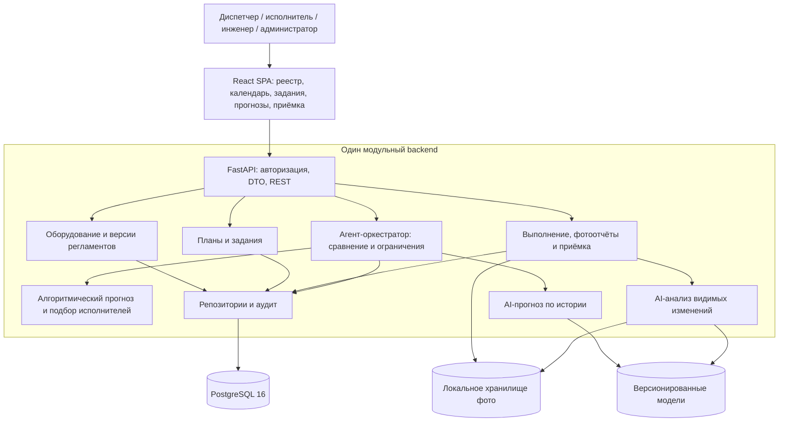

# Схема компонентов

Общее описание действующей реализации — в [ARCHITECTURE](../ARCHITECTURE.md). Это исходная схема компонентных границ; стрелки внутри backend обозначают Python-вызовы, а не отдельные сетевые сервисы. Точные пути к коду приведены в [описаниях узлов](../service/INDEX.md).

[Mermaid-источник](diagrams/system_architecture.mmd) · [draw.io](diagrams/system_architecture.drawio). Валидатор сравнивает этот блок с источником и рёбрами draw.io; файл не является отдельной версией архитектуры.
