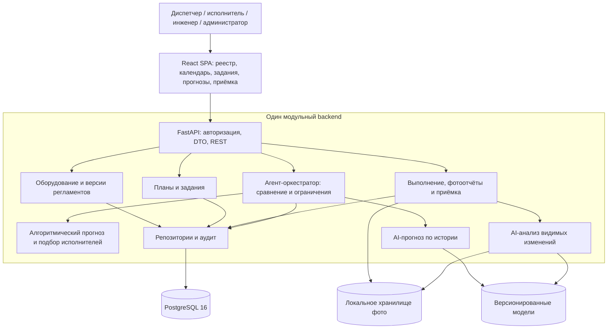

> Срез интеграционной dev: фактические возможности, контракты и команды запуска описаны в [SYSTEM_OVERVIEW](../SYSTEM_OVERVIEW.md). Ниже сохранён исходный проектный/исторический материал; он не означает реализацию всех перечисленных сервисов.

# Архитектура системы ТО/ППР

Срез: 26.10.2026. Это целевая архитектура прототипа к 07.11.2026. [Стек](tech_stack.md), [модель данных](data_model_draft.md) и [контракты](api_contracts.md) определяют детали реализации. Изменение концепции не означает конвертацию сметных таблиц в таблицы ТО.

## Компоненты и границы

Исходники: [Mermaid](diagrams/system_architecture.mmd), [draw.io](diagrams/system_architecture.drawio). Это схема компонентов, не окончательная ER-диаграмма. Внутренние стрелки — Python-интерфейсы; отдельные сетевые сервисы из них не следуют.

| Модуль | Владеет | Получает / возвращает | Чего не решает |
|---|---|---|---|
| `auth` | Пользователи, роли, сессии, доступ к объекту | Проверенный principal и site scope | Не доверяет user_id/ролям из тела команды |
| `catalog` | Site, Equipment, типы, версии операций/регламентов, импорт | Подтверждённые привязки оборудования и правил | Не создаёт задания из неоднозначного Excel |
| `planning` | План и PlanOccurrence | Даты/окна из регламента, материализация по ключу вхождения | Не помечает просрочку новой датой и не принимает работы |
| `work_orders` | Task, Assignment, доступность, переходы | Подбор кандидатов и атомарное назначение бригады | Не заменяет квалификацию вероятностью/AI-оценкой |
| `execution` | Попытки выполнения, чек-лист, фото, EngineerDecision, история | Отчёт → заключение → человеческое решение | Не разрешает AI утвердить работу |
| `algorithmic` | Чистый расчёт сроков и ранжирование исполнителей | ForecastSnapshot → ForecastResult; данные доступности → кандидаты | Не пишет в БД и не переносит сроки |
| `forecast_ai` | Признаки, загрузка модели и прогноз | Тот же ForecastSnapshot → тот же ForecastResult | Не использует будущую историю/решение оркестратора как вход |
| `orchestrator` | Сравнение, валидация, объяснение | Два результата одного снимка → OrchestrationDecision | Не действует через свободный LLM-цикл и не назначает работы сам |
| `photo_ai` | Ограниченный анализ фото | PhotoReviewRequest → PhotoReviewResult | Не доказывает скрытые операции и не пишет EngineerDecision |
| `repositories/audit` | Транзакционная запись, версии, восстановление истории | DTO/доменные объекты ↔ ORM; события действий | Не исполняет бизнес-логику AI |

Агент-оркестратор — управляемый программный координатор с фиксированными инструментами и политикой выбора, без автономного изменения регламентов. Его агентная роль состоит в запуске двух методов, проверке результатов, сравнении и объяснении; языковая модель для этой роли не требуется.

## Пользовательские экраны и роли

| Экран | Роль | Основной процесс |
|---|---|---|
| Панель диспетчера | dispatcher, admin | Просрочки, нераспределённые работы, отсутствующие данные, текущие задания |
| Реестр оборудования | Все в пределах доступных объектов | Поиск по объекту/типу/инвентарному номеру, добавление оборудования уполномоченным пользователем |
| Календарь ТО | dispatcher, engineer; executor — свои задания | Календарная проекция строк PlanOccurrence, фильтр месяца, отдельные признаки просрочки и неполного регламента |
| Карточка оборудования | Все в пределах доступа | Паспорт, действующая версия регламента, принятая история, наработка |
| Кабинет исполнителя | executor | Назначенные задания, начало работы, чек-лист, показания, фото, отправка отчёта |
| Сравнение прогнозов | dispatcher, engineer | Одинаковые входные данные, обе исходные даты, неопределённость, итог и объяснение; маркировка synthetic_demo/unavailable |
| AI-контроль и приёмка | engineer | Фото по попытке/пункту, заключение AI и его ограничения, принять/отклонить с причиной |

`admin` управляет справочниками/пользователями, но само наличие admin не заменяет роль engineer для приёмки. Роли могут сочетаться, однако принимать собственное выполнение нельзя. Доступ к фото и истории проверяется по объекту и заданию на backend; скрытия кнопки недостаточно.

Вход — пароль и серверная сессия. Сессия выдаёт профиль и CSRF token, сервер хранит hash непрозрачного токена, время истечения и отзыв. Cookie HttpOnly, SameSite=Lax, Secure при HTTPS; изменение состояния требует CSRF-заголовок. Локальный HTTP допускается только в явно заданном режиме разработки. Пароли и cookie не попадают в аудит. Общедоступной регистрации в v1 нет.

## Расчёт календаря и обязательного срока

`OperationVersion` задаёт содержание и норму работы, `RecurrenceRule` — периодичность, `EquipmentOperationBinding` — применение конкретной версии к оборудованию. `PlanOccurrence` — одно вхождение, `Task` — организация работы, `ExecutionReport` — факт попытки, результаты проверок хранятся отдельно.

Все календарные даты принадлежат часовому поясу Site, для демонстрации `Asia/Yekaterinburg`. Время событий хранится как aware timestamp; API передаёт ISO 8601 с offset. `mandatory_due_date=D` — последний допустимый локальный день, исключительная временная граница — начало D+1. Признак просрочки вычисляется на момент просмотра; не является новым состоянием задания. Работы, отправленные, но ещё не принятые, показываются отдельно и не считаются принятой историей.

Разрешённое раннее выполнение задаётся подтверждённым `allowed_lead_days`; `earliest_date = mandatory_due_date - allowed_lead_days`, с учётом начала действия Binding. По умолчанию допуск равен 0: AI не может самостоятельно расширять окно. Для ежедневного ТО допуск 0 обязателен, иначе разные суточные обязательства смешались бы. Для демонстрационного примера очистки допуск 6 дней — отдельное синтетическое условие, а не вывод из Excel. При незаданном окне/сроке автоматическая рекомендация к исполнению не публикуется.

| Правило | Проектная семантика | Недостающие данные |
|---|---|---|
| `calendar_interval`, 1 day, `fixed_calendar` | Одна операция на каждую локальную дату от утверждённого anchor. Выходные не пропускаются. Окно дня и обязательный срок — эта дата | Неизвестный год/anchor → `needs_input`; preview отдельно |
| `calendar_interval`, 3 month | Вариант фиксированных дат от anchor либо от последнего принятого выполнения — только после явного выбора basis. При несуществующем дне берётся последний день месяца, дальнейший расчёт снова от исходного anchor | Текст `1/квар` не определяет basis/anchor. До уточнения правило не подтверждено |
| `explicit_dates`, `yearly_count=5` | Пять уникальных утверждённых дат в каждом включённом году; сезонные окна в v1 выражаются выбранными датами | Частота `5/год` сама дат не создаёт; не делить год на 5 автоматически |
| `runtime` | Порог счётчика от принятого ТО либо ввода. При достижении порога требуется обслуживание; срок в часах хранится отдельно от даты | Нет достоверных показаний/исходного счётчика → `needs_input`. Дата не экстраполируется из воздуха |
| Календарь + наработка | Применяется более раннее обязательное условие. При достигнутом runtime-пороге ручная проверка даже до календарной даты | Для прогноза даты порога нужен явно заданный подтверждённый режим наработки; в v1 его нет |

Для режима `after_accepted_completion` расчёт использует `performed_at` последнего принятого выполнения, а не дату приёмки. До приёмки новый исходный факт не возникает. Для фиксированного календаря ни позднее выполнение, ни поздняя приёмка не сдвигают последующие вхождения. Без истории можно использовать только подтверждённый anchor/дату ввода, допускаемые правилом; иначе запросить данные. Нельзя считать, что предыдущее ТО было «вчера».

Генерация выполняется по явной команде диспетчера для ограниченного периода, повторный вызов идемпотентен по `(binding_id, rule_version_id, occurrence_date)`. Для after-completion будущие даты за следующим событием не утверждаются до нового принятого факта. Предпросмотр после изменения версии не удаляет старые задания: требуется сверка отличий. Календарь хранит строки событий, а не 31 колонку.

## Два метода прогнозирования

Оба метода получают один неизменяемый `ForecastSnapshot`: оборудование, версия привязки/операции/правила, `as_of`, горизонт, обязательная дата/порог, только принятые факты и доступные показания с датами не позже `as_of`. Backend формирует снимок, hash и единицы до вызова методов. Метод возвращает `ForecastResult`; исходные AI-даты сохраняются даже при последующем ограничении оркестратором.

Алгоритмический метод рассчитывает ближайшее обязательное вхождение и просрочку. Его прогноз — вычисление по регламенту, а не вероятность отказа. Отсутствующие входы дают `needs_input`. Неопределённость `deterministic` означает определённость вычисления относительно входа, а не достоверность самого регламента.

AI-метод v1 — `RandomForestRegressor`, прогнозирующий дни до следующей подтверждённой потребности в обслуживании. Обучение отдельно от API. Допустимые признаки: тип оборудования/операции, возраст, прошедшие дни и наработка после принятого ТО, предшествующие интервалы, зарегистрированные до `as_of` замечания. Цель должна иметь подтверждённую дату потребности из журнала состояния/дефекта; одна дата планового выполнения не доказывает момент необходимости. Если есть только даты ТО, допустим отдельный эксперимент «следующий фактический интервал» с явной подписью и без заявления прогноза отказа.

На реальных данных нет ни такой выборки, ни модели. Поэтому реальный режим пока возвращает `unavailable` / `MODEL_NOT_READY` или `INSUFFICIENT_HISTORY`. Для демонстрации предусматривается отдельный синтетический датасет с моделируемой датой потребности, документацией генератора, seed и маркировкой `synthetic_demo`. Он показывает выполнение ML-пути, но не качество на оборудовании заказчика. Обучать на датах алгоритмического прогноза и выдавать повторение правила за независимый AI нельзя.

Предлагаемый технический минимум для допуска экспериментального обучения — 50 целевых событий, минимум 5 единиц оборудования, полный набор обязательных признаков; это настройка эксперимента, не статистическое доказательство достаточности. Разделение по времени и оборудованию исключает попадание будущего факта/того же эпизода в train и test. Публикуются MAE в днях, доля опозданий относительно target, покрытие оценочного диапазона и сравнение с простым baseline на той же выборке. При малом тестовом наборе качество считается неопределённым.

Модель хранит feature schema, dataset hash, происхождение, seed, дату границы обучения и метрики. Диапазон 10–90 перцентилей прогнозов деревьев — `tree_dispersion`, не калиброванный доверительный интервал. Числовой «процент уверенности» из него не строится. Выход вне горизонта/неполный/несовместимый по единицам отклоняется. Результат любого метода включает `warnings`, `explanation`, nullable дату и статус; никаких отдельных несовместимых AI DTO.

## Политика оркестратора

1. Проверить одинаковые snapshot_id/hash, оборудование, binding и `as_of`; сохранить обе попытки расчёта, версии методов и диагностические коды. Чужой снимок даёт ошибку контракта.
2. Если обязательный срок/правило не определён, вернуть `needs_input`, `selected_date=null`. AI не восполняет отсутствующий норматив.
3. Если обязательный срок уже прошёл либо достигнут runtime-порог, вернуть `manual_review`, не менять исторический deadline. Диспетчер получает требование ручного разбора. Отдельный процесс восстановительного назначения после пропущенного срока в v1 не реализуется; обычная команда назначения за deadline не проходит. Фактически поздно завершённая ранее назначенная работа сохраняется с `deadline_breached=true`: запись правдивого факта не означает разрешение переноса.
4. Если алгоритм не дал валидного результата, AI не выбирается самостоятельно: `needs_input` или `manual_review` в зависимости от причины.
5. Если AI `unavailable/failed/needs_input`, выбрать алгоритмическую дату, статус `fallback`, указать причину. На экране остаётся и неуспешный результат AI.
6. При двух валидных результатах выбрать более раннюю дату, ограниченную снизу максимумом текущего локального дня и earliest_date, а сверху обязательным сроком. Пустое разрешённое окно даёт manual_review. Рекомендуемая дата AI за пределами обязательного срока сохраняется как исходная; итог ограничивается алгоритмом и кодом `AI_AFTER_DEADLINE`. Дата раньше разрешённого начала даёт `AI_BEFORE_WINDOW`, не изменение регламента.
7. Любое несовпадение дат показывается в днях; ни принятие рекомендации, ни повторный запуск не изменяют `mandatory_due_date`. В v1 исключения из deadline не реализуются: команда переноса за срок возвращает `409 DEADLINE_EXCEEDED`.

`selected`/`fallback` — рекомендация, а не автоматическое создание Task. Диспетчер подтверждает план/создание задания. Перед записью повторно проверяются версии регламента и доступность; устаревшая рекомендация → `409 STALE_SNAPSHOT`. Систематическое раннее обслуживание по AI также оценивает инженер: более ранняя дата не равна автоматически полезной рекомендации.

## Назначение исполнителей

Шаблон операции задаёт число работников и квалификационные требования. Для расчёта загрузки отдельно нужна подтверждённая `planning_duration_minutes`. Пока единица нормы не выяснена, назначение запрещено `DURATION_UNCONFIRMED`. Норму труда и продолжительность бригады нельзя молча приравнивать.

Алгоритм отбирает активных работников с доступом к объекту и действующими на весь интервал допусками, исключает отсутствие/пересечения, проверяет общую доступность всей бригады на одном интервале. Для v1 каждый член бригады должен соответствовать полному набору требований операции; разный состав допусков по ролям в бригаде — расширение после уточнения. В реализованном ALG03 сначала выбирается самый ранний полный интервал, а на нём — минимальная занятость в локальный день начала, затем стабильная сортировка по UUID. Для каждой кандидатуры показываются причины выбора/отказа. [Правила и граница рекомендательного расчёта ALG03](../algorithms/assignment_rules.md).

Интервалы доступности и бронирования полуоткрытые `[start,end)`, в минутах, с offset. Назначение бригады атомарно: блокируются строки работников в стабильном порядке, повторно проверяются занятость, допуски, revision задания и crew_size, затем сохраняются Assignment + Task + AuditEvent. Без достаточной бригады задание остаётся draft, возвращается `409 INSUFFICIENT_CAPACITY`; частичного скрытого назначения нет. AI может предложить раннюю дату, но не снять квалификационные ограничения.

## Выполнение и приёмка

Жизненный цикл Task: `draft → assigned → in_progress → submitted → accepted` либо `submitted → rework_required → assigned`. Отмена разрешена для `draft/assigned`, с освобождением назначений; начатая работа требует ручного разбора и не стирается отменой. Новое назначение до начала закрывает старые Assignment. При доработке новая попытка отчёта получает новый ID и номер; старые фото, ответы и решения неизменны.

Исполнитель отмечает пункты чек-листа, вводит требуемые значения с единицами и загружает фото с фазой `before/after`, `view_key`, operation/checklist item. Отправка замораживает текущую попытку. Backend проверяет комплектность, права, версию и последовательность времён. Фото «до» для конкретной попытки должно быть зафиксировано до соответствующего выполнения пункта; EXIF сам по себе не доказывает время съёмки. Отсутствие обязательной пары — `422 EVIDENCE_INCOMPLETE`.

Photo AI сначала проверяет читаемость, наличие пары/одного ракурса и совпадение equipment/execution/item. Для ограниченного демонстрационного сценария очистки использует CLIP с заранее заданными описаниями чистого/загрязнённого узла. Сравниваются оценки соответствия описаниям до/после, сохраняются model revision, prompt set и исходные photo_id. Разница оценок зависит от ракурса и освещения и не является доказательством ремонта. Шаблонные формулировки результата собираются из структурированных признаков; свободное неподтверждённое описание действий не генерируется.

Технические индикаторы качества: яркость/контраст и оценка резкости через Pillow/NumPy; view_key задаёт ракурс, а несопоставимое содержимое дополнительно помечается uncertain. Совпадающий SHA-256 до/после не подтверждает изменение. Пороговые значения и набор описаний версионируются и проверяются на подготовленных кадрах; до такой проверки они экспериментальные, автоматический положительный вывод не допускается.

Плохие кадры дают `uncertain`; недоступные веса — `unavailable`; операция, результат которой нельзя подтвердить визуально, — `not_verifiable`. Контроль показаний может быть зафиксирован фотографией прибора, но точность измерения/внутреннее состояние модуля/выпуск воздуха по ней не подтверждаются. Для непроверяемых пунктов инженер опирается на показания/протокол, а не повышает уверенность AI.

Окончательное решение создаёт engineer. AI-заключение не обязательно должно быть положительным для ручной приёмки; при `uncertain/not_verifiable/unavailable` нужны текстовое основание и дополнительные данные. Принятие отчёта, проверка запрета собственной приёмки, запись EngineerDecision, перевод Task, создание ServiceEvent и аудит происходят в одной транзакции. Следующее ТО считает только принятые ServiceEvent и сохраняет время фактического выполнения. Отклонение не создаёт принятую историю и не сбрасывает отсчёт; возвращает `rework_required` с обязательной причиной.

## Исполнение, хранение и отказы

Backend синхронно запускает ограниченные локальные расчёты вне event loop, без разделения Session между потоками. Предлагаемые бюджеты v1: AI-прогноз 5 секунд, две фотографии 20 секунд после предварительной загрузки модели; превышение приводит к терминальному результату `unavailable`, а не к вечному spinner. Эти бюджеты подлежат измерению до репетиции. Вызов модели не удерживает блокировки транзакции назначения/приёмки.

Сначала фиксируется ForecastRun со снимком и сроком завершения, затем выполняются методы; результаты обоих методов и решение записываются атомарно. При ошибке создаётся терминальная запись неуспешного метода. После падения процесса просроченный `running` при следующем обращении/старте переводится в failed с причиной `RUN_INTERRUPTED`; повторная команда создаёт новый запуск либо возвращает прежний по idempotency key. Устаревший по версии результат сохраняется для истории, но не используется для создания задания.

Файлы: проверка MIME и фактического декодирования, максимум 10 МиБ/20 мегапикселей как проектный лимит, SHA-256 оригинала, безопасная производная копия без EXIF для выдачи. Пользователь передаёт фото, не `storage_key`. Запись файла и строки БД не общая транзакция: временная атомарная запись → метаданные → фиксация; при ошибке БД компенсирующее удаление новых файлов, при аварии сверка незарегистрированных временных файлов. Принятые доказательства не удаляются фоновым cleanup. Фото выдаются авторизованным endpoint, а не общим каталогом nginx.

Аудит неизменяемый, содержит principal, действие, сущность, before/after revision, основание и correlation ID. Входные снимки, оба прогноза, решение и версии сохраняются независимо от успешности AI. Недоступность AI не блокирует исполнение регламента и ручную приёмку с основанием; недоступность БД блокирует мутации и возвращает 503.
