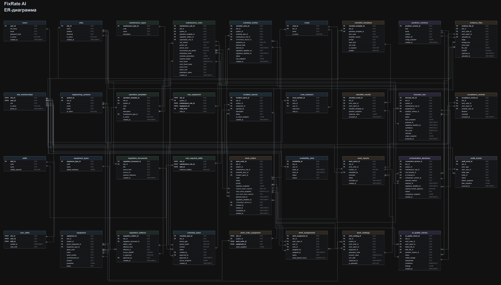

# Модель данных FixRate AI · ТО/ППР

**Версия:** `0.9-architecture-draft` · **Дата комплекта:** 27.10.2026  
**Масштаб:** 35 таблиц · 310 полей · 72 внешних ключа · 6 доменов  
**Целевая СУБД:** PostgreSQL 16 · **Статус:** логический проект, до согласования с текущими API-контрактами.

[Главная](../../README.md) · [Архитектура](../architecture/README.md) · [API-контракты](../architecture/api_contracts.md)

## Состав комплекта

| Файл | Содержание |
|---|---|
| [erd.drawio](erd.drawio) | Редактируемая ER-диаграмма в классическом тёмном стиле; открыть в draw.io / diagrams.net |
| [erd.svg](erd.svg) | Векторное превью из draw.io: открывается в браузере и масштабируется без потери резкости |
| [erd.png](erd.png) | Изображение 6216 × 3548 для просмотра прямо в Markdown |
| [specification.md](specification.md) | Атрибуты, типы PostgreSQL, ключи, индексы и проектные ограничения |
| [relationships.md](relationships.md) | Каталог всех 72 FK, кардинальности, сценарии и примеры SQL |
| [model_catalog.json](model_catalog.json) | Машиночитаемое описание таблиц, полей и связей |

Документы получены из `FixRate_AI_TO_PPR_ERD_Documentation.zip` и перенесены без изменения исходного содержимого. Отдельно переданный `FixRate_AI_TO_PPR_ERD_CLASSIC.drawio` побайтно совпадает с `erd.drawio` из архива; в репозитории хранится один экземпляр диаграммы. README архива заменён этим навигационным документом для интеграции в проект.

ER-комплект описывает предполагаемую БД. SQL-миграции, ORM и применённые ограничения в текущем `main` отсутствуют; SQL-примеры из комплекта ещё нельзя выполнять как запросы к готовой схеме проекта.

## Диаграмма

[](erd.svg)

[Открыть SVG и увеличить поля](erd.svg) · [PNG в полном размере](erd.png) · [Редактировать исходный draw.io](erd.drawio)

Превью сохраняет таблицы, поля, цветовую схему, координаты и маршруты 72 связей из исходного файла архива. Для обновления SVG после правки диаграммы выполните из корня репозитория:

```powershell
python -B docs/database/export_erd.py
```

[Экспортёр](export_erd.py) использует стандартную библиотеку Python и поддерживает графические элементы текущей диаграммы. PNG — снимок SVG в масштабе 2×; после изменения SVG его нужно обновить отдельно.

## Домены

| Домен | Таблиц | Основные сущности |
|---|---:|---|
| Объекты и доступ | 11 | Объекты, инженерные системы, оборудование, пользователи, компетенции, бригады |
| Регламенты и периодичность | 7 | Шаблоны операций, документы и редакции, правила, привязки к оборудованию |
| Планирование и заявки | 3 | Месячные планы, календарные вхождения, инциденты |
| Исполнение и приёмка | 9 | Наряды, назначения, отчёты, чек-листы, показания, файлы, решения инженера |
| Прогнозы и качество | 4 | Версии методов, результаты прогнозов, решения оркестратора, фотоанализ |
| История | 1 | Аудит действий |

## Согласование с текущей архитектурой

Исходная спецификация создавалась без доступа к новой архитектурной ветке и ссылается на `scope.md`, `roles.md` и файл `График для ии.xlsx`. Этих путей нет в текущем checkout. Доступный материал заказчика — [techical_service_schedule.xlsx](../customer/techical_service_schedule.xlsx), его интерпретация зафиксирована в [анализе графика](../architecture/customer_schedule_analysis.md).

При интеграции выявлены следующие различия. Они требуют отдельного решения перед DDL; таблица не устанавливает автоматическое соответствие сущностей.

| Область | ER-комплект | Текущая архитектура / DTO `maintenance-0.1` | Что согласовать |
|---|---|---|---|
| Роли | `executive`, `chief_engineer`, `engineer`, `technician` | `admin`, `dispatcher`, `executor`, `engineer` | Матрицу прав и отображение бизнес-ролей; простая замена названий недостаточна |
| Состояния задания | В том числе `clarification`, `in_review`, `rework`, `completed` | `draft`, `assigned`, `in_progress`, `submitted`, `rework_required`, `accepted`, `cancelled` | Единую машину состояний и переходы |
| Операции и версии | `operation_templates` + `maintenance_rules`; правило содержит периодичность и норму | `OperationVersion`, `RecurrenceRule`, `EquipmentOperationBinding` разделены | Сохранение независимых версий инструкции, правила и привязки |
| Периодичность | `fixed_interval`, `calendar_window`, `explicit_months` | `calendar_interval`, `explicit_dates`, `runtime`; явные anchor, basis, даты и допуск | Выразимость правил, включая наработку и границы окна |
| Трудоёмкость | `norm_hours_basis`: `total_person_hours / per_person / unknown`, `NUMERIC(12,2)` | `norm_unit`: `unconfirmed / person_hour / elapsed_hour`, до 3 знаков; отдельно `planning_duration_minutes` | Семантику, точность хранения и подтверждённую длительность назначения |
| Прогнозы | `forecast_runs` хранит результат метода `rule` или `ai`, снимок в JSONB | `ForecastRun` — запуск сравнения; `ForecastResult` — результат `algorithmic` или `ai`; отдельный `ForecastSnapshot` | Общий неизменяемый вход, два результата и их связь с одним запуском |
| План и оборудование | `work_order_equipment` допускает несколько единиц в наряде | В v1 одно вхождение связано с одним заданием через привязку к оборудованию | Границы группировки и уникальность плановой работы |
| История и служебные данные | 35 таблиц без отдельных таблиц сессий, идемпотентности и принятого `ServiceEvent` | В архитектуре описаны серверные сессии, `IdempotencyRecord`, `ServiceEvent` | Способ хранения и транзакционные гарантии; возможное расширение ER |

Основания для сверки: [предварительная доменная модель](../architecture/data_model_draft.md), [API-контракты](../architecture/api_contracts.md), [backend DTO](../../backend/app/schemas/maintenance.py) и [REST-модели](../../backend/app/schemas/maintenance_api.py).

Подробное соответствие каждого поля, варианты JOIN и конкретные пробелы рассмотрены в [DTO ↔ БД](../architecture/dto_db_mapping.md). Документ подготовлен для согласования и не фиксирует подтверждения от разработчиков.

## Следующий шаг для реализации

1. Зафиксировать согласованное отображение доменных сущностей и API на физические таблицы.
2. Утвердить роли, статусы, календарную семантику, версии и неизменность исторических снимков.
3. Подготовить независимые SQL-миграции ТО/ППР и ORM, затем проверить FK, ограничения и транзакции на PostgreSQL 16.
4. Проверить назначения бригады, повтор команд, отказ AI и приёмку с сохранением истории по [матрице сценариев](../architecture/architecture_validation.md).

Правила в приложенных документах рассматриваются как содержание проектного комплекта. Актуальные соглашения реализации должны быть явно согласованы с кодом и архитектурой текущей ветки.
