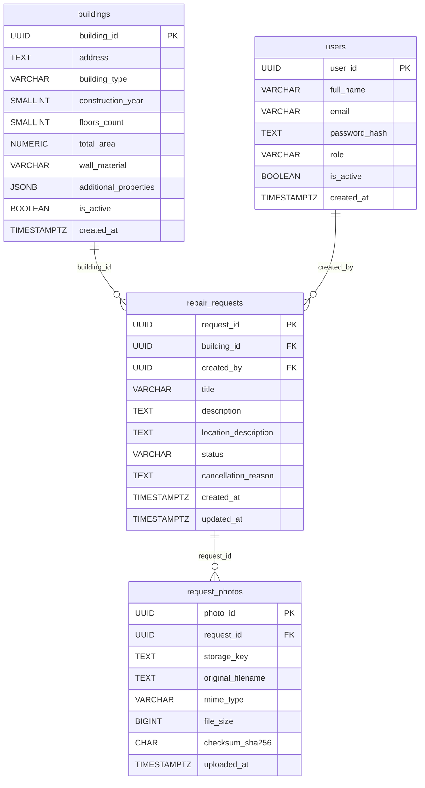
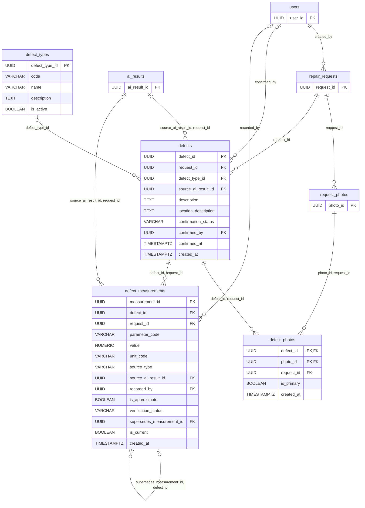
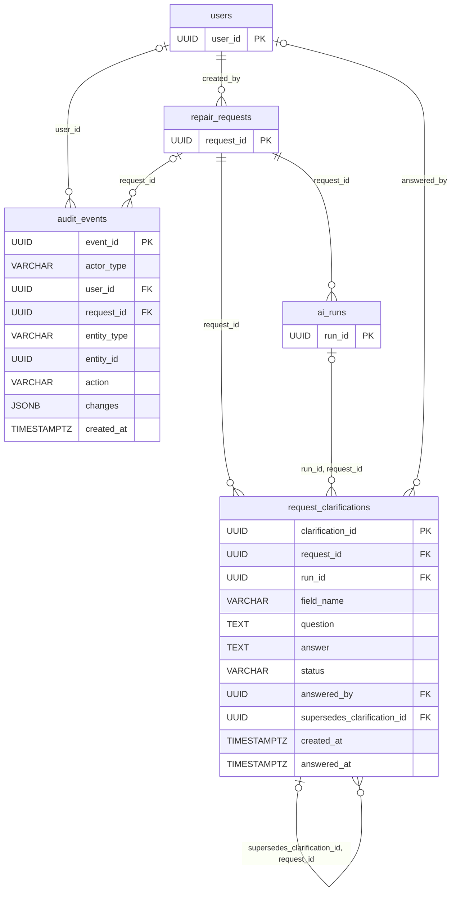
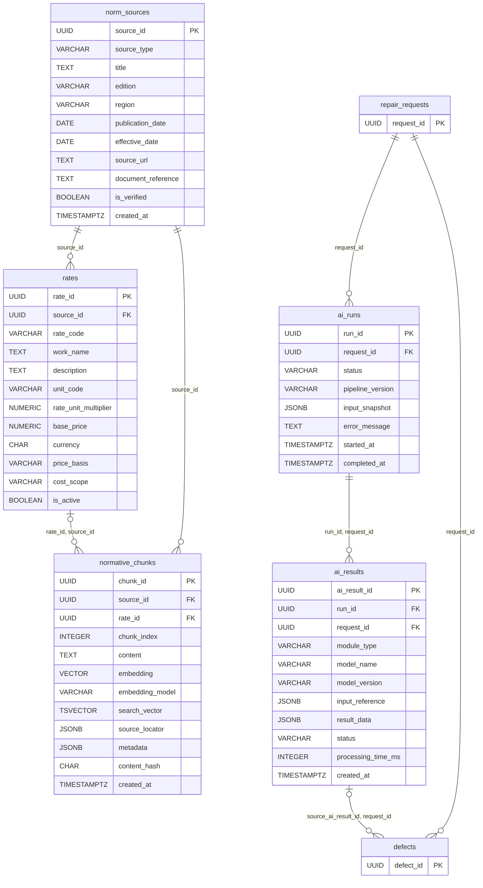
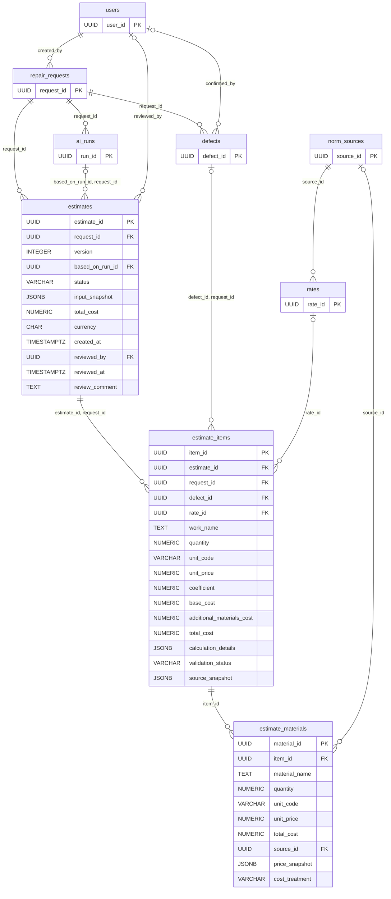

# FixRate AI — ER-диаграмма (Mermaid)

Схема описана текстом в формате [Mermaid](https://gitverse.ru/docs/collaborative/repositories/reference/markup-guide/),
поэтому рендерится прямо в README, на странице GitVerse и в предпросмотре VS Code,
остаётся векторной при любом масштабе и читается в diff’ах.

Состав: 18 таблиц, 32 внешних ключа. Назначение полей — в [specification.md](specification.md),
сценарии проверки — в [test_scenarios.md](test_scenarios.md).

## Как читать

- `||` со стороны родителя — ровно одна родительская запись (FK обязателен);
- `|o` со стороны родителя — родитель необязателен (nullable FK);
- `o{` со стороны потомка — 0..N дочерних записей.

Надпись на связи — поля FK в дочерней таблице. `PK, FK` — составной первичный ключ,
который одновременно ссылается на родителя (жёсткая проверка принадлежности заявке).
У составных FK проверяется вся пара полей, поэтому составных связей меньше, чем полей.

Полная схема одним холстом (все 18 таблиц со всеми атрибутами) — в [erd.svg](erd.svg).

## Домен «Заявки и дефекты»

Объект, автор и заявка, фотографии, дефекты с измерениями, уточнения и журнал событий.

### Объекты, пользователи и заявки

Таблицы: `users`, `buildings`, `repair_requests`, `request_photos`.

### Дефекты, их фото и измерения

Таблицы: `defect_types`, `defects`, `defect_photos`, `defect_measurements`.

Связанные таблицы вне блока: `users`, `ai_results`, `repair_requests`, `request_photos` — показаны только первичные ключи.

### Уточнения и журнал событий

Таблицы: `request_clarifications`, `audit_events`.

Связанные таблицы вне блока: `users`, `repair_requests`, `ai_runs` — показаны только первичные ключи.

## Домен «AI и нормативы»

Запуски CV/NLP/RAG и результаты по модулям, источники нормативов и прайсов, расценки и RAG-фрагменты.

### Модули AI и нормативная база

Таблицы: `ai_runs`, `ai_results`, `norm_sources`, `rates`, `normative_chunks`.

Связанные таблицы вне блока: `repair_requests`, `defects` — показаны только первичные ключи.

## Домен «Сметы и цены»

Версионные сметы, позиции работ и материалы; ссылки на дефекты, расценки и результаты AI.

### Смета, позиции и материалы

Таблицы: `estimates`, `estimate_items`, `estimate_materials`.

Связанные таблицы вне блока: `users`, `repair_requests`, `defects`, `ai_runs`, `rates`, `norm_sources` — показаны только первичные ключи.

## Исходные файлы

- [erd.svg](erd.svg) — прежняя версия из draw.io (один холст 3010×1870 со всеми атрибутами);
- [erd.drawio](erd.drawio) — исходник для редактирования в draw.io;
- [specification.md](specification.md) — описание сущностей, ограничений и индексов;
- [test_scenarios.md](test_scenarios.md) — сценарии проверки модели.
