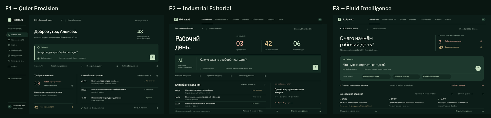

# FixRate AI · Visual Exploration E · 17.11.2026

**Последующее решение владельца: выбрана E3.** Продолжение — [E3 · Core Workflows: четыре рабочих экрана и две мобильные композиции](2026-11-17-e3-core-workflows.md). Исходные три варианта и приведённая ниже историческая сравнительная рекомендация сохранены без переделки.

Завершён самостоятельный дизайн-срез **одной главной главного инженера**, Desktop 1440×900: E1 Quiet Precision, E2 Industrial Editorial, E3 Fluid Intelligence. Это три художественных направления для выбора владельцем, не внедрённый редизайн приложения. Рекомендация — **E2** за наиболее выраженный характер инженерного продукта и ясную типографическую структуру. Масштабирование не начато.

[Открыть страницу в локальном Penpot](http://localhost:9001/?screen=workspace&team-id=8b7de69e-e368-81a5-8008-f56e4d02d5b0&project-id=8b7de69e-e368-81a5-8008-f56e5c02ec42&file-id=13ac3151-58c1-801c-8008-f58dd579cd50&page-id=ecd29d2d-0751-800b-8008-f5988773752e). Нужен обычный вход в существующий локальный Penpot. Файл **FixRate AI — AI-native Concepts**, страница **E · Visual Exploration · Chief Engineer**. Три board стоят рядом, промежуток 240 px. Архив SVG не открывался и не копировался.

## Экраны и детали в исходном масштабе

Полные PNG экспортированы официальным Penpot MCP непосредственно из нативных board. Каждый — 1440×900. Детали вырезаны из этих PNG без изменения масштаба: **один пиксель детали равен одному пикселю макета**. Сравнительное изображение выше уменьшено только для обзора.

| Направление | Полный экран | AI и действия, 100% | Рабочие записи, 100% | Типографика, 100% |
|---|---|---|---|---|
| E1 Quiet Precision | [PNG](../design/concepts/visual-exploration-e/renders/e1.png) | [PNG](../design/concepts/visual-exploration-e/renders/e1-composer-100.png) | [PNG](../design/concepts/visual-exploration-e/renders/e1-work-100.png) | [PNG](../design/concepts/visual-exploration-e/renders/e1-type-100.png) |
| E2 Industrial Editorial | [PNG](../design/concepts/visual-exploration-e/renders/e2.png) | [PNG](../design/concepts/visual-exploration-e/renders/e2-composer-100.png) | [PNG](../design/concepts/visual-exploration-e/renders/e2-work-100.png) | [PNG](../design/concepts/visual-exploration-e/renders/e2-type-100.png) |
| E3 Fluid Intelligence | [PNG](../design/concepts/visual-exploration-e/renders/e3.png) | [PNG](../design/concepts/visual-exploration-e/renders/e3-composer-100.png) | [PNG](../design/concepts/visual-exploration-e/renders/e3-work-100.png) | [PNG](../design/concepts/visual-exploration-e/renders/e3-type-100.png) |

## Основание и границы

Основание — предоставленное владельцем ТЗ «FixRate AI — Visual Design Breakthrough», актуальный [командный план](../plans/2026-11-17-team-delivery-plan.md), [сценарии UX](../service/user-experience.md), [производительность](../service/performance.md), [MVP](../MVP_SCOPE.md) и реализованные контракты [архитектуры](../ARCHITECTURE.md). Визуально просмотрены нативные рендеры A/B/C/D. От C сохранён принцип широкой горизонтали; D не использована как заготовка нового оформления.

Роль — главный инженер. Утром он проверяет просрочки и назначения, затем открывает конкретную очередь или работу. Первое видимое действие — разобрать 3 просрочки либо сформулировать задачу в широком AI-поле. После выбора очереди следующий шаг — открыть работу, проверить состояние и допустимое действие. После AI-запроса предполагается переход в полноценный диалог с точным предложением и отдельным подтверждением записи. Ручные входы в планирование, оборудование, задания и приёмку остаются видимыми.

Двухролевая целевая постановка владельца сохранена; на этом этапе представлен только главный инженер. Текущий RBAC не изменён. Никаких новых backend/frontend операций, контрактов, миграций или assistant capabilities не добавлено.

| Связь с MVP | Исходное требование | Что здесь можно проверить | Что остаётся за пределами среза |
|---|---|---|---|
| MVP-01, доступ и роли | AT-03/10/17, CR-17 | Объект и роль постоянно видимы; обычная навигация доступна | Реализация новой ролевой модели |
| MVP-06, рабочие задания | PLN-07/10/13/17/21, AT-06/08/09/11 | Просрочка, отсутствие назначения и состояние работы различаются | Реальные назначения и изменение графика |
| MVP-08, приёмка | AN06/AN07, AT-10/11/16 | Очередь приёмки присутствует даже при нулевом количестве | Доказательства и решение по отчёту |
| MVP-11, помощник | PLN-12/20, AT-08…12/17/30 | AI как основной вход вместе с ручными действиями | Исполнение инструментов, подтверждения и восстановление диалога |

Сейчас от заказчика требуется только выбор художественного направления. Неопределённые нормативы, RAG и промышленная приёмка не закрываются этими макетами. Другие семь экранов, мобильные версии, чат исполнителя и библиотека компонентов не проектировались. Production frontend, backend, бизнес-логика и права сохранены.

## Одинаковая рабочая ситуация

Все данные синтетические: ЖК «Сосновый парк», вторник 17 ноября 2026 года, главный инженер Алексей Крылов. На объекте 48 незавершённых работ, 3 просрочки, 42 работы без исполнителя, 6 работ на сегодня, 0 новых отчётов в приёмке. Категории пересекаются и не складываются в итог.

| Время | Работа | Контекст и состояние |
|---|---|---|
| 09:00 | Контроль параметров приборов | Индивидуальный тепловой пункт · Не назначен |
| 10:00 | Протоколирование показаний счётчиков | Алексей Морозов · Назначено |
| 11:00 | Проверка температуры и давления | Алексей Морозов · В работе |

Во всех направлениях выделена одна и та же просроченная работа: **Проверка управляющего модуля**, срок **16 ноября**, состояние **На доработке**. Просрочка не подменяет состояние. На первом экране видны три ближайших задания из шести; переход к графику обозначает полный список. Нулевой приёмке не выдуманы отчёты ради визуального наполнения.

## Художественные решения

**E1 — Quiet Precision.** Боковая навигация отделяет устойчивую оболочку от рабочей плоскости. Широкое поле 1128×164 занимает всю ширину содержания. Под ним — текстовые AI-действия, затем две разные по плотности области: решения слева, расписание справа. Свободное место отделяет первичную постановку задачи от просмотра записей. Локальные линии направляют чтение; рамка используется только для composer. Заголовок IBM Plex Sans Medium 38 px; рабочие названия 16 px, метаданные 13–14 px. Это самый спокойный вариант, но и самый привычный по характеру.

**E2 — Industrial Editorial.** Верхняя навигация освобождает ширину. Двухстрочный заголовок 64 px и крупные числа набраны настоящим IBM Plex Sans Condensed Medium, без искусственного горизонтального сжатия. Линейная сетка связывает сводку, AI-полосу 1328×160 и рабочие записи. Левая колонка AI-блока объясняет назначение, правая остаётся собственно областью ввода. Квадратная кнопка и ровный край поддерживают характер инструмента. Внизу компактная таблица соседствует с отдельным разбором первого приоритета; одинаковых KPI-карточек нет. Риск — крупная сводка конкурирует с AI за первый взгляд; это сознательный баланс рабочего контроля и помощника.

**E3 — Fluid Intelligence.** Заголовок 48 px, компактный контекст справа, единая зелёная область AI 1312×226 с запросом и быстрыми действиями внутри. У неё одна непрерывная поверхность, а не вложенные карточки. Ниже связаны конкретная просрочка и горизонтальный ряд ближайших работ. Контекст воспринимается продолжением AI-области. Круглая кнопка и мягкая геометрия относятся только к этому направлению; свечения и градиенты не используются. Риск — горизонтальные задания хуже переносят длинные названия и большой список; при развитии потребуется проверка реальных длин и переход к полному реестру.

Общее семейство цветов связывает три направления с FixRate AI: canvas `#0C1D18`, navigation `#091611`, surface `#142B22`, raised `#1D382D`, text `#EDF1E7`, action `#C6DEC0`, overdue `#E7AA99`, unassigned `#DEC08C`. В локальную библиотеку добавлены только 12 базовых цветов с отдельным путём **E · Visual Exploration**. Цвета D не переписывались. Предложенная F-монограмма — часть исследования, а не утверждённый новый логотип.

## Шрифты и фактическая доступность

До этого среза Penpot предоставлял Source Sans Pro и загруженный Source Sans 3. Inter/Manrope/Onest не были установлены; они не назначались в надежде на fallback. Для новых направлений из [официального IBM Plex](https://github.com/IBM/plex) загружены статические IBM Plex Sans Regular/Medium/SemiBold и IBM Plex Sans Condensed Medium под SIL OFL. [Источники и SHA-256](../design/concepts/visual-exploration-e/fonts/sources.json), [лицензия](../design/concepts/visual-exploration-e/fonts/OFL.txt).

Наличие семейств и весов подтверждено повторным MCP-чтением после загрузки и перезагрузки редактора. Используемые начертания Sans 400/500 и Condensed 500 имеют `FontFace.status=loaded` в браузере; Sans 600 установлен, но в этих экранах не используется. Проверка cmap всех четырёх TTF нашла все 66 букв русского алфавита: [протокол](../design/concepts/visual-exploration-e/renders/font-coverage.json). Кириллица дополнительно просмотрена в финальных native PNG и девяти деталях 100%.

Минимальный размер текста — 12 px для второстепенных меток; названия работ — 16 px, рабочие метаданные — 13–14 px, навигация — 14 px, основное поле — 24/28/30 px. Основной межстрочный интервал 1,22. Контраст рассчитан по sRGB WCAG: text/canvas 15,22:1; muted/raised 6,44:1; faint/raised 4,87:1; ink/action 10,74:1. У статусов есть текст, а не только цвет.

## Использованные навыки и доступные референсы

Фактически прочитаны установленные `C:/Users/kran/.codex/skills/taste-skill/SKILL.md` (tasteskill 2.5.1) и `C:/Users/kran/.codex/skills/emil-design-eng/SKILL.md`. От taste-skill применены единая сетка, равные края, ясная типографическая иерархия, отказ от шаблонных карточек и проверка реального изображения. Его автоматический gate рассчитан на маркетинговые HTML-страницы; здесь он не запускался и не объявляется PASS. Бриф Penpot и запрет мобильных экранов/анимации имеют приоритет над его шаблонами hero, эффектами и мобильными проверками.

От emil-design-eng применены согласованность формы, отзывчивость будущих управляющих элементов, сохранение пространственной связи при смене состояния и учёт reduced motion. Никакой motion-код на этом этапе не писался.

Получены и просмотрены реальные материалы:

- [Linear: How we redesigned the Linear UI](https://linear.app/now/how-we-redesigned-the-linear-ui) и изображение нового UI — разбор навигационной оболочки, выравнивания и уровней содержания. В исследование перенесён принцип отделения оболочки от данных, а не чужая геометрия экрана.
- [Raycast AI](https://www.raycast.com/core-features/ai) — визуально проверено соседство основного поля, контекста и истории. Заимствован принцип доминирующего взаимодействия; автоматизации и сторонние интеграции Raycast в макеты не добавлялись.
- [Geist Design System](https://vercel.com/geist/introduction) — визуально проверены модульная сетка и подчинённые разделители. Использованы дисциплина краёв и ранжирование тонов, а не чёрно-белая палитра Vercel.

Первый адрес `vercel.com/design/geist` был недоступен; исследован доступный `vercel.com/geist/introduction`. Прямая загрузка изображения Linear через web-инструмент не удалась, но оно затем успешно открыто и просмотрено в существующем браузере. Stripe/Notion не исследовались и не указаны как использованные источники. Чужие изображения, код и фирменные эффекты в макеты не перенесены.

## Визуальный аудит и два цикла пересмотра

Исходные, промежуточные и финальные PNG получены из Penpot. На каждом этапе просмотрены конкретные изображения, а не только успешные MCP receipts. Самооценки в баллах не используются.

| Направление / проход | Найдено | Изменение и результат |
|---|---|---|
| E1, первый | Статусы 12 px и повторение AI-символа возле каждого запроса создавали мелкий шум | Статусы увеличены до 13 px, метаданные до 14 px; повторяющиеся символы убраны. Рабочие строки читаются ровнее |
| E1, второй | Текстовые быстрые действия без общего названия можно было принять за обычные переходы | Добавлено «Спросить AI», действия распределены по ширине composer. Прямые очереди остались в рабочей области ниже |
| E2, первый | Разделители пересекали вторые строки при шаге 50 px; нижняя информационная строка была слишком тесной | Шаг увеличен до 60 px, вторые строки размещены внутри строки, AI-полоса поднята на 18 px. Footer разнесён по ширине |
| E2, второй | Реальные метрики Condensed выходили за высоту двух текстовых слоёв; подпись «Задача. Решение. Действие.» была абстрактной | Увеличены контейнеры текста; подпись заменена на «Помощник главного инженера». Финальный text overflow пуст |
| E3, первый | Два скруглённых фона создавали вмятину на боках; нулевая приёмка терялась внизу | AI получил одну непрерывную поверхность. Приёмка перенесена к заголовку ближайших работ |
| E3, второй | Области нижних ссылок выходили на 6 px за viewport; контекст первой работы был слишком сокращён | Footer поднят на 10 px, возвращено полное название теплового пункта, второстепенная метка увеличена до 12 px. Выходов за board нет |

Финально просмотрены три полных экрана и девять отдельных деталей. Проверены характер каждого направления, главный AI-вход, ручные действия, читаемость, отрицательное пространство, сроки и названия статусов. Нативный аудит подтверждает отсутствие выходов за границы board и переполнения текста. Это не автоматическое доказательство художественного качества или удобства на реальном пользователе.

## Сравнение и рекомендация

| Критерий | E1 | E2 | E3 |
|---|---|---|---|
| Выразительность | Сдержанная; близка к знакомому рабочему инструменту | Самая отчётливая за счёт набора, масштаба и линейной структуры | Выразительное поле AI и спокойная открытая композиция |
| Типографика | Ровный ритм Sans, один крупный заголовок | Настоящий Condensed в крупных уровнях, Sans в рабочих строках | Крупный лёгкий Sans, контраст масштаба с приоритетами |
| Композиция | Устойчивая боковая оболочка и две рабочие колонки | Редакционная сводка → AI-полоса → таблица и приоритет | Общий контекст → единая AI-поверхность → горизонт заданий |
| Индивидуальность FixRate AI | Цвет и точность; меньше собственного характера | Наиболее убедительная связь с инженерной работой | Выраженный образ AI-продукта; мягче инженерной редакционности E2 |
| Понятность UX | Самая привычная навигация | Контроль сроков хорошо виден до ввода запроса | Лучше всего видна возможность начать с AI |
| Инженерная практичность | Удобна для плотных списков и расширения меню | Компактные строки и отдельный первый приоритет | Хороша для короткого утреннего обзора; длинные записи требуют стресс-проверки |
| AI-native ощущение | AI заметен, но рабочая плоскость сохраняет самостоятельность | AI — отдельная полоса профессионального инструмента | Самое сильное: запрос и быстрые действия на одной поверхности |
| Масштабируемость | Самая простая общая оболочка для многих разделов | Сильная основа для таблиц, планирования и журналов | Уместна прежде всего для главной и начала диалога |
| Реализация в React | Grid/sidebar, простая форма и нативные списки | Grid, обычные разделители и загружаемые шрифты | Grid/flex, скруглённая поверхность, без обязательных тяжёлых эффектов |

**Рекомендуется E2.** Именно он лучше отвечает художественной проблеме предыдущего D: индивидуальность строится на шрифте, пропорциях и структуре реальной рабочей информации. Его можно развивать без свечений, сложной графики и набора одинаковых карточек. E1 — более консервативный выбор. E3 — сильнейший альтернативный вариант, если решающим критерием станет первое впечатление AI-native рабочего места.

Из E3 полезен принцип общего контейнера запроса и быстрых действий. Это кандидат для отдельной проверки после выбора владельца; автоматически соединять его с E2 не предлагается. Типографическую систему и квадратную полосу E2 сначала следует оценить как целое.

Будущая трансформация в чат предусмотрена композицией всех трёх направлений: глобальная навигация и объект сохраняются, ввод вместе с вложениями остаётся тем же состоянием, рабочая область раскрывается в ленту, composer занимает нижнюю позицию в своей ширине. В E2 второстепенная левая подпись может свернуться; в E3 быстрые действия могут уйти из первого плана. Это намерение для следующего этапа, не проверенная анимация. Реализация должна сохранять черновик, вложения и фокус; использовать transform/opacity и отдельный reduced-motion режим, с замером в production-сборке.

## Сохранение и проверенные артефакты

[Машинный readback](../design/concepts/visual-exploration-e/penpot.json): после сохранения создана версия **E · Visual Exploration · Reviewed · 2026-11-17**, редактор перезагружен, выполнено независимое повторное чтение через официальный MCP. После reopen revision 18; сохранены все три board, их ID, нативные тексты и шрифты. Это реальная проверка сохранения, не только наличие объектов в памяти.

| Результат | E1 | E2 | E3 |
|---|---:|---:|---:|
| Размер | 1440×900 | 1440×900 | 1440×900 |
| Редактируемые текстовые слои | 52 | 49 | 44 |
| Нативные потомки board | 110 | 96 | 92 |
| Растры / svg-raw внутри дизайна | 0 | 0 | 0 |
| Выходы за board / text overflow | 0 / 0 | 0 / 0 | 0 / 0 |

Сравнение 12 прежних страниц до и после работы по ID, именам, геометрии, текстам, заливкам и назначенным шрифтам дало **0 различий**. Добавлены только E-страница и её собственные библиотечные цвета; шрифты добавлены в библиотеку команды. Архив и A/B/C/D не переделывались.

[Нативный сценарий построения](../design/concepts/visual-exploration-e/native.js) сохранён для воспроизводимости; проверяет ID лёгкого файла и работает только на E-странице. [Скрипт упаковки экспортов](../design/concepts/visual-exploration-e/export-review.py) создаёт PNG-детали и проверяет cmap. [Опись экспортов и SHA-256](../design/concepts/visual-exploration-e/renders/exports.json). Runtime-доказательства трёх визуальных проходов и исходное сравнение страниц находятся локально в `var/penpot-migration-20261117/e*`; приватные настройки и учётные данные не копировались в Git.

`git diff -- frontend backend contracts` пуст; HEAD приложения `804917495200e457272fcb2103f3043dccbad91b`. Контракты и миграции не менялись. Новые функциональные тесты приложения не запускались: этот срез не меняет исполняемый продукт. Детерминированные проверки дизайна, экспорты, шрифты и reopen выполнены; performance/FPS, Back/Forward, RBAC, ошибки API и мобильные сценарии не выдаются за проверенные новым статическим макетом. Коммит, push и deployment не выполнялись.
