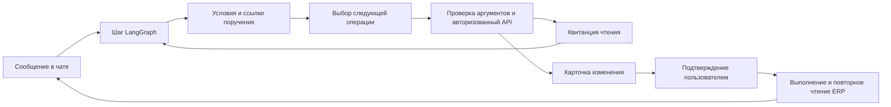

# 23.11.2026 · Экспериментальный ERP-оператор

MVP‑11, MVP‑08 и MVP‑04, требования PLN‑12, PLN‑20 и AT‑08…AT‑12. Экспериментальная ветка `agentic-erp-operator` создана от `llm_dynamic` на `b98ab57`. Опорный v3 — `8869946`. Проверяемый пользовательский сценарий начинается со списка установок без принятого ТО. Уточнения сохраняют область, местную дату и состояние наряда, ограничивают выдачу и позволяют перейти к проверяемому назначению. Для пилота нужны согласованные права, действующие регламенты и достоверные данные о сменах, квалификациях и истории приёмки.

## Контур исполнения

В приложении один React-чат для исполнителя и инженера. Авторизованная сессия задаёт пользователя, объект, роль и часовой пояс. FastAPI проверяет доступ на каждом вызове. PostgreSQL хранит наряды, допуски, отчёты, решения о приёмке и журнал изменений. Чтение истории использует связанные наряды и принятые отчёты. Подбор исполнителя использует действующие бизнес-правила назначения. Прогнозы и фотоанализ остаются отдельными сервисными возможностями. Права API, предметные ограничения и UI-действия описаны в [архитектуре](../ARCHITECTURE.md), [сценариях ролей](../service/roles.md) и [руководстве ассистента](../service/assistant.md).



- Модель выбирает операцию и изучает результат перед следующим шагом. Для дополнительных операций она запрашивает названия в одной предметной области, затем схему конкретной допустимой операции.
- Первый шаг реплики выбирает продолжение, восстановление недавнего поручения или новую задачу. Изменения состояния затрагивают перечисленные поля, остальные фильтры сохраняются. Ссылки на сущности хранят тип и UUID. Выборка оборудования по истории переносится в связанный поиск нарядов как серверный предикат. Для полной ограниченной выборки применяется список проверенных UUID. Поиск, фильтры, предел и порядок работают в SQL.
- Состояние и квитанции хранятся в приватном рабочем состоянии PostgreSQL. Каждый шаг выполняется в узле LangGraph. Для восстановления используются штатные checkpoints и сохранённая рабочая запись. Конфигурация модели и серверные права проверяются через существующий контур. Схема БД использует миграцию 028 из v3. [Документация LangGraph о сохранении состояния](https://docs.langchain.com/oss/python/langgraph/persistence).
- Завершение чтения требует квитанцию нужного источника. Строки и счётчики формирует сервер. Покрытие ограничений проверяется перед чтением, полнота страницы проверяется перед выставлением статуса. Формулировки, где модель неверно поняла исходное требование, по-прежнему требуют выявления на независимом корпусе.
- Изменение использует прежние карточку, хеш согласованного запроса, ревизию, разрешения, аудит и идемпотентное подтверждение. Назначение берёт время и состав из серверного предпросмотра. Статус подтверждённого изменения основывается на повторном чтении и проверке постусловия. Для каждой карточки требуется отдельное подтверждение. Сквозное выполнение нескольких зависимых мутаций одним поручением остаётся открытым.

## Покрытие

[Машиночитаемый реестр](../../contracts/assistant-tools.json) сверяется с OpenAPI. Для каждой записи указаны предметная область, обработчик, идентификатор OpenAPI, поля аргументов, задокументированные ответы, роль, предварительное чтение и доступность в эксперименте. Право на конкретную сущность, состояние и допустимые переходы определяет бизнес-обработчик. У маршрутов с нетипизированным ответом поле схемы остаётся пустым. Полное сопоставление с элементами UI, предусловиями, ошибками и компенсациями ещё требуется.

| Роль | Учтено в реестре | Чтение в эксперименте | Карточки изменений | Пробел |
|---|---:|---:|---:|---:|
| Руководитель | 94 | 33 | 0 | 61 |
| Главный инженер | 177 | 37 | 6 | 134 |
| Инженер | 128 | 37 | 3 | 88 |
| Диспетчер | 139 | 37 | 4 | 98 |
| Администратор | 149 | 33 | 3 | 113 |
| Исполнитель | 58 | 18 | 3 | 37 |

Всего 182 зарегистрированных операции, из них 37 чтений и 9 типов подтверждаемого изменения доступны в новом контуре. Это статическое покрытие по разрешённым маршрутам. Оно учитывает доступность входа в операцию, а не результаты естественноязыковых сценариев. Среди карточек — назначение, отмена, начало, сохранение отчёта, передача, решение по приёмке, создание и изменение оборудования и изменение доступа сотрудника. Для остальных 136 операций в реестре указан `operator=unavailable`, включая файловые действия, изменение и публикацию планов, часть административных действий и исключения приёмки.

В чате инженер отправляет задачу и получает ответ с источником либо карточку для проверки параметров. Исполнитель открывает тот же чат, видит результаты по своим назначениям и может проверить статус по сохранённой ссылке на диалог. Чат использует уже существующий блок состояния поручения, карточку изменения и историю действий. Видимая информация о ходе выполнения опирается на штатные статусы и результаты. Отдельного таймлайна плана в интерфейсе ещё нет.

## Запуск и переключение

Параметры изолированного стенда приведены ниже.

```dotenv
FIXRATE_ASSISTANT_AGENT_VERSION=v3
FIXRATE_ASSISTANT_V3_PIPELINE=erp_operator
FIXRATE_ASSISTANT_OPERATOR_STEPS=8
FIXRATE_ASSISTANT_OPERATOR_OUTPUT_TOKENS=6000
```

Используется штатный тайм-аут выбранной модели. Дополнительные пределы ограничивают число шагов и выделяемые токены ответа. Фактические метрики провайдера сохраняются там, где он их возвращает. Денежный лимит и оценка стоимости за успешное поручение ещё не реализованы.

Для перехода к штатному v3 установите `FIXRATE_ASSISTANT_V3_PIPELINE=v3` и перезапустите стенд. Новый чат и новые сообщения получат штатный пайплайн. Восстановление сохранённого исполнения использует его записанную версию. Подтверждения и их история используют общий сервис действий.

## Проверка

```powershell
python scripts/assistant_capabilities.py
python scripts/verify.py --pg-bin 'C:/Program Files/PostgreSQL/18/bin' --agent-only --pytest-target agent_reliability_lab/evals/test_erp_operator.py agent_reliability_lab/evals/test_dynamic_boundaries.py tests/backend/test_assistant_graph_v3.py tests/backend/test_assistant_capabilities.py
python -m agent_reliability_lab.run_pipeline_comparison --output reports/operator-comparison --variants D
python -m agent_reliability_lab.run_pipeline_comparison --output reports/operator-cloud-comparison --variants EC --cloud-config <private-test-config>
python -m agent_reliability_lab.run_pipeline_comparison --output reports/operator-holdout --operator-holdout --variants EC --cloud-config <private-test-config>
```

Для сквозной проверки назначьте `FIXRATE_ASSISTANT_AGENT_VERSION=v3`. Варианты A и B используют локальную Qwen и соответствуют штатному v3 и `llm_dynamic`. Вариант C — `llm_dynamic` на DeepSeek V4 Flash, D — новый контур на Qwen, E — новый контур на DeepSeek. Облачный стенд допускает только синтетический корпус и сетевой адрес настроенного провайдера. Факты и изменения сверяются с PostgreSQL. Тесты с управляемыми ответами планировщика проверяют сохранение области и дат в пяти репликах, отказ при расширении области, начало новой задачи, ограничение видимости исполнителя и подтверждаемое назначение. Они измеряют контракт исполнения. Отдельный набор включает 10 диалогов по 5–6 сообщений на двух фиксированных seed. Ожидания рассчитаны по SQL-данным и сохранены до первого прогона набора.

Данные исходного сравнения — 10/50 для штатного v3 на Qwen, 9/50 для `llm_dynamic` на Qwen и 17/50 для `llm_dynamic` на DeepSeek. Подробности задержки и ошибок приведены в [отчёте исходного эксперимента](2026-11-23-assistant-pipeline-experiment.md). Статическое покрытие и сквозные проверки не являются основанием для запуска пилота. Для допуска нужны независимый корпус, проверка всех доступных действий и превосходство над исходной модельной связкой.
