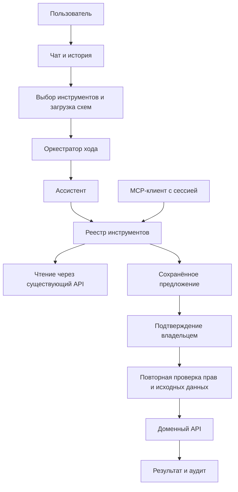

# ИИ-помощник и агенты

Текущий срез после переноса аудита в kran_dev: [результаты, первопричины и ограничения](../agent-audit/final-report.md). Дополнения C5 сохраняют первую часть поддерживаемой команды «прочитай, затем измени» и продолжают подготовку предложения, различают UUID и инвентарный код, используют реальные read/write tool modes и единый native формат истории Ollama. Для явно указанного rename/role доступна ограниченная подготовка карточки по авторизованному чтению; неполные и условные команды этим механизмом не дополняются. Выполнение по-прежнему требует отдельного подтверждения. `membership_is_active` и `account_is_active` различаются, role-only update сохраняет исходное членство и даты. `current_only` в inventory ограничивает обзор выбранным зданием, прежний default охватывает доступные здания с проверкой каждой роли.

C4: однозначный список оборудования текущего объекта читается через backend независимо от router и не расширяет scope на другие здания; фильтры/второе действие не отбрасываются. All-failed reads дают явный тип ограничения, не «нет данных». Native grammar отделяет describe_tool.name от обычных path/query/body/view. Смена роли сохраняет отсутствующие employment dates и проверяет объединённый период; явный null остаётся очищением. Read-only распознавание кода/показания с одного фото использует строгий VisiblePhotoReading и не создаёт record/approval/приёмку. Другие команды остаются в обычном подтверждаемом workflow.

При нормализации команды сохраняйте набор явно переданных полей (`exclude_unset`): omission PATCH и явный null имеют разные значения. expected_revision — текущая ревизия из свежего чтения, не следующая. Ошибка команды сообщает только поле/тип без сырых значений. Локальная Ollama получает объект аргументов в native grammar и адаптируется в каноническую arguments_json DTO; облачный strict wire сохранён. Ни адаптация, ни inference retry не исполняют write: запись требует отдельного server approval, а потеря ответа после dispatch остаётся uncertain без автоматического повторения.

Аналитика заданий: [аудит 76/124, серверной даты, дублей, норм и отказов Ollama](../ASSISTANT_ANALYTICS_AUDIT.md). `tasks_analyze` рассчитывает полный разрешённый набор одним SELECT; `complete` и fingerprint отделяют полные агрегаты от страниц подробностей. `all_tasks`, `execution_pending`, `unfinished` и `scheduled_unfinished` имеют разные значения. Завершённые/отменённые исключены из незавершённых, работа и приёмка включены. Для новых аналитических сценариев числа, календарные сравнения и единицы рассчитывайте на сервере; промпт не заменяет проверку полноты. `server_context.local_date/timezone` обязательны в контексте финальной генерации, включая обычный разговор; календарные выводы опираются на них, но выводить незапрошенную дату в каждом сообщении не требуется. Неполный снимок, отсутствие прав, пустой набор и ошибка провайдера должны оставаться различимы. При ошибке финальной генерации хранится failed/error_code, а не фиктивный completed.

Производственные процессы: [проверка 12 исходных запросов, оценки и полные ответы](../ASSISTANT_PRODUCTION_SCENARIOS.md). Типовые операции планирования используют `production_workflow.py`: чтение подтверждённых обязанностей периода, создание черновика, запуск baseline/CP-SAT, новая версия, фактическое сравнение сегментов и публикация выбранного утверждённого предложения. Параметры UUID/revision/idempotency берутся из API или генерируются сервером, а не запрашиваются у пользователя как недостающие нормативы. Каждая запись требует собственной карточки и подтверждения; роли и валидатор сохраняются. Неподдерживаемый what-if и отсутствующие исходные сведения объявляются явно.

P0-аудит чтения реестра: [причины, воспроизведение, контракты и трассы](../ASSISTANT_P0_AUDIT.md), последующий [изолированный red-team](../agent-audit/README.md). GET допускает не более двух безопасных коррекций: оболочка/пагинация, затем только неизвестная проекция; query/path селекторы не удаляются. Запись, запреты доступа и ошибки backend автоматически не повторяются. Межобъектная инвентаризация использует фактическую роль пользователя в каждом здании и выводит данные PostgreSQL независимо от вложений Excel.

Для новых расчётов по прикреплённому Excel используйте проверку готовности источника: исходный файл не утверждает нормы, единицы, привязку к активам или полезную ёмкость смены. `quantity` не является `person_hours`; пустая нормативная ячейка остаётся `null`. Реальная численность/план по неподготовленному файлу не вычисляется текстовой моделью: возвращаются фактические пробелы, затем доступны подготовка импорта и утверждение исходных данных. Подробный анализ уже предоставленных сведений остаётся обычным текстовым ответом. Импорт не выполняется молча вместо анализа. Повторный явный запрос файла выбирает отправленный файл по имени; самостоятельный вопрос о текущем объекте не подменяется старым вложением. Свободный текст trace всегда хешируется, даже если похож на UUID; открытые UUID допустимы только в реальных ID-полях.

Отдельный чат, запрошенный владельцем 14.11.2026, реализован на `/assistant`. Он использует существующие операции; наличие чата не означает завершение остальных пунктов ТЗ. Права, нормативные проверки, версии и стадии согласования сохраняются. Свободные ответы локальной 4B модели и длинные диалоги остаются отдельной областью проверки качества и задержек.

## Пользовательский путь

Любой вошедший пользователь: **ИИ-помощник → написать сообщение или прикрепить файл**. По уточнению владельца от 14.11.2026 интерфейс содержит один универсальный чат без выбора специализации. Пустой экран сразу предлагает поле ввода; диалог создаётся при первой отправке/вложении. История находится справа, на узком экране открывается отдельной правой панелью с Escape и возвратом фокуса. ИИ читает доступные данные и уточняет недостающее. Для изменения появляется карточка с объектом, параметрами, исходным состоянием и причиной. Пользователь проверяет её, отмечает согласие и нажимает «Подтвердить и выполнить» либо отклоняет. После успеха видны статус и результат существующего API. Сообщение «да» и решение модели не заменяют подтверждение карточки.

`/assistant?chat=<uuid>` восстанавливает диалог после reload и Back/Forward; прежние ссылки с agent продолжают открываться. Диалог принадлежит пользователю, зданию и роли создания; после понижения роли прежняя привилегированная история не открывается. Известный UUID не даёт чужих прав. При смене контекста remount и scoped cache исключают прежние кадры. Несохранённый текст сохраняется при переключении диалогов в пределах открытой страницы; reload восстанавливает отправленные сообщения. Лента ограничена 25 ходами, список диалогов — 25 строками. Переписка открывается внизу до первого paint; «Ранее» показывает старую страницу, «К последним» возвращает актуальную. Поле сообщения остаётся внизу отдельной области, прокрутка нативная. Автопрокрутка следует за ответом только у нижней границы; ручное чтение выше не прерывается обновлениями. Каждое отправленное сообщение и ответ показывают дату/время в часовом поясе объекта, ответ использует finished_at. Enter отправляет, Shift+Enter оставляет новую строку; IME composition не отправляет сообщение.

При работе показываются приглушённые **фактические статусы**, без скрытых рассуждений модели. Сервер сохраняет ограниченную trace перед маршрутизацией, модельным шагом и вызовом конкретного инструмента, затем отмечает completed/denied/proposed. Poll читает те же авторизованные страницы; таймеры и случайная смена «этапов» не имитируют работу. После ответа краткий журнал доступен в «Ход выполнения». В прогресс не входят аргументы, секреты и текст внутренних рассуждений. Новая SQL-миграция не нужна.

Поиск заданий, сотрудников и оборудования сохраняет только число найденных и число записей на полученной странице; предварительная проверка назначения — признак наличия предложения. Поэтому журнал не выдаёт страницу за весь результат и не раскрывает записи. Ошибки параметров, отсутствующей записи и отсутствия доступа обозначаются отдельно, включая случаи последующего успешного повтора. Модели возвращается подсказка о допустимых параметрах и различии ID задания и оборудования; права и подтверждение изменений остаются серверными.

Краткие ответы «готов», «да», «согласен» и аналогичные передаются модели вместе с недавней историей, чтобы сохранить смысл продолжения. Они не заменяют подтверждение конкретной карточки и не обходят ограничения подбора. При ошибке схемы локальной модели выполняется одна повторная генерация без повторного вызова инструментов; если модель снова не сформировала шаг, а проверенные результаты уже есть, ассистент пытается сформировать ответ по ним, явно сохраняя ограничения.

Если ассистент попросил выбрать задание или сотрудника, короткий ответ сохраняет контекст диалога. Инструмент `assignment_prepare` принимает найденные идентификаторы задания и сотрудников, получает актуальные версию и окно работы на сервере и запускает существующий подбор с проверкой доступности и допусков. При явно порученном назначении успешная проверка автоматически готовит карточку `task_assign`; сервер повторно проверяет состав и время перед предложением и перед исполнением. Неоднозначный выбор и отсутствие допустимого варианта не должны превращаться в назначение. Все записи выполняются только после подтверждения карточки и повторной проверки прав.

Для выбора конкретного задания после вопроса ассистента сервер сначала самостоятельно сопоставляет название с доступными предстоящими заданиями и имена с сотрудниками объекта. Только при единственном совпадении задания и полном просмотре ограниченной выборки запускается проверка; результат с неподходящим названием не используется для автоматического предложения. При неоднозначности или слишком большом наборе выполняется обычная обработка диалога. Точные название и имена из проверенных данных указываются в карточке; результат совпадения не заменяет подтверждение пользователя.

Если при назначении запрос к конкретной работе не удался, а поиск уже вернул задания, ответ содержит до пяти фактически найденных работ с названием, оборудованием, сроком, статусом и полным ID. Пользователь может ответить номером или скопированным ID; сервер принимает только идентификатор из последнего показанного списка и перепроверяет запись. Если пользователь просил одного исполнителя, автоматический подбор не подменяет подтверждённую численность бригады: для задания с большим составом возвращается объяснение, без предложения назначить одного человека.

Остановка атомарно фиксирует завершение ответа и отменяет его неподтверждённые предложения; перед следующими вызовами проверяется статус, а создание предложения блокирует строку ответа. Уже запущенный синхронный запрос провайдеру не прерывается на уровне транспорта: его результат больше не применяется, и слот освобождается после возвращения запроса. Удаление личного диалога удаляет сообщения, вложения и предложения, но не отменяет бизнес-изменения; при исполняемом подтверждённом действии возвращается конфликт. Операции относятся к управлению транспортом чата и не предоставляются модели как инструменты.

## Пайплайн

Все новые и прежние диалоги исполняются универсальным `assistant` с полным реестром текущей роли. Сохранённый agent у старой истории не ограничивает новый запрос; подтверждения и MCP используют те же текущие права. Шаблоны `planner` и `photo` в `backend/app/assistant/prompts/` и discovery API сохраняются для совместимости и внутренних специализаций; они не являются пользовательскими вкладками. Фотоанализ остаётся отдельным доменным pipeline. Отдельный промпт `router.md` выбирает до восьми инструментов из каталога текущей роли; сервер подставляет их настоящие схемы до исполнения. Это уменьшает число вызовов для выяснения аргументов. Остальные схемы доступны через `describe_tool`, выбор маршрутизатора сам не вызывает API и не повышает права.

| Агент | Назначение | Граница |
|---|---|---|
| `assistant` | Поиск, оборудование, задания, отчёты и объяснения | Изменения только через карточку и API пользователя |
| `planner` | Состав/версии плана, условия, нагрузка, solver, согласование | Расчёт, применение, утверждение и выпуск — отдельные подтверждаемые команды |
| `photo` | Найти задание и запустить анализ сохранённого фотоотчёта | Сопоставимость не подтверждается моделью; приёмка остаётся инженеру |

Фотоагент вызывает существующий `photo-review`: сервер собирает конкретные файлы/пункты, проверяет MIME/SHA/лимиты и использует настроенный CLIP/Ollama/AI Tunnel pipeline. Внутри vision-пайплайна сохраняются специализированные промпты оценки снимков. Текстовая модель не получает байты фото и не выдаёт карточку задания за просмотр фотографии. Заключение не подтверждает скрытые операции и безопасность оборудования.

## Инструменты и расширение

`assistant/tools.py` и `assistant/capabilities.py` содержат имя, название, фиксированный метод/путь, роли, профили, режим read/write и preflight. Аргументы проверяются реальным FastAPI-контрактом через `field_info.is_required()`; неизвестные поля запрещены. Нет SQL, shell, произвольных URL, чтения/смены паролей и рекурсивного подтверждения самим агентом.

По уточнению владельца подключён весь существующий пользовательский API: **160 инструментов** с учётом роли и финальной проверки существующим endpoint. Оборудование/детали/наработка, регламенты и чек-листы, задания/фото/акты/приёмка, команда/смены/допуски/заявки, календарь/планы/solver/выпуск, Excel preview/import/export, уведомления, обращения, разрешения на просрочку, профиль/email, смена здания и выход. Смена пароля исключена. Вход/регистрация до авторизации, дублирующие URL и транспорт истории/человеческого подтверждения перечислены явно в [манифесте](../../contracts/assistant-tools.json). Права ОС и ещё не реализованные доменные функции не появляются из-за наличия чата.

`scripts/assistant_capabilities.py --write` экспортирует манифест. Тест `test_assistant_capabilities.py` проверяет весь зарегистрированный API без исключения по общему префиксу: любое новое действие требует инструмента либо конкретного объяснённого alias/инфраструктурного исключения. Эти правила добавлены в корневой AGENTS.md.

Поиск `tasks_find`, `equipment_find`, `staff_find` работает по всему разрешённому набору с SQL-пагинацией 25 строк. Ближайшее ТО сортируется по фактической плановой/обязательной дате, а история доступна через period/state/active_only. Нормативы, численность и длительность не угадываются. `task_assign` перед созданием предложения и при подтверждении проходит настоящий `assignment_context` и `assignment_preview`; состав и время должны совпасть с допустимым результатом. Недостаточность данных или людей объясняется без создания заведомо неверного назначения.

Для вложенных длинных списков инструмент чтения поддерживает `view.path`, `offset/limit`, `q`; длинный текст читается через `text_offset/text_limit` и возвращается частями без пропуска символов. JSON-ответы сокращаются целыми структурами с явной отметкой; сериализованный JSON не обрезается посреди значения. Старые обмены инструментами вытесняются при достижении бюджета контекста, сохраняя пользовательский запрос.

Чат и MCP используют один реестр. Вызовы своего API проходят через ASGI transport без сетевого round-trip. Модель выбирает имя и JSON-аргументы; URL/заголовки выбирает сервер. Cookie/CSRF живут только в памяти и не входят в промпты/историю. Каждый внутренний запрос аутентифицируется; ContextVar закрепляет исходные user/site/role. Доменный endpoint повторяет свои проверки прав, locks, ревизий, персонала и состояния.

Для нового действия: переиспользовать доменный endpoint, явно зарегистрировать capability/preflight/роли/агентов, проверить отказ/повтор/изменение исходных данных, карточку согласия и mobile; обновить документацию. Read разрешён только без доменной записи. Сохранение AI-заключения, запуск solver и подготовка публикации — write. Утверждённые нормы и безопасность не заменяются свободным ответом LLM.

## Подтверждения и сбои

Миграция `019_assistant_workspace.sql` добавляет только таблицы диалогов, ходов и действий. Прежние строки не меняются. Proposal хранит проверенные аргументы, причину, владельца через диалог, hash состава/контекста, hash исходного состояния и preview; срок — 15 минут. Состав после создания не редактируется.

Confirm принимает ID, точный hash и `confirmed=true`; проверяет владельца, текущие права и preflight. Изменившаяся исходная карточка делает предложение stale. Row lock атомарно фиксирует executing **до** вызова команды, поэтому конкурентный/повторный confirm не запускает её второй раз. Результат и `audit_events` сохраняют успех/отказ/неопределённость.

Текущий пароль для изменения email и необязательный личный ключ провайдера вводятся только в защищённом поле карточки. В proposal хранится `__human_secret__`, реальные значения передаются текущей команде только при подтверждении, не пишутся в историю/аудит и не попадают к модели. Смена пароля инструментом отсутствует. Изменения сессии передают настоящие Set-Cookie браузеру и обновляют контекст других вкладок; csrfToken не записывается в результаты. Принятый сервером повтор того же текста получает новый turn key, потерянный HTTP-ответ повторяется с прежним key. Кнопка повтора не удаляет старую ошибку и восстанавливает запрос в composer.

## Файлы

С 15.11.2026 (`fixrate-agents-v5`) чат читает содержимое XLSX напрямую, независимо от предметного формата импорта. До маршрутизации проверяются владелец/роль/объект и SHA; сервер разбирает до четырёх текущих книг и передаёт листы, исходные номера строк, значения и сохранённые результаты формул. Повторяющиеся соседние календарные отметки без потери данных сжимаются в диапазоны колонок; отдельные формулы сохраняются. Примеры текстовых выражений и пустых ссылок формул выделяются детерминированно, без исполнения формул и внешних ссылок. Бюджет данных — 60 000 символов; complete/truncated/rows_included и deferred/unreadable явно описывают покрытие. Ограничения парсера: 10 МиБ файла, до 200 ZIP-записей / 20 МиБ распаковки, 5000 строк / 200 000 ячеек, без паролей/макросов/DTD. Эти границы не означают автоматическую поддержку любого Excel.

`attachment_read` (161-я capability) читает приватную книгу через `GET /api/v1/assistant/conversations/{identity}/attachments/{attachment_id}/content`: точное имя листа, offset, limit≤25, поиск q, исходные адреса и next_offset. Тот же маршрут доступен MCP, с повторной проверкой владельца и текущих серверных прав; импорта и подтверждения для чтения нет. Ранее отправленная книга выбирается router через workbook_ids, поэтому вопрос о той же таблице не требует повторной загрузки. Неотправленные вложения в автоконтекст не попадают. Изображения прежних сообщений автоматически не пересылаются.

Планирование инструментов сохраняет строгую схему; обычное объяснение и финальный ответ используют отдельный текстовый вызов AI Tunnel без response_format/JSON-обёртки, до 8192 выходных токенов / 32 000 символов. При пустом выборе инструментов нет лишнего AgentStep. Общий provider deadline не продлевается. Перед каждым новым этапом проверяется сессия/роль/объект; изменение данных по-прежнему требует карточки подтверждения. В UI разрешён Markdown с таблицами, списками и кодом; HTML и внешние изображения отключены, ссылки фильтруются. Форматирование memoized и загружается только с разделом чата. Полное чтение файла не гарантирует верность интерпретации дешёвой моделью: числа, единицы и инженерные выводы требуют проверки по исходным ячейкам. Ответ не становится утверждённым нормативом или фактом выполнения.

С 15.11.2026 (`021_assistant_message_attachments.sql`, промпт `fixrate-agents-v4`) загрузка и отправка разделены: `MessageCreate.attachment_ids` задаёт до 20 ID этого диалога в определённом порядке. Разрешено сообщение только с файлами; сервер сохраняет явную просьбу их проанализировать. Повтор ключа сравнивает текст и порядок ID, изменение состава даёт 409. Пустой текст без файлов, дубликаты ID и чужие вложения отклоняются до создания хода. Старый клиент без поля attachment_ids получает только ещё не отправленные вложения; новый клиент передаёт явный массив, включая пустой. Чтение возвращает вложения по сообщениям и отдельный `pending_attachments` пакетными запросами.

Агент получает метаданные отправленных файлов и пиксели только изображений текущего сообщения, максимум четыре. Перед облачным вызовом проверяются актуальная сессия/роль/объект, принадлежность и SHA. Изображения ограничены 20 млн пикселей, ориентированы по EXIF, уменьшены до 1280×1280, преобразованы в JPEG без метаданных; оригиналы сохраняются. Router получает только метаданные. XLSX обрабатывается существующими preview/import инструментами по ID; импорт подтверждается человеком. Байты изображений не записываются в историю/trace. Прежние отправленные файлы доступны инструментам, незавершённые загрузки не включаются в контекст нового сообщения автоматически.

Миграция `020_assistant_attachments.sql` добавляет личные неизменяемые вложения диалога в приватном photo storage. XLSX/JPEG/PNG/WebP до 10 МиБ, максимум 20 файлов / 100 МиБ на диалог, дедупликация SHA+имени, проверка user/site/role/conversation и контрольной суммы. Стадия прикрепления сама не импортирует данные и не изменяет отчёт.

Файловые инструменты принимают ID вложения, а не путь, URL или байты от модели. Сервер собирает исходную multipart-форму существующего API. Предпросмотр доступен до подтверждения; импорт, запись фотографии/показания и акта требуют отдельной карточки. Выгрузки возвращаются авторизованными ссылками исходного API; двоичные файлы не превращаются в текстовый контекст LLM. В MCP файловому preview также нужен conversation_id для проверки владения.

Общей транзакции чата и всех API нет: прежние доменные сервисы сами владеют транзакцией. Потеря ответа после dispatch даёт uncertain и запрещает слепой повтор. Нужно проверить фактическую карточку перед новой командой. Это at-most-once граница, не exactly-once. Executing старше трёх минут показывается как uncertain. Доменные idempotency keys и ревизии дополнительно действуют там, где предусмотрены.

Сообщение имеет conversation-bound idempotency key и сравнение текста. Один активный ход на диалог, два на процесс, выбор инструментов и до 12 модельных шагов, включая финальный ответ / 20 tool calls / одно предложение за ход. Последний шаг зарезервирован под итог: `FinalReply` принимает только непустой answer и не исполняет инструменты. При третьем одинаковом вызове, исчерпании бюджета инструментов, контекста или приближении deadline проверка также завершается итогом по уже полученным результатам. Пустой ответ без вызовов проходит ту же финализацию. Промпт `final.md` требует отличать отсутствие записей от неполной проверки, ошибки и отсутствия прав; рейтинг не выводится по первой странице. Если финальная модель недоступна, сервер возвращает честное пояснение ограничения и полезный следующий шаг. Техническое «Достигнут предел шагов» больше не подменяет ответ. Частичный timeout сохраняет failed/error_code и объяснение пользователю.

Один клиент делит общий provider timeout на весь ход, без нового deadline для финализации; за 12 секунд до него предпринимается попытка подвести итог. Контекст ограничен 100 тысячами символов, история — 15 тысячами, ответ инструмента — 1 МиБ и укороченной проекцией модели. В истории — модель, версия промпта и статусы, без chain-of-thought/секретов. Модель вызывается вне DB-транзакции. Ход выполняется в процессе приложения; после перезапуска через три минуты показывается failed с сохранённым сообщением. Автоматического возобновления внешним durable worker нет.

## MCP и настройка

`fixrate-agents-v7` формирует ответ от главного к подробностям, использует понятные статусы, короткие списки и не повторяет общие ограничения под каждой строкой. Для текстового ответа обычному пользователю результаты инструментов дополнительно проецируются: известные названия полей и статусы переводятся, UUID в полях опускаются; исходные результаты сохраняются для работы инструментов. При явном техническом вопросе передаются исходные данные. Данная проекция не изменяет БД, права, условия поиска или карточку подтверждения; неполная проверка и источники фактов не выдаются за доказательство отсутствия данных. Это инструкция и ограниченная проекция, а не гарантия поведения каждой модели.

`fixrate-agents-v6`: маршрутизатор и итоговый ответ ориентируются на последнее сообщение. Для самостоятельного вопроса прежние ходы не передаются модели; при явных отсылках и коротких командах продолжения используются последние ходы. Это эвристика, поэтому неоднозначная формулировка без отсылки может потребовать уточнения. Текущий вопрос не дублируется в истории итогового ответа. Простому разговору без файлов и результатов инструментов выделен короткий промпт, чтобы примеры предметных сценариев не навязывались ответу. Приветствия и вопросы об ассистенте допускаются; посторонние темы перенаправляются к FixRate и инженерному обслуживанию. Данные, ошибка фильтра или отсутствие вложения в текущем контексте не объявляются отсутствующими во всей системе. Права, предметные чтения и подтверждение записи не меняются.

`ASSISTANT_PROVIDER=ollama` выбирает локальный `OllamaClient` вместо AI Tunnel. `OLLAMA_CHAT_BASE_URL` разрешает только loopback, Docker Desktop host или фиксированные локальные имена ollama/vision; userinfo, произвольные пути, query, fragment и редиректы запрещены. `OLLAMA_CHAT_MODEL` — явный локальный tag, `OLLAMA_CHAT_DIGEST` — SHA-256 manifest из `/api/tags`. Перед каждой генерацией сверяется digest; удалённые модели и cloud-теги отклоняются. Провайдер сам не скачивает модель и не переключается в облако. Обычный ответ идёт без format, выбор инструментов — с JSON schema в format, изображения — штатным полем images. Thinking из ответа не сохраняется и не показывается. Неизвестный провайдер делает конфигурацию недоступной.

Локальные настройки: `OLLAMA_CHAT_NUM_CTX=32768`, `OLLAMA_CHAT_TIMEOUT_SECONDS=240` (допустимо до 600). Один deadline включает проверку manifest, router, инструменты и ответ. Восстановление прерванного хода учитывает timeout + 30 секунд с минимумом 180; при текущих параметрах — 270 секунд, чтобы медленный локальный ответ не был преждевременно помечен failed через три минуты. Обработка подтверждённых доменных команд не меняется. Профиль `compose.ollama.yaml` использует ту же Ollama для фото и RF для прогнозов; облачный ключ для такого режима не требуется.

Для Windows: `powershell -NoProfile -ExecutionPolicy Bypass -File scripts/start_ollama_chat.ps1` запускает установленную Ollama скрыто на 127.0.0.1:11434, скачивает модель при отсутствии и сохраняет manifest в `var/ollama-chat/model.json`; `-SkipPull` проверяет подготовленную модель без скачивания. Кеш весов — `var/ollama-models`. В Docker Desktop у backend адрес `http://host.docker.internal:11434`, у нативного backend — loopback. Helper `start_local.py` читает только разрешённые AI-настройки из `.env` и добавляет профиль Ollama при ASSISTANT_PROVIDER=ollama. Готовую установку и замеры см. в [runtime](runtime.md).

`POST /api/v1/assistant/mcp`: stateless JSON Streamable HTTP, версия `2025-06-18`; `initialize`, `ping`, `tools/list`, `tools/call`, `prompts/list`, `prompts/get`, `notifications/initialized`. GET возвращает 405, отдельного SSE-потока нет. Accept: `application/json, text/event-stream`; после initialize требуется `MCP-Protocol-Version: 2025-06-18`. Действуют Origin, session cookie и CSRF. Это транспорт для уже аутентифицированного клиента; OAuth provisioning и произвольные внешние MCP-серверы не подключены.

Write tool требует `conversation_id` личного диалога и создаёт ту же карточку. Инструмента confirm в MCP нет. Человек подтверждает в `/assistant`. Контракт опирается на [MCP tools](https://modelcontextprotocol.io/specification/2025-06-18/server/tools), [lifecycle](https://modelcontextprotocol.io/specification/2025-06-18/basic/lifecycle), [HTTP transport](https://modelcontextprotocol.io/specification/2025-06-18/basic/transports).

Используется существующий `AITunnelClient`, без нового SDK. `AITUNNEL_API_KEY` (alias `AI_TUNNEL_API_KEY`) хранится на сервере; `AITUNNEL_CHAT_MODEL` выбирает модель, по умолчанию прежний `qwen3.7-flash`. `AITUNNEL_TIMEOUT_SECONDS` ограничивает ход. Фото/прогнозы имеют собственные настройки. Новые провайдеры подключаются на границе `assistant/service.py:provider`, а не в доменных endpoint.

Отсутствие ключа, отказ/timeout, неверная модель/JSON/схема дают явный unavailable/failed. Успех не имитируется. ScriptedModel существует только в изолированном QA runner и тестах, не входит в deploy image и не заменяет реальный провайдер. В облако передаются сообщения и результаты разрешённых чтений, без ключа и прямого доступа к БД.

## Поиск знаний и контекст

Единый чат пока не содержит универсального document RAG: нет общего chunk/embedding index и semantic retrieval по инструкциям, паспортам и документам. Он получает авторизованные факты через backend tools, читает личные XLSX и ограниченно использует историю. Отдельный triage в integration/incidents.py ранжирует существующие кандидаты регламентов по пересечению слов, передаёт top-10 модели и возвращает retrieved_sources; это узкий retrieval-augmented путь. CLIP text embeddings относятся к сравнению фотографий, не к поиску базы знаний чата. Наличие MCP/tool calling само по себе не означает наличия документного RAG.
