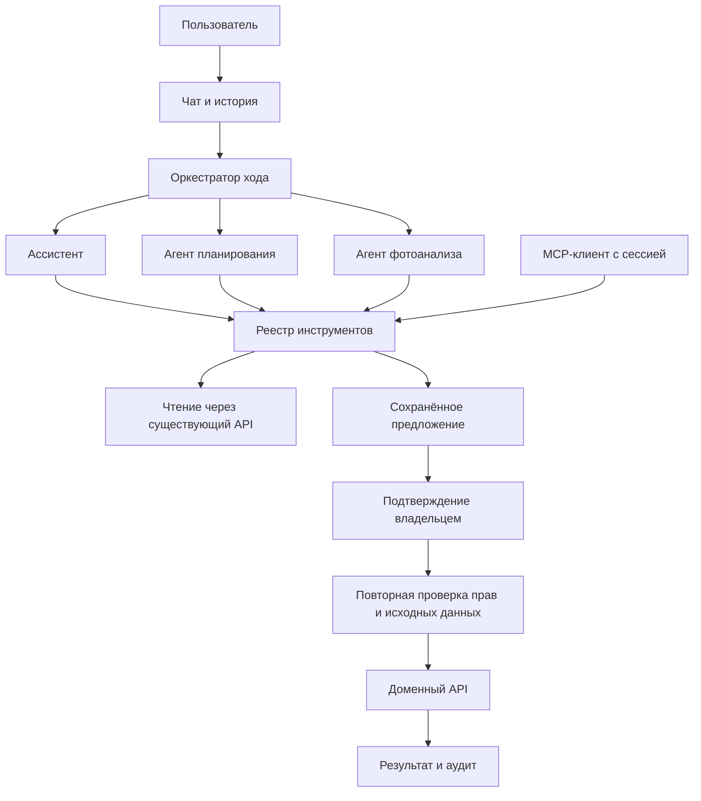

# ИИ-помощник и агенты

По решению владельца от 14.11.2026 отдельный чат становится следующим приоритетом. Он использует существующие операции; наличие чата не означает завершение остальных пунктов ТЗ. Права, нормативные проверки, версии и стадии согласования сохраняются.

## Пользовательский путь

Любой вошедший пользователь: **ИИ-помощник → Начать диалог → сообщение**. ИИ читает доступные данные и уточняет недостающее. Для изменения появляется карточка с объектом, параметрами, исходным состоянием и причиной. Пользователь проверяет её, отмечает согласие и нажимает «Подтвердить и выполнить» либо отклоняет. После успеха видны статус и результат существующего API. Сообщение «да» и решение модели не заменяют подтверждение карточки.

`/assistant?chat=<uuid>&agent=assistant|planner|photo` восстанавливает диалог после reload и Back/Forward. Диалог принадлежит пользователю, зданию и роли создания; после понижения роли прежняя привилегированная история не открывается. Известный UUID не даёт чужих прав. При смене контекста remount и scoped cache исключают прежние кадры. Несохранённый текст сохраняется при переключении диалогов в пределах открытой страницы; reload восстанавливает отправленные сообщения. Лента ограничена 25 ходами, список диалогов — 25 строками. Прокрутка нативная, без посимвольной анимации; ожидание показано явно.

## Пайплайн

Агенты — специализированные профили одного ограниченного runtime. Каждый имеет системный промпт в `backend/app/assistant/prompts/` и allowlist инструментов; общие правила помощника применяются ко всем. Профиль сохраняется при создании диалога и не повышает права человека.

| Агент | Назначение | Граница |
|---|---|---|
| `assistant` | Поиск, оборудование, задания, отчёты и объяснения | Изменения только через карточку и API пользователя |
| `planner` | Состав/версии плана, условия, нагрузка, solver, согласование | Расчёт, применение, утверждение и выпуск — отдельные подтверждаемые команды |
| `photo` | Найти задание и запустить анализ сохранённого фотоотчёта | Сопоставимость не подтверждается моделью; приёмка остаётся инженеру |

Фотоагент вызывает существующий `photo-review`: сервер собирает конкретные файлы/пункты, проверяет MIME/SHA/лимиты и использует настроенный CLIP/Ollama/AI Tunnel pipeline. Внутри vision-пайплайна сохраняются специализированные промпты оценки снимков. Текстовая модель не получает байты фото и не выдаёт карточку задания за просмотр фотографии. Заключение не подтверждает скрытые операции и безопасность оборудования.

## Инструменты и расширение

`assistant/tools.py` содержит явные имя, название, метод, фиксированный путь, роли, профили, режим read/write и preflight. Схема и валидация аргументов берутся из реального FastAPI route. Неизвестные поля запрещены. Нет SQL, shell, произвольных URL, паролей, смены ролей и рекурсивных вызовов самого ассистента.

Подключены оборудование/инструкции, задания/назначения/отчёты по ролям, общие и каталожные планы, нагрузка/policy/размещение/деление/undo, solver и применение, предложение/утверждение/выпуск. Multipart-загрузки Excel/фото, администрирование учётных данных и ещё не реализованные доменные операции остаются обычными формами. Ассистент обязан объяснять отсутствие инструмента; права разработчика ОС ему не передаются.

Чат и MCP используют один реестр. Вызовы своего API проходят через ASGI transport без сетевого round-trip. Модель выбирает имя и JSON-аргументы; URL/заголовки выбирает сервер. Cookie/CSRF живут только в памяти и не входят в промпты/историю. Каждый внутренний запрос аутентифицируется; ContextVar закрепляет исходные user/site/role. Доменный endpoint повторяет свои проверки прав, locks, ревизий, персонала и состояния.

Для нового действия: переиспользовать доменный endpoint, явно зарегистрировать capability/preflight/роли/агентов, проверить отказ/повтор/изменение исходных данных, карточку согласия и mobile; обновить документацию. Read разрешён только без доменной записи. Сохранение AI-заключения, запуск solver и подготовка публикации — write. Утверждённые нормы и безопасность не заменяются свободным ответом LLM.

## Подтверждения и сбои

Миграция `019_assistant_workspace.sql` добавляет только таблицы диалогов, ходов и действий. Прежние строки не меняются. Proposal хранит проверенные аргументы, причину, владельца через диалог, hash состава/контекста, hash исходного состояния и preview; срок — 15 минут. Состав после создания не редактируется.

Confirm принимает ID, точный hash и `confirmed=true`; проверяет владельца, текущие права и preflight. Изменившаяся исходная карточка делает предложение stale. Row lock атомарно фиксирует executing **до** вызова команды, поэтому конкурентный/повторный confirm не запускает её второй раз. Результат и `audit_events` сохраняют успех/отказ/неопределённость.

Общей транзакции чата и всех API нет: прежние доменные сервисы сами владеют транзакцией. Потеря ответа после dispatch даёт uncertain и запрещает слепой повтор. Нужно проверить фактическую карточку перед новой командой. Это at-most-once граница, не exactly-once. Executing старше трёх минут показывается как uncertain. Доменные idempotency keys и ревизии дополнительно действуют там, где предусмотрены.

Сообщение имеет conversation-bound idempotency key и сравнение текста. Один активный ход на диалог, два на процесс, до 8 модельных шагов / 12 tool calls / одного предложения за ход. Один клиент делит общий provider timeout на весь ход; контекст ограничен 100 тысячами символов, ответ инструмента — 1 МиБ и укороченной проекцией модели. В истории — модель, версия промпта и статусы, без chain-of-thought/секретов. Модель вызывается вне DB-транзакции. Ход выполняется в процессе приложения; после перезапуска через три минуты показывается failed с сохранённым сообщением. Автоматического возобновления внешним durable worker нет.

## MCP и настройка

`POST /api/v1/assistant/mcp`: stateless JSON Streamable HTTP, версия `2025-06-18`; `initialize`, `ping`, `tools/list`, `tools/call`, `prompts/list`, `prompts/get`, `notifications/initialized`. GET возвращает 405, отдельного SSE-потока нет. Accept: `application/json, text/event-stream`; после initialize требуется `MCP-Protocol-Version: 2025-06-18`. Действуют Origin, session cookie и CSRF. Это транспорт для уже аутентифицированного клиента; OAuth provisioning и произвольные внешние MCP-серверы не подключены.

Write tool требует `conversation_id` личного диалога и создаёт ту же карточку. Инструмента confirm в MCP нет. Человек подтверждает в `/assistant`. Контракт опирается на [MCP tools](https://modelcontextprotocol.io/specification/2025-06-18/server/tools), [lifecycle](https://modelcontextprotocol.io/specification/2025-06-18/basic/lifecycle), [HTTP transport](https://modelcontextprotocol.io/specification/2025-06-18/basic/transports).

Используется существующий `AITunnelClient`, без нового SDK. `AITUNNEL_API_KEY` (alias `AI_TUNNEL_API_KEY`) хранится на сервере; `AITUNNEL_CHAT_MODEL` выбирает модель, по умолчанию прежний `qwen3.7-flash`. `AITUNNEL_TIMEOUT_SECONDS` ограничивает ход. Фото/прогнозы имеют собственные настройки. Новые провайдеры подключаются на границе `assistant/service.py:provider`, а не в доменных endpoint.

Отсутствие ключа, отказ/timeout, неверная модель/JSON/схема дают явный unavailable/failed. Успех не имитируется. ScriptedModel существует только в изолированном QA runner и тестах, не входит в deploy image и не заменяет реальный провайдер. В облако передаются сообщения и результаты разрешённых чтений, без ключа и прямого доступа к БД.
