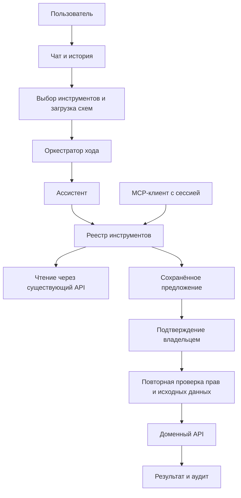

# ИИ-помощник и агенты

По решению владельца от 14.11.2026 отдельный чат становится следующим приоритетом. Он использует существующие операции; наличие чата не означает завершение остальных пунктов ТЗ. Права, нормативные проверки, версии и стадии согласования сохраняются.

## Пользовательский путь

Любой вошедший пользователь: **ИИ-помощник → написать сообщение или прикрепить файл**. По уточнению владельца от 14.11.2026 интерфейс содержит один универсальный чат без выбора специализации. Пустой экран сразу предлагает поле ввода; диалог создаётся при первой отправке/вложении. История находится справа, на узком экране открывается отдельной правой панелью с Escape и возвратом фокуса. ИИ читает доступные данные и уточняет недостающее. Для изменения появляется карточка с объектом, параметрами, исходным состоянием и причиной. Пользователь проверяет её, отмечает согласие и нажимает «Подтвердить и выполнить» либо отклоняет. После успеха видны статус и результат существующего API. Сообщение «да» и решение модели не заменяют подтверждение карточки.

`/assistant?chat=<uuid>` восстанавливает диалог после reload и Back/Forward; прежние ссылки с agent продолжают открываться. Диалог принадлежит пользователю, зданию и роли создания; после понижения роли прежняя привилегированная история не открывается. Известный UUID не даёт чужих прав. При смене контекста remount и scoped cache исключают прежние кадры. Несохранённый текст сохраняется при переключении диалогов в пределах открытой страницы; reload восстанавливает отправленные сообщения. Лента ограничена 25 ходами, список диалогов — 25 строками. Переписка открывается внизу до первого paint; «Ранее» показывает старую страницу, «К последним» возвращает актуальную. Поле сообщения остаётся внизу отдельной области, прокрутка нативная. Автопрокрутка следует за ответом только у нижней границы; ручное чтение выше не прерывается обновлениями. Каждое отправленное сообщение и ответ показывают дату/время в часовом поясе объекта, ответ использует finished_at. Enter отправляет, Shift+Enter оставляет новую строку; IME composition не отправляет сообщение.

При работе показываются приглушённые **фактические статусы**, без скрытых рассуждений модели. Сервер сохраняет ограниченную trace перед маршрутизацией, модельным шагом и вызовом конкретного инструмента, затем отмечает completed/denied/proposed. Poll читает те же авторизованные страницы; таймеры и случайная смена «этапов» не имитируют работу. После ответа краткий журнал доступен в «Ход выполнения». В прогресс не входят аргументы, секреты и текст внутренних рассуждений. Новая SQL-миграция не нужна.

## Пайплайн

Все новые и прежние диалоги исполняются универсальным `assistant` с полным реестром текущей роли. Сохранённый agent у старой истории не ограничивает новый запрос; подтверждения и MCP используют те же текущие права. Шаблоны `planner` и `photo` в `backend/app/assistant/prompts/` и discovery API сохраняются для совместимости и внутренних специализаций; они не являются пользовательскими вкладками. Фотоанализ остаётся отдельным доменным pipeline. Отдельный промпт `router.md` выбирает до восьми инструментов из каталога текущей роли; сервер подставляет их настоящие схемы до исполнения. Это уменьшает число вызовов для выяснения аргументов. Остальные схемы доступны через `describe_tool`, выбор маршрутизатора сам не вызывает API и не повышает права.

| Агент | Назначение | Граница |
|---|---|---|
| `assistant` | Поиск, оборудование, задания, отчёты и объяснения | Изменения только через карточку и API пользователя |
| `planner` | Состав/версии плана, условия, нагрузка, solver, согласование | Расчёт, применение, утверждение и выпуск — отдельные подтверждаемые команды |
| `photo` | Найти задание и запустить анализ сохранённого фотоотчёта | Сопоставимость не подтверждается моделью; приёмка остаётся инженеру |

Фотоагент вызывает существующий `photo-review`: сервер собирает конкретные файлы/пункты, проверяет MIME/SHA/лимиты и использует настроенный CLIP/Ollama/AI Tunnel pipeline. Внутри vision-пайплайна сохраняются специализированные промпты оценки снимков. Текстовая модель не получает байты фото и не выдаёт карточку задания за просмотр фотографии. Заключение не подтверждает скрытые операции и безопасность оборудования.

## Инструменты и расширение

`assistant/tools.py` и `assistant/capabilities.py` содержат имя, название, фиксированный метод/путь, роли, профили, режим read/write и preflight. Аргументы проверяются реальным FastAPI-контрактом через `field_info.is_required()`; неизвестные поля запрещены. Нет SQL, shell, произвольных URL, чтения/смены паролей и рекурсивного подтверждения самим агентом.

По уточнению владельца подключён весь существующий пользовательский API: **160 инструментов** с учётом роли и финальной проверки существующим endpoint. Оборудование/детали/наработка, регламенты и чек-листы, задания/фото/акты/приёмка, команда/смены/допуски/заявки, календарь/планы/solver/выпуск, Excel preview/import/export, уведомления, обращения, разрешения на просрочку, профиль/email, смена здания и выход. Смена пароля исключена. Вход/регистрация до авторизации, дублирующие URL и транспорт истории/человеческого подтверждения перечислены явно в [манифесте](../../contracts/assistant-tools.json). Права ОС и ещё не реализованные доменные функции не появляются из-за наличия чата.

`scripts/assistant_capabilities.py --write` экспортирует манифест. Тест `test_assistant_capabilities.py` проверяет весь зарегистрированный API без исключения по общему префиксу: любое новое действие требует инструмента либо конкретного объяснённого alias/инфраструктурного исключения. Эти правила добавлены в корневой AGENTS.md.

Поиск `tasks_find`, `equipment_find`, `staff_find` работает по всему разрешённому набору с SQL-пагинацией 25 строк. Ближайшее ТО сортируется по фактической плановой/обязательной дате, а история доступна через period/state/active_only. Нормативы, численность и длительность не угадываются. `task_assign` перед созданием предложения и при подтверждении проходит настоящий `assignment_context` и `assignment_preview`; состав и время должны совпасть с допустимым результатом. Недостаточность данных или людей объясняется без создания заведомо неверного назначения.

Для вложенных длинных списков инструмент чтения поддерживает `view.path`, `offset/limit`, `q`; длинный текст читается через `text_offset/text_limit` и возвращается частями без пропуска символов. JSON-ответы сокращаются целыми структурами с явной отметкой; сериализованный JSON не обрезается посреди значения. Старые обмены инструментами вытесняются при достижении бюджета контекста, сохраняя пользовательский запрос.

Чат и MCP используют один реестр. Вызовы своего API проходят через ASGI transport без сетевого round-trip. Модель выбирает имя и JSON-аргументы; URL/заголовки выбирает сервер. Cookie/CSRF живут только в памяти и не входят в промпты/историю. Каждый внутренний запрос аутентифицируется; ContextVar закрепляет исходные user/site/role. Доменный endpoint повторяет свои проверки прав, locks, ревизий, персонала и состояния.

Для нового действия: переиспользовать доменный endpoint, явно зарегистрировать capability/preflight/роли/агентов, проверить отказ/повтор/изменение исходных данных, карточку согласия и mobile; обновить документацию. Read разрешён только без доменной записи. Сохранение AI-заключения, запуск solver и подготовка публикации — write. Утверждённые нормы и безопасность не заменяются свободным ответом LLM.

## Подтверждения и сбои

Миграция `019_assistant_workspace.sql` добавляет только таблицы диалогов, ходов и действий. Прежние строки не меняются. Proposal хранит проверенные аргументы, причину, владельца через диалог, hash состава/контекста, hash исходного состояния и preview; срок — 15 минут. Состав после создания не редактируется.

Confirm принимает ID, точный hash и `confirmed=true`; проверяет владельца, текущие права и preflight. Изменившаяся исходная карточка делает предложение stale. Row lock атомарно фиксирует executing **до** вызова команды, поэтому конкурентный/повторный confirm не запускает её второй раз. Результат и `audit_events` сохраняют успех/отказ/неопределённость.

Текущий пароль для изменения email и необязательный личный ключ провайдера вводятся только в защищённом поле карточки. В proposal хранится `__human_secret__`, реальные значения передаются текущей команде только при подтверждении, не пишутся в историю/аудит и не попадают к модели. Смена пароля инструментом отсутствует. Изменения сессии передают настоящие Set-Cookie браузеру и обновляют контекст других вкладок; csrfToken не записывается в результаты. Принятый сервером повтор того же текста получает новый turn key, потерянный HTTP-ответ повторяется с прежним key. Кнопка повтора не удаляет старую ошибку и восстанавливает запрос в composer.

## Файлы

Миграция `020_assistant_attachments.sql` добавляет личные неизменяемые вложения диалога в приватном photo storage. XLSX/JPEG/PNG/WebP до 10 МиБ, максимум 20 файлов / 100 МиБ на диалог, дедупликация SHA+имени, проверка user/site/role/conversation и контрольной суммы. Стадия прикрепления сама не импортирует данные и не изменяет отчёт.

Файловые инструменты принимают ID вложения, а не путь, URL или байты от модели. Сервер собирает исходную multipart-форму существующего API. Предпросмотр доступен до подтверждения; импорт, запись фотографии/показания и акта требуют отдельной карточки. Выгрузки возвращаются авторизованными ссылками исходного API; двоичные файлы не превращаются в текстовый контекст LLM. В MCP файловому preview также нужен conversation_id для проверки владения.

Общей транзакции чата и всех API нет: прежние доменные сервисы сами владеют транзакцией. Потеря ответа после dispatch даёт uncertain и запрещает слепой повтор. Нужно проверить фактическую карточку перед новой командой. Это at-most-once граница, не exactly-once. Executing старше трёх минут показывается как uncertain. Доменные idempotency keys и ревизии дополнительно действуют там, где предусмотрены.

Сообщение имеет conversation-bound idempotency key и сравнение текста. Один активный ход на диалог, два на процесс, выбор инструментов и до 12 исполнительных модельных шагов / 20 tool calls / одного предложения за ход. Один клиент делит общий provider timeout на весь ход; контекст ограничен 100 тысячами символов, история — 15 тысячами, ответ инструмента — 1 МиБ и укороченной проекцией модели. В истории — модель, версия промпта и статусы, без chain-of-thought/секретов. Модель вызывается вне DB-транзакции. Ход выполняется в процессе приложения; после перезапуска через три минуты показывается failed с сохранённым сообщением. Автоматического возобновления внешним durable worker нет.

## MCP и настройка

`POST /api/v1/assistant/mcp`: stateless JSON Streamable HTTP, версия `2025-06-18`; `initialize`, `ping`, `tools/list`, `tools/call`, `prompts/list`, `prompts/get`, `notifications/initialized`. GET возвращает 405, отдельного SSE-потока нет. Accept: `application/json, text/event-stream`; после initialize требуется `MCP-Protocol-Version: 2025-06-18`. Действуют Origin, session cookie и CSRF. Это транспорт для уже аутентифицированного клиента; OAuth provisioning и произвольные внешние MCP-серверы не подключены.

Write tool требует `conversation_id` личного диалога и создаёт ту же карточку. Инструмента confirm в MCP нет. Человек подтверждает в `/assistant`. Контракт опирается на [MCP tools](https://modelcontextprotocol.io/specification/2025-06-18/server/tools), [lifecycle](https://modelcontextprotocol.io/specification/2025-06-18/basic/lifecycle), [HTTP transport](https://modelcontextprotocol.io/specification/2025-06-18/basic/transports).

Используется существующий `AITunnelClient`, без нового SDK. `AITUNNEL_API_KEY` (alias `AI_TUNNEL_API_KEY`) хранится на сервере; `AITUNNEL_CHAT_MODEL` выбирает модель, по умолчанию прежний `qwen3.7-flash`. `AITUNNEL_TIMEOUT_SECONDS` ограничивает ход. Фото/прогнозы имеют собственные настройки. Новые провайдеры подключаются на границе `assistant/service.py:provider`, а не в доменных endpoint.

Отсутствие ключа, отказ/timeout, неверная модель/JSON/схема дают явный unavailable/failed. Успех не имитируется. ScriptedModel существует только в изолированном QA runner и тестах, не входит в deploy image и не заменяет реальный провайдер. В облако передаются сообщения и результаты разрешённых чтений, без ключа и прямого доступа к БД.
