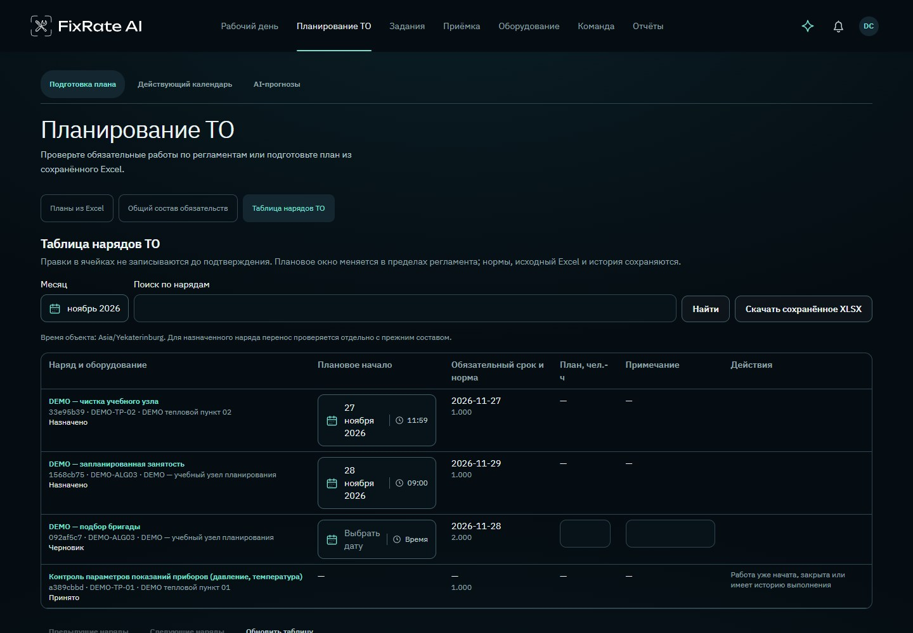
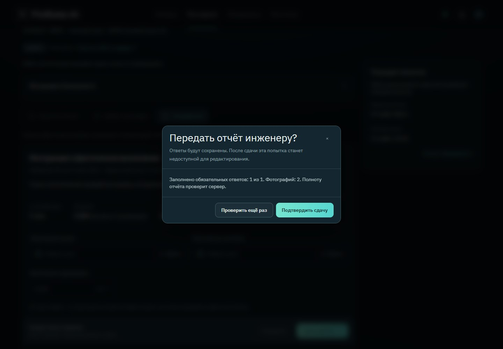

# Демонстрация FixRate AI в браузере

## Кадры из README

Пять кадров корневого README сняты с production-сборки на отдельной PostgreSQL.
Playwright проверяет путь от назначения до ручной приёмки, ответ v4 через
Ollama с чтением реестра и серверную карточку подтверждения назначения.
Карточку создаёт вызов MCP на проверенном составе; он не применяет назначение.
Имена и изображения создаёт тестовая фикстура, отметки демонстрационного
режима в кадрах не скрываются CSS — такой режим не включён.

После `npm --prefix frontend ci` задайте `OLLAMA_CHAT_MODEL` и
`OLLAMA_CHAT_DIGEST` для уже загруженной модели в Ollama на `127.0.0.1:11434`.
Запустите:

```console
python scripts/verify_web.py --pg-bin "<каталог PostgreSQL bin>" --readme
```

Результат лежит в `readme-gallery/` рядом с `results.json`. Манифест
фиксирует состав кадров и их SHA‑256. Реквизиты и файлы рабочего стенда
для захвата не используются.

## Расширенная галерея

Снимки созданы Playwright в Chrome из production-сборки на новой PostgreSQL 18. Вход — через форму под фактическими ролями `chief_engineer` и `executor`; обычный `engineer` участвовал только в проверке паритета. Данные синтетические. Размеры — 1440×1000 и 390×844. [Манифест с маршрутами и SHA‑256](../assets/release-gallery/manifest.json).

## Главный инженер

| Экран | Что показано |
|---|---|
| [Рабочий день](../assets/release-gallery/chief_engineer/workday.jpg) | Незавершённые работы, сроки, таймлайн и вход в чат |
| [Оборудование](../assets/release-gallery/chief_engineer/equipment.jpg) · [Паспорт](../assets/release-gallery/chief_engineer/equipment-card.jpg) · [Настройка обслуживания](../assets/release-gallery/chief_engineer/service-settings.jpg) | Реестр, паспорт и действующий регламент учебного узла |
| [Наряды](../assets/release-gallery/chief_engineer/work-orders.jpg) · [Подбор бригады](../assets/release-gallery/chief_engineer/crew-preview.jpg) | Реестр и предпросмотр состава до записи |
| [Календарь](../assets/release-gallery/chief_engineer/calendar.jpg) · [Таблица ТО](../assets/release-gallery/chief_engineer/planning.jpg) | Нормативный график и редактируемые наряды |
| [Предпросмотр Excel](../assets/release-gallery/chief_engineer/catalog-preview.jpg) · [Сохранённый каталог](../assets/release-gallery/chief_engineer/catalog-draft.jpg) | Учебный СВиК до записи и после сохранения черновика; сохранённая ссылка открывается после обновления |
| [Команда и смены](../assets/release-gallery/chief_engineer/workforce.jpg) · [Отчёты](../assets/release-gallery/chief_engineer/analytics.jpg) · [Прогноз](../assets/release-gallery/chief_engineer/forecast.jpg) | Люди и аналитика объекта |
| [Очередь](../assets/release-gallery/chief_engineer/review-inbox.jpg) · [Фото](../assets/release-gallery/chief_engineer/photo-review.jpg) · [Подтверждение](../assets/release-gallery/chief_engineer/acceptance.jpg) | Доказательства и ручное решение о приёмке |
| [Чат v4](../assets/release-gallery/chief_engineer/assistant.jpg) | Фактический ответ о названии оборудования по коду |

[](../assets/release-gallery/chief_engineer/planning.jpg)

## Исполнитель

| Экран | Что показано |
|---|---|
| [Мой день](../assets/release-gallery/executor/assigned.jpg) · [Мои задания](../assets/release-gallery/executor/queue.jpg) · [Карточка наряда](../assets/release-gallery/executor/work-order.jpg) | Своя работа, обязательный срок и начало исполнения |
| [Чек-лист](../assets/release-gallery/executor/checklist.jpg) · [Снимки](../assets/release-gallery/executor/photos.jpg) · [Сдача](../assets/release-gallery/executor/submit-review.jpg) | Отметки, загрузка двух учебных доказательств и отдельное подтверждение |
| [Мои отчёты](../assets/release-gallery/executor/reports.jpg) · [Мои смены](../assets/release-gallery/executor/shifts.jpg) · [Мой календарь](../assets/release-gallery/executor/calendar.jpg) | Отправленная попытка, график и календарь без инженерных команд |
| [Чат v4](../assets/release-gallery/executor/assistant.jpg) | Ответ по оборудованию из доступных исполнителю данных |

[](../assets/release-gallery/executor/submit-review.jpg)

## Мобильный экран

| Главный инженер | Исполнитель |
|---|---|
| [Рабочий день](../assets/release-gallery/mobile/workday.jpg) | [Карточка отправленного наряда](../assets/release-gallery/mobile/work-order.jpg) |

## Как повторить

На машине нужны Google Chrome, Node.js 24, Python 3.12 с зависимостями из `deploy/requirements-core.lock` и локальные утилиты PostgreSQL 18. Подключение к существующей БД не требуется.

```console
npm --prefix frontend ci
python scripts/verify_web.py --pg-bin "<каталог PostgreSQL bin>" --documentation
```

Выходной каталог указан в `Results`; кадры лежат в `documentation-gallery/`. Для двух кадров чата добавьте `--documentation-local-ai` и задайте `OLLAMA_CHAT_MODEL` и `OLLAMA_CHAT_DIGEST` уже установленной локальной модели. В этих кадрах использована `qwen3.5:4b-q4_K_M`: тест подтвердил движок v4, результат Ollama, вызов инструмента чтения, название из API и отсутствие записывающих действий. Если ответ не подтвердится, кадр пропускается с отметкой в манифесте.

Для видео добавьте `--documentation-video`; предварительно выполните `npx playwright install ffmpeg` из `frontend/`. Записи обеих ролей создаются в `documentation-gallery/video/` и остаются локальными, не в Git и не в установочном архиве.

Галерея не подтверждает качество облачных ответов или VLM. Два прикрепления используют один штатный учебный файл; по этим кадрам нельзя оценивать результат обслуживания.
