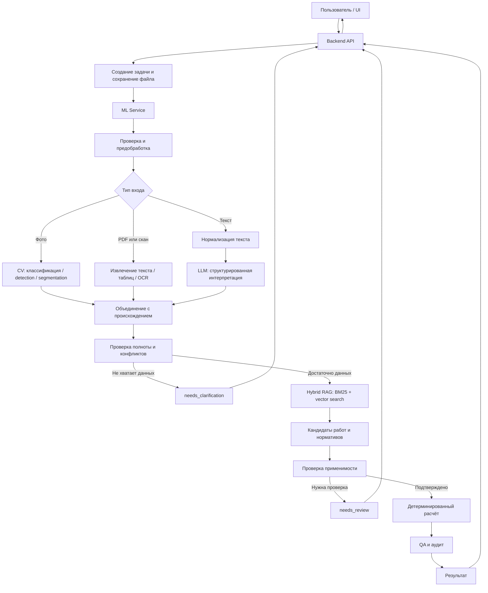
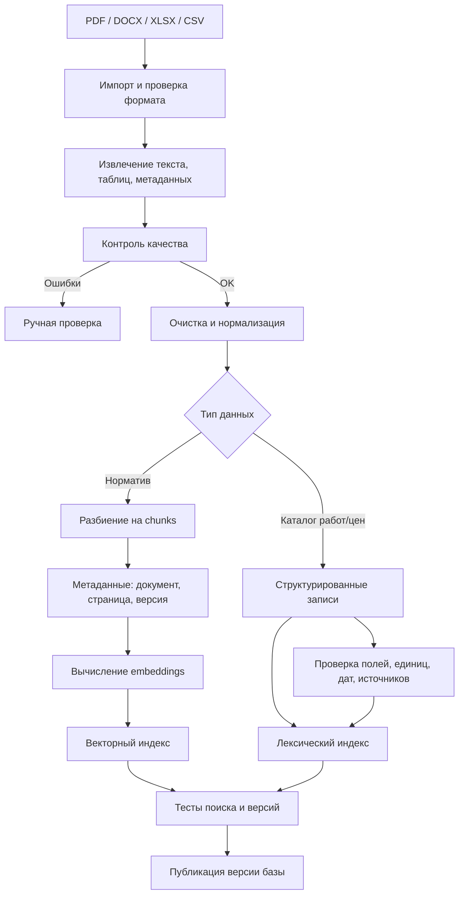

# FixRate_AI — подробная архитектура и пайплайн ML-модуля

**Версия:** 2.0  
**Дата:** 20 октября 2026 г.

> **Статус документа.** Это целевая архитектура, а не подтверждение того, что все компоненты уже реализованы в репозитории. Перед изменениями нужно сверить текущий код, API-контракты, зависимости и тесты. Примеры ниже иллюстративные.

## 1. Цель системы

FixRate_AI должен помогать формировать смету по строительному повреждению или ремонтной задаче на основе пользовательских материалов, структурированного каталога работ и расценок, а также нормативных/технических документов.

Основной сценарий:
1. Пользователь загружает фотографию, документ и/или описание.
2. API проверяет вход, сохраняет оригинал и создаёт задачу.
3. CV извлекает визуальные признаки, если для задачи есть подходящая модель.
4. OCR извлекает текст из документов, если это необходимо.
5. LLM нормализует свободное описание в структуру.
6. Система объединяет данные, сохраняя источник каждого значения.
7. Валидатор проверяет полноту и противоречия.
8. RAG ищет кандидатов работ, расценок и нормативов.
9. Валидатор применимости решает, какие кандидаты разрешено использовать.
10. Детерминированный расчётный модуль вычисляет количества и стоимость.
11. QA проверяет результат и возвращает смету, вопросы или ошибку.

**Главный принцип:** LLM не придумывает цены, количества, нормативные ссылки или итоговые суммы. Неизвестные значения остаются неизвестными, пока не будут подтверждены.

## 2. Компоненты и ответственность

### Backend/API
Принимает запрос, проверяет доступ, создаёт задачу, сохраняет оригиналы и метаданные, вызывает ML service и возвращает статус/результат. Точный контракт должен быть согласован с backend-командой.

### ML service
Оркестрирует обработку, вызывает CV/OCR/LLM/RAG, объединяет результаты, проверяет полноту и формирует структурированный ответ. Для MVP это может быть один FastAPI-сервис с внутренними модулями; отдельный микросервис на каждый этап не обязателен.

### CV — YOLO как основной детектор визуальных дефектов
Для CV-пайплайна целевым семейством моделей является YOLO. Конкретный пакет, версия архитектуры, размер весов и задача (`detect`, `segment` или классификация) должны быть зафиксированы в конфигурации после проверки совместимости с лицензией, окружением и датасетом. Нельзя считать, что модель уже обучена или что стандартные предобученные веса распознают строительные дефекты: это требуется подтвердить отдельным тестированием.

CV-модуль возвращает машинно-обрабатываемые результаты YOLO: имя класса, числовой `class_id`, confidence, bounding box в координатах исходного изображения и, если используется сегментация, маску/полигон. Результат должен содержать размеры исходного изображения, параметры препроцессинга, версию весов и время инференса. Детекция дефекта не подтверждает причину повреждения, глубину, скрытые повреждения, материал основания или реальные физические размеры. Эти данные нельзя выводить из пиксельной рамки без масштаба или отдельной измерительной методики.

### OCR/обработка документов
Извлекает текст и таблицы из PDF и сканов, сохраняет связь с исходным документом, страницей и областью. OCR не нужен для каждой фотографии и не подтверждает актуальность документа.

### LLM / Model Gateway
Нормализует описание, извлекает явно указанные параметры, формирует JSON по схеме и поисковый запрос. Адаптер скрывает особенности провайдера. Выход проверяется схемой; отсутствующие значения не додумываются.

### RAG
Ищет кандидатов в каталоге работ/расценок и нормативных документах. Возвращает записи с источниками. Найденный результат — кандидат, а не автоматически одобренная позиция.

### Валидатор
Проверяет обязательные поля, единицы, диапазоны, противоречия, актуальность и применимость источников, а также полноту данных для расчёта.

### Расчётный модуль
Выполняет детерминированные формулы, коэффициенты и округление, сохраняет промежуточные значения и версии правил. Арифметика не поручается LLM.

### QA/отчёт
Проверяет результат и формирует позиции, количества, единицы, цены, суммы, формулы, источники, допущения и предупреждения.

## 3. Общая схема



Это логическая схема. Очередь задач, object storage и worker-процессы добавляются по необходимости. Для MVP не обязательно сразу вводить много микросервисов.

## 4. Runtime-пайплайн: один пользовательский запрос

### Этап 0 — приём запроса
**Вход:** фото/PDF, описание, дополнительные поля и идентификаторы по API-контракту.

1. Проверить тип, размер и возможность открыть файл.
2. Создать `request_id` и `job_id` согласно контракту.
3. Сохранить оригинал без изменений.
4. Сохранить MIME-тип, размер, время загрузки и при необходимости контрольную сумму.
5. Создать задачу и начальный статус.
6. Не писать секреты и лишние персональные данные в логи.

**Выход:** задача и ссылка на оригинал. Неподдерживаемый формат, пустой файл и превышение лимита должны возвращать явную ошибку.

### Этап 1 — выбор ветки
Определить тип входа: фото повреждения, текстовый PDF, скан, таблица расценок или иной поддерживаемый формат. Не запускать все модели на каждом файле.

### Этап 2 — предобработка
Для изображения: проверить ориентацию, формат цвета, разрешение и читаемость; подготовить вход для модели; сохранить связь с оригиналом. Не применять изменения, уничтожающие тонкие признаки.

Для PDF: извлечь текстовый слой, если он есть; иначе отрендерить страницы и выполнить OCR. Сохранять страницу и координаты.

Для таблиц: сохранить строки, заголовки, коды и единицы. Неоднозначные значения помечать для проверки, не угадывать их.

### Этап 3 — CV-анализ

Возможные задачи:
- **Классификация:** класс изображения/фрагмента (`crack`, `tile_chip`, `water_stain`, `no_visible_damage`, `unknown`). Не указывает точное место.
- **Object detection:** класс и рамка `x1, y1, x2, y2`. Рамка может быть грубой для тонкой трещины.
- **Сегментация:** маска пикселей дефекта; полезна для формы трещины/скола, но требует разметки масками.

Предобученные веса на обычных объектах не гарантируют распознавание строительных дефектов. Для дообучения:
1. Определить классы и задачу.
2. Собрать репрезентативные изображения.
3. Разметить классы, рамки или маски.
4. Разделить данные на train/validation/test без утечки похожих фотографий.
5. Обучить/дообучить модель.
6. Оценить качество на отложенном наборе и реальных фото.
7. Зафиксировать веса, настройки и версию.

SDNET2018 можно рассмотреть для экспериментов с трещинами в бетоне, но он не гарантирует качество на штукатурке, плитке или пятнах протечки.

**Измерения:** пиксели не равны сантиметрам. Для физических размеров нужен масштаб, калибровка или другая проверенная методика. Без неё реальные размеры должны быть `null`.

Пример условного результата:

```json
{
  "model_name": "configured_cv_model",
  "model_version": "configured_version",
  "observations": [
    {
      "class": "crack",
      "confidence": 0.91,
      "geometry_type": "bbox",
      "bbox_xyxy": [120, 80, 460, 270],
      "real_world_measurements": null
    }
  ],
  "warnings": []
}
```

### Этап 4 — OCR/документы
Для текстового PDF извлечь текст и таблицы; для скана — отрендерить страницы и выполнить OCR; для каталога — преобразовать строки в структурированные записи. Сохранять источник, страницу, раздел, единицы и ошибки извлечения. OCR не подтверждает применимость документа.

### Этап 5 — LLM
LLM получает описание, известные параметры, результаты CV/документов и JSON-схему. Она извлекает только явно указанные сведения, нормализует термины, отмечает пропуски и неоднозначности.

Пример целевой структуры (не утверждение о текущей схеме API):

```json
{
  "damage_type": "crack",
  "surface": "wall",
  "material": "plaster",
  "location_type": "interior",
  "requested_action": "repair",
  "length_m": null,
  "width_mm": null,
  "area_m2": null,
  "missing_fields": ["damage_dimensions"],
  "ambiguities": []
}
```

Проверять JSON через Pydantic или эквивалент. Ограничивать допустимые классы. Не использовать ответ модели как SQL, команду или путь к файлу. При невалидном JSON — ограниченный повтор, затем контролируемая ошибка; при тайм-ауте не ждать бесконечно.

### Этап 6 — объединение данных
Объединить текст, CV, OCR и пользовательские параметры. Для каждого поля хранить:
- значение и единицу;
- источник (`user`, `cv`, `ocr`, `llm_normalization`, `catalog`, `calculation`);
- ссылку на файл/страницу/область;
- confidence, если применимо;
- статус проверки и предупреждения.

Если материал указал пользователь, источник — `user`, а не CV. При критическом конфликте не выбирать значение молча: спросить пользователя или направить на ручную проверку.

### Этап 7 — проверка полноты
Для каждого вида работ определить обязательные поля и правила. Проверить обязательные значения, единицы, диапазоны, конфликты, источники и возможность применить формулу. Если данных мало — `needs_clarification` с конкретными вопросами. Найденная расценка не даёт права выдумывать количество работ.

### Этап 8 — запрос RAG
Сформировать запрос из типа дефекта, поверхности, материала, предполагаемой работы, региона, единиц и ограничений. Искать отдельно:
1. в каталоге работ/расценок;
2. в нормативных/технических документах.

### Этап 9 — Hybrid RAG

**BM25/полнотекстовый поиск** полезен для кодов, точных названий, терминов и нормативных обозначений.

**Векторный поиск** превращает запрос в embedding и ищет семантически близкие записи. Семантическая близость не доказывает техническую применимость.

Подготовка индекса:
1. Извлечь и очистить документы.
2. Разбить длинные нормативы на смысловые chunks.
3. Сохранить документ, страницу, раздел, версию и метаданные.
4. Вычислить embeddings.
5. Построить векторный и лексический индексы.
6. Для каталога сохранить структурированные поля, чтобы цена, код и единица не терялись в текстовых chunks.

Объединить результаты двух поисков, убрать дубли и применить известные фильтры: регион, версия, срок действия, материал, единица и статус. Не фильтровать по неизвестным значениям.

Каждый кандидат должен содержать ID, тип записи, название/код, фрагмент, источник, страницу/раздел, версию, регион/единицу и оценку поиска. Низкая релевантность или конфликт кандидатов ведут к повторному поиску, уточнению или ручной проверке.

### Этап 10 — проверка применимости
RAG отвечает «что может подойти?», валидатор — «что разрешено использовать?».

Проверить соответствие работы, поверхности и материала; единицы; актуальность источника; регион; цену; полноту количества; дубли и конфликты; происхождение каждого критичного значения.

Возможные статусы кандидата: `candidate`, `approved`, `rejected`, `needs_review`, `missing_data`. Названия согласовать с фактическим кодом. Найденная позиция не одобряется автоматически.

### Этап 11 — расчёт
Для простой позиции:

`line_total = quantity × unit_price`

Сложные формулы, коэффициенты и округление задаются утверждённым кодом/версионируемыми правилами. Сохранять параметры, единицы, формулу, промежуточные значения, источник цены, коэффициенты и версию расчёта.

Если цена или количество неизвестны, не подставлять произвольное число. Позиция остаётся нерассчитанной либо система запрашивает данные.

### Этап 12 — QA
Проверить источники критичных позиций, единицы, допустимость значений, промежуточные вычисления, суммы, предупреждения и воспроизводимость. При критической ошибке не выдавать результат как подтверждённую смету.

### Этап 13 — ответ
Предлагаемые статусы:
- `completed` — расчёт завершён и прошёл предусмотренные проверки;
- `needs_clarification` — нужны данные пользователя;
- `needs_review` — нужна экспертная проверка;
- `failed` — техническая ошибка.

Ответ содержит позиции, количества/единицы, цену, сумму, итог при наличии оснований, источники и версии, формулы, допущения, предупреждения и вопросы. Завершение пайплайна не означает, что CV установил скрытую причину повреждения.

## 5. Ingestion pipeline — подготовка RAG заранее



### Каталог работ/расценок
Минимальные поля: `work_id`, код, название, описание, единица, цена только если подтверждена, валюта/регион, `source_id`, версия, период действия, статус, дата импорта и проверки.

Пример условной записи — не реальная расценка:

```json
{
  "work_id": "repair_plaster_crack",
  "name": "Ремонт трещины в штукатурке",
  "unit": "m",
  "price": null,
  "region": "Екатеринбург",
  "source_id": "catalog_001",
  "source_version": "2026-01",
  "status": "needs_price"
}
```

`price: null` означает, что цена не подтверждена и позицию нельзя использовать для окончательного расчёта стоимости.

### Нормативные документы
Хранить ID, название, источник, тип, версию/дату, дату импорта, статус, исходный файл, страницы/разделы. Для каждого chunk хранить ID, текст, `document_id`, страницу, раздел, версию, метаданные и embedding. Таблицы нельзя разбивать так, чтобы строки теряли заголовок, единицу или связь с колонками.

### Обновление корпуса
При новой версии сравнить документы, сохранить историю, отметить устаревшие записи, переиндексировать изменённые фрагменты, запустить тесты и опубликовать версию только после проверки.

## 6. Контракты данных

Ниже — примеры предлагаемых логических контрактов, не подтверждённые схемы текущего API.

### Job
```json
{
  "job_id": "job-001",
  "request_id": "req-001",
  "status": "processing",
  "input_file_ids": ["file-001"],
  "created_at": "ISO-8601 timestamp",
  "pipeline_version": "v1"
}
```

### Извлечённое поле
```json
{
  "field": "length_m",
  "value": null,
  "unit": "m",
  "source_type": "user",
  "source_ref": null,
  "confidence": null,
  "validation_status": "missing",
  "warnings": []
}
```

Не придумывать confidence для значения, которое пользователь ввёл напрямую.

### Позиция сметы
```json
{
  "item_id": "item-001",
  "work_id": "repair_plaster_crack",
  "parameters": {},
  "quantity": null,
  "unit": "m",
  "norm_ref": null,
  "price": null,
  "formula_id": null,
  "line_total": null,
  "validation_status": "missing_data",
  "warnings": ["Нужно подтвердить количество"]
}
```

### Ошибка/вопрос
```json
{
  "code": "MISSING_REQUIRED_FIELD",
  "field": "length_m",
  "message": "Для выбранной формулы нужно указать длину повреждения",
  "severity": "blocking",
  "requires_user_action": true
}
```

Не возвращать stack trace как пользовательское сообщение.

## 7. Оркестрация и состояния

Для MVP достаточно явного графа состояний или последовательности функций с ветвлениями. LangGraph — возможный инструмент, но не обязательное условие.

Пример состояний: `RECEIVED`, `PREPROCESSING`, `EXTRACTING`, `INTERPRETING`, `MERGING`, `VALIDATING`, `NEEDS_CLARIFICATION`, `RETRIEVING`, `REVIEW_REQUIRED`, `CALCULATING`, `QA`, `COMPLETED`, `FAILED`.

Правила:
1. Переходы явные, у каждого этапа определены вход и выход.
2. Повторы не должны дублировать смету.
3. Число повторов ограничено, тайм-аут не вызывает бесконечное ожидание.
4. Состояние сохраняется для продолжения после ответа пользователя.
5. При изменении входа определяется, какие этапы повторить.

Псевдокод:

```python
def process_job(job):
    prepared = preprocess(job)
    observations = run_cv_if_applicable(prepared)
    document_data = run_document_extraction_if_applicable(prepared)
    interpretation = interpret_text_if_needed(job, observations, document_data)
    analysis = merge_with_provenance(job, observations, document_data, interpretation)

    validation = validate_required_fields(analysis)
    if validation.needs_clarification:
        return make_clarification_result(validation.questions)

    candidates = hybrid_retrieve(analysis)
    approved = validate_candidate_applicability(candidates, analysis)
    if approved.needs_review:
        return make_review_result(approved.issues)

    calculation = calculate_deterministically(analysis, approved.items)
    qa_result = quality_check(calculation)
    if not qa_result.ok:
        return make_review_result(qa_result.issues)

    return make_completed_result(calculation, qa_result)
```

Это псевдокод, не готовый исполняемый код.

## 8. Предлагаемая структура `ml_service/`

```text
ml_service/
├── app/
│   ├── main.py
│   ├── api/{routes.py,schemas.py}
│   ├── config.py
│   ├── domain/{models.py,statuses.py,errors.py}
│   ├── pipeline/{orchestrator.py,state.py,preprocessing.py,merge.py,validation.py}
│   ├── adapters/
│   │   ├── cv/{protocol.py,yolo_adapter.py}
│   │   ├── ocr/{protocol.py,document_ocr.py}
│   │   ├── llm/{protocol.py,gigachat_adapter.py}
│   │   └── embeddings/adapter.py
│   ├── rag/{ingestion.py,chunking.py,lexical_search.py,vector_search.py,hybrid_search.py,source_metadata.py}
│   ├── calculation/{formulas.py,engine.py,audit.py}
│   └── reporting/result_builder.py
├── tests/{unit,integration,fixtures}/
├── data/README.md
├── Dockerfile
├── requirements.txt
└── README.md
```

Это рекомендуемая структура, а не требование создать всё немедленно. Сначала изучить текущие файлы и переиспользовать существующие компоненты. Не создавать пустые модули ради совпадения с деревом.

## 9. Интеграция с backend

Точный endpoint, JSON, авторизация и способ передачи файла должны соответствовать существующему контракту. Если контракта нет, его нужно согласовать до интеграции.

Возможный поток:
1. Backend создаёт задачу и сохраняет файл.
2. Backend вызывает ML service с `job_id` и способом чтения файла.
3. ML service выполняет пайплайн.
4. ML service возвращает результат или статус.
5. Backend сохраняет и передаёт результат UI.

При долгой обработке можно использовать очередь и worker: API принимает задачу, worker выполняет CV/LLM/RAG, статус обновляется, клиент получает результат согласованным способом. Redis/очередь не обязательны заранее.

Согласовать endpoint, схему, идентификаторы, статусы, ошибки, тайм-ауты, повторы, авторизацию, лимиты файлов и поведение повторного запроса.

## 10. Тестирование и метрики

### Unit-тесты
Схемы, нормализация единиц, происхождение полей, полнота, формулы, пустой RAG-результат, ошибки адаптеров.

### Интеграционные тесты
- фото → CV → структурированный результат;
- скан → OCR → текст;
- описание → LLM → валидный JSON;
- запрос → Hybrid RAG → источники;
- проверенные данные → расчёт;
- недостаток данных → `needs_clarification`;
- ошибка модели → контролируемый результат;
- повторный запрос → отсутствие дублирования.

### CV
Классификация: precision, recall, F1, confusion matrix. Detection: precision/recall и mAP. Сегментация: IoU/Dice. Метрика должна соответствовать задаче; общая accuracy может скрывать пропуски редких дефектов.

### RAG
Подготовить запросы с эталонными документами. Измерять Recall@k, Precision@k, MRR/NDCG при необходимости, корректность источников, устаревшие результаты и способность воздерживаться от ответа.

### Расчёт
Зафиксировать эталонные параметры, работы, формулы, цены и суммы; сравнивать результаты с ручным эталоном. При одинаковых данных и версиях правил результат должен быть воспроизводимым.

### End-to-end
Проверить нормальный случай, отсутствующий размер, конфликт источников, неподходящий норматив, отсутствие цены, низкую уверенность CV, ошибку LLM/RAG, невалидный файл и ручную проверку.

## 11. Логирование, версии и безопасность

Для задачи сохранять `job_id`, `request_id`, время/статусы этапов, версию пайплайна, CV-модели, LLM/промпта, embedding-модели, RAG-индекса, источников и расчётных правил. Не записывать секреты и лишние персональные данные.

Минимальные меры:
- лимиты типов/размера файлов;
- обработка ошибок парсинга;
- не исполнять содержимое документов как код;
- контроль доступа к файлам и результатам;
- секреты в конфигурации/секрет-хранилище;
- тайм-ауты и ограниченные повторы;
- удаление временных файлов по политике хранения;
- проверка источников и версий;
- защита от дублирующих запросов;
- ручная проверка сомнительных случаев.

## 12. План реализации MVP

### Этап 1 — контракт и данные
Согласовать API, статусы, схемы, единицы и происхождение полей. **Готово:** backend и ML service одинаково понимают контракт, тесты схем проходят.

### Этап 2 — базовый pipeline
Приём тестового запроса, сохранение входа, нормализация, проверка полей, контролируемый ответ. **Готово:** ветки и ошибки работают предсказуемо.

### Этап 3 — один CV-сценарий
Выбрать один класс, собрать данные, проверить/дообучить модель, оценить на отложенном наборе, подключить адаптер. **Готово:** есть метрики и согласованный выходной формат.

### Этап 4 — источники RAG
Найти реальные каталоги/нормативы, проверить право использования, извлечь и нормализовать, сохранить метаданные, подготовить тестовые запросы. **Готово:** каждая запись прослеживается до источника.

### Этап 5 — Hybrid RAG
Лексический и векторный поиск, объединение, фильтры, ссылки. **Готово:** качество измеряется на эталонных запросах.

### Этап 6 — LLM
Структурированный вывод, проверка схемы, тайм-ауты, обработка невалидных ответов. **Готово:** неподтверждённые цены не появляются в результате.

### Этап 7 — расчёт и QA
Утверждённые формулы, проверки единиц, промежуточные значения, тесты с эталонными суммами. **Готово:** расчёты совпадают с эталонами.

### Этап 8 — интеграция
Backend, статусы, end-to-end тесты, повторы, сбои и демонстрационные сценарии. **Готово:** предусмотренные сценарии завершаются результатом либо корректным запросом уточнений.

## 13. Демонстрационные сценарии

### `facade_crack`
Фото фасадной трещины → CV → запрос размеров → RAG → проверка применимости → расчёт только при подтверждённых параметрах и цене.

### `tile_chip`
Фото скола плитки → CV → уточнение количества/размера и необходимости замены → RAG → проверка единиц/цены → расчёт.

### `parking_leak`
Фото пятна → CV классифицирует видимый признак, но не устанавливает причину протечки только по фото → уточнение → поиск работ → ручная проверка, если причина не подтверждена.

Это предлагаемые тестовые направления; бизнес-правила нужно согласовать с командой.

## 14. Решения, которые команда должна принять

1. Типы повреждений MVP.
2. Для каждого типа: классификация, detection или segmentation.
3. Реальные источники расценок/нормативов и право использования.
4. Регионы и периоды актуальности.
5. Кто утверждает формулы и округление.
6. LLM-провайдер и правила обработки данных.
7. Хранилище файлов, результатов, индексов и версий.
8. Точный контракт backend ↔ ML service.
9. Минимальные метрики CV/RAG/расчёта.
10. Кто подтверждает сомнительные результаты.

Этот список не означает, что решения уже приняты.

## 15. Матрица ответственности

| Компонент | Вход | Выход | Не должен делать |
|---|---|---|---|
| Backend/API | Файл и параметры | Задача, статус, результат | Подменять логику моделей |
| Preprocessing | Файл | Подготовленные данные | Терять связь с оригиналом |
| CV | Изображение | Класс, рамка/маска, confidence | Придумывать физические размеры |
| OCR | Документ | Текст/таблицы/координаты | Считать текст автоматически верным |
| LLM | Текст и контекст | JSON по схеме | Изобретать цены/нормативы |
| Hybrid RAG | Запрос | Кандидаты с источниками | Считать релевантность доказательством применимости |
| Validator | Данные/кандидаты | Допуск, ошибки, вопросы | Игнорировать конфликты |
| Calculation | Проверенные параметры | Количества/суммы | Придумывать формулы |
| QA/Report | Расчёт и источники | Проверенный отчёт | Скрывать предупреждения |

## 16. Принципы архитектуры

1. Каждое критичное значение имеет происхождение.
2. Неизвестное остаётся неизвестным.
3. RAG находит кандидатов, валидатор проверяет применимость.
4. Расчёт детерминированный и воспроизводимый.
5. CV не является измерительной системой без отдельной методики.
6. LLM подключается через адаптер.
7. Узкий MVP с измеряемым качеством лучше множества непроверенных функций.
8. Архитектура должна соответствовать реальному коду.

## 17. Аудит репозитория перед изменениями

Проверить:
- какие эндпоинты и схемы существуют в `ml_service/`;
- какие статусы определены;
- есть ли CV-адаптер и реальные веса;
- есть ли OCR/LLM/RAG-адаптеры или только протоколы/заглушки;
- существуют ли реальные источники расценок и нормативов;
- как backend вызывает ML service;
- какие тесты запускаются и что проверяют;
- какие зависимости и Docker-настройки используются;
- какие файлы принадлежат другим участникам команды.

**Практическое правило:** сначала составить список «готово / частично / заглушка / отсутствует», затем планировать изменения. Архитектурный документ задаёт направление, но не заменяет аудит реализации.

---

## 18. Техническая спецификация CV на базе YOLO

Этот раздел задаёт целевое поведение CV-части для агента Antigravity. Он является техническим заданием на реализацию, а не утверждением, что модель, датасет или обучение уже существуют. Перед написанием кода агент обязан осмотреть текущий `ml_service/`, `pyproject.toml`/`requirements.txt`, Dockerfile, тесты и принятые в проекте API-контракты. Не создавать параллельную архитектуру, если подходящие модули уже есть.

### 18.1. Задача модели и границы ответственности

**Основная задача MVP:** по фотографии обнаруживать видимые дефекты, которые представлены в размеченном датасете, и возвращать структурированные детекции для следующих стадий пайплайна.

YOLO — не одна конкретная модель и не готовая база строительных дефектов, а семейство архитектур/реализаций для компьютерного зрения. До фиксации реализации проверить:
- какая реализация YOLO будет использоваться и как она устанавливается;
- доступность нужных весов и их лицензионные условия;
- поддержку Python, PyTorch, CPU/GPU и целевой среды Docker;
- поддерживаемую задачу: detection (рамки) либо segmentation (маски);
- формат весов, способ загрузки и возможность закрепить точную версию зависимости.

Не подменять проверку совместимости предположением, что «самая новая YOLO» автоматически подходит проекту. Зафиксировать конкретную версию пакета и модель в зависимостях после проверки.

**YOLO detection** подходит для локализации отдельных дефектов прямоугольными рамками. **YOLO segmentation** дополнительно выделяет пиксельную область дефекта и предпочтительна, если в датасете есть качественные полигональные/масочные разметки и приложению нужна площадь дефекта в пикселях. Если разметка содержит только рамки, не объявлять маски доступными и не имитировать их.

YOLO может дать:
- `class_id` и имя класса из утверждённого списка;
- confidence модели;
- bounding box;
- маску/полигон, только если используется segmentation-модель;
- метаданные инференса и версию модели.

YOLO само по себе не должно давать:
- цену ремонта или нормативную стоимость;
- окончательную сметную позицию;
- физическую длину, ширину, площадь или глубину без известного масштаба и подходящей методики;
- диагноз причины дефекта (например, «протечка вызвала трещину») только по изображению;
- вывод об отсутствии дефекта с абсолютной гарантией;
- название материала, если такой класс не размечался и не валидировался.

### 18.2. Каталог классов

Список классов — часть контракта модели, а не произвольные строки в коде. Источник истины хранить в версионируемом конфиге/файле меток, синхронизированном с порядком `class_id` в весах. Не менять порядок классов после обучения без переобучения/переэкспорта и обновления метаданных.

Для MVP использовать только классы, согласованные с реальными демонстрационными сценариями и доступной разметкой. Например, `facade_crack`, `tile_chip`, `parking_leak` — это **идентификаторы сценариев проекта**, но не автоматически утверждённые классы YOLO: перед использованием команда должна определить, что именно видно на фото и реально размечается. `parking_leak` может описывать ситуацию/контекст, а не визуальный объект; нельзя добавлять такой класс в модель, пока не определены наблюдаемые признаки и правила разметки.

Рекомендуемый контракт файла классов:
```yaml
# Пример схемы; фактический список классов утверждается по датасету.
names:
  0: facade_crack
  1: tile_chip
```

Правила:
1. У каждого класса есть стабильный `class_id`, машинный ключ, русское отображаемое название и текстовое описание.
2. Описание класса должно говорить, что считать положительным примером и что не размечать.
3. Не объединять визуально разные типы дефектов в один класс только ради удобства, если это ухудшит применимость результата.
4. Если нужного класса нет в модели, возвращать `unsupported_or_unknown_class`/неуверенный результат, а не переименовывать похожий класс.
5. Версии класса/разметки и весов должны быть связаны метаданными модели.

### 18.3. Данные и разметка

До обучения выяснить, какие изображения уже есть у команды, кому принадлежат права на их использование и можно ли сохранять их в репозитории. Не загружать пользовательские/конфиденциальные изображения в Git без разрешения. Большие наборы изображений и веса обычно хранятся отдельно от исходников; в Git следует держать конфиги, схемы, скрипты и небольшие тестовые fixtures, если это разрешено.

Для YOLO detection разметка обычно хранится в текстовом формате по изображению: одна строка на объект с `class_id`, нормализованными координатами центра рамки и нормализованными шириной/высотой. Значения координат находятся в диапазоне 0–1 относительно ширины и высоты изображения. Для segmentation нужен соответствующий формат полигонов/масок, который поддерживает выбранная реализация.

Рекомендуемая структура датасета (адаптировать к выбранному инструменту и текущему репозиторию):
```text
ml_service/
  cv/
    configs/
      defect_yolo.yaml
    data/
      README.md
      dataset.yaml
      images/
        train/
        val/
        test/
      labels/
        train/
        val/
        test/
    scripts/
      validate_dataset.py
      train_yolo.py
      evaluate_yolo.py
```

Не добавлять `data/` с реальными изображениями в Git автоматически. Если датасет хранится вне репозитория, `README.md` должен описывать способ получить его, требуемую структуру и проверку целостности, но не содержать секретных ссылок или токенов.

Требования к датасету:
- Разделять train/val/test по исходным объектам, сериям или локациям, а не случайно по почти одинаковым кадрам. Иначе соседние кадры одного дефекта могут попасть и в train, и в test, что даст завышенную оценку.
- `train` использовать для обновления весов; `val` — для выбора настроек и порогов; `test` — только для итоговой оценки после фиксации решения.
- Проверять повреждённые изображения, отсутствующие labels, неправильные `class_id`, пустые/выходящие за границы рамки и дубликаты.
- Учитывать отрицательные изображения без целевых дефектов, если выбранный формат и обучение это поддерживают.
- По возможности собирать вариации освещения, угла, расстояния, разрешения, загрязнений, фона и типа камеры.
- Сохранять происхождение данных, разрешение на использование, версию разметки и дату подготовки.
- Не считать синтетические/аугментированные копии независимыми исходными примерами.

Аугментации должны имитировать допустимые вариации съёмки, но не менять смысл класса. Любые геометрические трансформации обязаны корректно преобразовывать разметку. Не применять сильные цветовые/геометрические искажения без проверки, что дефект остаётся визуально распознаваемым.

### 18.4. Конфигурация и загрузка модели

Не зашивать путь к весам, размер изображения, confidence threshold и device в разные участки кода. Использовать единый конфиг с безопасными значениями по умолчанию и валидацией.

Пример целевой конфигурации:
```yaml
cv:
  enabled: true
  provider: yolo
  task: detect
  model_path: "models/defect-yolo.pt"
  image_size: 640
  confidence_threshold: 0.25
  iou_threshold: 0.45
  max_detections: 100
  device: "auto"
  allowed_classes:
    - facade_crack
    - tile_chip
  fail_open: true
```

Это пример структуры, а не универсально оптимальные параметры. Пороги, `image_size`, `device` и `max_detections` должны быть выбраны по валидационному набору и производительности среды. `model_path` должен разрешаться относительно конфигурации/корня сервиса и проверяться при старте. В продакшене предпочтительны явные переменные окружения для переопределения путей/режима, но не для скрытой смены класса модели.

При старте:
1. Проверить, включён ли CV.
2. Проверить наличие файла весов и его доступность на чтение.
3. Загрузить модель один раз при старте приложения или лениво один раз при первом запросе с защитой от гонок.
4. Проверить список классов и согласованность с конфигом.
5. Зафиксировать версию пакета, идентификатор модели/весов и устройство инференса в health/diagnostics без раскрытия внутренних секретов.
6. Если веса отсутствуют или несовместимы, не возвращать фиктивные пустые детекции как успешный результат. Приложение должно явно сообщить, что CV недоступен, а оркестратор — применить предусмотренную политику ошибки.

Не загружать модель заново на каждый HTTP-запрос. Ограничить конкурентность инференса и объём параллельных задач согласно RAM/VRAM и измеренной производительности.

### 18.5. Входное изображение и препроцессинг

Принимать только разрешённые форматы и валидировать фактическое содержимое файла, а не только расширение/MIME-заголовок. Ограничивать размер файла, ширину/высоту и общее число пикселей до декодирования, чтобы защититься от чрезмерного потребления памяти. Обрабатывать ошибки декодирования, пустые изображения и некорректные цветовые каналы.

Целевой порядок:
1. Получить исходный файл из проверенного хранилища/входного адаптера.
2. Проверить размер, формат, целостность и допустимое число пикселей.
3. Декодировать изображение в поддерживаемое представление.
4. Учесть EXIF orientation, чтобы детекция соответствовала визуальной ориентации исходного фото.
5. Сохранить исходные `width` и `height`.
6. Передать изображение в API выбранной YOLO-реализации, позволив ей выполнять штатный resize/letterbox и нормализацию, если это предусмотрено API.
7. Не применять второй независимый resize/letterbox поверх уже выполненного библиотекой без явной необходимости.
8. Получить координаты в известной системе и преобразовать их к системе исходного изображения, если библиотека возвращает координаты в размере преобразованного тензора.
9. Проверить координаты на конечность, положительную площадь и границы исходного изображения.
10. Сформировать сериализуемый DTO результата.

Все преобразования координат должны быть проверены unit-тестами на изображениях с известными размерами. Внутри сервиса стандартизировать рамку как `[x1, y1, x2, y2]` в пикселях исходного изображения, где левый верхний угол — `(0,0)`, `x2 > x1`, `y2 > y1`. При сериализации округлять координаты предсказуемо, но не округлять до целых до завершения внутренних вычислений.

### 18.6. Результат YOLO и внутренний контракт

Внутри Python-кода использовать Pydantic-модель/эквивалент, согласованную с версией Pydantic в проекте. Не передавать наружу сырой объект библиотеки YOLO/PyTorch: он может содержать тензоры и не сериализоваться в JSON.

Пример контракта:
```json
{
  "status": "ok",
  "provider": "yolo",
  "task": "detect",
  "model_id": "defect-yolo",
  "model_version": "2026-10-20",
  "weights_sha256": "sha256:...",
  "image": {"width": 1920, "height": 1080, "sha256": "sha256:..."},
  "detections": [
    {"class_id": 0, "class_name": "facade_crack", "confidence": 0.87,
     "bbox_xyxy": [412.5, 208.0, 901.0, 640.5], "mask": null}
  ],
  "inference": {"device": "cpu", "image_size": 640, "elapsed_ms": 128.4},
  "warnings": []
}
```

Все значения выше иллюстративные. Не использовать фиктивные `sha256`, `model_version` или результаты в реальном ответе. Для `mask` определить отдельную схему (например, полигон в координатах исходного изображения или компактная RLE-маска); не передавать массив произвольной формы без указания системы координат. Для detection без сегментации использовать `mask: null` или исключать поле согласно согласованной схеме.

Отдельно определить статус:
- `ok` — модель успешно обработала изображение, включая случай нуля детекций;
- `disabled` — CV отключён конфигурацией;
- `unavailable` — модель/устройство/веса недоступны;
- `invalid_input` — изображение не прошло проверку;
- `failed` — ошибка инференса.

**Ноль детекций не означает, что дефекта точно нет.** Это означает, что модель не вернула детекцию при текущих весах, порогах и данном изображении.

### 18.7. Confidence, NMS и пороги

Confidence — оценка модели, а не гарантированная вероятность истинности. Значение `0.87` нельзя интерпретировать как доказанную вероятность 87% без отдельной калибровки.

Выполнять штатную постобработку выбранной YOLO-библиотеки, включая NMS (non-maximum suppression — подавление перекрывающихся дублирующих рамок), если она входит в inference API. Не реализовывать NMS второй раз поверх уже обработанных результатов без доказанной необходимости.

Начальный threshold, например `0.25`, допустим только как стартовая настройка для эксперимента. На validation-наборе подобрать пороги по классу или общие пороги, учитывая стоимость ложноположительных и ложноотрицательных результатов. Если используются разные пороги по классам, хранить их в конфиге и логировать применённый порог. Не подбирать порог по test-набору.

Не скрывать все низкоуверенные результаты бесследно: если это нужно для UI/ручной проверки, возвращать подходящее предупреждение или статус проверки согласно контракту. Но не превращать низкий confidence в автоматически подтверждённый дефект.

### 18.8. Несколько фотографий одного случая

Каждое изображение обрабатывать отдельно и связывать результаты с `image_id`/`attachment_id`. Не объединять рамки разных фотографий в одну систему координат. При объединении на уровне кейса сохранять ссылку на изображение-источник каждой детекции.

Если на входе несколько фото:
- валидировать каждый файл независимо;
- разрешать частичный успех, если это предусмотрено контрактом;
- не считать отсутствие детекции на одном фото противоречием обнаружению на другом;
- не усреднять confidence разных изображений без обоснованной модели;
- не считать разные ракурсы независимыми дефектами автоматически;
- при дублировании/почти дублировании изображений избегать повторного подсчёта одного и того же повреждения в смете.

Дедупликация детекций между разными фото — отдельная задача, требующая метаданных/геометрии или подтверждения человеком. Для MVP лучше сохранить отдельные наблюдения, чем ошибочно объединить их.

### 18.9. Передача CV-результатов оркестратору

Оркестратор должен воспринимать CV как источник наблюдений, а не как единственный источник всей сметной структуры. Для каждого визуального поля сохранять provenance:
- `source_type: "cv"`;
- `source_id`: ID вложения/изображения;
- `model_id`, `model_version` и hash весов;
- `class_name`, confidence и координаты;
- `created_at`;
- `review_status`: например `unreviewed`, `accepted`, `rejected`, если ручная проверка предусмотрена.

Не смешивать уверенность YOLO с уверенностью LLM или OCR в одно число. У этих оценок разный смысл. Если требуется единая оценка доверия, определить отдельную валидируемую политику; не использовать произвольное среднее.

Пример события для следующего шага:
```json
{
  "observation_type": "visual_defect",
  "value": {"class_name": "facade_crack", "bbox_xyxy": [412.5, 208.0, 901.0, 640.5]},
  "source": {"source_type": "cv", "attachment_id": "att_123", "model_id": "defect-yolo", "model_version": "1.0.0"},
  "confidence": 0.87,
  "review_status": "unreviewed"
}
```

Идентификаторы и результаты в примере фиктивные. Не генерировать `attachment_id` или значения, которые не поступили из реальной задачи.

### 18.10. CV → RAG → расчёт: важное разделение

YOLO обнаруживает визуальный паттерн. RAG ищет записи в каталоге и документах. Валидатор проверяет применимость. Расчётный модуль считает стоимость. Эти стадии нельзя смешивать.

Пример корректной логики:
1. YOLO возвращает наблюдение `facade_crack` с рамкой и confidence.
2. Оркестратор отмечает, что наблюдение не содержит физической длины трещины.
3. Валидатор проверяет, какие параметры требуются для конкретной сметной позиции.
4. Если длина/площадь/глубина нужна, а подтверждённого значения нет, система запрашивает уточнение или предлагает ручной ввод/измерение.
5. RAG находит возможные позиции каталога по типу дефекта, материалу и описанию.
6. Проверка применимости выбирает только позиции с подходящими единицами, условиями и актуальным источником.
7. Калькулятор считает только на основе подтверждённых количеств и цен.
8. Если параметров не хватает, вернуть `needs_clarification`, а не оценивать длину трещины по пикселям как реальные метры.

Если в кадре есть известный масштаб (линейка, калибровочная метка или другая подтверждённая геометрия), физическое измерение всё равно должно быть отдельным алгоритмом с описанной методикой, проверкой перспективы/плоскости и оценкой погрешности. Простое деление ширины рамки на произвольный коэффициент запрещено.

### 18.11. Ошибки и деградация

Ошибки CV не должны приводить к скрытому выдумыванию данных:
- Невалидное изображение → `invalid_input` и диагностическая причина.
- Нет файла весов/модель не загрузилась → `unavailable`.
- Ошибка GPU/CUDA → попытка CPU fallback только если это разрешено конфигом и проверено; записать фактическое устройство.
- Тайм-аут → контролируемая ошибка этапа; не запускать бесконечные повторные попытки.
- Ноль детекций → успешный inference с пустым массивом и соответствующим сообщением о неопределённости.
- CV отключён → явный `disabled`, а не пустой успешный результат.
- Ошибка CV при наличии текста/документа → оркестратор может продолжить неполный сценарий только если это разрешено бизнес-правилами; результат должен отражать, что визуальная проверка не выполнена.

Логи должны содержать request/job ID, image ID, model ID/version, статус, длительность и тип ошибки. Не записывать в обычные логи полные изображения, секреты, пользовательские документы или лишние персональные данные.

### 18.12. Производительность и ресурсы

Сначала реализовать корректный inference на CPU и измерить базовую задержку на целевом окружении. Затем, если среда предоставляет совместимый GPU, сравнить latency, пропускную способность и потребление памяти. Не предполагать наличие CUDA в контейнере только по наличию GPU на хосте.

Требования:
- загружать веса один раз на процесс;
- использовать ограниченную очередь/конкурентность для inference;
- измерять отдельно decode/preprocess, model inference и postprocess;
- не хранить большие тензоры между задачами;
- ограничивать число и размер изображений на задачу;
- добавить тайм-аут и отмену обработки;
- не добавлять batching, tiling или GPU-specific оптимизации до появления измерений, которые доказывают их необходимость.

Для очень больших изображений можно рассмотреть tiled inference (разбиение на перекрывающиеся фрагменты), но это не включать по умолчанию: нужно правильно переводить координаты тайлов в координаты исходного изображения и дедуплицировать перекрывающиеся детекции. Добавлять только с тестами на границы тайлов и подтверждённым улучшением recall.

### 18.13. Метрики и критерии качества

Не ограничиваться accuracy: для object detection нужны метрики обнаружения и локализации. На validation/test отчёте фиксировать:
- precision и recall;
- mAP@0.5 и mAP@0.5:0.95 (если поддерживается используемым evaluation tool);
- метрики по каждому классу;
- матрицу ошибок/ошибки классификации между классами;
- количество false positives и false negatives на согласованной выборке;
- latency p50/p95, пропускную способность и пиковую память;
- результаты по условиям съёмки, если выборка достаточна.

mAP не является бизнес-метрикой сам по себе. Дополнительно измерить, как ошибки детектора влияют на следующие стадии: сколько случаев неверно маршрутизируется, сколько сметных позиций ошибочно предлагается и сколько случаев корректно отправляется на уточнение.

До появления согласованного датасета и критериев не заявлять, что модель «точная», «готова к продакшену» или «обучена на строительных дефектах». Установить baseline, записать его, затем сравнивать улучшения на неизменном test-наборе.

### 18.14. Автоматические тесты CV

Обязательный минимум:
1. Тест чтения/валидации конфигурации.
2. Тест отсутствующих весов и понятного статуса `unavailable`.
3. Тест недопустимого/повреждённого файла.
4. Тест изображения с EXIF orientation.
5. Тест преобразования координат в исходную систему.
6. Тест рамки с отрицательными/не конечными/выходящими за границы координатами.
7. Тест JSON-сериализации результата без тензоров.
8. Тест пустых детекций как валидного inference-результата.
9. Тест нескольких изображений с сохранением image/attachment ID.
10. Тест согласованности `class_id` и `class_name`.
11. Тест тайм-аута и ошибки модели.
12. Интеграционный smoke test на небольшом тестовом изображении с закреплёнными весами — если лицензия и размер fixture позволяют хранить их в тестовой среде.

Не требовать точного совпадения confidence до последнего знака между разными устройствами/версиями библиотек. Для smoke test проверять форму результата, допустимые координаты, известный ожидаемый класс/область и разумный допуск.

Для unit-тестов препроцессинга/валидации использовать поддельный backend модели (mock), чтобы тесты не зависели от загрузки тяжёлых весов. Отдельно запускать CV integration tests, если модельные веса доступны.

### 18.15. Разделение модулей в `ml_service/`

Предлагаемое размещение — согласовать с существующей структурой, не дублировать уже существующие файлы:
```text
ml_service/
  cv/
    __init__.py
    config.py          # валидация параметров CV
    schemas.py         # входные/выходные Pydantic-схемы
    image_io.py        # проверка и декодирование изображения
    yolo_detector.py   # адаптер конкретной YOLO-реализации
    service.py         # публичный интерфейс CV-подсистемы
    errors.py          # типизированные ошибки CV
    tests/
      test_config.py
      test_image_io.py
      test_schemas.py
      test_yolo_detector.py
      test_service.py
```

Ответственность файлов:
- `config.py`: единая конфигурация, валидация порогов/размеров, разрешение пути к весам.
- `schemas.py`: сериализуемые DTO; не импортировать типы PyTorch/YOLO в публичную схему.
- `image_io.py`: безопасная валидация и нормализация изображения, исходные размеры и EXIF.
- `yolo_detector.py`: единственный модуль, который напрямую зависит от выбранной библиотеки YOLO; инкапсулирует загрузку модели и вызов inference.
- `service.py`: координирует вход, detector, нормализацию результата, ошибки и тайминг.
- `errors.py`: различает invalid input, model unavailable, timeout и inference failure.

Публичный интерфейс CV должен быть узким, например `async def detect_image(...)` или синхронный эквивалент, соответствующий текущему стилю сервиса. Не блокировать event loop FastAPI тяжёлым синхронным inference: выполнять его в подходящем thread pool/worker или в отдельном worker-процессе, исходя из текущей архитектуры и измерений. Не создавать отдельную очередь/микросервис до необходимости.

### 18.16. Что агент Antigravity должен сделать

Порядок работы агента:
1. **Аудит до изменений.** Просмотреть файлы `ml_service/`, зависимости, Dockerfile, тесты, текущие схемы и интеграционные точки. Составить краткий список уже реализованного, частично реализованного, заглушек и отсутствующего.
2. Проверить, есть ли уже CV-адаптер, конфиг и модели данных; переиспользовать их, если они подходят.
3. Зафиксировать выбранную YOLO-реализацию и точную версию пакета только после проверки лицензии, совместимости Python/PyTorch и способа запуска в целевом Docker-окружении.
4. Не скачивать автоматически произвольные веса и не заявлять, что они обучены на строительных дефектах. Если обученных весов нет, реализовать интерфейс и тесты с mock-моделью, явно обозначив CV как `unavailable` до предоставления валидных весов.
5. Реализовать типизированные схемы и конфигурацию.
6. Реализовать безопасную обработку изображения и адаптер YOLO, загружающий веса один раз.
7. Реализовать нормализацию координат и сериализуемый результат.
8. Добавить обработку ошибок, тайм-ауты, логирование без содержимого изображений и тесты.
9. Подключить CV к существующему оркестратору через согласованный интерфейс; не менять API backend и root `docker-compose.yml` без необходимости и согласования.
10. Запустить имеющиеся тесты `ml_service` и новые тесты; затем интеграционные тесты, если доступны реальные веса.
11. В итоговом отчёте перечислить изменённые файлы, команды тестирования, результаты, ограничения, статус реальных весов и любые решения, которые требуют подтверждения команды.

**Не входит в задачу без отдельного согласования:** обучение модели на выдуманном/случайном датасете, создание фальшивых детекций, автоматическое получение сметных размеров из рамки, автоматическое подтверждение цены по результату YOLO, массовая перестройка backend, изменение публичного API и добавление тяжёлых зависимостей без проверки окружения.

### 18.17. Definition of Done для YOLO-интеграции

CV-часть можно считать технически интегрированной, если:
- [ ] конкретная YOLO-реализация и версия зависимости закреплены;
- [ ] список классов соответствует метаданным весов;
- [ ] отсутствие весов даёт явный `unavailable`, а не фальшивый успех;
- [ ] модель загружается один раз на процесс;
- [ ] входные изображения валидируются и имеют лимиты;
- [ ] выход не содержит сырых tensor/объектов библиотеки;
- [ ] координаты относятся к исходному изображению и покрыты тестами;
- [ ] статус, версия модели, длительность и предупреждения возвращаются по контракту;
- [ ] ошибки CV не заставляют систему выдумывать данные;
- [ ] тесты проходят без реальных весов с использованием mock;
- [ ] integration smoke test описан и запускается, когда доступны реальные веса;
- [ ] документация различает «интеграция YOLO выполнена» и «модель обучена/оценена на целевом датасете».

