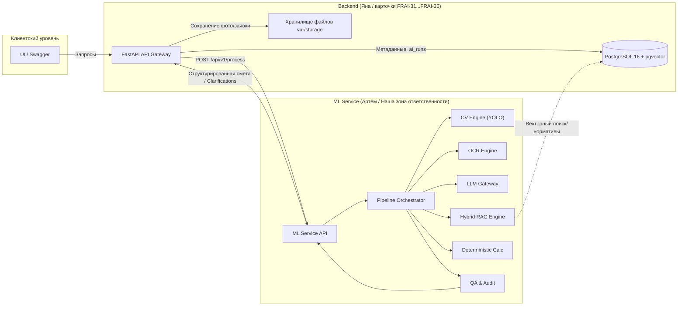
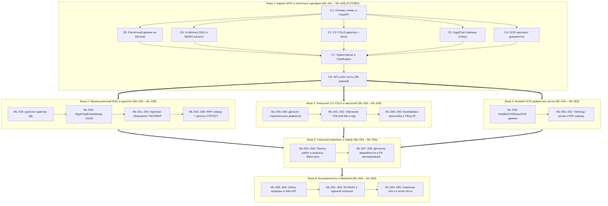

# FixRate AI — Архитектурный план и дорожная карта ML Service (PLAN.md)

**Версия документа:** 1.0  
**Дата обновления:** 21 октября 2026 г.  
**Статус:** Базовый аудит проведён, дорожная карта утверждена к поэтапной реализации.  
**Связанные документы:**
- [ML_PIPELINE.md](file:///home/handraqw/Projects/FixRate_AI/ml_service/ML_PIPELINE.md) — целевая архитектура и спецификация AI-пайплайна
- [PRODUCT.md](file:///home/handraqw/Projects/FixRate_AI/ml_service/PRODUCT.md) — требования к продукту и границы MVP
- [TASKS.md](file:///home/handraqw/Projects/FixRate_AI/ml_service/TASKS.md) — полный реестр микрозадач и граф зависимостей
- [PROGRESS.md](file:///home/handraqw/Projects/FixRate_AI/ml_service/PROGRESS.md) — оперативный журнал разработки
- [docs/database/specification.md](file:///home/handraqw/Projects/FixRate_AI/docs/database/specification.md) — каноническая спецификация базы данных
- [backend/README.md](file:///home/handraqw/Projects/FixRate_AI/backend/README.md) — описание серверной части

---

## 1. Назначение ML Service

**ML Service** — специализированный вычислительный и аналитический сервис в составе FixRate AI, отвечающий за автоматизированный анализ дефектов объектов недвижимости, извлечение характеристик повреждений, семантический подбор применимых строительных нормативов и расценок (RAG) и детерминированный расчёт черновика сметы и ведомости объёмов работ (ВОР).

### Ключевые принципы архитектуры:
1. **Строгий детерминизм расчётов:** LLM категорически запрещено самостоятельно вычислять итоговые суммы, придумывать расценки, нормативы или физические размеры повреждений.
2. **Прослеживаемость происхождения (Data Provenance):** каждое число, единица измерения, дефект и позиция сметы обязаны содержать ссылку на источник (`source_type`: `cv`, `ocr`, `user`, `calc`, `rag_candidate`).
3. **Неизвестное остаётся неизвестным:** при отсутствии масштаба на фото или точных геометрических измерений система не генерирует произвольные числа, а формирует структурированный запрос на уточнение (`needs_clarification`).
4. **Безопасная деградация:** недоступность внешней LLM или весов нейросети CV не должна приводить к неконтролируемому сбою (`500 Internal Error`), а переводит систему в понятный статус с информативным сообщением.

---

## 2. Результаты первоначального аудита репозитория (Этап A)

Аудит проведён 21 октября 2026 г. на ветке `ai/ml-service` (коммит `fec2f1c`).

### 2.1. Окружение и инфраструктура
- **ОС:** Linux (Arch Linux rolling).
- **Python:** 3.14.8 системный.
- **Инструменты виртуализации:** `docker-compose.yml` в корне запускает только PostgreSQL 16 с расширением `pgvector` (`image: pgvector/pgvector:pg16`).
- **Backend:** каркас FastAPI на Python (`backend/app/main.py`), карточка FRAI-31 выполнена разработчиком Яной.
- **База данных:** документация и тесты описаны в `docs/database/`, официальный DDL находится в ветке `origin/kran_dev` (`db/001_init.sql`, `db/002_seed_demo.sql`).
- **Каталог `ml_service/`:** на момент аудита содержал **только** `ML_PIPELINE.md`. Никакого исполняемого кода, тестов, зависимостей или моделей не существовало.

### 2.2. Матрица статусов компонентов

| Компонент / Подсистема | Статус | Доказательство / Артефакт | Описание текущего состояния |
|:---|:---:|:---|:---|
| **Ядро ML Service (Config, Logging, Exceptions)** | `MISSING` | Каталог `ml_service/` пуст (только `ML_PIPELINE.md`) | Требуется создать `app/core/config.py`, `app/core/errors.py`, `app/core/logging.py`. |
| **API и Schemas (FastAPI, DTO, Health check)** | `MISSING` | Отсутствуют файлы API в `ml_service/` | Требуется FastAPI приложение, схемы запросов/ответов, эндпоинты `GET /health`, `POST /api/v1/process`. |
| **CV-подсистема: адаптер YOLO** | `MISSING` | Отсутствует код в `ml_service/` | Нет модулей `cv/yolo_detector.py`, `cv/image_io.py`, `cv/schemas.py`. |
| **CV-веса и датасет строительных дефектов** | `BLOCKED` | Файлы весов `.pt` и размеченные датасеты отсутствуют в репозитории | Стандартные веса COCO не распознают строительные дефекты. Для разработки необходима mock-реализация и фиксация блокировки до поставки датасета. |
| **OCR / Обработка документов** | `MISSING` | Отсутствуют модули OCR | Требуется модуль извлечения текста/таблиц из документов (PDF/сканы) с сохранением ссылок на страницы. |
| **LLM Gateway (Нормализация описаний)** | `MISSING` | Отсутствуют адаптеры LLM | Нет интерфейса и адаптера для GigaChat/OpenAI/локальных LLM со структурированным JSON-выходом. |
| **RAG: Демо-каталог расценок и нормативов** | `PARTIAL` | `db/002_seed_demo.sql` на ветке `origin/kran_dev` | 3 пилотных сценария: `facade_crack`, `tile_chip`, `parking_leak`. В ветке `ai/ml-service` файл отсутствует; нужны локальные фикстуры. |
| **RAG: Поисковый движок (BM25 + Векторный + Гибрид)** | `MISSING` | Отсутствуют модули `rag/` | Нет модулей токенизации, BM25, векторного ранжирования и проверки применимости. |
| **Оркестратор пайплайна (State Machine, Merge)** | `MISSING` | Отсутствует код в `ml_service/` | Нет координатора этапов, механизма объединения признаков с происхождением и формирования `needs_clarification`. |
| **Детерминированный расчётный модуль** | `MISSING` | Отсутствует код в `ml_service/` | Нет формул расчёта объёмов и стоимости по утверждённым расценкам. |
| **Модуль контроля качества (QA & Audit)** | `MISSING` | Отсутствует код в `ml_service/` | Нет верификатора полноты сметных позиций и предупреждений. |
| **Тестовый набор ML Service** | `MISSING` | Тесты в `ml_service/tests/` отсутствуют | 0 тестов. Необходимо построить независимый тестовый набор с mock-моделями. |

### 2.3. Фактический статус реализации компонентов

| Компонент / Подсистема | Статус | Артефакты реализации | Текущее состояние |
|:---|:---:|:---|:---|
| **Ядро ML Service (Config, Logging, Errors)** | `IMPLEMENTED` | `app/core/config.py`, `errors.py`, `logging.py` | Полная конфигурация `pydantic-settings`, сквозной `X-Request-ID`, канонический формат `AppError`. |
| **API и Schemas (FastAPI, DTO)** | `IMPLEMENTED` | `app/schemas/`, `app/api/v1/`, `app/main.py` | Контракты `JobRequestDTO`, `JobResponseDTO`, `GET /health`, `POST /api/v1/process`. |
| **CV-подсистема (YOLO)** | `PARTIAL` | `app/cv/image_io.py`, `schemas.py`, `service.py`, `yolo_detector.py` | Защита от DecompressionBomb, EXIF, протокол детектора, адаптер Ultralytics, MockYoloDetector. Веса модели заблокированы отсутствием датасета (`ML-009`). |
| **OCR / Обработка документов** | `PARTIAL` | `app/ocr/document_parser.py`, `protocol.py`, `schemas.py` | Протокол и структурированное извлечение дефектовок с постраничным provenance. |
| **LLM Gateway (NLP)** | `IMPLEMENTED` | `app/llm/schemas.py`, `mock_provider.py`, `gigachat_provider.py`, `gateway.py` | Anti-hallucination схема `NormalizedDefectDescription`, боевой провайдер **GigaChat** (Сбер) и эвристический fallback. |
| **RAG (Поиск расценок)** | `PARTIAL` | `app/rag/catalog.py`, `lexical_search.py`, `vector_search.py`, `hybrid.py` | DEMO-справочник расценок, BM25 + Vector Cosine + RRF гибрид, фильтр применимости. |
| **Детерминированный калькулятор** | `IMPLEMENTED` | `app/calculation/formulas.py`, `engine.py`, `audit.py` | Строгий `Decimal` (`ROUND_HALF_UP`), расчёт объёмов, надбавка запаса, аудит. ИИ к расчету денег не прикасается. |
| **Оркестратор (Pipeline)** | `IMPLEMENTED` | `app/pipeline/merge.py`, `validation.py`, `orchestrator.py` | Слияние данных с приоритетом источников, определение нехватки параметров и генерация `needs_clarification`. |
| **Автотесты ML Service** | `IMPLEMENTED` | `tests/unit/`, `tests/integration/` | **99 автотестов**, 100% pass rate. Проверены все 3 пилотных сценария и ветки уточнений. |

---

## 3. Границы ответственности и взаимодействие



### 3.1. Зона ответственности ML Service (папка `ml_service/`)
- Приём запроса на обработку через внутренний API или прямой вызов пайплайна.
- Валидация входных файлов (фото, сканы) и текстовых описаний.
- Детекция визуальных дефектов через YOLO (с mock-режимом при отсутствии весов).
- Извлечение данных из актов/паспортов объектов через OCR.
- Нормализация свободных пользовательских описаний через LLM Gateway.
- Проверка достаточности данных и генерация вопросов (`needs_clarification`).
- Поиск подходящих расценок и норм в базе знаний через гибридный RAG.
- Проверка применимости найденных расценок к обнаруженному дефекту.
- Математический расчёт объёмов работ, потребности в материалах и предварительной стоимости.
- Аудит качества сметы и формирование трассировки расчёта.

### 3.2. Зона ответственности Backend (`backend/`)
- Аутентификация, авторизация (JWT), управление сессиями пользователей.
- Приём multipart-загрузок от клиентов и сохранение файлов в постоянное хранилище (`var/storage` / S3).
- Персистентность бизнес-сущностей (`users`, `buildings`, `repair_requests`, `defects`, `defect_measurements`).
- Создание и фиксация записей `ai_runs`, `ai_results` в PostgreSQL.
- Создание версий смет (`estimates`, `estimate_items`) на основе ответа ML Service.
- Предоставление пользовательского API для сметчиков и фронтенда.

### 3.3. Согласование контрактов
1. **Транспорт:** HTTP REST JSON (`POST /api/v1/process`), с возможностью прямого вызова через Python-пакет `from ml_service.pipeline import run_pipeline` при запуске в одном процессе.
2. **Идентификаторы:** сквозной `request_id` (UUID) передаётся во всех заголовках (`X-Request-ID`) и телах запросов для сквозного логирования.
3. **Ошибки:** соблюдение единого формата FixRate AI:
   ```json
   {
     "error": {
       "code": "ERROR_CODE",
       "message": "Понятное описание проблемы",
       "details": [{"field": "field_name", "issue": "описание ошибки"}],
       "request_id": "uuid"
     }
   }
   ```
4. **Нехватка данных:** возврат статуса `needs_clarification` с массивом конкретных уточняющих вопросов, а не код ошибки 4xx/500.

---

## 4. Целевая архитектура каталогов `ml_service/`

```text
ml_service/
├── ML_PIPELINE.md            # Каноническая спецификация пайплайна v2.0
├── PLAN.md                   # Данный архитектурный план и дорожная карта
├── PRODUCT.md                # Продуктовые требования и сценарии
├── TASKS.md                  # Реестр микрозадач с критериями приёмки
├── PROGRESS.md               # Журнал разработки и проверок
├── requirements.txt          # Производственные зависимости сервиса
├── requirements-dev.txt      # Зависимости для тестирования и линтинга
├── pyproject.toml            # Метаданные пакета и конфигурация инструментов
├── Dockerfile                # Контейнеризация ML Service
├── app/
│   ├── __init__.py
│   ├── main.py               # Точка входа FastAPI приложения
│   ├── core/
│   │   ├── __init__.py
│   │   ├── config.py         # Pydantic Settings (параметры, пути, пороги)
│   │   ├── errors.py         # Иерархия исключений и обработчики
│   │   └── logging.py        # Настройка структурированного логирования
│   ├── schemas/              # Внешние DTO контракты
│   │   ├── __init__.py
│   │   ├── common.py         # Базовые типы, provenance, единицы измерения
│   │   ├── request.py        # Входной контракт задачи на анализ
│   │   ├── response.py       # Выходной контракт сметы и уточнений
│   │   └── internal.py       # Внутренние DTO между этапами
│   ├── cv/                   # Компьютерное зрение (YOLO)
│   │   ├── __init__.py
│   │   ├── config.py         # Параметры детектора (пороги, размер, устройство)
│   │   ├── image_io.py       # Безопасное чтение изображений, EXIF, размеры
│   │   ├── schemas.py        # DTO детекций, координаты, классы
│   │   ├── yolo_detector.py  # Адаптер YOLO (Ultralytics / ONNX)
│   │   ├── mock_detector.py  # Тестовый детектор для детерминированных тестов
│   │   └── service.py        # Фасад CV-сервиса
│   ├── ocr/                  # Извлечение данных из документов
│   │   ├── __init__.py
│   │   ├── schemas.py        # DTO извлечённого текста и таблиц
│   │   └── document_parser.py# Парсер документов (PDF/изображения)
│   ├── llm/                  # Языковая модель (Model Gateway)
│   │   ├── __init__.py
│   │   ├── protocol.py       # Интерфейс LLM-провайдера
│   │   ├── schemas.py        # Схемы структурированного вывода
│   │   ├── mock_provider.py  # Mock-провайдер для тестов
│   │   └── gateway.py        # Фасад с валидацией JSON по Pydantic-схеме
│   ├── rag/                  # Поиск нормативов и расценок
│   │   ├── __init__.py
│   │   ├── schemas.py        # DTO расценок, нормативов, чанков
│   │   ├── catalog.py        # Локальный реестр / кэш эталонных расценок
│   │   ├── lexical_search.py # BM25 / полнотекстовый поиск
│   │   ├── vector_search.py  # Векторный поиск (pgvector / in-memory FAISS)
│   │   ├── hybrid.py         # Гибридное слияние (RRF) и ранжирование
│   │   └── applicability.py  # Проверка применимости кандидатов
│   ├── calculation/          # Детерминированный расчёт
│   │   ├── __init__.py
│   │   ├── formulas.py       # Библиотека формул объёмов и стоимости
│   │   ├── engine.py         # Расчётный движок с сохранением шагов
│   │   └── audit.py          # Трассировка вычислений и аудит сметы
│   ├── pipeline/             # Оркестрация сквозного пайплайна
│   │   ├── __init__.py
│   │   ├── state.py          # Модель состояния задачи и переходы
│   │   ├── merge.py          # Слияние данных CV, OCR, LLM с сохранением Provenance
│   │   ├── validation.py     # Валидация достаточности данных
│   │   └── orchestrator.py   # Главный координатор сквозного пайплайна
│   └── api/
│       ├── __init__.py
│       └── v1/
│           ├── __init__.py
│           ├── health.py     # GET /health
│           └── process.py    # POST /api/v1/process
├── data/                     # Фикстуры и эталонные DEMO-справочники
│   ├── demo_rates.json       # Демо-расценки (согласованы с 002_seed_demo.sql)
│   ├── defect_catalog.json   # Каталог поддерживаемых дефектов
│   └── test_samples/         # Тестовые изображения для smoke-проверок
└── tests/
    ├── conftest.py           # Общие фикстуры pytest
    ├── unit/                 # Модульные тесты
    │   ├── test_config.py
    │   ├── test_schemas.py
    │   ├── test_cv_image_io.py
    │   ├── test_cv_detector.py
    │   ├── test_llm_gateway.py
    │   ├── test_rag_search.py
    │   ├── test_calculation.py
    │   └── test_merge.py
    └── integration/          # Интеграционные тесты
        ├── test_health_api.py
        ├── test_orchestrator.py
        └── test_demo_scenarios.py # Сквозные тесты 3 пилотных сценариев
```

---

## 5. Дорожная карта и этапы реализации полного ML Pipeline



### Детализация фаз разработки:
- **Фаза 1: MVP-каркас (`ML-001` — `ML-028`):** Сквозной пайплайн в памяти, детерминированные формулы `Decimal`, боевой GigaChat для NLP, 3 пилотных сценария, 99 автотестов (100% герметичны). **Статус: `DONE`.**
- **Фаза 2: Боевой RAG и нормативная база (`ML-029` — `ML-038`):** Переход с in-memory на PostgreSQL `pgvector`, векторные эмбеддинги `GigaChatEmbeddings` (1024 dims), семантический чанкер СП/ГОСТ, Ingestion pipeline для сборников ГЭСН/ФЕР/ТЕР, реранкер и подтверждающие цитаты нормативов в сметах.
- **Фаза 3: Реальное компьютерное зрение YOLO (`ML-039` — `ML-048`):** Сбор и валидация размеченного датасета строительных дефектов, обучение YOLOv8-det и seg, калибровка масштаба по реперным маркерам (монеты, карточки, линейки), пространственная дедупликация серии фото, Tiled-инференс для 4K/8K.
- **Фаза 4: Боевой OCR и акты (`ML-049` — `ML-053`):** Интеграция промышленного OCR (PaddleOCR/EasyOCR), распознавание таблиц дефектных ведомостей и сметных актов со сканов, многостраничный PDF-парсер.
- **Фаза 5: Сметный комплекс и Safety Guardrails (`ML-054` — `ML-058`):** Комплексы сопутствующих работ (Work Bundles), региональные индексы Минстроя РФ, детектор аварийности несущих конструкций (`needs_review`), маскирование ПДн (PII).
- **Фаза 6: Асинхронные очереди и Backend интеграция (`ML-059` — `ML-065`):** Фоновые воркеры Celery/Redis с 13 состояниями конечного автомата, S3-хранилище MinIO, вебхуки, единый `docker-compose.yml`, сквозные e2e-тесты контура и нагрузочное тестирование Locust.

---

## 6. Риски, блокировки и решения, требующие согласования

### 6.1. Текущие блокировки
1. **Отсутствие реального строительного датасета для YOLO:**
   - *Последствия:* Невозможно обучить веса детектирования строительных дефектов.
   - *Решение:* Реализовать адаптер детектора, поддерживающий реальную модель YOLO, но в тестовом окружении использовать детерминированный `MockYoloDetector`. Реальный инференс помечается `unavailable`, если веса не предоставлены.
2. **Лицензирование справочников ФЕР/ТЕР:**
   - *Последствия:* Официальные сметные базы защищены авторским правом и не могут быть включены в открытый репозиторий.
   - *Решение:* Использовать демонстрационный каталог (`source_type: DEMO`), полностью совместимый со схемой `002_seed_demo.sql` из ветки `kran_dev`.
3. **Отсутствие боевого API-ключа LLM в репозитории:**
   - *Последствия:* Вызовы внешних LLM API не могут выполняться в CI/локальном окружении без ключей.
   - *Решение:* Архитектура через абстрактный `LLMProviderProtocol`. Предоставление `MockLLMProvider` для тестов и `GigaChatProvider` / `OpenAIProvider`, активируемых только при наличии ключей в `.env`.

### 6.2. Решения, требующие согласования с командой
1. **Транспорт интеграции Backend ↔ ML Service:**
   - Рекомендация: Для локальной разработки запуск ML Service на отдельном порту (например, `http://localhost:8001`) с контрактом REST API. При необходимости поддержать прямой импорт как Python-библиотеки.
2. **Выбор реализации YOLO и лицензия:**
   - Пакет `ultralytics` лицензирован под AGPL-3.0. Необходимо подтвердить у заказчика (Сбербанк/УрФУ), допустимо ли использование AGPL-3.0 в проекте, либо требуется экспорт модели в ONNX Runtime (MIT License).
3. **Единицы измерения и округление:**
   - Согласовать стандартные единицы (`m`, `m2`, `m3`, `pcs`) и точность денежных величин (2 знака после запятой, банковское округление `ROUND_HALF_UP`).
