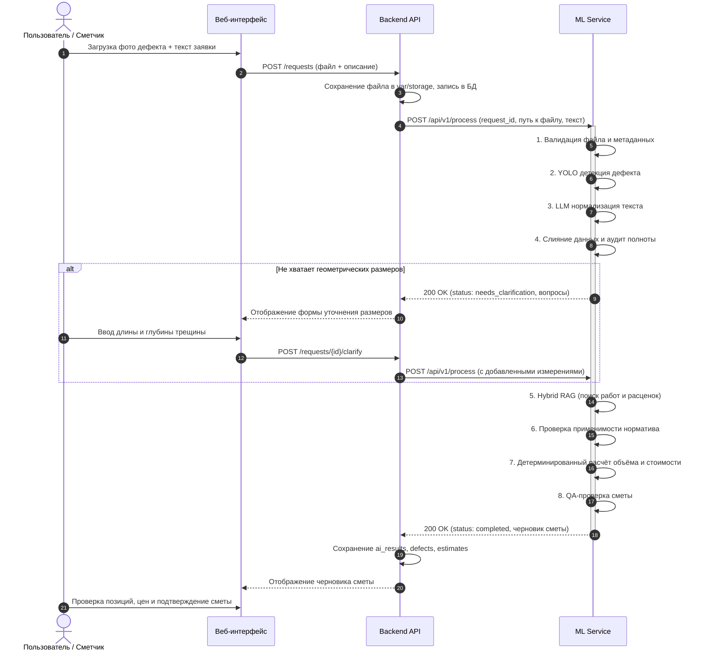

# FixRate AI — Продуктовые требования и спецификация ML Service (PRODUCT.md)

**Версия документа:** 1.0  
**Дата обновления:** 21 октября 2026 г.  
**Статус:** Утверждён для реализации этапа MVP  
**Связанные документы:**
- [PLAN.md](file:///home/handraqw/Projects/FixRate_AI/ml_service/PLAN.md) — архитектурный план и дорожная карта
- [ML_PIPELINE.md](file:///home/handraqw/Projects/FixRate_AI/ml_service/ML_PIPELINE.md) — каноническая архитектура AI-пайплайна
- [TASKS.md](file:///home/handraqw/Projects/FixRate_AI/ml_service/TASKS.md) — реестр микрозадач

---

## 1. Назначение продукта

**ML Service** — это интеллектуальное ядро системы FixRate AI, функционирующее как сервис аналитики и предварительного сметного расчёта. Сервис предназначен для автоматизации первичного анализа заявок на устранение дефектов объектов недвижимости и формирования научно-обоснованного черновика ведомости объёмов работ (ВОР) и сметной стоимости.

ML Service выступает как **«ассистент инженера-сметчика»**:
- Автоматически распознаёт тип и локализацию видимых дефектов по фотографиям.
- Извлекает текстовые описания и числовые параметры повреждений.
- Сопоставляет дефекты с нормативной базой и каталогом ремонтно-восстановительных работ.
- Детерминированно вычисляет объёмы работ и предварительную стоимость.
- Явно запрашивает уточнения, если входных данных недостаточно для однозначного расчёта.

---

## 2. Границы ответственности: ML Service vs Backend

| Функция | Зона ответственности | Описание реализации |
|:---|:---:|:---|
| Авторизация и аутентификация пользователей | Backend | Выпуск и валидация JWT-токенов |
| Приём multipart-запросов и сохранение файлов на диск | Backend | Сохранение файлов в `var/storage`, генерация `storage_key` |
| Постоянное хранение данных заявок, смет и версий | Backend | PostgreSQL (`repair_requests`, `estimates`, `ai_runs`) |
| **Анализ изображений и детекция дефектов** | **ML Service** | Предобработка изображений, YOLO-детекция, координаты рамок |
| **Извлечение текста из документов (OCR)** | **ML Service** | Парсинг PDF/сканов, поиск параметров повреждений |
| **Семантическая нормализация текста (LLM)** | **ML Service** | Преобразование свободного текста в структурированный JSON |
| **Поиск расценок и нормативов (Hybrid RAG)** | **ML Service** | BM25 + векторный поиск по каталогу работ и нормам |
| **Проверка применимости нормативов** | **ML Service** | Валидация соответствия работ типу дефекта и материалу |
| **Расчёт объёмов работ и стоимости** | **ML Service** | Детерминированные математические формулы |
| **Формирование вопросов на уточнение** | **ML Service** | Формирование `needs_clarification` с перечнем недостающих полей |
| Утверждение сметы человеком-сметчиком | Пользователь / UI | Сметчик проверяет черновик, корректирует и утверждает |

---

## 3. Входные и выходные данные

### 3.1. Входные данные (`JobInput`)
Запрос на обработку может содержать комбинацию следующих данных:
1. **Изображения:** Одно или несколько фото дефекта (JPEG, PNG, WebP) в виде локального пути к файлу или байтового потока.
2. **Документы:** Сканы или PDF-файлы (акты осмотра, дефектные ведомости, паспорта БТИ).
3. **Текстовое описание:** Описание дефекта со слов заявителя или инспектора (свободный текст).
4. **Параметры объекта:** Характеристики здания/помещения (тип здания, материал стен, год постройки, этаж).
5. **Известные измерения:** Явно указанные пользователем длина, ширина, глубина или площадь дефекта с единицами измерения.
6. **Метаданные:** `request_id`, `job_id`, идентификаторы файлов в хранилище.

### 3.2. Выходные данные (`JobOutput`)
ML Service возвращает результат в одном из трёх основных статусов:

#### А. Статус `COMPLETED` (Смета успешно рассчитана)
Возвращается при наличии всех необходимых измерений и подобранных расценок:
- Список обнаруженных дефектов (`defects`) с классами, уверенностью и координатами.
- Нормализованные измерения (`measurements`) с указанием происхождения каждого числа (`user`, `ocr`, `cv_scaled`, `calc`).
- Подобранные позиции сметы (`estimate_items`):
  - Код и наименование работы по каталогу.
  - Обоснование / нормативная ссылка (источник).
  - Рассчитанный объём работ и единица измерения (`m`, `m2`, `m3`, `pcs`).
  - Базовая расценка за единицу.
  - Итоговая сумма по позиции.
  - Формула и трассировка расчёта.
- Итоговая стоимость ремонта (в рублях).
- Предупреждения и допущения (`warnings`, `assumptions`).

#### Б. Статус `NEEDS_CLARIFICATION` (Требуются уточнения пользователя)
Возвращается, если обнаружен дефект, но отсутствуют критичные физические параметры:
- Список обнаруженных дефектов.
- Перечень конкретных вопросов к пользователю (`clarification_questions`):
  - Какого параметра не хватает (например, `length_m`, `width_mm`, `material`).
  - Понятный текст вопроса на естественном языке.
  - Допустимые единицы измерения и диапазон значений.
  - Варианты выбора (если применимо).

#### В. Статус `NEEDS_REVIEW` (Требуется ручная проверка специалистом)
Возвращается при обнаружении конфликтов (например, противоречие между текстом пользователя и данными CV) или при низкой уверенности в применимости найденной расценки.

#### Г. Статус `FAILED` (Отказ обработки)
Возвращается при технических сбоях (повреждённый файл, недопустимый формат). Ошибка оформляется в едином формате FixRate AI.

---

## 4. Пользовательские и системные сценарии

### 4.1. Пилотный сценарий 1: `facade_crack` (Трещина фасада)
1. Вход: Фотография вертикальной трещины на наружной оштукатуренной стене здания.
2. CV: Модель детектирует класс `facade_crack` с уверенностью 0.88, возвращает нормализованный bounding box.
3. Валидация: Поскольку фотография не содержит калибровочного маркера, физическая длина и раскрытие трещины не могут быть определены из пикселей.
4. Ветвление: Если пользователь не указал размеры в описании, сервис возвращает `needs_clarification` с вопросом: *«Укажите длину трещины в метрах и ширину раскрытия в мм»*.
5. После получения длины (например, `4.5 м`):
   - RAG подбирает расценку `DEMO-FACADE-CRACK-01` («Заделка трещин фасада», ед. изм. `m2` или `m`).
   - Расчётный модуль: вычисляет площадь разделки и стоимость по утверждённой формуле.
   - Итог: смета с указанием базовой ставки, объёма и источника цены.

### 4.2. Пилотный сценарий 2: `tile_chip` (Скол плитки)
1. Вход: Фото скола керамической плитки входной группы + текст *«Откололся угол плитки на крыльце»*.
2. CV: Модель детектирует `tile_chip`.
3. LLM: Извлекает тип конструкции (*крыльцо/входная группа*) и характер повреждения (*скол*).
4. RAG: Находит расценку `DEMO-TILE-CHIP-01` («Замена повреждённой облицовочной плитки»).
5. Валидация: Требуется уточнить количество плиток под замену или общую площадь.
6. Расчёт: Вычисление стоимости демонтажа и укладки плитки.

### 4.3. Пилотный сценарий 3: `parking_leak` (Протечка парковки)
1. Вход: Фотография влажного пятна/высолов на потолке подземного паркинга.
2. CV: Детектирует видимый признак `parking_leak`.
3. Важное ограничение: CV не может диагностировать скрытую причину (разрыв шва, нарушение гидроизоляции плиты перекрытия или конденсат).
4. Система формирует статус `needs_review` или `needs_clarification` с предупреждением для сметчика о необходимости инструментального обследования.

---

## 5. Требования к качеству и нефункциональные требования

### 5.1. Нефункциональные требования
1. **Детерминированность:** Повторный вызов расчётного модуля с идентичными входными параметрами обязан приводить к строго идентичной смете до копейки.
2. **Время отклика (SLA):**
   - Анализ единичного изображения (CV inference на CPU): $\le 1.5$ сек.
   - Поиск по RAG (каталог до 10 000 позиций): $\le 300$ мс.
   - Сквозной пайплайн без внешней LLM (на mock/локальных правилах): $\le 2$ сек.
   - Сквозной пайплайн с внешней LLM: $\le 8$ сек (с таймаутом ожидания LLM 10 сек).
3. **Безопасность и приватность:**
   - Никакие персональные данные (ФИО, телефоны) не передаются во внешние API.
   - Файлы валидируются на допустимые MIME-типы (`image/jpeg`, `image/png`, `application/pdf`) и максимальный размер (до 20 МБ).
   - Защита от Zip-бомб и Decompression Bomb для изображений (лимит Pillow `MAX_IMAGE_PIXELS`).
4. **Надёжность и обработка сбоев:**
   - При недоступности внешней LLM сервис деградирует до базового парсера регулярных выражений и ключевых слов.
   - При отсутствии обученных весов YOLO сервис корректно сообщает о статусе `cv_unavailable`, не прерывая работу пайплайна с текстовыми данными.

### 5.2. Критерии приёмки MVP (Фаза 1 — Выполнена 22.10.2026)
Все критерии MVP успешно выполнены и зафиксированы в `master`:
- [x] Описана архитектура, схемы и продуктовые сценарии.
- [x] Развёрнут каркас ML Service с эндпоинтом `GET /health` и сквозным `request_id`.
- [x] Реализован детерминированный расчётный модуль на базе `Decimal` с набором формул.
- [x] Реализован RAG с поддержкой лексического (BM25) и векторного поиска по DEMO-базе расценок.
- [x] Реализован адаптер YOLO с безопасной обработкой изображений и `MockYoloDetector` для unit-тестов.
- [x] Реализован Model Gateway для LLM с валидацией схемы JSON и защитой от галлюцинаций цен (GigaChat).
- [x] Реализован сквозной оркестратор, поддерживающий ветвление на `needs_clarification`.
- [x] 3 пилотных сценария (`facade_crack`, `tile_chip`, `parking_leak`) покрыты автоматическими тестами (99 passed).

### 5.3. Границы MVP (отложено до промышленных фаз)
- Автоматическое вычисление физических размеров дефекта из пиксельных рамок без маркёра масштаба.
- Поддержка полной сметно-нормативной базы ФЕР/ТЕР всех регионов РФ (в MVP использовался DEMO-каталог).
- Обучение собственной нейросети с нуля без предоставленного размеченного датасета.
- Автоматическое выставление юридически значимых смет без согласования человеком-сметчиком.
- Поддержка видеопотока и 3D-сканирования (LiDAR).

### 5.4. Требования к целевой промышленной версии (Фазы 2–6)
1. **Промышленный RAG (Фаза 2):** Хранение нормативных чанков в `pgvector`, векторные эмбеддинги `GigaChatEmbeddings` (1024 dims), семантический чанкинг СП/ГОСТ, точные ссылки на нормативы в смете.
2. **Боевое CV (Фаза 3):** Реальные обученные веса YOLOv8-det и seg на дефектах фасадов/плитки/подвалов, калибровка масштаба по реперным маркерам, дедупликация серии фото одного дефекта.
3. **Боевой OCR (Фаза 4):** Интеграция PaddleOCR/EasyOCR для распознавания таблиц дефектных ведомостей со сканов документов.
4. **Сметный инжиниринг (Фаза 5):** Комплексы сопутствующих работ (Work Bundles), индексы пересчета Минстроя РФ, детектор аварийности несущих конструкций (`needs_review`), маскирование ПДн (PII).
5. **Асинхронная архитектура (Фаза 6):** Фоновые воркеры Celery/Redis, S3 MinIO хранилище файлов, сквозная интеграция с Backend API.
