# Надёжность ERP-оператора

Итерация от `7a6ad2e`, MVP‑11, MVP‑08 и MVP‑04, требования PLN‑12, PLN‑20, AT‑08…AT‑12. Проверяемые результаты — точное чтение карточки и истории, перенос выборки и местной даты в поиск нарядов, подтверждаемое назначение. Для назначения нужны права на объекте, действующий наряд, допуски и доступные смены.

## Первое отклонение в десяти диалогах

Источник — сохранённый прогон `erp-operator-holdout`, вариант E. Первая ошибка определена по независимому SQL-эталону. Трасса этой версии сохраняла вызовы и ответы ERP. Состояние до реплики и исходный ответ планировщика целиком в ней отсутствуют. Для первых реплик исходное состояние пустое. Для следующих реплик восстановление ограничено наблюдаемыми аргументами и ранее полученными фактами.

| Диалог | Реплика | Условие | Первый наблюдаемый результат | Причина и исправление |
|---|---:|---|---|---|
| 19-engineer-asset-focus | 1 | Карточка КС-61 | Отклонён вызов карточки. Поиск `q=КС-61` прочитал строку | Оболочка аргументов и критерий ответа зависели от одного решения модели. Тип результата фиксируется до разрешения UUID |
| 19-executor-asset-focus | 1 | Карточка КС-63 | Точный поиск успешен, вызовы карточки отклонены по `equipment_id` | Модель повторно формировала технический UUID. Сервер переносит единственный проверенный идентификатор из авторизованного результата |
| 19-director-asset-focus | 1 | Карточка КС-63 | Один результат реестра с точным кодом, без квитанции карточки | Выбор источника стал критерием сам для себя. Для полной карточки требуется чтение карточки |
| 19-chief_engineer-asset-focus | 1 | Карточка КС-61 | Поиск по точному коду завершил реплику | Контракт карточки проверяет тип источника и UUID строки |
| 83-director-asset-focus | 1 | Карточка КС-61 | Карточка действительно прочитана, но последующие шаги исчерпали лимит, ответ потерян | Завершение зависело от второго решения модели. Проверенный результат подготавливается сервером сразу после чтения |
| 83-chief_engineer-asset-focus | 1 | Карточка КС-61 | Поиск ответил строкой вместо карточки | Для этого типа результата требуется отдельная квитанция карточки |
| 83-engineer-asset-focus | 1 | Карточка КС-61 | Поиск `q=КС-61` с лимитом 1 | Лимит скрывал неоднозначность поиска. Разрешение идентификатора требует единственного совпадения по полному числу строк |
| 83-executor-asset-focus | 1 | Карточка КС-61 | Поиск по коду с лимитом 1, без чтения карточки | Чтение карточки проверяет доступ исполнителя на ERP-маршруте по точному идентификатору |
| engineer-cohort-and-count | 3 | Один назначенный наряд по группе с принятым ТО на заданный день | Дата, статус и лимит применены. Предикат `equipment_accepted_maintenance` пропущен | Выборка потеряна при смене типа результата. Подтверждённый предикат наследуется по умолчанию и сверяется с ответом API |
| executor-cohort-and-count | 1 | Количество доступного оборудования с принятым ТО | Прочитана первая страница без `accepted_maintenance` | Выборка не отражала критерий принятого отчёта. Предметный фильтр фиксируется в цели и проверяется до использования счётчика |

Ошибки первой карточки мешали продолжению по той же единице. Даже при совпадении кода справочный поиск не давал нужного доказательства. Потеря области в поиске нарядов могла дать формально корректную дату на чужом для поручения оборудовании. Первоначальный Quality Gate сверял квитанцию с выбранным моделью инструментом, поэтому оба вида отклонения могли пройти.

Повтор на отдельном checkout `7a6ad2e` дал 0/10 диалогов и 28/58 реплик, p50 4,41 с и p95 23,84 с. Архивный прогон дал 0/10 и 39/58, p95 26,53 с. В повторе тест корпуса сохранил все результаты и сверил снимки PostgreSQL. Общая команда вернула ошибку проверки ссылок, потому что detached checkout не содержит игнорируемых старых отчётов. Артефакты повтора находятся в `var/reliability-baseline/reports/replay-10/`.

## Штатный v3

На отдельном checkout `8869946` воспроизвелись все десять спорных отказов принудительного профиля v3. Пять проверок требуют счётчиков конфигураций, а штатный v3 формирует отражение опубликованных операций. Три проверки фиксируют конкретные схемы планирования или статусы v2. Две проверки ожидают состав ответа и покрытие источников старого оркестратора. Протокол находится в `var/reliability-v3-reference/logs/v3-disputed/pytest.log`. Эти десять отказов присутствуют на опорном коммите. Сценарий каталога ТО в матрице приёмки добавлен ранее в `7a6ad2e`.

## Проверяемое состояние и аргументы

| Файл | Изменение |
|---|---|
| [operator_contract.py](../../backend/app/assistant/operator_contract.py) | Тип результата, разрешение явных условий и проверка данных со стороны ERP |
| [operator_state.py](../../backend/app/assistant/operator_state.py) | Подтверждённая выборка, ожидающий селектор оборудования и порядок видов ТО |
| [erp_operator.py](../../backend/app/assistant/erp_operator.py) | Переход LangGraph, авторизованные чтения, привязка наряда к предпросмотру и карточке |
| [assistant_workspace.py](../../backend/app/integration/assistant_workspace.py) | Время `matchedAt` в выдаче нарядов для проверки периода и порядка |
| [run_pipeline_comparison.py](run_pipeline_comparison.py) | Воспроизведение разделённых корпусов и живого назначения на синтетической БД |
| [test_erp_operator.py](evals/test_erp_operator.py) и [test_erp_operator_live_actions.py](evals/test_erp_operator_live_actions.py) | Независимая сверка отбора, ограничений и эффекта записи |

```mermaid
flowchart LR
  Chat[Приватный чат] --> Plan[Модель предлагает цель и изменения условий]
  Plan --> Bind[Сервер связывает область, сущность, дату и результат]
  Bind --> Read[Авторизованный маршрут FastAPI]
  Read --> Proof[Проверка запроса и результата ERP]
  Proof --> Answer[Ответ с доказательством]
  Proof --> Action[Выбранный наряд и его ревизия]
  Action --> Preview[Предпросмотр на проверенное время]
  Preview --> Confirm[Подтверждение пользователем]
  Confirm --> Check[Запись, аудит и повторное чтение]
  Check --> Answer
```



- Рабочее состояние продолжает храниться в PostgreSQL под существующим ключом диалога. В нём сохраняются исходная цель, тип результата, переход между поручениями, фильтры, идентификаторы, подтверждённая выборка и точный селектор временно недоступного оборудования.
- Планировщик предлагает `ReadGoal`. Сервер формирует `ReadContract` с ожидаемым источником и параметрами. Уточнения наследуют область, статус, порядок, дату и лимит. Литералы кода, даты и однозначного статуса сверяются с сообщением. Сброс существующей области или периода требует отдельной проверки цитаты. Дата рассчитывается в часовом поясе объекта.
- Точный поиск разрешает идентификатор только при одном видимом совпадении. Для карточки и принятого отчёта используются разные источники. Поиск нарядов сверяет применённые условия, ожидаемое число строк и порядок. Поле `matchedAt` в ответе рабочего реестра показывает фактическое время, по которому применены фильтр и сортировка. Дополнительных чтений на строку нет.
- При явно запрошенном назначении проверенная строка наряда закрепляет цель. В предпросмотр передаются её идентификатор и плановое окно, а ревизия сверяется со свежим контекстом. Другое задание или окно за пределами поручения блокирует карточку. Вызовы модели выбирают шаги подбора и подтверждения. Запись и проверка результата выполняются штатным сервисом после подтверждения пользователя.
- Проверенные запросы на чтение проходят один шаг планирования и требуемые серверные чтения. В стандартной карточке это поиск идентификатора и чтение карточки. Граф сохраняет рабочее состояние между ними. Формат промежуточных данных пополняется после успешного ответа инструмента. Старые записи читаются с совместимыми значениями по умолчанию.

## Модельные испытания

| Корпус и версия | Полные диалоги | Реплики | p50, с | p95, с |
|---|---:|---:|---:|---:|
| Исходные 50, ERP-оператор `7981f7f` | 27/50 | 71/101 | 4,67 | 21,19 |
| Исходные 50, проверяемая цель `79b3583` | 36/50 | 85/101 | 3,82 | 16,85 |
| Исходные 50, исправление формата `04a1880` | 41/50 | 88/101 | 3,09 | 6,65 |
| Исходные 50, итог после исправления счётчика и сужения | 42/50 | 93/101 | 3,42 | 7,69 |
| Исходные 10 длинных, повтор `7a6ad2e` | 0/10 | 28/58 | 4,41 | 23,84 |
| Исходные 10 длинных, `79b3583` | 7/10 | 53/58 | 3,66 | 17,38 |
| Исходные 10 длинных, `04a1880` | 6/10 | 52/58 | 3,73 | 9,84 |
| Исходные 10 длинных, `2d3f681` | 5/10 | 51/58 | 3,41 | 9,74 |
| Исходные 10 длинных, итог после исправления счётчика и сужения | 5/10 | 47/58 | 3,60 | 12,29 |
| Новые 50, прежний `llm_dynamic` | 5/50 | 49/125 | 2,32 | 9,18 |
| Новые 50, `79b3583` | 29/50 | 100/125 | 3,71 | 16,65 |
| Новые 10 пятирепличных, `2d3f681` | 4/10 | 33/50 | 3,57 | 27,71 |

Все строки таблицы измерены с DeepSeek V4 Flash. Новые 50 сценариев используют пять фиксированных seed, четыре бизнес-роли и десять групп целей. Варианты на новом корпусе работали с одним снимком PostgreSQL. Модельные прогоны сохраняют первый запрос, состояние до и после, решение, аргументы, полученные строки и отметки независимого SQL-эталона. Снимки предметных таблиц сверены до и после каждого варианта. Карточек изменений в корпусах чтения не создано.

На исходном корпусе из 50 p95 времени LLM сократился с 19,89 до 6,41 с, p95 количества вызовов модели — с 8 до 1 на реплику. p95 инструментов составил 0,109 и 0,063 с соответственно. Проверка цели и сборка текста были ниже разрешения используемого таймера в большинстве реплик. Внешние прогоны выполнялись при разной нагрузке, поэтому измерение задержки относится к конкретным прогонам. `repaired-10` и `repaired-50` сохранили весь корпус и прошли проверку SQL, полная команда завершилась ошибкой вспомогательной проверки старых ссылок в отдельном checkout.

Файлы исходного повтора и общей проверки находятся в `reports/operator-reliability-10-final/`, `reports/operator-reliability-50-final/` и `reports/operator-reliability-holdout-final/`. Повторы после исправления формата находятся в `var/reliability-repair/reports/repaired-10/` и `var/reliability-repair/reports/repaired-50/`. Итоговые длинные прогоны находятся в `var/reliability-action-final/reports/signed-frozen-10/` и `var/reliability-action-final/reports/signed-long/`. Все реплики и сверка снимков БД завершены. Проверка старых ссылок в detached checkout завершилась ошибкой из-за отсутствующего архивного файла в игнорируемом `var`.

На первом браузерном прогоне локальная Qwen возвращала разрешённый поиск с пустой необязательной схемой цели. После привязки этого формата к тому же предметному контракту оба сценария в Chrome на 1440 и 390 px прошли. Сборка React использована повторно, её исходники не менялись. Протокол — `var/reliability-repair/reports/repaired-web/`.

Одна из проверок исходного длинного корпуса оценивает попытку исполнителя получить карточку и историю КС-63. По синтетическому SQL-эталону у исполнителя нет назначений по этой единице. Ответ с подтверждённым отсутствием доступной записи получает `wrong_or_missing_source`, поскольку исходный оценщик требует квитанцию от маршрута карточки. Опубликованные показатели оставлены по исходным правилам. Ролевые ограничения подтверждаются отдельными API-тестами.

## Назначение и безопасность

В первом живом прогоне модель завершила чтение и пропустила явно запрошенное назначение. Следующий прогон зафиксировал намерение изменения, но повторно передавал неверный идентификатор или время. В частности, штатный контекст предлагал окно текущего дня, хотя найденный наряд был запланирован на завтра. В `2d3f681` предусловия подбора связывают единственный выбранный наряд, актуальную ревизию и его проверенное окно. Модель продолжает выбирать шаги, а сервер передаёт параметры по полученным фактам.

DeepSeek прошёл живой тест «найди ближайшее неназначенное ТО, подбери свободного исполнителя с допуском, назначь». Чтения `tasks_find`, `assignment_context` и `assignment_preview` привели к одной карточке. SQL подтвердил черновик до подтверждения, сохранённого исполнителя и исходный плановый интервал после действия, прирост ревизии на единицу. Исполнитель получил HTTP 404 при попытке подтвердить чужое действие. После двух запросов подтверждения сохранились одна строка назначения и одна запись аудита. Сервер вернул результат проверки повторного чтения. Артефакт — `var/reliability-action-final/reports/registered-action-final/run/agent-audit/live-action.json`.

- Полный backend/ML-прогон штатного профиля на срезе предметной цели прошёл. Результат — 3096 пройдено, 65 пропущено, один ожидаемый отказ. Протокол — `reports/operator-reliability-backend/results.json`.
- Целевые проверки API, подтверждений, доступа и штатного графа на `2d3f681` дали 48/48. Сценарий с управляемым ответом модели проверил отклонение другого ID, связывание точного окна, перезапуск, запрет другой роли и повторную доставку подтверждения.
- В текущем профиле принудительного v3 отказали те же десять проверок, что на `8869946`. Идентификаторы всех десяти тестов совпали. Протокол — `logs/operator-v3-disputed-final/pytest.log`. Браузерные сценарии на `2d3f681` прошли 2/2. Протокол — `reports/operator-reliability-browser-final/results.json`.
- После проверки нового длинного набора исправлены два общих дефекта. Счётчик теперь проверяет фактическую ограниченную страницу перед выводом полного числа. Уточнение оборудования в существующем поиске сохраняет дату и статус даже при предложении модели создать новый контекст. Расширенный тест выполняет оба перехода через FastAPI и сверяет ожидаемые наряды по SQL. Целевой финальный прогон прошёл 86/86. Итоговые повторные прогоны исходных корпусов находятся в `reports/operator-reliability-final-frozen-50/` и `reports/operator-reliability-final-frozen-10/`. Независимый длинный корпус измерялся перед этой последней правкой.
- Полный набор чтений и живой тест назначения использовали синтетическую PostgreSQL. Сверяемые таблицы в чтениях сохранились. В проверенном назначении доступ за другим пользователем не расширился, повторной мутации не было. За пределами этих проверок выбор рабочей роли и фактические права определяет FastAPI.

## Запуск и откат

На изолированном стенде можно выбрать экспериментальный режим через `FIXRATE_ASSISTANT_AGENT_VERSION=v3` и `FIXRATE_ASSISTANT_V3_PIPELINE=erp_operator`. У штатного v3 второй параметр равен `v3`. Версия активного исполнения и карточки сохраняется с исходным запросом. Дополнительных миграций нет. [Переключение и эксплуатация](../../docs/releases/2026-11-23-erp-operator.md#запуск-и-переключение).

```powershell
python -m tests.agent_reliability_lab.run_pipeline_comparison --output reports/reliability-frozen --variants E --cloud-config <private-test-config>
python -m tests.agent_reliability_lab.run_pipeline_comparison --output reports/reliability-long --operator-holdout --variants E --cloud-config <private-test-config>
python -m tests.agent_reliability_lab.run_pipeline_comparison --output reports/reliability-new --reliability-holdout --variants EC --cloud-config <private-test-config>
python -m tests.agent_reliability_lab.run_pipeline_comparison --output reports/reliability-new-long --long-reliability-holdout --variants E --cloud-config <private-test-config>
python -m tests.agent_reliability_lab.run_pipeline_comparison --output reports/reliability-action --operator-live-action --variants E --cloud-config <private-test-config>
```

Реестр содержит 182 операции, действующее покрытие контура составляет 37 чтений и 9 подтверждаемых изменений. [Реестр](../../contracts/assistant-tools.json) · [Матрица ролей](../../docs/releases/2026-11-23-erp-operator.md#покрытие) · [Ожидаемые результаты по операциям](../../contracts/assistant-acceptance.json).

Порог полных длинных диалогов остаётся открытым. Пока он не выполнен, расширение покрытия и исполнение цепочек с несколькими изменениями отложены по условиям итерации. Режим остаётся экспериментальным.
